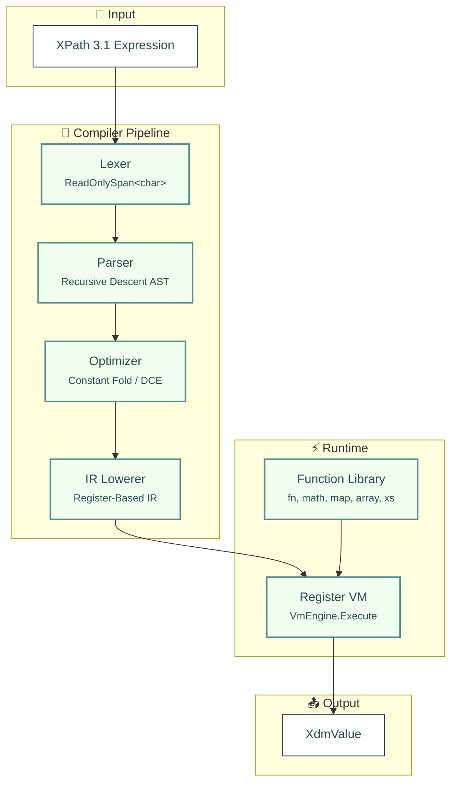

<div align="center">
  
  <br><br>
  <h1>Bosak XPath</h1>
  <p>A high-performance, XDM-first XPath 3.1, XSLT 3.0 and XQuery 3.1 engine for .NET — with opt-in XPath/XSLT 4.0</p>
</div>

**REQ-128 consumer F1 correction - 2026-10-15:** Typed node tests, including nested document tests, now refuse within the existing insertion coverage boundary in original and proposed slots. All 141 focused insertion cases pass; final verification and exact-commit consumer re-review remain. [Correction and evidence](docs/REQ-128-CONSUMER-REVIEW-F1.md). Source 1.8.0 remains unpublished, REQ-128 In Progress, and Braid adoption remains separate. Earlier candidate entries below are historical.

**REQ-128 engine implementation - 2026-10-15:** Unpublished source **1.8.0** adds engine-owned value-of append targets, isolated byte-spliced candidates, exact new select context and complete surviving-node provenance. REQ-128 is In Progress, owner Charles Korthout. Strict UTF-8/BOM UTF-16 and eight-MiB limits apply; static preprocessing, unproven expression/function contexts and dependency edits refuse without IO. [API, coverage and evidence](docs/REQ-128-IMPLEMENTATION.md). Eligibility is read from retained source independently of prior inspection compilation. Verification passes 8,564 solution tests, 81 focused insertion cases and 84 language-server tests, with unchanged frozen gates. Fresh package consumers also pass all 81 cases against exact source 526924f0; ten package versions/revisions and nine restored archive/cache/output assemblies verify. Public libraries remain 1.7.1; VS Code 0.2.3 bundles 1.7.1. Braid production adoption and UI remain separate. Earlier entries below are historical.

**VS Code 0.2.3 published - 2026-10-15:** The [Marketplace extension](https://marketplace.visualstudio.com/items?itemName=fytala.vscode-bosak) is published from approved immutable tag `vscode-v0.2.3` (`9c310d3f`), bundling engine 1.7.1. Workflow checks pass 84 language-server tests and highlighting/launcher tests. Public VSIX payload files and bytes match the workflow artifact; ten exact assembly versions/revisions, protocol and isolated editor checks verify. [Publication evidence](docs/VSCODE-0.2.3-PUBLICATION.json). Public libraries remain 1.7.1; Braid public compatibility remains 843 tests with production adoption separate. REQ-128 stays Pending with a proposed contract, not an insertion API. No engine/API/REQ/gate changes or normal local installation in this publication step. Earlier entries below are historical.

**REQ-128 insertion design - 2026-10-15:** The [proposed contract](docs/REQ-128-INSERTION-CONTRACT.md) resolves snapshot-bound target eligibility, exact byte insertion/candidate identity, encoding/static-context/resource rules and planned acceptance fixtures for one value-of append. Design only: REQ-128 remains Pending/TBD/Unassigned; no insertion API/capability/UI, implementation acceptance, engine version or release is added. Public libraries remain 1.7.1; extension publication is separate. Earlier entries below are historical.

**Public 1.7.1 Braid compatibility and VS Code 0.2.3 preparation - 2026-10-15:** Fresh isolated Braid verification passes 843 tests against public 1.7.1 with zero build warnings/errors and nine-package provenance; original files/status/pin are unchanged. [Braid evidence](docs/BRAID-1.7.1-PUBLIC-COMPATIBILITY.md). Unpublished extension 0.2.3 bundles 1.7.1; 84 language-server tests, highlighting/launcher checks, packaged protocol and isolated editor checks pass. [Extension preparation](docs/VSCODE-0.2.3-PREPARATION.md). Exact merged-revision rebuild and separate Marketplace approval remain. Public libraries remain 1.7.1; Marketplace 0.2.2 bundles 1.7.0. No engine/API/REQ/gate membership change. Earlier entries below are historical.

**1.7.1 published - 2026-10-15:** Ten .NET 10 libraries are published from approved immutable tag `v1.7.1` (`35e531c1`), correcting lexical original binding in escaping inline functions. Release CI passes 8,483 solution tests. Fresh nuget.org-only consumers pass 153 broad checks and 185 focused tests (33 overlap); public archive/cache/output bytes, dependency versions and exact assembly revision metadata verify. [Release notes and publication evidence](docs/RELEASE-NOTES-1.7.1.md). VS Code 0.2.2 still bundles engine 1.7.0. Braid retains 843 final-candidate tests; production adoption remains separate. REQ-126 stays In Progress; no public API or gate membership changes. Earlier entries below are historical.

**1.7.1 release preparation - 2026-10-15:** PR #305 is integrated after refreshed-head CI; source/test trees match the reviewed closure fix. Frozen gates remain 31,142/0/679 and 8,278/0/1,894; 153 broad checks, 185 focused tests and 843 isolated Braid tests pass against exact refreshed-head packages with matching archive/cache/output provenance. Final merged-revision repacking and fresh consumers are required before publication approval. Public libraries remain 1.7.0; published VS Code 0.2.2 bundles 1.7.0. No publication/tag/API/REQ/gate membership change. [Release notes](docs/RELEASE-NOTES-1.7.1.md). Earlier entries below are historical.

**Escaping inline originals corrected - 2026-10-15:** Unpublished source 1.7.1 preserves lexical concrete-original binding in returned/nested inline functions, including invocation inside another override. Only hidden bound aliases are captured; ordinary registries remain untouched and caller aliases are restored after return/errors. Eighteen regressions pass; public-1.7.0 baseline 6 pass/12 fail, separate from scope 3/5. Full solution 8,483/0/0 (XSLT 5,597), language server 84/0/0; frozen gates remain 31,142/0/679 and 8,278/0/1,894. [Contract and evidence](docs/XSLT40-ESCAPING-INLINE-ORIGINALS.md). No public API/REQ/gate change; REQ-126 In Progress. Public libraries remain 1.7.0; Published VS Code 0.2.2 remains on its separate engine-1.7.0 revision; the user confirms the upgraded extension has restarted. General package graphs/overlapping families remain separate. Earlier entries below are historical.

**VS Code 0.2.2 published and installed - 2026-10-15:** The [Marketplace extension](https://marketplace.visualstudio.com/items?itemName=fytala.vscode-bosak) is published from approved immutable tag `vscode-v0.2.2` (`f25474fd`), bundling engine 1.7.0. Publication passes 84 language-server tests and highlighting/launcher checks. Public VSIX and installed local payload match the workflow artifact; all ten assembly versions/revisions and packaged protocol/isolated editor checks verify. The requested local VSIX upgrade replaces 0.2.1 with 0.2.2; existing windows need Reload Window to activate. [Publication and installation evidence](docs/VSCODE-0.2.2-PUBLICATION.json). Libraries remain 1.7.0; draft PR #305 (unpublished 1.7.1 closure fix) is separate and not bundled. No engine/API/REQ/gate changes. Earlier entries below are historical.

**Public Braid verification and VS Code 0.2.2 preparation - 2026-10-15:** A fresh Braid snapshot passes 843 tests against public 1.7.0 with zero build warnings/errors, exact nine-package provenance and original checkout/pin preserved. [Public Braid evidence](docs/BRAID-1.7.0-PUBLIC-COMPATIBILITY.md). Unpublished extension 0.2.2 bundles engine 1.7.0; 84 language-server tests, package/protocol and isolated editor checks pass. [Extension preparation](docs/VSCODE-0.2.2-PREPARATION.md). Exact merged-revision repack and separate Marketplace approval remain. [Escaping inline closures](docs/XSLT40-ESCAPING-INLINE-CLOSURES-SCOPE.md) have a public 1.7.0 baseline of 3 pass/5 fail; scope only. No engine/API/REQ/gate changes. Marketplace remains 0.2.1 with engine 1.6.0; REQ-126 stays In Progress. Earlier entries below are historical.

**1.7.0 published - 2026-10-15:** Ten .NET 10 libraries are published from approved immutable tag `v1.7.0` (`33efd8e5`), adding bounded direct and transitive abstract optional function overrides. The release workflow passes 8,465 solution tests. Fresh nuget.org-only consumers pass 153 broad checks and 167 focused tests (33 overlap); public archive/cache/output bytes, dependency versions and exact assembly revision metadata verify. [Release notes and publication evidence](docs/RELEASE-NOTES-1.7.0.md). VS Code 0.2.1 still bundles engine 1.6.0. Braid has 843 candidate-package tests; production adoption remains separate. REQ-126 stays In Progress; no public API or conformance gate membership changes. Earlier entries below are historical.

**1.7.0 candidate preparation - 2026-10-15:** Reviewed PR #301 is merged at `7978e5d7`, with successful post-merge CI. The exact merged candidate passes 8,465 solution tests, 84 language-server tests, unchanged frozen gates, 153 broad release checks and 167 focused package tests (33 overlapping cases). All ten archives and consumer assembly/cache/output provenance verify. An isolated current Braid snapshot passes 843 tests; original files, status and production pin are preserved. [Release notes](docs/RELEASE-NOTES-1.7.0.md), [checklist](docs/RELEASE-1.7.0-CHECKLIST.md) and [Braid evidence](docs/BRAID-1.7.0-COMPATIBILITY.md). Final documentation-revision repacking remains before publication approval. Source is unpublished 1.7.0; public libraries/extension engine remain 1.6.0. No public API, REQ status or gate membership change; REQ-126 stays In Progress. Earlier entries below are historical.

**Transitive principal-package lookup - 2026-10-15:** The bounded transitive slice now covers implicit stylesheet packages and explicit principal packages. The runtime distinguishes an override owned by the containing package from an external contribution when resolving dynamic lookup; declaring-library public-original lookup remains intact. Forty-five transitive cases; merged baseline 5 pass/40 fail, prior implementation candidate 166 pass/1 fail across the expanded selection. Final solution 8,465/0/0 (XSLT 5,579), language server 84/0/0; frozen gates remain 31,142/0/679 and 8,278/0/1,894. [Correction evidence](docs/XSLT40-TRANSITIVE-PRINCIPAL-PACKAGE-FIX.json). Source remains unpublished 1.7.0; REQ-126 In Progress and scope boundaries unchanged. Earlier entries below are historical.

**Transitive abstract optional adoption - 2026-10-15:** Unpublished source 1.7.0 now supports a bounded A-to-B-to-C abstract optional family: visibility-aware adoption, concrete binding from each package, original keywords and replacement defaults/private scope. Static original-reference errors and hidden/unresolved boundaries are retained; named/partial items may leave A or B while remaining bound. Solution 8,460/0/0 (XSLT 5,574), language server 84/0/0; frozen gates remain 31,142/0/679 and 8,278/0/1,894. Forty regression cases have a preserved merged-candidate baseline of 4 pass/36 fail. [Contract and evidence](docs/XSLT40-TRANSITIVE-ABSTRACT-ADOPTION.md). REQ-126 stays In Progress; escaping inline closures, overlapping families and editor package signatures remain separate. Published libraries and extension bundle remain 1.6.0. Earlier entries below are historical.

**Abstract optional slice integrated; transitive scope - 2026-10-15:** [PR #299](https://github.com/Fytala-Charles/Bosak/pull/299) merged as `d6b984cb`; its source/test trees match verified head `7a9422cf` (solution 8,420/0/0, language server 84/0/0, frozen gates unchanged). [The next bounded scope](docs/XSLT40-TRANSITIVE-ABSTRACT-ADOPTION-SCOPE.md) covers A declaring, B accepting as abstract, and C overriding one optional family. Exact merged-package probes give one passing direct control and seven transitive failures at XTSE3058; downstream runtime binding remains unmeasured. Scope only: no further engine/API/version/REQ/gate changes or publication. Source remains unpublished 1.7.0. Earlier entries below are historical.

**Abstract override review corrections - 2026-10-15:** [PR #299](https://github.com/Fytala-Charles/Bosak/pull/299) now checks additional expression/AVT slots, ignores foreign annotations on XSLT instructions and normalizes inherited `expand-text` values. Solution 8,420/0/0 (XSLT 5,534), language server 84/0/0; frozen gates unchanged at 31,142/0/679 and 8,278/0/1,894. Twelve added regressions extend the abstract fixture to 48 cases and the focused selection to 122; ten of the new cases fail against the previous exact PR packages. [Correction evidence](docs/XSLT40-ABSTRACT-OPTIONAL-REVIEW-FIXES.json). Source remains unpublished 1.7.0; REQ-126 remains In Progress and existing scope boundaries are unchanged. Earlier entries below preserve historical results.

**Abstract optional overrides - 2026-10-15:** Unpublished source 1.7.0 supports direct concrete replacements across an abstract optional function family, original keyword names and replacement defaults/private scope. Semantic original references raise static XTSE3075, including uncalled/default/dead-branch references; strings/comments remain valid. Solution 8,408/0/0 (XSLT 5,522), language server 84/0/0; frozen gates 31,142/0/679 and 8,278/0/1,894. 36 new cases; public-1.6.0 baseline 4 pass/32 fail; isolated candidate package consumer 110/0/0 with nine engine dependencies verified. [Contract and evidence](docs/XSLT40-ABSTRACT-OPTIONAL-OVERRIDES.md). [Draft review PR #299](https://github.com/Fytala-Charles/Bosak/pull/299); committed-revision package proof passes 110 tests. REQ-126 remains In Progress; transitive adoption, escaping inline closures, overlapping families and editor package signatures stay separate. Published libraries and extension bundle remain 1.6.0. Earlier entries below are historical.

**VS Code 0.2.1 published - 2026-10-15:** The [Marketplace extension](https://marketplace.visualstudio.com/items?itemName=fytala.vscode-bosak) is published from approved tag `vscode-v0.2.1` (`10433195`), bundling engine 1.6.0. Publication checks pass 84 language-server tests plus highlighting/launcher checks. The public VSIX matches workflow runtime/client payload and exact assembly revision metadata; protocol and isolated editor valid/error/live-correction checks pass. [Publication evidence](docs/VSCODE-0.2.1-PUBLICATION.json). NuGet remains 1.6.0; package-dependent editor validation limits and REQ/gate status are unchanged. Abstract optional overrides remain scoped only. Earlier entries below are historical.

**VS Code 0.2.1 candidate and next engine scope - 2026-10-15:** The unpublished extension candidate bundles engine 1.6.0; compilation, highlighting/launcher checks, 84 language-server tests, packaged protocol diagnostics and isolated editor valid/error/live-correction checks pass. [Candidate and evidence](docs/VSCODE-0.2.1-PREPARATION.md). Package-dependent editor validation remains limited; Marketplace remains 0.2.0 pending final-revision packaging and separate publication approval. [Abstract optional overrides](docs/XSLT40-ABSTRACT-OPTIONAL-OVERRIDE-SCOPE.md) are scoped only, including static original-reference errors; overlapping families stay separate. No engine/API/REQ status/gate changes. Earlier entries below are historical.

**Braid 1.6.0 compatibility - 2026-10-15:** An isolated snapshot of the current Braid working tree builds against public 1.6.0 packages with zero warnings/errors; all 836 tests pass (27 Core, 291 Application, 314 Infrastructure, 204 Workbench). Nine engine packages, test-output DLL bytes and exact release revision metadata are verified. The original Braid files, Git status and production source pin remain unchanged. [Compatibility result and evidence](docs/BRAID-1.6.0-COMPATIBILITY.md). This is automated compatibility of an isolated package adaptation; production adoption and native/independent acceptance remain separate. NuGet remains 1.6.0; VS Code 0.2.0 bundles 1.4.0. No engine, API, REQ status or gate membership changes; earlier entries below are historical.

**1.6.0 published - 2026-10-15:** All ten .NET 10 libraries are published from approved tag `v1.6.0` (`3715b2f9`), including bounded optional function overrides. The release workflow passes 8,372 solution tests; fresh nuget.org-only consumers pass 153 broad checks and 74 focused tests (33 overlap). All ten DLL versions and exact revision metadata, public archive/cache hashes and output bytes are verified. [Release scope, boundaries and publication evidence](docs/RELEASE-NOTES-1.6.0.md). VS Code 0.2.0 still bundles engine 1.4.0. REQ status and conformance gate membership are unchanged; earlier entries below are historical.

**1.6.0 release preparation - 2026-10-15:** Optional overrides are merged at `6dcc9671`; post-merge CI passes 8,372 solution and 84 language-server tests plus extension checks. Ten local archives and a fresh package-only 74-test consumer are verified; frozen gates remain 31,142/0/679 and 8,278/0/1,894. [Release notes](docs/RELEASE-NOTES-1.6.0.md), [preparation evidence](docs/RELEASE-1.6.0-PREPARATION.json) and [publication checklist](docs/RELEASE-1.6.0-CHECKLIST.md) record the scope and remaining final-revision checks. The fresh broad consumer also passes 153 checks across all ten libraries with exact DLL bytes and revision metadata verified. NuGet remains 1.5.0; VS Code 0.2.0 bundles 1.4.0. No REQ status or gate membership changes. Tagging/publication await final verification and approval; earlier entries below are historical.

**Optional function overrides - 2026-10-15:** Unpublished source 1.6.0 supports public used-package optional overrides, full-range dispatch and declaration-bound original named/partial items. Defaults retain declaring scope and appropriate focus; compatibility errors, hidden lookup and original/replacement memoization stay distinct. 41 regressions; solution 8,372/0/0 (XSLT 5,486), language server 84/0/0; frozen gates 31,142/0/679 and 8,278/0/1,894. [Bounded contract and evidence](docs/XSLT40-OPTIONAL-OVERRIDES.md). Abstract optional originals, overlapping families and authoring package signatures remain deferred. No public API, REQ status or gate membership changes; NuGet remains 1.5.0 and VS Code 0.2.0 bundles 1.4.0. Earlier entries below are historical.

**Braid 1.5.0 compatibility - 2026-10-15:** An isolated adaptation of the current Braid working tree builds against public 1.5.0 packages with zero warnings/errors; all 836 automated tests pass. Nine engine dependencies and test-output DLL bytes match the published packages. Braid's production source pin is unchanged; independent/native acceptance is not claimed. [Compatibility evidence](docs/BRAID-1.5.0-COMPATIBILITY.md). The [optional override follow-up](docs/XSLT40-OPTIONAL-OVERRIDE-SCOPE.md) is scoped for implementation; engine behavior, version, REQ statuses and gate membership remain unchanged. Earlier entries below are historical.

**1.5.0 published - 2026-10-15:** All ten .NET 10 libraries are published from approved tag `v1.5.0` (`d5c3aa9e`). Bounded optional/default arguments in used-package functions are included. The release workflow passed 8,331 solution tests; a fresh nuget.org-only consumer passes 153 checks and verifies ten assembly versions as 1.5.0.0 and exact release revision metadata. [Scope, limitations and publication evidence](docs/RELEASE-NOTES-1.5.0.md). VS Code 0.2.0 remains published with engine 1.4.0. REQ statuses and gate membership are unchanged; earlier entries below are historical.

**1.5.0 release preparation - 2026-10-14:** The used-package optional/default function scope is frozen after PR #288. All ten local packages pass content/revision/provenance checks; a fresh package-only consumer passes 153 checks and verifies ten assembly versions. Frozen gates remain 31,142/0/679 and 8,278/0/1,894. Release build and all 8,331 solution tests pass; language-server tests pass 84/0/0. [Release scope and evidence](docs/RELEASE-NOTES-1.5.0.md). Libraries remain published at 1.4.0; VS Code 0.2.0 bundles engine 1.4.0. Tagging/publication await review of the final verified revision. REQ statuses and gate membership are unchanged; earlier entries below are historical.

**VS Code 0.2.0 published - 2026-10-14:** The [Marketplace extension](https://marketplace.visualstudio.com/items?itemName=fytala.vscode-bosak) is published from approved tag `vscode-v0.2.0` (`ebd37910`), bundling engine 1.4.0. Publication workflow passed 84 language-server tests plus highlighting/launcher checks. The public VSIX matches workflow runtime/client content and passes protocol and actual editor valid/error/live-correction checks. [Publication evidence](docs/VSCODE-0.2.0-PUBLICATION.json). NuGet remains 1.4.0; engine source candidate 1.5.0 remains unpublished. NuGet publication now matches numeric version tags (`v[0-9]*`), excluding extension tags (`vscode-v*`); the earlier overlap skipped ten existing packages. Earlier entries below are historical.

**Both slices integrated - 2026-10-14:** VS Code candidate 0.2.0 is verified at `ebd37910` with engine 1.4.0; used-package optional functions are integrated at `bfb050e5` as source candidate 1.5.0. PRs #287/#288 passed exact-head CI; all 8,331 solution and 84 language-server tests pass on the engine slice, with frozen gates unchanged. [Delivery and exact-revision package evidence](docs/XSLT40-USED-PACKAGE-DELIVERY.json). Marketplace remains 0.1.6 and NuGet remains 1.4.0; neither new candidate has been published.

**Used-package optional functions - 2026-10-14:** Source candidate 1.5.0 executes reduced-arity/default calls with declaring-package scope, caller focus and upper-bound accept/expose identities. Private helpers stay isolated. Optional overrides and overlapping adopted ranges remain explicit unsupported boundaries; authoring package coverage is unchanged. 33 new cases; solution 8,331/0/0, language server 84/0/0; frozen gates unchanged. [Contract and evidence](docs/XSLT40-USED-PACKAGE-OPTIONAL-FUNCTIONS.md). NuGet remains 1.4.0; the verified VS Code 0.2.0 candidate remains pinned to engine 1.4.0, Marketplace 0.1.6. Earlier entries below are historical.

**VS Code 0.2.0 candidate - 2026-10-14:** Bundles Bosak 1.4.0 and connects XSLT diagnostics to retained stylesheet contexts. Coverage gaps remain warnings; external module resolution is deferred. DLL/apphost launching and runtime dependency packaging are corrected. [Scope and verification](docs/VSCODE-0.2.0-PREPARATION.md). Marketplace remains 0.1.6 pending publication; NuGet remains 1.4.0.

**1.4.0 published - 2026-10-14:** All ten .NET 10 libraries are published from approved tag `v1.4.0` (`1ebbc8ec`). Private XSLT 4.0 functions without a namespace are included. The release workflow passed 8,298 solution tests; a fresh nuget.org-only consumer passes 120 checks and verifies ten assembly versions as 1.4.0.0. [Scope, limitations and publication evidence](docs/RELEASE-NOTES-1.4.0.md). The separately published extension remains 0.1.6. Earlier entries below are historical.

**1.4.0 release preparation - 2026-10-14:** The private namespace-free function scope is frozen after PR #284. All ten local packages pass content/revision/provenance checks; a fresh package-only consumer passes 120 checks and verifies ten assembly versions. [Release scope and evidence](docs/RELEASE-NOTES-1.4.0.md). Source 1.4.0 is unpublished; libraries remain released at 1.3.2 and extension at 0.1.6. Tagging/publication await approval of the exact final verified revision. Earlier entries below are historical.

**Private namespace-free functions - 2026-10-14:** Source candidate 1.4.0 supports ordinary XSLT 4.0 private no-namespace functions with arity-aware fn fallback, explicit EQName identity, optional calls, authoring signatures and runtime pattern/AVT calls. Eight upstream cases and 39 focused cases pass; solution 8,298/0/0 and frozen gates unchanged. [Contract and evidence](docs/XSLT40-NO-NAMESPACE-FUNCTIONS.md). Published libraries remain 1.3.2 and extension 0.1.6; this slice is unpublished. Earlier milestone entries below are historical.

**1.3.2 published - 2026-10-14:** All ten .NET 10 libraries are published at 1.3.2 from approved tag `v1.3.2` (`3d90d346`). Optional/default XSLT function arguments and bounded conversion corrections are included. The release workflow passed 8,259 solution tests; a fresh nuget.org-only consumer passes 79 checks and verifies ten assembly versions. [Scope, limitations and publication evidence](docs/RELEASE-NOTES-1.3.2.md). The separately published extension remains 0.1.6. Earlier entries below are historical.

**1.3.2 release preparation - 2026-10-14:** Bounded optional/default XSLT function arguments, default error identity and primitive numeric coercion are integrated through PR #281. All ten local packages pass content/provenance checks; a fresh-cache consumer passes 79 checks. [Frozen scope and evidence](docs/RELEASE-NOTES-1.3.2.md). Libraries remain published at 1.2.1 and extension at 0.1.6; tagging/publication await approval of the final verified revision. Earlier entries below are historical.

**Primitive numeric coercion - 2026-10-14:** Source candidate 1.3.2 supports the permitted decimal/float/double casts in XPath and ordinary XSLT 4.0 function arguments, including defaults. Double-to-integer remains invalid. The previous broader changelog interpretation is corrected: [PR #32](https://github.com/qt4cg/xslt40-test/pull/32) retains its original 903 fixture and updates only the error expectation. [Contract and evidence](docs/XSLT40-PRIMITIVE-NUMERIC-COERCION.md). Published libraries remain 1.2.1 and extension 0.1.6; source 1.3.2 is unpublished. Earlier milestone entries below are historical.

**Optional-default conversion correction - 2026-10-14:** Source candidate 1.3.1 reports XPTY0004 for invalid omitted function arguments through the existing function conversion path. The optional family passes 61/0/0; QT3 and qt4 gates retain their required totals. [Upstream PR #32](https://github.com/qt4cg/xslt40-test/pull/32) separately corrects two existing default fixtures; acceptance and independent confirmation are pending. [Fix and evidence](docs/XSLT40-DEFAULT-ARGUMENT-ERRORS.md). Published libraries remain 1.2.1 and extension 0.1.6; source 1.3.1 is unpublished. Earlier milestone entries below are historical.

**Optional-function upstream tests - 2026-10-14:** [PR #31](https://github.com/qt4cg/xslt40-test/pull/31) submits three cases for keyword omission versus explicit empty values, shadowed global defaults, and function-item creation focus. Exact checks pass 3/0; all three negative controls and pre-feature replays fail as expected. The broader sample has 29 passes and ten unchanged existing failures. Prepared against refreshed upstream `91328fbf`; acceptance and independent confirmation are pending. [Contribution evidence](contributions/xslt40/optional-function-boundaries/README.md). Implementation PR #278 merged after CI; source 1.3.0 remains unpublished, libraries 1.2.1 and extension 0.1.6 remain published.

**Optional XSLT function arguments - 2026-10-14:** Source candidate 1.3.0 supports trailing `required="no"` parameters in ordinary XSLT 4.0 functions, positional/keyword/arrow omissions and reduced-arity function items. Defaults use declaration namespaces/globals with caller focus; bodies retain absent focus. Captured authoring signatures and supported expression edits agree with execution. Used-package optional arity linkage and optional `xsl:override` remain explicit unsupported profiles. Published libraries remain 1.2.1 and Marketplace extension 0.1.6; no publication in this slice. [Contract and evidence](docs/XSLT40-OPTIONAL-FUNCTION-ARGUMENTS.md). Earlier milestone entries below are historical.


**VS Code highlighting correction - 2026-10-14:** Published extension 0.1.6 gives XML attribute names and literal values separate scopes, and embeds XPath in expression-valued XSLT attributes. For `select="concat('a','b')"`, Dark+ renders `select` light blue, `concat` yellow, and string arguments orange. Semantic highlighting recognizes unprefixed functions and excludes ordinary XML values/text/comments plus XPath strings/comments from code matching. Both quote styles, multiline values and doubled quotes are covered. [Marketplace 0.1.6](https://marketplace.visualstudio.com/items?itemName=fytala.vscode-bosak) is published and its downloaded grammar/client/server payload matches the successful CI package. Library release remains 1.2.1. Earlier milestone entries below are historical. [Verification and installation](docs/VSCODE-XSLT-HIGHLIGHTING.md).


**1.2.1 published - 2026-10-14:** [Release](https://github.com/Fytala-Charles/Bosak/releases/tag/v1.2.1) from `70f5c5b2`. All ten .NET 10 packages were published by the successful [release workflow](https://github.com/Fytala-Charles/Bosak/actions/runs/38525706208), passing 8,170 tests with zero failures/skips. All ten published packages pass content/metadata/hash checks; a fresh-cache consumer using only nuget.org passes 60 checks and verifies all ten assembly versions. See [release notes](docs/RELEASE-NOTES-1.2.1.md). Earlier preparation and slice entries are historical. Upstream PR #29/#30 review and independent processor confirmation remain pending; broader REQ-126 work remains separate.


**1.2.1 preparation - 2026-10-14:** The namespace/context and key-indexing patch scope is frozen through PR #273. See [release scope](docs/RELEASE-NOTES-1.2.1.md). Published version remains 1.2.0; tagging and publication require approval after final verification.

**Upstream key indexing tests - 2026-10-14:** [PR #30](https://github.com/qt4cg/xslt40-test/pull/30) submits two declaration-context cases; [evidence](contributions/xslt40/key-index-contexts/README.md) records exact 2/0, expanded family 18/0/0 and negative controls. Acceptance and independent confirmation are pending; source candidate 1.2.1 remains unpublished.

**Key indexing contexts - 2026-10-14:** Source candidate 1.2.1 compiles key match/use expressions with declaring namespaces and local grammar; see [integration details](docs/INTEGRATION.md#key-indexing-static-contexts---2026-10-14). Candidate 1.2.1 remains unpublished.

**Local key identities - 2026-10-14:** Source candidate 1.2.1 retains module fixed key declaration names under local earlier XSLT versions; see [integration details](docs/INTEGRATION.md#local-key-declaration-qname-identities---2026-10-14). Candidate 1.2.1 remains unpublished.

**Local mode bindings - 2026-10-14:** Source candidate 1.2.1 retains module fixed mode identities under local earlier XSLT versions; see [integration details](docs/INTEGRATION.md#local-mode-qname-identities---2026-10-14). Upstream test contributions must use refreshed upstream bases as recorded in [the contribution guide](contributions/xslt40/README.md#upstream-submission-base). Candidate 1.2.1 remains unpublished.

**Namespace assertion correction - 2026-10-14:** Michael Kay identified missing native namespace nodes in expected outputs for fixed-namespaces-013/015 ([issue #28](https://github.com/qt4cg/xslt40-test/issues/28)). [Correction PR #29](https://github.com/qt4cg/xslt40-test/pull/29) retains the fixtures and adds namespace-sensitive checks; the corrected family passes 16/0/0 with the Bosak source fix. Prior pass receipts remain historical and did not verify namespace copying; independent processor confirmation is pending. Original 17-case upstream acceptance is retained, with two assertions under correction review. Candidate 1.2.1 remains unpublished.


**Source correction - 2026-10-14:** Named-template declarations/calls and function declarations retain module fixed namespace bindings under local earlier XSLT versions. Function keyword signature capture uses the same identities. See [integration details](docs/INTEGRATION.md#local-named-template-qname-identities---2026-10-14). Candidate 1.2.1 remains unpublished.

**Upstream acceptance — 2026-10-13:** Michael Kay (`michaelhkay`) merged xslt40-test PRs #22–27: fourteen cases across the original five areas plus three fixed-namespace cases, **17 accepted cases**. Independent processor execution confirmation remains pending. Published Bosak version is 1.2.0; source candidate 1.2.1 remains unpublished. [Merge records](contributions/xslt40/UPSTREAM_ACCEPTANCE.json).

**1.2.0 published — 2026-10-13:** [Release](https://github.com/Fytala-Charles/Bosak/releases/tag/v1.2.0) from `56486e96`. All ten .NET 10 packages are available on nuget.org; the release workflow passes 7,676 tests with zero failures/skips, and a fresh-cache consumer restored exclusively from nuget.org passes 45 checks. REQ-125 acceptance is included. See [release notes](docs/RELEASE-NOTES-1.2.0.md). Earlier preparation and slice entries below are historical. Additional focused fixes, authoring-context alignment and a new XSLT 4.0 contribution-area batch follow this release; Broader REQ-126 coverage and independent processor execution confirmation remain outstanding; upstream acceptance is recorded in the current milestone.


<div align="center">

[](https://dotnet.microsoft.com/)
[](license.md)
[]()
[](https://www.nuget.org/packages/Bosak.XPath.Api)
[](https://github.com/Fytala-Charles/Bosak/actions/workflows/ci.yml)
[](docs/ARCHITECTURE.md)

</div>

**1.1.0 published 2026-10-11:** supported authoring, controlled validation/preview, and executable reference chapters. See [release notes](docs/RELEASE-NOTES-1.1.md) for compatibility and coverage restrictions.

The [REQ-126 completeness audit](docs/xpath40-catalog/COMPLETENESS-AUDIT.md)
records the remaining catalog gaps and prioritized documentation work.
**1.1.1 published 2026-10-11:** effective-version XPath40 propagation in XSLT is corrected across all ten public packages. See [patch release notes](docs/RELEASE-NOTES-1.1.1.md). Verification: **4,103 tests passed**, unchanged QT3 gate and zero qt4 gated failures. The complete verification record is in [the compatibility dossier](docs/REQ-118-XSLT-XPATH40-COMPATIBILITY.md). The [routing chapter](docs/xpath40-catalog/worked-examples/order-routing/README.md) now includes a self-contained 4.0 stylesheet alongside the published-1.1.0 integration alternative.

The reference catalog includes [product-map indexing](docs/xpath40-catalog/functions/product-map-index.md), [array import batches](docs/xpath40-catalog/functions/import-array-batches.md), and [order-export selection](docs/xpath40-catalog/functions/order-sequence-selection.md). These explain complete cases, 3.1 alternatives and verified edge contracts. There are 67 entries and 2,602 executable documentation checks; the audit records remaining coverage and the 1.1.1 map result-shape differences corrected in published 1.1.2.

**1.1.2 published 2026-10-11:** corrects `map:entries` to return a sequence of single-entry maps and `map:items` to concatenate value items. See [the correction and migration guide](docs/REQ-118-MAP-RESULT-SHAPES.md). All ten packages are published and verified; see [patch release notes](docs/RELEASE-NOTES-1.1.2.md).

[Shipment-event sequence checks](docs/xpath40-catalog/functions/shipment-event-sequences.md) explain complete histories, adjacent processing rules and identity/presence guards, with exact reports and XPath 3.1 comparisons. The audit now assigns 117 of 117 registered names, leaving 0 for further coverage.

The catalog and audit also link primary specifications, draft history, and upstream
tests; individual feature entries provide direct specification-section references.

--- 
## About FYTALA

**FYTALA — Feeling Young, Thriving, Active, Learning Always** — is a personal initiative founded after retirement, driven by the belief that curiosity, enthusiasm, and learning have no age limit.

It is about staying engaged, exploring new ideas, and sharing the excitement of technology and innovation with others. A special ambition of FYTALA is to spark that enthusiasm in young people and encourage them to discover how fascinating technology can be—not just by talking about technology, but by making it visible, tangible, surprising, and fun.

My dream captures that ambition perfectly: **to walk into a classroom one day, side by side with a humanoid robot, and make my enthusiasm for technology and innovation contagious.**

If that experience inspires even a few young minds to start asking questions, experimenting, building, programming, or imagining what might be possible, FYTALA has achieved something worthwhile.

Technology, after all, is not just about machines, electronics, or software. It is about curiosity, creativity, and turning ideas into reality. FYTALA therefore takes a deliberately broad perspective, embracing software, electronics, engineering, science, artificial intelligence, robotics, and whatever comes next.

> Experimenting matters.
>
> Making mistakes matters.
>
> Understanding *why* something works matters even more.

Every project is an opportunity to learn something new and, hopefully, to help someone else learn as well.

The cable-stayed bridge in the FYTALA logo represents that philosophy. A bridge connects places, but it can also connect people, ideas, generations, and fields of knowledge. Its strength comes from many individual elements working together—much like technology itself.

FYTALA wants to help build those bridges: between experience and youthful curiosity, theory and practice, and imagination and real-world creation. It encourages looking beyond the obvious, asking questions, taking things apart, and building them again in new ways.

Above all, FYTALA is about keeping the desire to discover alive—and passing that desire on to the next generation.

> Because we never have to stop being curious.
>
> We never have to stop creating.
>
> And we are never too old—or too young—to learn something new.


---

## Overview

**Bosak** is a ground-up .NET implementation of **XPath 3.1** (with forward-compatibility for 4.0), with full **XSLT 3.0** and **XQuery 3.1** processors built on the same expression engine.

**XPath/XSLT 4.0 (opt-in, 1.0).** Bosak 1.0 ships the first complete adoption wave of the XPath/XSLT 4.0 drafts behind a version gate: `CompileOptions.Compatibility = XPathCompatibility.XPath40` opts in to 4.0-only F&O functions, keyword arguments, string templates, the `??`/`->`/`=!>` operators, focus functions, enum/choice/record item types, `for member`/`for key value` bindings, and the XSLT 4.0 surfaces (`xsl:note`, `xsl:if` then/else, separators, `xsl:map` select/duplicates, `xsl:array`, `xsl:switch`) — with XPath 3.1 behavior bit-identical by default (QT3 31,142/0/679 preserved exactly). See `docs/REQ-118-xpath-xslt-40.md`.

The project is named for **Jon Bosak**, who chaired the W3C working groups that created XSLT and XPath and donated the XML logo to the community — the standards this engine implements.

Unlike `System.Xml.XPath`, Bosak is built on the **W3C XQuery Data Model (XDM)** from day one. Expressions are compiled once to an intermediate representation (IR) and executed many times on a lightweight, register-based virtual machine. XSLT and XQuery reuse the same XPath engine for all expression evaluation.

## Why and when to use XSLT

XSLT turns structured XML into another document or data format using reusable transformation rules. XPath selects the information to process; XSLT templates describe how to reshape it. This is useful when the transformation must handle namespaces, repeated records, optional fields, or documents that mix text and markup.

| Situation | Practical transformation |
|---|---|
| Business document exchange | Map a supplier's invoice into the XML structure expected by an ERP system, converting dates, grouping tax lines, and preserving document identifiers. |
| Publishing and technical documentation | Turn an XML manual into HTML pages, preserving headings, inline emphasis, cross-references, and a generated table of contents. |
| Reporting and reconciliation | Group order lines by customer or product, calculate totals, and produce a report plus a separate exception document for incomplete records. |
| Maintaining document formats | Convert an older XML vocabulary into a newer one while retaining content that does not need to change. |
| Data interchange | Extract XML records into JSON or text for another application, with explicit rules for missing values and repeated elements. |

Choose XSLT when the rules follow the structure of the document and need to be reused across many inputs. Template matching suits publishing: a rule can render a paragraph wherever it appears while preserving its surrounding text. Explicit field selection suits integration: a rule can map an invoice line into a target schema. Stylesheets keep these rules together and make them independently testable with representative input and expected output. Outputting XSL-FO is also possible; producing a PDF from it requires a separate formatter.

Bosak provides these transformations within a .NET application, with XPath and XQuery available on the same data model. See the [integration guide](docs/INTEGRATION.md) for the public APIs and supported behavior.

### Catalogs as a reference guide

The examples' stylesheets also serve as teaching material: file-level contracts,
documented helpers, and template comments explain the decisions alongside the
executable rules. See the [annotated invoice stylesheet](docs/xpath40-catalog/worked-examples/invoice-to-erp/invoice-to-erp.xsl).

The [XPath/XSLT feature catalog](docs/xpath40-catalog/README.md) is intended to grow into a book or reference guide: chapters that explain problems, practical solutions, and the reasons for choosing a feature. Entries should work both as a learning path and as a quick lookup during development. Examples will use realistic documents and tasks, with sample input, expected output, edge cases, and compatibility notes. Start with [supplier invoices to ERP XML](docs/xpath40-catalog/worked-examples/invoice-to-erp/README.md), a complete XSLT 3.0 mapping with fixtures, expected outputs, and executable checks. Its optional XPath 4.0 comparison illustrates migration without changing the mapping's requirements. Continue with [XML manual publishing](docs/xpath40-catalog/worked-examples/manual-to-html/README.md) and [order reconciliation](docs/xpath40-catalog/worked-examples/order-reconciliation/README.md). Each chapter README explains the case in depth, shows complete input and output documents, and maps the source fields and XSLT elements to their responsibilities. The catalog now has 67 entries and [2,578 executable feature cases](docs/xpath40-catalog/examples/README.md), including earlier-version baselines and edge outcomes. Continue with [order validation and routing](docs/xpath40-catalog/worked-examples/order-routing/README.md), which combines explicit XPath40 planning with portable XSLT output. Wider feature inventory remains in progress.

### Key Features

- **XDM-First Architecture** — All inputs are adapted to `IXdmNode`; no proprietary DOM lock-in
- **Compile Once, Execute Many** — Parse → Optimize → Lower to IR → VM execution
- **Zero-Allocation Sequences** — Lazy struct enumerators avoid `IEnumerable<T>` boxing on hot paths
- **Pluggable Backends** — Works with `XDocument`, `XmlDocument`, streaming readers, or custom `IXdmNode` providers
- **XPath 3.1 Complete** — Maps, arrays, higher-order functions, arrow expressions (`=>`), string concat (`||`), FLWOR, JSON functions
- **XPath/XSLT 4.0 (opt-in)** — 4.0-only F&O functions (`fn:replicate`, `fn:slice`, `fn:parse-uri`, `map:build`, `fn:parse-csv`, `fn:element-to-map`, `fn:jtree`/`fn:jkey`/`fn:jvalue`, …), keyword arguments, string templates, `??`/`->`/`=!>`, focus functions, enum/choice/record item types, `for member`/`for key value`, JNode path navigation (`E/"key"`, `E/2`, `E/{expr}`), and XSLT 4.0 instructions (`xsl:note`, `xsl:array`, `xsl:switch`, …) behind `CompileOptions.Compatibility`; default 3.1 behavior is bit-identical
- **XSD Regex with Pinned Unicode 9.0** — Full `\p{X}`/`\P{X}` category and `\p{IsBlock}` support, class subtraction, astral-safe matching
- **XSLT 3.0 Transform Engine** — Template matching, sequence constructors, `xsl:copy`/`xsl:copy-of`, `xsl:for-each-group`, `xsl:analyze-string`, `xsl:where-populated`, `xsl:on-empty`, `xsl:iterate`/`xsl:break`, `fn:transform()`
- **Source-Preserving Authoring API** — `Bosak.Xslt.Authoring` (REQ-124) gives visual designers engine-owned, source-aware state: byte-exact original export, source maps with expression-slot contexts, validated expression edits as isolated candidates (splice-only emission), a static `AuthoringCapabilities` descriptor (encodings, limits, version policy — no exception probing), and a classified failure taxonomy — untouched XSLT is never re-serialized (powers the Bosak.Braid visual designer)
- **Controlled Preview APIs** — `Bosak.Xslt.Validation` (static validation over authoring envelopes: Valid/Invalid/InvalidSource/UnsupportedCoverage/Refused/Cancelled with real static context, never a silent pass), `Bosak.XPath.Runtime.Resources` (opt-in controlled resource policy: 14 acquisition routes under one host authority, XV0004/XV0005 refusals, SHA-256 provenance receipts with digest-validated cache hits), `Bosak.Xslt.Capture` (principal + secondary output identities and serialization bytes with no disk writes, incremental byte-bounded serialization with explicit unsupported profiles, XTDE1490 collisions), and execution limits/cancellation via `ExecutionGate` (token, wall-clock, exact operation budget, unconditional completion checks — all classified, never thrown) — the supported public surface behind the Bosak.Braid designer preview (REQ-125, all four slices; opt-in, default bit-identical)
  Byte-bounded profiles and refusals are documented in the [integration guide](docs/INTEGRATION.md#req-125-consumer-review-corrections-2026-10-11); C-F1/D-F1 are closed; Braid accepted the documented contract on 2026-10-11.
- **Burst-Mode Streaming Input** — `XmlStreamingProvider` + `XsltExecutable.TransformStreaming`/`TransformStreamingToString` process multi-GB record documents in bounded memory (verified at 500k records); forward-only with loud errors instead of silent data loss; pre-root comment/PI parity with the in-memory provider; push-style streaming accumulators (`xsl:accumulator` works over the stream)
- **XQuery 3.1 (Phase 4)** — full core FLWOR, direct and computed constructors, switch/typeswitch, `validate` (`strict`/`lax`/`type QName`), output declarations and serialization, user-defined functions and variables, library modules (`import module` with %public/%private visibility), schema-aware user-defined simple types, QName/NOTATION preservation and ID/IDREF detection, higher-order function item instance-of over element kind tests, empty `document-node()` matching, constructed-element `xs:anyType` annotations, QName accessor singleton-sequence XPTY0004, function return-type atomization for user-defined schema types, keywords as unprefixed function names, instance-of type-hierarchy semantics for user-defined schema types; schema-aware `fn:json-to-xml` with `validate:=true()` against the W3C schema-for-JSON; QT3 wired (31,142/0/679 strict — 100% of runnable)

---

## Quick Start

```bash
dotnet add package Bosak.XPath.Api    # XPath entry point
# or: dotnet add package Bosak.Xslt   # XSLT 3.0 transforms
# or: dotnet add package Bosak.XQuery  # XQuery 3.1 queries
```

```csharp
using Bosak.XPath.Api;
using Bosak.XPath.Core.Xdm;

// Compile once (XPathExpression is the version-neutral entry point;
// XPath31Expression remains fully supported)
var expr = XPathExpression.Compile("$price * (1 + $taxRate)");

// Execute many times with different inputs
var ctx = new EvaluationContext()
    .WithVariable("price", XdmValue.FromDecimal(100.00m))
    .WithVariable("taxRate", XdmValue.FromDecimal(0.21m));

var result = expr.Evaluate(ctx);
Console.WriteLine(result.DecimalValue); // 121.00
```

### XPath/XSLT 4.0 opt-in

```csharp
// Opt into the XPath 4.0 surfaces (default stays XPath 3.1, bit-identical)
var expr40 = XPathExpression.Compile(
    "fn:substring('hello', start := 2)",
    new CompileOptions { Compatibility = XPathCompatibility.XPath40 });
```

### Conditional Expressions

```csharp
var expr = XPath31Expression.Compile(
    "if ($score ge 90) then 'A' else if ($score ge 80) then 'B' else 'C'");
```

### Sequence & Range

```csharp
var expr = XPath31Expression.Compile("1 to 5");
// Returns: [1, 2, 3, 4, 5]
```

### XQuery 3.1

```csharp
using Bosak.XQuery.Api;
using Bosak.XPath.Core.Xdm;

var query = new XQueryCompiler().Compile("for $i in 1 to 3 return $i * $i");
var result = query.Evaluate(new XQueryContext());

foreach (var item in XdmSequence.FromSource(result.SequenceValue!))
    Console.WriteLine(item.IntegerValue);
// => 1 4 9
```

---

## Architecture



### Layer Stack

| Layer | Project | Responsibility |
|-------|---------|----------------|
| **Public API** | `Bosak.XPath.Api` | `XPathExpression` (version-neutral), `XPath31Expression`, `CompileOptions`, `EvaluationContext` |
| **Standard Library** | `Bosak.XPath.Standard` | `fn:*`, `math:*`, `map:*`, `array:*`, `xs:*` constructors |
| **Runtime / VM** | `Bosak.XPath.Runtime` | `VmEngine`, function dispatch, sequence operators |
| **Compiler / IR** | `Bosak.XPath.Compiler` | `XPathOptimizer`, `IrLowerer`, bytecode emitter |
| **Parser** | `Bosak.XPath.Parser` | `XPathLexer`, `XPathParser`, AST nodes |
| **XDM Core** | `Bosak.XPath.Core` | `XdmValue`, `IXdmNode`, `XdmSequence`, axis kinds |
| **Node Providers** | `Bosak.XPath.Providers` | `XDocument`, `XmlDocument`, burst-mode streaming (`XmlStreamingProvider`) |
| **XSLT** | `Bosak.Xslt` | `XsltCompiler`, `TransformEngine`, `fn:transform()` |
| **XQuery** | `Bosak.XQuery` | `XQueryCompiler`, `XQueryExecutable`, `XQueryParser`, `XQueryStaticContext`; full core FLWOR + direct and computed constructors + switch/typeswitch + output declarations and serialization + user-defined functions/variables + library modules + schema-aware user-defined simple types; QT3 wired (31,142/0/679 strict — 100% of runnable) |
| **Language Server** | `Bosak.LanguageServer` | LSP server for XPath / XSLT / XQuery — diagnostics, completions, hover, go-to-definition, document outline, semantic tokens, code actions, code lens |
| **VS Code Extension** | `vscode-bosak/` | TypeScript client for the language server |

---

## Performance Strategy

| Technique | Application |
|-----------|-------------|
| `ReadOnlySpan<char>` | Lexer, string comparisons, name tests |
| Struct enumerators | `XdmSequence`, axis iteration |
| `ArrayPool<T>` | Temporary buffers during sorting / materialization |
| Lazy evaluation | Sequences, predicates, path steps |
| Register VM | Expression execution (better cache locality than tree walking) |
| IL JIT *(future)* | Hot expression compilation to `DynamicMethod` |

---

## Roadmap

| Phase | Deliverable | Status |
|-------|-------------|--------|
| 1 | XPath 3.1 Core — compiler + VM + standard functions | ✅ Complete |
| 2 | XSLT 2.0/3.0 — template matching, sequence constructors, `fn:transform()` | ✅ Complete — full option surface + QT3 Tier-2m (117/124 passed, 7 skipped) |
| 3 | XQuery 3.1 — prolog parser, static context, prolog-less queries, full core FLWOR | 🚧 Phase 4 (constructors, modules, serialization, HOF, `fn:load-xquery-module`, schema-aware user-defined simple types, `validate`, QName/NOTATION/ID support, QName accessor singleton-sequence XPTY0004, function return-type atomization for user-defined schema types, schema-aware `fn:json-to-xml`); QT3 wired (31,142/0/679 strict — 100% of runnable) |
| 4 | Streaming — `XmlReader`-backed `IXdmNode` | ✅ Phases A+B+C+D — burst-mode streaming input (`XmlStreamingProvider`, `TransformStreaming`, `TransformStreamingToString`) + push-style streaming accumulators + `streamable="yes"` (§19 analyzer + runtime posture); provider batch: per-node wrapper cache, pre-root comment/PI surfacing, `fn:copy-of` deep-copy guard; PC-1 streaming conformance cluster closed (REQ-117 — all 26 FAIL→PASS, schema-aware sweep 11,054/1, 2026-10-02) |
| 5 | Database backends — XML database adapters | 🚧 **In Progress — Slice 2 done: basex/exist/marklogic REST scheme registry** (`Bosak.XPath.Providers.Database`; `Bosak.` NuGet prefix **reserved 2026-10-05**); dossier `docs/REQ-120-database-backends.md` |
| 6 | XPath/XSLT 4.0 adoption (REQ-118 / REQ-123) | 🚧 **Wave 1 landed in 1.0.0 (slices S0–S8)** — stabilized draft features behind the default-3.1 version gate: 4.0-only F&O functions, keyword arguments, string templates, `??`/`->`/`=!>`, focus functions, enum/choice/record item types, `for member`/`for key value`, and XSLT 4.0 instructions (`xsl:note`, `xsl:if` then/else, separators, `xsl:map` select/duplicates, `xsl:array`, `xsl:switch`); **'4.0 Experimental' level (REQ-123) S1 landed** — opt-in `XPathCompatibility.XPath40Experimental` tier above the frozen `XPath40` level exposes not-yet-stabilized draft additions (first: `fn:scan`); **S2 landed** — qt4tests wired as the 4.0 conformance harness (`tests/Bosak.XPath.Conformance40`, GatedSets gate, baseline 25,774/5,933 exploratory/15,278 skipped); **fn:op landed** — F&O 4.0 §18.4 operator accessor at the frozen level, all 31 operators sharing semantics with the infix dispatch via `VmEngine.ApplyBinaryOperator` (qt4tests fn-op 34/0/1); **parse-csv landed** — F&O 4.0 §17.5 `fn:parse-csv`/`fn:csv-to-xml`/`fn:csv-doc` at the frozen level plus the bare `{…}` map constructor and multi-clause 4.0 FLWOR (qt4tests 124/0/0, 68/0/2, 20/0/0); **element-to-map landed** — F&O 4.0 §17.6 `fn:element-to-map`/`fn:map-to-element`/`fn:element-to-map-plan`/`fn:jvalue` at the frozen level (layout inference, plan-driven typing with integer→decimal→double promotion, PR2688 map path navigation `E/"key"`/`E//"key"`/`E//QName`) plus the recursive entity-decode harness convention (qt4tests fn-element-to-map 174/0/40 dep-skips, fn-map-to-element, fn-element-to-map-plan); **atomic-equal landed** — F&O 4.0 §2.2.1 `fn:atomic-equal` (map-key equality exposed: exact-magnitude numerics, collation-free strings, timezone-presence date/times, PR2168 hex/base64 mutual comparison) plus two 4.0 parser companions (arrow targets accept the quantifier keywords — `$s => every()`; braced `if` branches with omittable `else`), qt4tests fn-atomic-equal 29/0/1 dep-skip, fn-while-do 30/0/0; **focus constructors landed** — every built-in `xs:*` constructor gains the 4.0 arity-0 form taking the context item (`'42' ! xs:integer()`, spec PR661; arity-aware version gate keeps the arity-1 forms 3.1-legal), qt4tests misc-FocusConstructors 153/0/0; **sort-with cluster landed** — F&O 4.0 `fn:compare` PR909 upgrade at the frozen level (comparands relaxed to `xs:anyAtomicType?`: exact cross-numeric ordering — `(double)3.1 > (decimal)3.1`, `(float)3.1 < (decimal)3.1`; NaN < −INF and NaN = NaN; booleans; hex/base64 by decoded octets; QName by {namespace URI, local}; durations of all subtypes by the un-normalized (months, days, seconds) tuple — `P2Y > P1000D`; g* types on the UTC instant) plus `fn:sort-with` comparator validation before the empty-input shortcut, new `array:sort-with#2`, `fn:is-NaN#1`, and the `fn:atomic-type-annotation#1` record (kind-inferred type names for unannotated literals; `variety`/`matches`/`constructor` members; hierarchy `base-type()`/`primitive-type()` closures); parser PR2962 `$map?$var` lookup keys; DependencyFilter40 marks `typedData` unsupported (no PSVI-typed source nodes); qt4tests fn-sort-with + array-sort-with 49/0/0, fn-is-NaN 14/0/2 dep-skips, fn-atomic-type-annotation 2/0/4 dep-skips, fn-compare 220/13 exploratory (was 107 failures: remaining = `#Q{}` literals, destructuring `let`, UCA collation) — gate now 215 sets; **compare-tail cluster landed** — Unicode case-insensitive collation `…/collation/unicode-case-insensitive` (PR1945) across the whole engine (value/general comparison via `CompareStrings`, collation-key sort keys, contains/starts-with/ends-with/substring-before/after/index-of, XSLT sort/group, XQuery prolog, order-by allow-list — invariant-culture `IgnoreCase` as the Unicode simple-case-folding approximation); keyword-argument rows `collation-key(value, collation)`, `contains-token(value, token, collation)`, `node-name(node)`, `min/max(values, collation)` with 4.0 empty-`()`-selects-default collation (PR197, 3.1 keeps XPTY0004); new `fn:collation-available#1` (4.0-only, resolves against base URI); `#` QName literals (PR1976/PR2227 — `#local`, `#prefix:local` static-context resolution with xml/fn/map/array/math fallback, `#Q{uri}local` retaining the lexical prefix, whitespace/comments after `#` per PR1982, XPST0081 unresolvable prefix, XPST0154 prefix-with-empty-URI, XPST0003 in 3.1) lowered to `fn:QName(ns, lexical)`; `fn:min`/`fn:max` order xs:QName by {URI, local} codepoint in 4.0 (PR2256, 3.1 keeps FORG0006); qt4tests fn-collation-key 37/0/0, fn-contains-token 48/0/0, fn-collation-available 8/0/0 (all promoted into the gate), fn-compare 231/4 exploratory (remaining 4 = destructuring `let`), fn-node-name/fn-min/fn-max collateral green — gate now 218 sets; **JNode cluster landed** — F&O 4.0 §17.7 JNode model at the frozen level (new `XdmValueKind.JNode` + `XdmJNode` wrapper over any item; `fn:jtree#1`, `fn:jkey`/`fn:jvalue` #0+#1; `jnode()`/`jnode(K)`/`jnode(K,T)` type matching; JNode-aware atomization/coercion; navigation rework — map entries/array members/sequence items become keyed child JNodes, NameTest-as-key, integer-literal step `E/2`, PR2667 braced selector `E/{expr}`, `?` unwrap; serializer + deep-equal recurse on jvalues; ⚠ the element-to-map slice's minimal `fn:jvalue#1` is superseded by the §17.7 accessor — XPTY0004 on non-JNode); qt4tests fn-jtree 30/0/0, fn-jkey 14/0/0, fn-jvalue 14/0/0 promoted into the gate, element-to-map family collateral green — gate now 221 sets; **destructuring-let landed** — XPath 4.0 destructuring let bindings (qt4cg PR1131) at the frozen level: `let $($x, $y) := …` (positional from a sequence; the LAST variable takes all remaining items, surplus variables bind `()`), `let $[$a, $b] := …` (positional from a single array; surplus members discarded, surplus variables FOAY0001), `let ${$x} := …` (map key = variable local name; missing keys bind `()`, record-typed patterns reject undeclared variables) with optional per-variable and whole-pattern `as` types (whole type must match the container family; RHS must be a single array/map even under `?`); typed let bindings at XP40+ use XPath 4.0 §3.4.2 coercion including PR 254 relabeling to derived integer types (42 → xs:short; 2.5 → xs:integer stays XPTY0004); lexical let scoping via new SaveVariables/RestoreVariables VM opcodes (a trailing `$var` outside the let's body raises XPST0008); qt4tests prod-LetClause 137/0/52 (XQ-only dependency skips) + fn-compare 233/0/2 promoted into the gate — gate now 223 sets; next: `fn:parse-html`; dossier `docs/REQ-118-xpath-xslt-40.md` |

**1.0 (GA):** ✅ **shipped 2026-10-09** — the within-major SemVer commitment now applies; see [ROADMAP.md](ROADMAP.md) and the [v1.0.0 release notes](docs/RELEASE-NOTES-1.0.md). The commercial Bosak.Schema 1.0 tags as the paired release (see the Bosak.Schema roadmap).

---

## Support

The open-source library is **community-supported and free forever** (Apache-2.0):

- **Questions & usage help** → [GitHub Discussions](https://github.com/Fytala-Charles/Bosak/discussions) (Q&A category)
- **Bugs & feature requests** → [GitHub Issues](https://github.com/Fytala-Charles/Bosak/issues)
- **Engine correctness work** — conformance fixes and correctness improvements are always done in the open; they are never paywalled

For guaranteed response times, direct engineering access, priority triage, or custom development, Fytala offers [commercial support contracts](COMMERCIAL.md). A future "Bosak Pro" add-on is planned for advanced schema-awareness scenarios; the conformant engine core stays Apache-2.0 regardless.

---

## Sponsorship

Bosak is free and open source (Apache-2.0) — and stays that way. Core conformance fixes and correctness work are always done in the open; they are never paywalled. If Bosak is useful to you, consider supporting its development through [GitHub Sponsors](https://github.com/sponsors/Fytala-Charles). Sponsorship does two things:

1. **Keeps Bosak moving** — conformance hardening, the VS Code extension, XQuery depth, and the road to a 1.0 release. Sponsors get a voice: roadmap votes and priority issue triage.
2. **Funds a mission close to Fytala's heart** — sparking enthusiasm for technology and innovation in young people, showing the next generation that building deep, beautiful software is something they can do too.

| Tier | Name | Benefits |
|------|------|----------|
| €3 / month | ☕ Supporter | Support Bosak and the youth-technology mission; your GitHub handle listed as a supporter in release notes |
| €10 / month | 🚀 Enthusiast | Everything above, plus votes on roadmap priorities and priority issue triage |
| €25 / month | 💎 Professional | Everything above, plus a direct line for integration questions and early input on new features |
| €100 / month | 🏢 Organization | Everything above, plus your logo and link in the Bosak README and release notes |

Every contribution, however small, is genuinely appreciated. Current sponsors are listed in [SPONSORS.md](SPONSORS.md) and acknowledged in release notes.

---

## VS Code Extension

A Language Server Protocol (LSP) implementation and VS Code extension provide IDE features for XPath, XSLT, and XQuery development — syntax highlighting, semantic tokens, diagnostics, completion, hover, go-to-definition, document outline, code actions (quick fixes), code lens for `.xpath`/`.xq`/`.xqy`/`.xquery` results, XSLT **Run XSLT transformation** and **Run initial template** lenses, `workspace/executeCommand` evaluation, and evaluate/run commands.

### Quick Install

```bash
# 1. Build the language server
dotnet build src/Bosak.LanguageServer/Bosak.LanguageServer.csproj

# 2. Build the extension
cd vscode-bosak
npm install
npm run compile

# 3. Open in VS Code and press F5 to launch the Extension Development Host
```

The extension is published on the VS Code Marketplace as [**Bosak XPath / XSLT**](https://marketplace.visualstudio.com/items?itemName=fytala.vscode-bosak) (`fytala.vscode-bosak`, 0.1.5, 2026-10-07). See [`vscode-bosak/README.md`](./vscode-bosak/README.md) for full installation options (Marketplace, VSIX, custom server path, troubleshooting).

---

## Building

```bash
dotnet build Bosak.sln
dotnet test Bosak.sln
```

Target framework: **.NET 10**.

Documentation follow-up baseline before the compatibility fix (2026-10-11): **4,068 unit tests pass / 0 failures / 0 skipped**, including 123 catalog/chapter checks. No engine behavior changed.

Release verification: **4,039 unit tests pass / 0 failures / 0 skipped** across the 10 assemblies in `Bosak.sln`, including 94 reference-guide/catalog checks. The separate Bosak.LanguageServer test project is outside this solution run.

---

## Conformance Testing

Bosak includes a W3C QT3 test suite harness for measuring XPath 3.1 standards compliance.

### Running the Harness

```bash
# Build the conformance runner
dotnet build tests/Bosak.XPath.Conformance/Bosak.XPath.Conformance.csproj

# Run against the full QT3 suite (~32,000 tests across 428 test sets)
dotnet run --project tests/Bosak.XPath.Conformance/Bosak.XPath.Conformance.csproj
```

The harness:
1. Discovers all test sets from `tests/qt3tests/catalog.xml`
2. Filters out unsupported features (schema-aware, XSLT streaming-only, serialization, static typing)
3. Routes XQuery-syntax tests through the `Bosak.XQuery` pipeline; evaluates the rest via the public `XPath31Expression.Compile(expr).Evaluate(ctx)` API
4. Executes each test with environment-defined namespaces, variables, and context documents wired in
5. Compares results against QT3 assertions (`assert-eq`, `assert-true`, `assert-xml`, etc.) with strict error-code matching

### Current Results

| Metric | Value |
|--------|-------|
| **XPath/XQuery (QT3)** | 428 test sets, ~32,000 tests |
| Pass Rate (XPath+XQuery) | **31,142 passed / 0 failed / 679 skipped** (97.87%) with strict error-code matching (2026-10-02 re-run, bit-identical to the 2026-09-09 baseline) — **100%** of runnable tests pass |
| **XSLT 3.0** | 224 test sets, 14,601 tests |
| Pass Rate (XSLT, basic sweep) | **10,242 passed / 0 failed / 4,359 skipped** (100.0% of runnable, harness 3.73, 2026-10-06 — the 26 formerly-failing tests are upstream catalog artifacts, skipped with reason per `docs/BASIC_SWEEP_TRIAGE.md` / w3c/xslt30-test#90) |
| Pass Rate (XSLT, schema-aware sweep) | **11,054 passed / 1 failed / 3,546 skipped** (100.0% of non-skipped, final gate 2026-10-03) — the single failure is `type-functions-0401` (DateTimeOffset year < −1, documented platform limitation); the non-streaming + streaming conformance tail is fully closed |
| unicode-90 set | **1,365 passed / 0 failed / 95 skipped** (skips are upstream test/data defects) |
| Unsupported Features | Complex-type schema awareness ships via the commercial **Bosak.Schema** add-on (Beta, `v0.2.0`); the free core raises XTSE1650 for `xsl:import-schema` unless the schema-aware seam is activated — see `COMMERCIAL.md`. XQuery-only dependencies |

> **Strict error matching** — Both conformance harnesses now require the declared
> `<error code="...">` to match the raised exception; previously any error satisfied an error
> expectation. The XSLT strict count (2026-09-01) exposed 147 tests that passed with a wrong
> error code (lenient figure 7,627/103/6,870). The QT3 strict tightening (2026-09-07) exposed
> 1,200 wrong-code passes; the triage fixed ~970 of them — cast-matrix error codes, static
> XPST0003/XPST0081/XPST0008 checks at parse/compile time, XQDY0054 dynamic detection,
> FOER0000 structural matching — leaving 233 triaged failures (documented engine gaps:
> schema list-type casts, extreme date/time ranges, JSON parse error-code granularity). No
> genuinely passing test was lost in either sweep.

### Known Limitations

| Assertion | Status | Impact |
|-----------|--------|--------|
| `assert-eq` | ✅ Implemented | Core value comparison |
| `assert-count` | ✅ Implemented | Sequence cardinality |
| `assert-deep-eq` | ✅ Implemented | Recursive XDM comparison |
| `assert-xml` | ⚠️ Partial | ~1,840 tests skipped |
| `assert-permutation` | ❌ Not implemented | ~92 tests skipped |
| Schema-aware | ⚠️ Opt-in (REQ-097) | ~5,000+ tests skipped — XSLT schema-aware compilation compiles `xsl:import-schema` and supports user-defined simple types via `SchemaAware` / `SchemaResolver` / `SchemaSet`; complex-type typed construction and runtime validation (`validation`/`@type`, XTTE15xx family) are implemented in the core behind the same opt-in (REQ-098–REQ-117 — last schema-aware sweep **11,054 passed / 1 failed / 3,546 skipped**; the single failure is type-functions-0401, a documented DateTimeOffset year platform limitation) |

### Adding New Tests

The harness is intentionally thin — it validates the **public API surface** end-to-end rather than calling internal layers directly. This ensures that parser, compiler, VM, and standard-library fixes are all exercised together.

---

<div align="center" style="background:#2F4F4F; color:#F0FFF0; padding:1rem; border-radius:12px; margin-top:2rem;">
  <p style="margin:0; font-family:Poppins,Segoe UI,sans-serif;">
    <strong>© Fytala</strong> — Bosak XPath Engine
  </p>
</div>

**REQ-125 delivery traceability (2026-10-11):** Bosak correction revision `0ff33163ba985bf8562722424db7e66c37e3566d` is accepted within the documented coverage and restricted byte-bounded profiles. Bosak.Braid adopted this exact immutable revision in commit `9423d41b52a5f3a3c1206df370c7998f7ad88886`. Its Release build passed with 0 errors, all **192 tests passed / 0 failed / 0 skipped** (including six public-contract checks), and the strict documentation gate passed. The bootstrap also rejects solution/manifest revision mismatches before checkout preparation. Both repositories have local commits; remote publication awaits explicit push authorization. Production preview adapter/worker integration remains separate product work.

[Ordered queue prefix](docs/xpath40-catalog/functions/ordered-queue-prefix.md) supplies take-while/drop-while with complete input/output, an XPath 3.1 comparison and 18 boundary/callback cases. Current coverage: 67 entries, 778 feature checks plus 24 chapter checks (802 total), and 117 assigned / 0 unassigned registered names. REQ-126 remains In Progress; source/public version remains 1.1.2. Bounded loop processing is now supplied by the reference below; dependency traversal and partial application are now supplied below.

[Bounded retry state](docs/xpath40-catalog/functions/bounded-retries.md) documents while-do/do-until using invoice-submission response fixtures, complete input/output, a bounded XPath 3.1 fold, and 25 executable normal/edge/error cases. It explains precondition versus postcondition evaluation, explicit attempt limits, zero-budget guarding, and whole-state callback values. Current coverage is 67 entries and 802 documentation checks (778 feature checks plus 24 chapter checks); 117 of 117 registered names have entries, leaving 0. REQ-126 remains In Progress; source/public version stays 1.1.2. Dependency traversal and partial application are supplied by this delivery.

[Product dependency closure](docs/xpath40-catalog/functions/product-dependency-closure.md) and [configured label callbacks](docs/xpath40-catalog/functions/configured-label-callbacks.md) add two complete references for transitive-closure, partial-apply and identity, with full input/output, XPath 3.1 comparisons and 37 executable cases. Shared dependencies, cycles, node identity/document order, unresolved references, argument order and callback binding limits are explicit. Current coverage: 67 entries, 778 feature checks plus 24 chapter checks (802 total), and 117 assigned / 0 unassigned registered names. REQ-126 remains In Progress; source/public version stays 1.1.2.

[Month-end cutoffs](docs/xpath40-catalog/functions/month-end-cutoffs.md) and [timestamp deadlines](docs/xpath40-catalog/functions/timestamp-deadlines.md) add full scheduling references for build-dateTime, days-in-month, unix-dateTime, seconds and duration-to-seconds. Complete inputs/reports, XPath 3.1 comparisons and 36 executable cases explain Gregorian leap rules, numeric timezone offsets, stamp types, epoch milliseconds, signed/fractional durations and explicit budget boundaries. Coverage is 67 entries, 778 feature checks plus 24 chapter checks (802 total), and 117 assigned / 0 unassigned registered names. REQ-126 remains In Progress; source/public stays 1.1.2. URI parsing/construction and encoding are supplied by the reference below.

[Invoice API URIs](docs/xpath40-catalog/functions/invoice-api-uris.md) supplies parse-uri, build-uri and decode-from-uri with full request input/output, a scoped XPath 3.1 construction comparison and 28 executable cases. It explains segment boundaries, query form decoding versus literal plus, repeated keys, permissive malformed-input decoding, component precedence and textual roundtrip limits. Coverage: 67 entries, 778 feature checks plus 24 chapter checks (802 total), and 117 assigned / 0 unassigned names. REQ-126 remains In Progress; source/public stays 1.1.2. Unicode/text cleanup and substring references are supplied below.

[Customer text cleanup](docs/xpath40-catalog/functions/customer-text-cleanup.md) and [import file names](docs/xpath40-catalog/functions/import-file-names.md) add eight function names with full input/output, scoped XPath 3.1 comparisons and 35 executable cases. They distinguish codepoints from grapheme clusters and display width, preserve interior whitespace, and explain final-delimiter/overlap rules. Bosak grapheme segmentation is approximate; complete Unicode segmentation remains outside the verified coverage. Current coverage: 67 entries, 778 feature checks plus 24 chapter checks (802 total), and 117 assigned / 0 unassigned registered names. REQ-126 remains In Progress; source/public stays 1.1.2. Ranking, numeric diagnostics and utility references are supplied below.

[Supplier offer ranking](docs/xpath40-catalog/functions/supplier-offer-ranking.md), [numeric import diagnostics](docs/xpath40-catalog/functions/numeric-import-diagnostics.md) and [payload fingerprints](docs/xpath40-catalog/functions/payload-fingerprints.md) add the final eight registered function names with 41 executable cases. Current coverage: 67 entries, 778 feature checks plus 24 chapter checks (802 total); all 117 registered names have family entries. This completes name assignment, not REQ-126 acceptance: signatures/options, grammar/disposition provenance and conformance limits remain. Computed-key boundary ties require explicit filtering in the business example and follow-up specification/engine reconciliation. Source/public stays 1.1.2; REQ-126 remains In Progress.

[Supplementary coverage audit](docs/xpath40-catalog/SUPPLEMENTARY-COVERAGE-AUDIT.md) (2026-10-12) records registered arities, changed existing-function contracts and wider grammar/disposition gaps. REQ-126 remains In Progress; current coverage is 67 entries and 802 checks. Typed measurement comparison with `fn:compare` is now supplied; min/max references are now supplied; sorting references are now supplied; URI option contracts and component precedence are now supplied; next: catalog close-out and prioritized follow-up review. Source/public version remains 1.1.2.

[Typed measurement comparison](docs/xpath40-catalog/functions/measurement-comparison.md) adds 27 executable cases for changed `fn:compare` behavior, with complete input/output and an explicit 3.1 double-normalization policy that differs at a decimal boundary. The runner verifies declared default-mode results or evaluation errors for existing functions. Keyword drift (`comparand1`/`comparand2` versus reviewed `value1`/`value2`) and legacy binary/empty-collation behavior are explicit. Current coverage: 67 entries, 778 feature plus 24 chapter checks (802 total); the 117-name assignment is unchanged. REQ-126 remains In Progress; source/public stays 1.1.2. Min/max references are now supplied; sorting references are now supplied; URI option contracts and component precedence are now supplied; next: catalog close-out and prioritized follow-up review.

[Batch extrema and component codes](docs/xpath40-catalog/functions/batch-extrema.md) adds 29 executable cases for `fn:min`/`fn:max`: complete batch input/output, explicit decimal normalization, namespace/local-name QName boundaries and a 3.1 fold comparison. Mixed numeric promotion/result-type and plain-duration limits remain explicit observed gaps against the pinned draft; these fixtures do not claim conformance. Current coverage: 67 entries, 778 feature plus 24 chapter checks (802 total); all 117 registered names remain assigned. REQ-126 remains In Progress; source/public stays 1.1.2. Sorting references are now supplied; URI option contracts and component precedence are now supplied; next: catalog close-out and prioritized follow-up review.

[Warehouse pick sorting](docs/xpath40-catalog/functions/warehouse-pick-sorting.md) adds 28 cases for retained `fn:sort`/`array:sort`: complete input/output, a portable 3.1 comparison, stable composite location keys and preserved multi-item array members. Mixed numeric promotion, input-dependent NaN order and missing empty-key defaults and unknown-collation acceptance are explicit observed boundaries. Exact fn-sort/array-sort gate membership is recorded without claiming full conformance. Coverage: 67 entries, 778 feature plus 24 chapter checks (802 total); all 117 names remain assigned. REQ-126 stays In Progress; source/public remains 1.1.2. URI option policy is now supplied; next: catalog close-out and prioritized follow-up review.

**Historical session close (2026-10-12, before URI review):** PR #173 merged after CI passed. Current reference coverage is 57 entries and 499 documentation checks (475 feature plus 24 chapter); all 117 registered names are assigned. Latest implementation validation: 4,497 tests passed across ten assemblies. REQ-126 remains In Progress; released/source version remains 1.1.2. Resume with URI options and component precedence; see [the handover](docs/AGENT_HANDOVER.md).


**URI option review — 2026-10-12:** [Archive and partner URI policy](docs/xpath40-catalog/functions/uri-option-policy.md) adds complete input/output, a scoped 3.1 comparison and 28 executable cases. Boolean options, UNC spelling, raw/structured authority and path/query precedence are explicit. Non-Boolean option truthiness and empty-query-map fallback remain observed draft gaps. Coverage: 67 entries, 778 feature plus 24 chapter checks (802 total); all 117 names remain assigned. REQ-126 stays In Progress; source/public version remains 1.1.2. Next: catalog close-out and prioritized follow-up review.

**Computed XPath constructor disposition — 2026-10-12:** [Deferred node construction](docs/xpath40-catalog/deferred/computed-node-constructors.md) separates the draft XPath feature from Bosak XQuery 3.1 support. Complete invoice input, refused XPath, 3.1 report and XSLT receipt output accompany 30 executable checks: 25 refusals across compatibility modes, three reports and two XML outputs. Current coverage: 67 entries, 778 feature plus 24 chapter checks (802 total); all 117 names remain assigned. Version stays 1.1.2; REQ-126 remains In Progress. Named XSLT declaration dispositions are now supplied; enclosing modes are now supplied; capturing accumulator disposition is now supplied; fn:apply-templates disposition is now supplied; next: catalog close-out and prioritized follow-up review.

**Named XSLT declaration review — 2026-10-12:** [xsl:item-type](docs/xpath40-catalog/deferred/xslt-item-type.md) and [xsl:record-type](docs/xpath40-catalog/deferred/xslt-record-type.md) add full invoice cases, pinned disposition evidence and 28 executable boundary/alternative checks. Unused 4.0 declarations are ignored, not implemented; named bindings and constructors fail. Portable map validation and inline enums are verified. Structural-record XSLT `@as` raises XTTE0570; explicit XPath cast in `select` plus `as="map(*)"` is the verified workaround. Catalog: 67 entries, 778 feature plus 24 chapter checks (802 total); all 117 names assigned. REQ-126 remains In Progress, version 1.1.2. Next: catalog close-out and prioritized follow-up review.

**Enclosing-mode review — 2026-10-12:** [Deferred enclosing modes](docs/xpath40-catalog/deferred/enclosing-modes.md) supplies a full invoice export/audit case, pinned draft/source evidence and 20 executable checks. Nested mode templates refuse with XTSE0260; top-level named rules provide supported dispatch, without enclosing-rule isolation. Explicit mode, #current and lexical defaults, empty/reordered input and namespace identity are verified. Catalog: 67 entries, 778 feature plus 24 chapter checks (802 total); all 117 names remain assigned. Version remains 1.1.2; REQ-126 In Progress. Next: catalog close-out and prioritized follow-up review.

**Capturing-accumulator review — 2026-10-12:** [Deferred capturing accumulators](docs/xpath40-catalog/deferred/capturing-accumulators.md) adds full invoice input/output and 16 executable cases. Accepted capture=yes retains source identity rather than a draft-required snapshot; invalid/start-phase capture is tolerated in tested 4.0 forms. Ordinary accumulators, explicit snapshots and scalar projection are verified separately in memory, without streaming or special annotation-copy claims. Catalog: 67 entries, 778 feature plus 24 chapter checks (802 total); all 117 names assigned. REQ-126 remains In Progress, version 1.1.2. Next: catalog close-out and prioritized follow-up review.

**fn:apply-templates review — 2026-10-12:** [Deferred function and invoice alternatives](docs/xpath40-catalog/deferred/fn-apply-templates.md) adds 28 executable checks. Calls/references refuse with XPST0017; instruction availability is separate from function availability. Full invoice input/output verifies named-mode dispatch and a stylesheet-function wrapper with ordinary/tunnel parameters, empty/reordered input and explicit joining. Draft dynamic options/public-mode validation remain deferred. Catalog: 67 entries, 778 feature plus 24 chapter checks (802 total); all 117 names assigned. Version 1.1.2, REQ-126 In Progress. Next: catalog close-out and prioritized follow-up review.

**Serialization parameter review — 2026-10-12:** [Nine draft additions and invoice export](docs/xpath40-catalog/deferred/serialization-parameters.md) adds 52 executable cases. XSLT JSON solidus control works; fn:serialize ignores the new keys. JSON Lines, canonicalization, layout controls and CSV serialization remain deferred; fn CSV fallback and XSLT sequence-as-array are explicit boundaries. Complete portable JSON Lines input/output includes empty/reordered cases. Catalog: 67 entries, 778 feature plus 24 chapter checks (802 total); all 117 names assigned. Version 1.1.2, REQ-126 In Progress. Next: catalog close-out and prioritized follow-up review.

**External-input function review — 2026-10-12:** [Five function boundaries and partner invoices](docs/xpath40-catalog/deferred/external-input-functions.md) adds 55 checks. parse-html, html-doc, invisible-xml, unparsed-binary and xsd-validator remain absent/out of the original implementation scope. Pinned contracts and per-function dependency/ownership rationale accompany complete normalized XML, fixed-record, binary-value and business-guard alternatives. These do not implement HTML recovery, arbitrary grammar parsing, binary acquisition or XSD factory validation. Catalog: 67 entries, 778 feature plus 24 chapter checks (802 total); all 117 registered names assigned. Version 1.1.2, REQ-126 In Progress. Next: catalog close-out and prioritized follow-up review.

**GNode/JNode scope review — 2026-10-12:** [Partial model and invoice navigation](docs/xpath40-catalog/data-model/jnode-template-boundary.md) replaces blanket exclusion with shipped JNode support and a deferred remainder. Eighteen added checks verify full invoice navigation/portable reports and broader node()/xnode()/identity gaps. Full generic-model and stylesheet built-in behavior remain uncertified. Catalog: 67 entries, 778 feature plus 24 chapter checks (802 total); all 117 registered names assigned. Version 1.1.2, REQ-126 In Progress. Next: catalog close-out and prioritized follow-up review.

**Language/streaming scope review — 2026-10-12:** [Existing APIs and separate 4.0 deltas](docs/xpath40-catalog/deferred/language-streaming-scope.md) adds 28 cases through XQuery, XPath, ordinary XSLT and actual streaming APIs. Corrects stale XPath where exclusion and distinguishes REQ-087 Done from historical residual reports. Full XQuery/Streaming 4.0 remains unclaimed. Catalog: 67 entries, 778 feature plus 24 chapter checks (802 total); all 117 names assigned. Version 1.1.2, REQ-126 In Progress. Next: catalog close-out and prioritized follow-up review.


Catalog signature audit (2026-10-12): **67 entries, 1,791 feature + 24 chapter checks = 1,815**; four worked chapters and all 117 registered names assigned. REQ-126 remains In Progress, version 1.1.2. The [prioritized review](docs/xpath40-catalog/CLOSEOUT-REVIEW.md) identifies constructor/signature/grammar and acceptance work, with engine follow-ups tracked separately. All 49 focus constructors now have representative lexical/type/context/error checks and paired delivery-import examples. D2 now supplies a first metadata matrix and selected behavior checks; full contracts remain partial. Next: review missing keyword metadata and defaults/options family by family.


The [signature contract audit](docs/xpath40-catalog/SIGNATURE-CONTRACT-AUDIT.md) compares 68 new-name families and 20 selected existing functions, records 148 exact registrations and distinguishes availability from keyword/default/type/option behavior. Its invoice-fingerprint examples reproduce spelling, default and expression-shape boundaries. REQ-126 remains In Progress; no engine or release change.


The [text/Unicode contract review](docs/xpath40-catalog/TEXT-CONTRACT-REVIEW.md) adds 83 keyword/default/empty/invalid/option and full import-report checks for eight families. Their keyword metadata remains absent; 29 other absent-metadata families still need targeted review. D2 remains partial. Next: sequence selection/repetition contracts.


The [sequence selection/repetition review](docs/xpath40-catalog/SEQUENCE-CONTRACT-REVIEW.md) adds 65 checks and paired normal/empty/reordered batch exports. Five more absent-keyword families are reviewed; 13 of 37 now have targeted review and 24 remain, with metadata unchanged. slice keywords/defaults work in the sampled forms; typed-position/coercion boundaries remain explicit. Next: sequence equality/distinctness/subsequence predicates.


**Predicate contract review — 2026-10-12:** [Equality/distinctness/subsequence contracts and complete shipment reports](docs/xpath40-catalog/PREDICATE-CONTRACT-REVIEW.md) add 102 checks: 15 keyword/mode refusals, 79 positional/default/type/callback checks and eight normal/empty/reordered/duplicate-event reports in 3.1/4.0. Targeted absent-keyword review now covers 18 of 37 families, with 19 remaining; metadata remains absent. Map acceptance in atomic-signature equality functions and numeric/empty-string collation processing remain engine follow-ups. Current catalog: 67 entries, 1,723 feature + 24 chapter checks = 1,747. Version 1.1.2, REQ-126 In Progress, D2 partial. This snapshot supersedes earlier counts and next-step queues. Next: duplicate-values/highest/lowest/index-where comparison and selection contracts.


**Comparison/selection contract review — 2026-10-12:** [Four-family review and detailed warehouse reports](docs/xpath40-catalog/SELECTION-CONTRACT-REVIEW.md) add 68 checks: 12 keyword/mode cases, 50 focused default/type/callback/keyword-validation checks and six complete 3.1/4.0 warehouse reports. Three more absent-keyword families reviewed: 21 of 37 supplied, 16 remaining, metadata unchanged. index-where keywords succeed. Map atomization and extrema NaN ordering remain explicit follow-ups. Current catalog: 67 entries, 1,791 feature + 24 chapter checks = 1,815; version 1.1.2, REQ-126 In Progress, D2 partial. This snapshot supersedes earlier counts and queues. Next: map:entries/map:items/map:filter and array:build/array:items/array:empty container contracts.


**REQ-127 compact authoring inspection — 2026-10-12:** published **1.1.3** corrects lexical extent calculation for immediately nested elements and compact siblings. Inspection retains exact original bytes, encoding/BOM and URI; no source normalization or new API/edit capability is introduced. 206 regressions cover layout/encoding/ranges/mixed content and isolated middle-sibling Expression edits. Verification passed: 6,019 full tests, QT3 31,142/0/679, zero qt4 gated failures. Implementation CI passed and Braid verification was reported by the user. See [criterion-level evidence and Braid adoption](docs/REQ-127-compact-source-inspection.md) and [patch notes](docs/RELEASE-NOTES-1.1.3.md). All ten 1.1.3 packages are published and verified; 29 fresh-cache consumer checks pass. REQ-126 stays In Progress; its next catalog slice is deferred behind this consumer defect.


**1.1.3 release decision — 2026-10-12:** The user reports that Braid verified REQ-127 and explicitly authorized publication of 1.1.3. This records consumer verification without inventing its exact adopted pin or test totals. Existing fix CI passed; final documentation CI, merge/tag, Trusted Publishing and public-package verification are the remaining release steps. No additional features are included.


**1.1.3 publication verified — 2026-10-12:** Published [1.1.3](https://github.com/Fytala-Charles/Bosak/releases/tag/v1.1.3) on 2026-10-12 from `636a2f4d64c757a1f3c00bcf7ec1387416530ccc`. [Trusted Publishing](https://github.com/Fytala-Charles/Bosak/actions/runs/38271538007) passed. All ten public .NET 10 packages were downloaded and verified for version, internal dependencies, net10 DLLs, README/license and SHA-256 records. A fresh-cache consumer restored only from nuget.org and passed 29 compact-inspection/source-range/encoding, isolated sibling-edit and malformed-refusal checks. Braid verification was reported by the user; its exact adopted pin and consumer test totals were not supplied. REQ-126 remains In Progress; resume the map/array container contract review.


**Container contract review — 2026-10-12:** [Six-family review and detailed stock-feed reports](docs/xpath40-catalog/CONTAINER-CONTRACT-REVIEW.md) 89 new checks: 18 keyword/mode refusals, 65 focused member/item/default/type/callback checks and six complete XPath 3.1/4.0 stock-feed reports. Targeted absent-keyword review: 27 of 37 families supplied, 10 remaining; metadata unchanged. map:filter accepts tested string/numeric predicate results despite its boolean result signature; dedicated conversion/enforcement review remains. Current catalog: 67 entries, 1,880 feature + 24 chapter checks = 1,904; four worked chapters, 117 names assigned. Version 1.1.3, REQ-126 In Progress, D2 partial; no engine/API/harness change or release. This snapshot supersedes earlier counts and queues. Next: build-dateTime, days-in-month, unix-dateTime, seconds and duration-to-seconds contracts.


**Date/time contract review — 2026-10-12:** [Five-family review and detailed receipt-retention reports](docs/xpath40-catalog/DATE-TIME-CONTRACT-REVIEW.md) 108 new checks: 15 keyword/mode refusals, 87 focused Gregorian/timezone/unit/type/cardinality checks and six full XPath 3.1/4.0 receipt-retention reports. Targeted absent-keyword review: 32 of 37 supplied, five remaining; metadata unchanged. Malformed string/multi-item tolerance, record conversion and fractional-component precision remain explicit follow-ups. Current catalog: 67 entries, 1,988 feature + 24 chapter checks = 2,012; four worked chapters, 117 names assigned. Version 1.1.3, REQ-126 In Progress, D2 partial; no engine/API/harness change or release. This snapshot supersedes earlier counts and queues. Next: build-uri, decode-from-uri, collation-available, identity and is-NaN.


**URI/import utility contract review — 2026-10-12:** [Five-family review and detailed import/link reports](docs/xpath40-catalog/URI-UTILITY-CONTRACT-REVIEW.md) 105 new checks: 15 keyword/mode refusals, 82 focused URI/option/decoding/collation/identity/NaN checks and eight complete XPath 3.1/4.0 import/link reports. All 37 originally absent-keyword families now have targeted review; zero await that first review, but all 37 still lack metadata. Boolean-option and record-field tolerance, empty query-map precedence and context-dependent collation boundaries remain follow-ups. Current catalog: 67 entries, 2,093 feature + 24 chapter checks = 2,117; four worked chapters, 117 names assigned. Version 1.1.3, REQ-126 In Progress, D2 partial; no engine/API/harness change or release. This snapshot supersedes earlier counts and queues. Next: exhaustively inventory changed existing 3.1 function contracts; the current matrix samples only twenty.


**Complete baseline-name inventory — 2026-10-12:** [Existing 3.1 contract inventory](docs/xpath40-catalog/CHANGED-31-CONTRACT-INVENTORY.md) The complete 197-name fn/math/map/array baseline inventory is now supplied, with dated W3C 3.1 declarations, pinned F&O e7ee4ab8 declarations and fresh 3.1/4.0 evidence. Added 353 checks: 320 exact-arity lookups, 17 named-reference refusals, ten focused defaults/behavior checks and six complete stock reports. Thirteen families have positional arity declaration differences; seventeen draft arities are unavailable in the fresh standard context. Type/prose differences remain candidates for semantic review, not certified behavioral changes. Empty substring/subsequence lengths have distinct observed 3.1 and 4.0 results. Empty sort keys and map:merge options refuse XPTY0004. Catalog: 67 entries, 2,446 feature + 24 chapter checks = 2,470; four chapters, 117 assigned names. All 37 reviewed keyword families still lack metadata. REQ-126 stays In Progress, D2 partial; version 1.1.3, no engine/API/harness change or release. Next: fn:sort, array:sort, fn:min, fn:max and map:merge defaults/conversion contracts. Prose classification, D3/D4, historical adoption pins and AC-03 remain open.


**Ordering/default review — 2026-10-12:** [Five-family review and supplier reports](docs/xpath40-catalog/ORDER-DEFAULT-CONTRACT-REVIEW.md) Targeted review of fn:sort, array:sort, fn:min, fn:max and map:merge adds 132 checks (126 focused, six complete supplier reports), preserving source declarations and exact 3.1/4.0/experimental keyword boundaries. min/max have no key callback parameter. Explicit empty sort keys and merge options, unknown sort collations, NaN ordering and malformed merge input/option cardinality remain engine follow-ups. Supplier rankings use numeric price plus stable ID and explicit duplicate combine; normal/reordered results match. Current catalog: 67 entries, 2,578 feature + 24 chapter checks = 2,602; four worked chapters, 117 assigned names. Version 1.1.3, REQ-126 In Progress, D2 partial. All 37 reviewed keyword families still lack metadata; no engine/API/harness change or release. Next: distinct-values, index-of, deep-equal, compare and contains-token equality/collation contracts. Earlier counts and queues are historical; normative prose impact, D3/D4, historical pins and AC-03 remain open.


**Upstream contribution adapter — 2026-10-12:** [Local setup and contribution workflow](docs/XSLT40_UPSTREAM_TESTING.md) Upstream XSLT 4.0 contribution setup now takes priority over the next equality/collation catalog slice. Independent ignored xslt40-test checkout at pin 6205faf9f32ace6338ac245c41f8eb9a1447926f retains native catalogs/schema/tests; Bosak supplies an explicit --xslt40 adapter mode, bounded runner with revision/status receipts and failure/zero-execution exit status, catalog validator and four adapter controls. Initial upstream select evidence: 157/0/1. Existing XSLT40+ JSON case executes and fails (-0 versus expected -0e0); it remains a visible finding. No upstream tests or expected results changed, no upstream PR/message and no release. Version 1.1.3; REQ-126 In Progress, prior D2/D3/D4 and provenance/metadata limits retained.


**New-element contribution priority — 2026-10-12:** The [contribution priority queue](docs/XSLT40_CONTRIBUTION_QUEUE.md) now starts with new XSLT 4.0 elements: array/member, select, switch, named item types and named records. Likely use is estimated, not measured; structural stylesheet counts are not semantic coverage. Next: N01 native array-case audit and a small nonduplicate order-export/member batch. Schema-awareness and inherited JSON findings remain secondary triage. Version 1.1.3; REQ-126 In Progress; no engine change or upstream submission.


**First upstream test batch — 2026-10-12:** N01 now has a [six-case native array/member batch](contributions/xslt40/array-member-boundaries/README.md), committed locally on bosak/array-member-review at e72f1b0e8511f78478e66c112201317cfe7b7ad1. Five exact new cases pass; array-032 exposes missing XTTE4060 enforcement and returns A|B. Normative expectations are retained. A portable mail patch, source/expected-outcome mapping, clean-commit receipts and an upstream PR draft preserve the work; no upstream submission or independent processor confirmation yet. Version 1.1.3, REQ-126 In Progress, no Bosak engine/API/adapter change. Next: independent assertion review and separate error triage before submission.


**Array/member correction — 2026-10-12:** The [array/member assertion review](contributions/xslt40/array-member-boundaries/ASSERTION_REVIEW.md) confirms the six native expectations. Bosak now preserves existing core JNode wrappers in both XSLT evaluation paths, unwraps member values at array construction, and raises XTTE4060 for multi-item per-focus results containing a JNode. All six unchanged native cases pass; the original five-pass/one-failure receipts remain historical. Five additional regression checks cover direct, empty, conditional and variable-carried errors plus valid grouped/nested wrappers. Source candidate 1.1.4 is unpublished; 1.1.3 remains the published version. N01 and REQ-126 stay In Progress; independent processor confirmation and upstream submission remain outstanding.


**Upstream submission — 2026-10-12:** The first six-case native array/member batch is [submitted as xslt40-test PR #22](https://github.com/qt4cg/xslt40-test/pull/22). All six exact cases pass with Bosak; specification review is recorded. No second processor was run: independent cross-check was requested in the PR. [Submission details](contributions/xslt40/array-member-boundaries/SUBMISSION.md) explain the Saxon PE/EE and partial-for-each limitation and the decision to seek upstream review without making local independent execution a prerequisite. Review/acceptance remain pending; N01 and REQ-126 stay In Progress. Bosak fix PR #202 merged after CI 38295568498 passed (6811 unit tests); source 1.1.4 remains unpublished, public release 1.1.3 unchanged.


**Remaining priority element batches — 2026-10-12:** Four additional native batches are submitted: [select PR #23](https://github.com/qt4cg/xslt40-test/pull/23), [switch PR #24](https://github.com/qt4cg/xslt40-test/pull/24), [item-type PR #25](https://github.com/qt4cg/xslt40-test/pull/25), [record-type PR #26](https://github.com/qt4cg/xslt40-test/pull/26). Eight new cases validate against native catalog schemas: switch 2 pass; select 2 fail (empty select results), item-type 2 fail (XPST0051), record-type/field 2 fail (constructor XPST0017). Normative outputs are retained, with [portable patches and detailed example/evidence pages](contributions/xslt40/README.md). No independent processor was run; reviewer cross-check requested in each PR. These are initial priority-family contributions, not complete XSLT 4.0 coverage. N02–N05 and REQ-126 stay In Progress while upstream review and engine triage are pending. Source 1.1.4 remains unpublished; public release 1.1.3.


**Select body evaluation — 2026-10-12:** Bosak now recognizes and evaluates xsl:select body XPath in template, function, simple-content and accumulator-rule paths, preserving literal newlines/CDATA and current focus without TVT expansion. Declared result coercion, collation restoration, fallback/content validation and streamed-body analysis are covered by 14 focused regressions. Both unchanged native contribution cases pass; [post-fix evidence](contributions/xslt40/select-boundaries/POST_FIX_RESULTS.json) retains the broader seqtor result 78/5/9. The five remaining failures concern expression-body namespace declarations, so complete select conformance is not claimed. Original failed receipts and upstream PR #23 remain unchanged; independent confirmation/acceptance are pending. Source candidate is 1.2.0 under the Minor-for-new-features convention, unpublished; public release remains 1.1.3. N02 and REQ-126 stay In Progress.


**Enumeration alias slice — 2026-10-12:** Bosak source candidate 1.2.0 (unpublished) now resolves xsl:item-type enumeration aliases in XPath instance-of and treat expressions, including AVTs, namespace rebinding, EQNames and occurrence indicators. Both unchanged native cases type-alias-023/024 pass; broader type-alias-filter run is 3 pass/29 fail/0 skip (includes inherited related cases). Other alias types, named XSLT @as conversion, package exposure and complete recursive/schema-collision validation remain unsupported. Duplicate winning declarations raise XTSE4030; lower-precedence definitions remain overridable. Original failure receipts are preserved; upstream PR #25 review and independent confirmation are pending. N04 and REQ-126 remain In Progress; public release remains 1.1.3. Next: generated nominative record constructors, with wider alias support and select namespace declarations tracked separately.


**Named record constructor slice — 2026-10-13:** Bosak source candidate 1.2.0 (unpublished) now recognizes xsl:record-type/xsl:field and registers constructor=yes functions. Constructors retain field order and empty entries, convert field values, supply trailing defaults and exclude static fields from arguments. Records carry declaration identity: constructed values satisfy named @as and instance-of tests; same-shaped other types and plain maps do not. Both unchanged native cases record-026/027 pass. The wider record substring sweep is 12 pass/52 fail/1 skip, including inherited structural/subtype cases. Plain-map coercion/casts, recursive record definitions, complete package exposure/function signatures and streaming conformance remain follow-ups. N05 and REQ-126 remain In Progress; original failed receipts and upstream PR #26 remain unchanged, with review/independent confirmation pending. Public release remains 1.1.3; no publication. Next: prioritize the wider named-type/coercion gaps and select body namespace declarations after checking this slice's CI.


**Select namespace follow-up — 2026-10-13:** Source candidate 1.2.0 (unpublished) now supports expression-local XPath 4.0 namespace declarations in the XPath API and xsl:select bodies. Prefix bindings override host bindings; an optional default element namespace must come first. Default ##any matches unprefixed element axis name tests across namespaces while preserving attribute/kind-test boundaries and XML Schema item type resolution. Namespace contexts restore after success or failure. All unchanged native seqtor-140–146 cases pass; the broader seqtor-filter run is 83 pass/0 fail/9 skip. The nine known harness skips, independent confirmation and upstream PR #23 acceptance remain outstanding, so this does not establish complete XSLT 4.0 conformance. N02 and REQ-126 remain In Progress; public release remains 1.1.3. See [current namespace evidence](contributions/xslt40/select-boundaries/NAMESPACE_RESULTS.json) and the [pinned XPath namespace declaration source](https://github.com/qt4cg/qtspecs/blob/e7ee4ab8cb6c6c0f6f60014e2367f1a90909e69e/specifications/xquery-40/src/expressions.xml). Twenty-three regressions were added; catalogue entry/check counts are unchanged. Next: named item-type conversion and remaining record coercion gaps, after this slice passes CI. Earlier select counts are historical.


**Enumeration binding follow-up — 2026-10-13:** Source candidate 1.2.0 (unpublished) now converts named enumeration aliases at XSLT variable, parameter and result boundaries. Namespace/EQName aliases and occurrence indicators resolve from the declaring instruction; atomization and membership use XPath function conversion rules. Direct/dynamic function metadata uses the same definitions; private package aliases are isolated and restored. Sixteen regressions cover valid values, membership/cardinality errors, source attributes, record fields, template/select/function boundaries and mixed-version refusal. The invoice currency fixture now returns EUR; invalid XYZ still raises XTTE0570. Original native type-alias-023/024 still pass; broader filtered family remains 3/29/0, with structural/recursive/schema/package gaps outstanding. N04 and REQ-126 stay In Progress; no complete alias or package-conformance claim. Public release remains 1.1.3. See [binding evidence](contributions/xslt40/item-type-boundaries/BINDING_RESULTS.json) and [XSLT 4.0 named item types](https://qt4cg.org/specifications/xslt-40/Overview.html#named-item-types). Catalogue counts remain 67 entries / 2,578 feature + 24 chapter checks. Next: structural aliases and remaining named-record coercion, after CI. Earlier named-enumeration binding refusals are historical.


**Atomic and array binding follow-up — 2026-10-13:** Source candidate 1.2.0 (unpublished) supports atomic and array item-type aliases at XSLT declaration and function boundaries. Array member types can use forward aliases, nested arrays, optional member sequences and enumeration aliases. Definition namespace bindings are preserved; outer occurrence indicators apply to arrays rather than their members. Supported direct/indirect recursive aliases raise XTSE4035. XPath 4.0 array coercion converts member sequences without atomizing the outer array; the XPath 3.1 path remains unchanged. Native type-alias-001/002 now pass; the filtered family is 6 pass/26 fail/0 skip, including unchanged contribution cases 023/024. Non-enumeration aliases in XPath instance-of/treat, general map/function/choice aliases, complete recursive validation, schema collisions and package exposure remain follow-ups. N04/REQ-126 remain In Progress. Public release remains 1.1.3. See [separate evidence](contributions/xslt40/item-type-boundaries/ARRAY_BINDING_RESULTS.json). Existing catalogue counts and expected outcomes are unchanged. Earlier slice results are historical. Next: structural aliases in XPath type expressions, other structural alias forms, then remaining named-record coercion.


**Atomic and array type-expression follow-up — 2026-10-13:** Source candidate 1.2.0 (unpublished) resolves the supported atomic and array xsl:item-type aliases in XPath instance-of and treat expressions, including AVTs and expression-local namespace declarations. Tests preserve alias occurrences and definition namespaces, distinguish type checking from conversion, and isolate private package definitions from same-named caller aliases. Mixed XPath 3.1 instructions still refuse these aliases. Fourteen new regressions pass; the public EnumerationItemTypes option retains its enum-only contract. General map/function/choice aliases, aliases nested in arbitrary XPath structural type syntax, complete schema/package semantics and remaining named-record coercion remain follow-ups. N04/REQ-126 remain In Progress. Public release remains 1.1.3. The native filtered family remains 6 pass/26 fail/0 skip; original 023/024 still pass. See [separate evidence](contributions/xslt40/item-type-boundaries/EXPRESSION_RESULTS.json). Catalogue counts and expected outcomes remain unchanged. Earlier slice results are historical. Next: other structural alias forms and nested references, then remaining named-record coercion.


**Typed map aliases and nested references — 2026-10-13:** Source candidate 1.2.0 (unpublished) supports typed map xsl:item-type aliases and nested alias references inside array/map types at XSLT binding/function boundaries and XPath instance-of/treat operands. Shared expansion respects declaration/use namespaces, occurrence indicators, quoted enumeration members, EQName URI delimiters, whitespace and nested comments. XPath 4.0 typed-map coercion recursively converts keys and values, rejects converted key collisions, preserves entry order and retains already-matching maps/record identity. The new coercion path excludes wildcard map types; their existing behavior is preserved. Twenty new regressions cover these boundaries and the documented sensor example. Function/choice/structural-record aliases, arbitrary type syntax, complete schema/package semantics and remaining named-record coercion remain follow-ups. N04/REQ-126 remain In Progress; public release remains 1.1.3. Broader native type-alias results remain 6/26/0; original 023/024 pass. See [separate evidence](contributions/xslt40/item-type-boundaries/MAP_RESULTS.json). Catalogue counts/outcomes and original native assertions remain unchanged. Earlier slice results are historical. Next: function and choice alias forms, then remaining named-record coercion.


**Function and choice aliases — 2026-10-13:** Source candidate 1.2.0 (unpublished) now expands function signatures and ordered choice xsl:item-type aliases, including nested references, parameter/result occurrences and outer function-item occurrences. Existing binding conversion wraps function results and tries choice alternatives in declaration order; instance-of/treat checks do not coerce. XPath 4.0 function instance-of now uses cardinality-aware matching, safely rejecting non-functions and handling empty sequences. Nineteen new regressions cover these boundaries, cycles, mixed-version refusal and a calibration example. Structural-record aliases, remaining named-record coercion and complete schema/package semantics remain follow-ups. N04/REQ-126 remain In Progress; public release remains 1.1.3. Native type-alias improves to 7/25/0: case 011 now passes; original 023/024 remain green. See [separate evidence](contributions/xslt40/item-type-boundaries/FUNCTION_CHOICE_RESULTS.json). Catalogue counts and original native expectations are unchanged; earlier slice notes are historical. Next: structural-record alias boundaries and remaining named-record coercion.


**Structural-record aliases — 2026-10-13:** Source candidate 1.2.0 (unpublished) now expands structural-record aliases and aliases nested in record fields, arrays, choices and function signatures. Quoted field names, default item()* fields, trailing commas, nested comments and declaration namespaces are preserved. Existing structural record coercion converts field values and annotates records; type checks require record values and do not coerce plain maps. Eleven new regressions cover the documented sensor example, nested contracts, function boundaries, invalid fields and cycles. Nominative record coercion, recursive named records and complete schema/package semantics remain follow-ups. N04/REQ-126 remain In Progress; published version remains 1.1.3. See [separate evidence](contributions/xslt40/item-type-boundaries/RECORD_ALIAS_RESULTS.json). Catalogue counts and original native assertions remain unchanged; earlier slice notes are historical. Next: nominative record coercion boundaries.

Current native type-alias follow-up: 8 passed, 24 failed, 0 skipped; case 005 newly passes. Original contribution cases 023/024 remain green.


**Nominative record coercion — 2026-10-13:** Source candidate 1.2.0 (unpublished) now coerces maps to package-local nominative xsl:record-type declarations at variable and function boundaries. Conversion applies field types, missing-field defaults and static initializers, rejects surplus keys and supplied static fields, preserves declaration order and annotates the result with the target identity. Existing matching records are retained. Type checks still reject plain maps and distinguish same-shaped declarations. Nine new regressions cover sensor defaults, function references, cardinality, invalid bindings and identity; the previous valid-map refusal test now rejects surplus fields. Named casts, recursive named records, nested named-type/static namespace resolution and complete package exposure remain follow-ups. N04/REQ-126 remain In Progress; published version remains 1.1.3. See [separate evidence](contributions/xslt40/record-type-boundaries/COERCION_RESULTS.json). Catalogue counts remain unchanged; the named-record plain-map fixture now expects INV-2048. Original native assertions remain unchanged; earlier slice notes are historical. Next: named record cast and nested type resolution boundaries.


**Named record casts and nested references — 2026-10-13:** Source candidate 1.2.0 (unpublished) now supports package-local nominative record cast/castable operations. Casts retain map operands, cast each present field sequence, apply defaults to missing fields, discard surplus keys, protect static fields and attach the target declaration identity. Nested named references in binding/function signatures resolve in their declaration namespace, and nested named record fields reuse casting recursively. Fourteen new regressions cover lexical/type failures, empty/optional inputs, field cardinalities and namespace boundaries. General array/map casts, item-type alias cast expansion, recursive definitions, full package exposure and complete static diagnostics remain follow-ups. N05/REQ-126 remain In Progress; published version remains 1.1.3. See [separate evidence](contributions/xslt40/record-type-boundaries/CAST_RESULTS.json). Catalogue counts/outcomes and original native assertions remain unchanged. Earlier slice notes are historical. Next: remaining recursive/static type-resolution and cast-container boundaries.


**Finite recursive records and container casts — 2026-10-13:** Source candidate 1.2.0 (unpublished) now casts XPath 4.0 arrays/maps by casting member/key/value sequences, retaining container shape and checking cardinality. Map-key collisions raise XQDY0137; wildcard casts retain the supplied container and empty container types reject nonempty inputs. Named record field casts reuse the shared sequence caster. Record field metadata resolves aliases and finite self/mutual named references in the declaration namespace without expanding nominative identities. Sixteen new regressions cover finite linked lists, recursive array casts, nested containers, invalid members and collisions. Arbitrary-depth resource handling, full recursive/static diagnostics, item-type alias cast expansion and package exposure remain follow-ups. N05/REQ-126 remain In Progress; published version remains 1.1.3. See [separate evidence](contributions/xslt40/record-type-boundaries/CONTAINER_RESULTS.json). Catalogue counts/outcomes and original native assertions remain unchanged; earlier slice notes are historical. Next: item-type alias cast expansion and static named-type validation.


## Item-type alias casts and declaration validation — 2026-10-13

Source candidate 1.2.0 (unpublished) expands named item-type aliases in XPath 4.0 cast and castable targets, including nested container targets and namespace forms. Atomic, enumeration, array, map and structural/nominative record aliases reuse existing casting. Optional targets preserve empty sequences. Function and generic item/node aliases raise XPST0080 as casting targets. Unknown named references in supported alias definitions raise XPST0051 during stylesheet registration; declared record references preserve nominative identity. Eighteen new regressions pass. Full schema validation, unsupported alias grammar, unknown names outside declarations, choice-target eligibility and package exposure remain follow-ups. N04/N05 and REQ-126 remain In Progress; published version stays 1.1.3.

See [cast and validation evidence](contributions/xslt40/item-type-boundaries/CAST_VALIDATION_RESULTS.json). Native type-alias remains 8/24/0; unchanged contributed cases 023/024 pass. Broader failures and independent processor confirmation remain outstanding.


## Choice casting target validation — 2026-10-13

Source candidate 1.2.0 (unpublished) statically rejects XPath 4.0 cast/castable choices containing syntactically non-atomic alternatives, including arrays, maps, records, functions and node tests. Validation covers direct targets and expanded aliases, follows nested parentheses and preserves quoted separators and EQName text. Atomic/enumeration choices, optional inputs, ordinary container-valued instance-of choices and standalone container casts remain supported. Twenty-one new regressions pass. Schema-defined and nominative QName classification, unknown expression type names, broader alias grammar and package exposure remain follow-ups. N04/N05 and REQ-126 remain In Progress; published version stays 1.1.3.

See [choice casting evidence](contributions/xslt40/item-type-boundaries/CHOICE_CAST_RESULTS.json). Native type-alias remains 8/24/0; unchanged contributed cases 023/024 pass. Broader failures and independent processor confirmation remain outstanding.


## Host static named-type validation — 2026-10-13

Source candidate 1.2.0 (unpublished) validates package-local named types in supported XPath 4.0 instance-of, treat, cast and castable targets when the XSLT host compiles the expression. Unknown direct/nested names raise XPST0051, including AVT expressions; undeclared prefixes retain XPST0081. Declared nominative record references are canonicalized to their expanded names, and record alternatives in choice cast targets raise XPST0080. Ordinary record-valued type-test choices remain valid. The internal host registry survives inline namespace declarations, recognizes built-in/XDM types and consults in-scope simple schema types. Twenty-one new regressions pass. Binding/field declaration validation, unsupported type grammar, complete schema variety/choice semantics and package exposure remain follow-ups. N04/N05 and REQ-126 remain In Progress; published version stays 1.1.3.

See [static named-type evidence](contributions/xslt40/item-type-boundaries/STATIC_TYPE_RESULTS.json). Native type-alias remains 8/24/0; unchanged contributed cases 023/024 pass. Broader failures and independent processor confirmation remain outstanding.


## Declaration static named-type validation — 2026-10-13

Candidate 1.2.0 now validates supported XPath 4.0 sequence-type names on XSLT @as declarations at stylesheet registration, including unused variables, parameters, function results and record fields. The check runs after package-local aliases and records are registered and traverses import/include modules with each declaration's namespace context. Unknown direct/nested names raise XPST0051; undeclared binding prefixes raise XPST0081; record registration retains XTSE0280 for unbound field prefixes. Forward aliases, finite recursive record references, default type namespaces and quoted enumeration/field names remain valid. Fourteen new regressions cover these boundaries. XPath 3.1 declarations keep their existing path. Unsupported shared-walker grammar, complete schema variety semantics and package type exposure remain follow-ups; N04/N05 and REQ-126 remain In Progress. Published version remains 1.1.3; no release or gate promotion.

[Verification evidence](contributions/xslt40/item-type-boundaries/DECLARATION_TYPE_RESULTS.json). Native type-alias: 9 pass/23 fail/0 skip; type-alias-019 newly passes and unchanged contribution cases 023/024 pass. Broader failures and independent processor confirmation remain outstanding.


## Node-kind alias grammar — 2026-10-13

Candidate 1.2.0 supports node-kind aliases whose tests have empty parentheses: element(), attribute(), text(), comment(), processing-instruction(), namespace-node() and document-node(). The shared type walker also accepts whitespace and nested comments around empty tests. These types can appear within supported array/map/record/function/choice types; adjacent unknown names now receive static validation instead of being hidden by an unsupported node-kind branch. Sixteen regressions verify node identity, occurrences, structural nesting, unknown names, binding failures and non-atomic choice cast rejection. Named/wildcard/schema-annotated node tests, fn/named-parameter function type grammar, full schema semantics and package type exposure remain follow-ups. N04/N05 and REQ-126 remain In Progress. Public version remains 1.1.3; candidate 1.2.0 stays unpublished.

[Verification evidence](contributions/xslt40/item-type-boundaries/NODE_KIND_RESULTS.json). Native type-alias remains 9 pass/23 fail/0 skip; original contribution cases 023/024 pass. Broader failures and independent processor confirmation remain outstanding.


## Named node-type alias grammar — 2026-10-13

Candidate 1.2.0 supports named element/attribute node tests, the complete * wildcard, and document-node(element(...)) inside package-local aliases and supported structural sequence types. Node names resolve in their declaration namespace and remain stable under use-site prefix/default namespace rebinding; unprefixed attributes retain the empty namespace. The host statically rejects unbound node prefixes and validates unknown type names beside named node tests. Explicit Q{}Name matching now checks both namespace and case-sensitive local name. Seventeen new regressions cover matching/mismatches, node identity, nested types, record fields, namespace defaults and static errors. Schema-annotated node tests, partial wildcards, processing-instruction targets, fn/named-parameter function grammar and package exposure remain follow-ups. N04/N05 and REQ-126 remain In Progress. Public version stays 1.1.3; candidate 1.2.0 remains unpublished.

[Verification evidence](contributions/xslt40/item-type-boundaries/NAMED_NODE_RESULTS.json). Native type-alias remains 9 pass/23 fail/0 skip; original contribution cases 023/024 pass. Broader failures and independent processor confirmation remain outstanding.


## Processing-instruction target aliases — 2026-10-13

Candidate 1.2.0 supports processing-instruction targets in item-type aliases and supported structural sequence types. NCName and quoted-string targets retain case, normalize surrounding whitespace and are never expanded as type QNames. The parser validates targeted sequence-type syntax using a shared target reader; runtime matching compares the actual PI target. Malformed targets raise XPST0003 and quoted targets outside the NCName lexical space raise XPTY0004. Twelve new regressions verify identity, target/case mismatch, nesting, optional occurrences and static diagnostics. Partial wildcards, schema-annotated node tests, fn/named-parameter function grammar and package exposure remain follow-ups. N04/N05 and REQ-126 remain In Progress. Public version stays 1.1.3; candidate 1.2.0 remains unpublished.

[Verification evidence](contributions/xslt40/item-type-boundaries/PI_TARGET_RESULTS.json). Native type-alias remains 9 pass/23 fail/0 skip; original contribution cases 023/024 pass. Broader failures and independent processor confirmation remain outstanding.


## Partial node wildcard aliases — 2026-10-13

Candidate 1.2.0 supports partial element/attribute name wildcards in aliases and supported structural types: *:Name matches an exact local name in any namespace; prefix:* and Q{uri}* match any local name in the specified namespace. Prefix wildcards retain declaration bindings under use-site rebinding, including document-node(element(...)) nesting. Unbound wildcard prefixes raise XPST0081; adjacent unknown type names retain XPST0051. The ##any declaration default now expands unprefixed element tests to *:Name while unprefixed attributes stay unqualified. Twenty new regressions verify identity, case/namespace mismatches, empty namespaces, nested arrays/documents and diagnostics. Node-name unions, schema-annotated tests, fn/named-parameter function grammar and package exposure remain follow-ups. N04/N05 and REQ-126 remain In Progress. Published version stays 1.1.3; candidate 1.2.0 remains unpublished.

[Verification evidence](contributions/xslt40/item-type-boundaries/NODE_WILDCARD_RESULTS.json). Native type-alias improves to 11 pass/21 fail/0 skip: wildcard-type-001/002 newly pass and original contribution cases 023/024 still pass. Broader failures and independent processor confirmation remain outstanding.


## Node-name union aliases — 2026-10-13

Candidate 1.2.0 supports node-name unions in element/attribute item-type aliases and supported structural sequence types: element(doctor|nurse) and attribute(price|cost) match any listed name. Each alternative retains declaration namespaces and may use a partial wildcard, including nested document-node(element(...)), arrays and record fields. EQName namespace URIs containing pipe or comma characters remain intact. Empty alternatives raise XPST0003; an undeclared prefix in any alternative raises XPST0081; adjacent unknown type names retain XPST0051. Twenty-two new regressions cover positive/negative matching, identity, declaration prefix rebinding, wildcard combinations, nested types and ##any defaults. Schema-annotated alias traversal, fn/named-parameter function grammar and package exposure remain follow-ups. N04/N05 and REQ-126 remain In Progress. Published version stays 1.1.3; candidate 1.2.0 remains unpublished.

[Verification evidence](contributions/xslt40/item-type-boundaries/NODE_UNION_RESULTS.json). Native type-alias stays 11 pass/21 fail/0 skip, including wildcard-type-001/002 and original contribution cases 023/024. Broader native failures and independent processor confirmation remain outstanding.


## Schema-annotated node aliases — 2026-10-13

Candidate 1.2.0 supports schema annotations in element/attribute item-type aliases and supported structural sequence types, including node-name unions, nested documents, arrays and record fields. The annotation resolves independently against in-scope schema types and retains declaration namespaces under prefix rebinding; item-type aliases are not substituted into the schema annotation. Built-in and imported simple/complex schema types are accepted. Unknown annotations raise XPST0008; undeclared annotation prefixes raise XPST0081; malformed or empty annotations raise XPST0003. Only element annotations permit the nillable ? marker. The ##any default maps unprefixed schema annotations to the XML Schema namespace. Twenty-eight new regressions cover matching untyped and validated nodes, non-coercion, imported simple/complex types, nillability, namespace identity, nested contracts and unused declarations. fn/named-parameter function grammar, schema-element/schema-attribute alias traversal, document shorthand and package exposure remain follow-ups. N04/N05 and REQ-126 remain In Progress. Published version stays 1.1.3; candidate 1.2.0 remains unpublished.

[Verification evidence](contributions/xslt40/item-type-boundaries/SCHEMA_NODE_RESULTS.json). Native type-alias stays 11 pass/21 fail/0 skip, including wildcard-type-001/002 and original contribution cases 023/024. Broader native failures and independent processor confirmation remain outstanding.


## Function-type grammar aliases — 2026-10-13

Candidate 1.2.0 accepts fn(...) as a synonym for function(...) and documentary parameter names in supported function-type aliases, direct XPath type operands and XSLT binding signatures. Names do not affect matching or coercion; duplicate expanded names raise XQST0039, including different prefixes bound to the same namespace and unprefixed names paired with Q{} names. Undeclared documentary prefixes raise XPST0081; malformed named parameters raise XPST0003; unknown parameter/result item types retain XPST0051. Named and unnamed parameters may be mixed, with independent name scopes for nested function types. Nested arrays, records and higher-order signatures retain parameter/result sequence occurrences. XPath 3.1 rejects fn type synonyms and named type parameters. Twenty-six new regressions cover callback conversion, wildcard maps/arrays, direct bindings without aliases, direct host evaluation, nesting, namespace identity, diagnostics and version boundaries. Annotated function types, schema-element/schema-attribute alias traversal, document shorthand and package exposure remain follow-ups. N04/N05 and REQ-126 remain In Progress. Published version stays 1.1.3; candidate 1.2.0 remains unpublished.

[Verification evidence](contributions/xslt40/item-type-boundaries/FUNCTION_GRAMMAR_RESULTS.json). Native type-alias stays 11 pass/21 fail/0 skip, including wildcard-type-001/002 and original contribution cases 023/024. Broader native failures and independent processor confirmation remain outstanding.


## Schema-declaration and document shorthand aliases — 2026-10-13

Candidate 1.2.0 supports schema-element(Name), schema-attribute(Name) and document-node(schema-element(Name)) in item-type aliases and supported structural sequence types. Schema declaration names retain their declaration namespace under prefix rebinding and must resolve to imported global elements/attributes; unknown or unavailable declarations raise XPST0008 and undeclared prefixes raise XPST0081. Wildcards, unions and empty declaration names raise XPST0003. Schema-element under ##any uses no namespace for an unprefixed declaration; unprefixed schema attributes always use no namespace. Document shorthand such as document-node(root|other) normalizes to document-node(element(root|other)), including wildcard and EQName alternatives, and reuses single-root matching. Direct host type operands and alias-free XSLT document/schema bindings normalize the new forms. Twenty-nine new regressions cover node identity, namespace mismatches, imported declarations, substitution members, typed attribute matching, rejection of untyped nodes, nested arrays, ##any defaults, empty documents and static validation of unused bindings. Annotated function types, package exposure and broader native type-alias gaps remain follow-ups. N04/N05 and REQ-126 remain In Progress. Published version stays 1.1.3; candidate 1.2.0 remains unpublished.

[Verification evidence](contributions/xslt40/item-type-boundaries/SCHEMA_DECLARATION_RESULTS.json). Native type-alias stays 11 pass/21 fail/0 skip, including wildcard-type-001/002 and original contribution cases 023/024. Broader native failures and independent processor confirmation remain outstanding.


## Package named type exposure — 2026-10-13

Candidate 1.2.0 accepts item-type and record-type components in xsl:expose and xsl:accept. Public or exposed named types enter using-package type registries unless accepted as hidden; private dependencies retain the defining package's resolved alias definitions and record metadata. Accept names resolve namespaces on the accept element. Missing component names, incompatible acceptance, invalid declaration visibility and collisions with local types produce static errors. Seventeen regressions cover public declarations, explicit and wildcard exposure, private and hidden names, prefix scope, record constructors, private alias dependencies rejected collisions and public/private visibility through an intermediate package. Native type-alias improves from 11/21/0 to 15/17/0; newly passing cases are 018, 020, 021 and 022. Original contribution cases 023/024 remain green. Broader native failures and independent processor confirmation remain outstanding; N04/N05 and REQ-126 stay In Progress. Published version remains 1.1.3; candidate 1.2.0 remains unpublished.

[Verification evidence](contributions/xslt40/item-type-boundaries/PACKAGE_EXPOSURE_RESULTS.json). The [XSLT 4.0 named type and package rules](https://qt4cg.org/specifications/xslt-40/Overview.html) define these visibility boundaries.


## Fixed namespace type contexts — 2026-10-13

Candidate 1.2.0 resolves fixed-namespaces for named item/record type names, supported nested type references, static declaration validation and the main XPath compilation paths. Supported tokens include #standard, selected root-native or conventional prefixes, explicit prefix=URI bindings and namespace-document references through the existing stylesheet resolver. Bindings are module-local, cached at compilation, unaffected by descendant rebinding and applied in token order. Invalid bindings or unavailable namespace documents raise XTSE0122. Unprefixed type/node names retain their existing default-namespace rules; fixed bindings do not create native result namespaces. Sixteen regressions cover standard prefixes, nested node contracts, explicit/repeated bindings, namespace documents, include isolation and invalid/unavailable bindings. Native type-alias remains 15/17/0: case 016 now passes namespace resolution but still fails its independent inline-function record conversion contract with XPTY0004. No upstream assertion changes. Fixed namespace coverage of other QName-bearing XSLT attributes, pattern compilation and shadow/static processing remains a follow-up; this is not complete fixed-namespaces support. N04/N05 and REQ-126 remain In Progress. Published version stays 1.1.3; candidate 1.2.0 remains unpublished.

[Verification evidence](contributions/xslt40/item-type-boundaries/FIXED_NAMESPACE_RESULTS.json). The [XSLT 4.0 fixed-namespaces rules](https://qt4cg.org/specifications/xslt-40/Overview.html#fixed-namespaces) define the namespace token and scope rules.


## Inline function named type contracts — 2026-10-13

Candidate 1.2.0 expands host named types in inline function parameter and return contracts before IR lowering. Both function(...) and fn(...) retain resolved atomic, array, structural record and nominative record types, including occurrence indicators and nested member aliases. Signature resolution uses the expression static namespace context, including defaults, EQNames, inline namespace declarations and fixed bindings; the existing VM conversion rules apply to arguments and results. Unknown supported signature types are rejected statically even when the function is unused. Public EnumerationItemTypes registrations also resolve in inline signatures and remain restricted to single enum item types. Omitted annotations and XPath 3.1 instructions keep their existing behavior. Twenty-five regressions cover record/date updates, argument and return coercion, cardinality errors, namespaces, array members, record identity, AVTs, public enumeration boundaries and mixed-version refusal. Native type-alias improves from 15/17/0 to 16/16/0: case 016 now passes without changing its assertion; original contribution cases 023/024 remain green. Broader record matching, annotated function types, type patterns and remaining native failures stay outstanding. N04/N05 and REQ-126 remain In Progress. Published version stays 1.1.3; candidate 1.2.0 remains unpublished.

[Verification evidence](contributions/xslt40/item-type-boundaries/INLINE_FUNCTION_RESULTS.json). The [XPath 4.0 inline function rules](https://qt4cg.org/specifications/xquery-40/xpath-40.html#id-inline-func) define parameter and result contracts.


## Direct structural record bindings — 2026-10-13

Candidate 1.2.0 coerces direct structural record(...) and record(*) XSLT binding contracts through the existing XPath 4.0 converter. Supported direct record fields resolve aliases and node/type namespaces in their declaration context. Local/global variables and template parameters preserve record annotations and numeric field conversion; invalid values retain XTTE0570/XTTE0590 binding diagnostics. Required single-record and record-plus conversion now reject empty sequences in both empty-value representations, while optional/star records retain empty-sequence support. Plain maps still do not match annotated record instance tests; record(*) requires an existing annotation. Seventeen regressions cover local/global/default-parameter bindings, occurrence indicators, field aliases and node contracts, empty records, invalid values/extra fields, parameter diagnostics and required inline function returns. The local inline-record40 invoice example now verifies INV-2048|EUR instead of the previously observed XTTE0570. Native type-alias stays 16/16/0: case 050 now gets past XTTE0570 record coercion but still fails its independent result assertion. Upstream assertions remain unchanged. Type patterns, broader native record outcomes and annotated function types remain follow-ups. N04/N05 and REQ-126 stay In Progress. Published version remains 1.1.3; candidate 1.2.0 remains unpublished.

[Verification evidence](contributions/xslt40/record-type-boundaries/STRUCTURAL_BINDING_RESULTS.json). The [XPath 4.0 structural record rules](https://qt4cg.org/specifications/xquery-40/xpath-40.html#id-record-types) distinguish coercion from annotated membership.


## Template type patterns — 2026-10-13

Candidate 1.2.0 supports standalone XSLT 4.0 template type patterns ~T with zero or more predicates, including parenthesized forms, named item types, structural records and nominative records. The matcher delegates membership to the existing XPath type tests and preserves numeric predicate, singleton focus and dynamic-error-as-nonmatch behavior. Template patterns compile with the declaring package type registry and applicable static namespaces, including fixed-namespaces. Default priorities cover item/node/function/map/array families, built-in atomic derivation depth, enumerations and supported choice types; predicate patterns have priority 0.5 and explicit priorities are retained. xs:anyAtomicType is now recognized in host-supplied static type contexts. Twenty-nine regressions cover these behaviors, invalid syntax, previous-profile rejection, quoted field names, EQName delimiters and package-private alias isolation. Native type-alias advances from 16/16/0 to 18/14/0: cases 008 and 009 now pass with their upstream assertions unchanged. Ordinary wildcard node patterns, full XSLT 4.0 union-pattern priority semantics, schema-defined atomic priority derivation and named-type/fixed-namespace authoring-validation contexts remain follow-ups. Non-template pattern slots have not gained the template declaring-type registry in this slice. Plain maps still do not acquire record annotations through pattern matching; cases 006/010/013 and case 050 result handling remain independent boundaries. N04/N05 and REQ-126 remain In Progress. Published version remains 1.1.3; candidate 1.2.0 remains unpublished.

[Verification evidence](contributions/xslt40/item-type-boundaries/TYPE_PATTERN_RESULTS.json). The [XSLT 4.0 type-pattern rules](https://qt4cg.org/specifications/xslt-40/Overview.html) and [default priorities](https://qt4cg.org/specifications/xslt-40/Overview.html) define matching and conflict resolution.


## Wildcard node patterns — 2026-10-13

Candidate 1.2.0 matches XSLT 4.0 element(...) and attribute(...) kind-test patterns using namespace wildcards (p:* and Q{uri}*), local-name wildcards (*:local), and supported name unions. Matching applies in standalone, explicit-axis and path steps while retaining schema type checks and distinct element/attribute default namespaces. The 4.0 priority table gives untyped partial wildcards -0.25, typed all-name wildcards 0, typed partial wildcards 0.125 and typed exact names 0.25; name unions use their highest member priority. Supported node type patterns and document-node wrappers reuse those priorities. Explicit priorities are retained, and predicates raise node-pattern priority to 0.5, including explicit-axis kind tests. Earlier profiles retain their existing matching and priority behavior. Node-type schema annotations now tolerate surrounding whitespace; 4.0 pattern EQName URI rewriting and kind-test argument splitting preserve embedded delimiters. Forty-one regressions cover matching/nonmatching namespaces and types, axes/paths, unions, priorities, malformed names, prior-profile compatibility and EQName delimiters. Native type-alias advances from 18/14/0 to 22/10/0: wildcard-type-003–006 newly pass with upstream assertions unchanged. Full XSLT 4.0 union-pattern priority/next-match semantics, other node-pattern priority forms, schema-defined atomic priorities, authoring-validation named-type/fixed-namespace contexts and non-template declaring-type registries remain follow-ups. Remaining record/result cases and annotated function types remain independent boundaries; plain maps do not gain record annotations through pattern matching. N04/N05 and REQ-126 remain In Progress. Published version remains 1.1.3; candidate 1.2.0 remains unpublished.

[Verification evidence](contributions/xslt40/item-type-boundaries/WILDCARD_PATTERN_RESULTS.json). The [XSLT 4.0 default priority table](https://qt4cg.org/specifications/xslt-40/Overview.html) in section 6.4.3 defines the supported kind-test priorities.


## Node union patterns — 2026-10-13

Candidate 1.2.0 keeps supported XSLT 4.0 node union patterns as one template rule, using the highest default priority of their alternatives even when a lower-priority alternative is the one that matches. xsl:next-match visits that rule once, and overlapping alternatives do not create competing rule identities. Earlier effective profiles retain separate rules and their original per-alternative next-match behavior. Explicit priorities remain unchanged. Priority calculation recognizes pipe and union keyword operators, recursively computes nested alternatives, and preserves strings, predicates and EQName URIs; parenthesized 4.0 matching retains the declaring static namespace/type context. Empty top-level alternatives are rejected with XTSE0340. Twenty-eight regressions verify maximum priority, single visits, duplicate alternatives, failing ambiguity modes, nested/default namespaces, explicit priorities, version overrides, delimiters and invalid alternatives. Native next-match (including si-next-match) remains 46/8/6, and type-alias remains 22/10/0 with all prior wildcard/type-pattern gains retained. Four next-match 4.0 assertions (021a/023a/025a/039a) reference version-2.0 stylesheets and therefore still select the earlier effective profile; their fixtures and assertions remain unchanged. Processor-level selection for those lower-version native fixtures is a separate harness/API boundary. Other node-pattern priority forms, broader pattern grammar, schema-defined atomic priorities, named-type/fixed-namespace authoring contexts, non-template type registries, remaining record/result cases and annotated function types remain follow-ups. N04/N05 and REQ-126 remain In Progress. Published version remains 1.1.3; candidate 1.2.0 remains unpublished.

[Verification evidence](contributions/xslt40/item-type-boundaries/UNION_PATTERN_RESULTS.json). The [XSLT 4.0 node-pattern priorities](https://qt4cg.org/specifications/xslt-40/Overview.html), section 6.4.3, define the single-rule union behavior.


## Attribute and forward-axis priorities — 2026-10-13

Candidate 1.2.0 computes supported XSLT 4.0 attribute shorthand and forward-axis pattern priorities from the underlying node test. Named attributes (@A and attribute::A) and named element axis tests have priority 0; namespace/local wildcards retain -0.25 and untargeted kind tests retain -0.5. Named processing-instruction axis tests have priority 0 and now match their target in 4.0 child/self/descendant-style node-test compilation. Existing 4.0 typed kind-test priorities, explicit priorities, predicate priority 0.5 and single-rule union behavior are retained. Earlier effective profiles keep their original behavior. Axis recognition for priority and 4.0 matching ignores :: inside EQName URIs. Thirty-three regressions compare default priorities against explicit competitors, verify earlier-profile differences, target nonmatches, attribute-union next-match chains and positive/negative EQName URI cases. Native next-match remains 46/8/6 and type-alias remains 22/10/0; prior wildcard/type-pattern gains remain green and upstream assertions/fixture versions are unchanged. Intersect/except and bare predicate-pattern priorities, broader pattern grammar, lower-version native fixture processor selection, schema-defined atomic priorities, named-type/fixed-namespace authoring contexts, non-template type registries, remaining record/result cases and annotated function types remain follow-ups. N04/N05 and REQ-126 remain In Progress. Published version remains 1.1.3; candidate 1.2.0 remains unpublished.

[Verification evidence](contributions/xslt40/item-type-boundaries/FORWARD_AXIS_PRIORITY_RESULTS.json). The [XSLT 4.0 node-pattern priorities](https://qt4cg.org/specifications/xslt-40/Overview.html), section 6.4.3, assign priorities independently of supported forward-axis prefixes.


## Set and predicate-pattern priorities — 2026-10-13

Candidate 1.2.0 computes supported XSLT 4.0 intersect/except pattern default priorities from the first operand, including mixed operators, parenthesized operands and union precedence. Bare predicate pattern `.` has priority -1; predicate patterns with one or more predicates have priority +1 even when their expressions contain path slashes or slash string literals. Earlier effective profiles retain their existing behavior. Thirty-four regressions compare explicit competitors, check excluded-node and false-predicate nonmatches, atomic bare-dot matching, comments, adjacent punctuation, operator-name elements and EQName URI operator text. This is a priority calculation slice; broader pattern grammar and set-matching semantics remain separate follow-ups. Native next-match remains 46/8/6 and type-alias remains 22/10/0; prior wildcard/type-pattern gains remain green and upstream assertions/fixture versions are unchanged. Parenthesized item-pattern static validation, broader pattern grammar, lower-version native fixture processor selection, schema-defined atomic priorities, named-type/fixed-namespace authoring contexts, non-template type registries, remaining record/result cases and annotated function types remain follow-ups. N04/N05 and REQ-126 remain In Progress. Published version remains 1.1.3; candidate 1.2.0 remains unpublished.

[Verification evidence](contributions/xslt40/item-type-boundaries/SET_PREDICATE_PRIORITY_RESULTS.json). The [XSLT 4.0 node-pattern priorities](https://qt4cg.org/specifications/xslt-40/Overview.html), section 6.4.3, use first-operand priorities for intersect/except; section 6.4.1 assigns bare-dot and filtered predicate-pattern priorities.


## Parenthesized item patterns — 2026-10-13

Candidate 1.2.0 admits supported parenthesized predicate and type patterns in the effective XSLT 4.0 profile and restricts those outer XNode patterns to nodes. Atomic values, maps and records therefore do not match a parenthesized item pattern; standalone predicate/type patterns retain their item matching. A prior local quoted-record-field regression incorrectly used a parenthesized type pattern for a map; it now uses the standalone type pattern, and new negative regressions verify the node boundary. Nested compilation retains declaring-package aliases, nominative type registries and applicable namespaces. Contained type priorities are recomputed after alias expansion, including wrapped union operands. Earlier profiles retain parenthesized-predicate rejection. Twenty-seven new regressions cover nesting, predicates, node-only membership, atomic/map negatives, aliases, default namespaces, contained priority and invalid direct item unions. Native next-match remains 46/8/6 and type-alias remains 22/10/0; prior wildcard/type-pattern gains remain green and upstream assertions/fixture versions are unchanged. Parenthesized outer-filter path classification, broader pattern grammar/set semantics, lower-version native fixture processor selection, schema-defined atomic priorities, named-type/fixed-namespace authoring contexts, non-template type registries, remaining record/result cases and annotated function types remain follow-ups. N04/N05 and REQ-126 remain In Progress. Published version remains 1.1.3; candidate 1.2.0 remains unpublished.

[Verification evidence](contributions/xslt40/item-type-boundaries/PARENTHESIZED_ITEM_PATTERN_RESULTS.json). The [XSLT 4.0 node-pattern priorities](https://qt4cg.org/specifications/xslt-40/Overview.html), section 6.4.3, preserve contained-pattern priorities; section 6.3.4 permits parenthesized item patterns within XNode patterns and restricts XNode patterns to nodes.


## Parenthesized outer-filter paths — 2026-10-13

Candidate 1.2.0 classifies supported XSLT 4.0 parenthesized outer filters using path slashes outside predicates, string literals and EQName namespace URIs. Patterns such as `(.[child/..])[true()]` keep candidate-node focus instead of incorrectly evaluating from the document root. Actual path patterns retain sequence-based positional filtering, including nested parentheses, descendant paths and paths whose EQName URIs contain slashes. Earlier effective profiles retain their existing classification. Twenty-five regressions cover candidate predicates, nested predicates, escaped quotes, URI slashes, aliases, real path positions and nonmatches. The initial twenty-one-case baseline had six failures before the fix; all final twenty-five cases pass. Native next-match remains 46/8/6 and type-alias remains 22/10/0; prior gains remain green and upstream assertions/fixtures are unchanged. Pattern delimiter scanning around quoted parentheses/brackets, broader grammar/set semantics, lower-version native fixture processor selection, schema-defined atomic priorities, fixed namespace/authoring contexts, non-template type registries, remaining record/result cases and annotated function types remain follow-ups. N04/N05 and REQ-126 remain In Progress. Published version remains 1.1.3; candidate 1.2.0 remains unpublished.

[Verification evidence](contributions/xslt40/item-type-boundaries/PARENTHESIZED_FILTER_PATH_RESULTS.json). See [XSLT 4.0 XNode pattern semantics](https://qt4cg.org/specifications/xslt-40/Overview.html), section 6.3.4.2.


## Pattern delimiter scanning — 2026-10-13

Candidate 1.2.0 matches pattern parentheses and brackets outside string literals and EQName namespace URIs, including doubled quote escapes. Predicate extraction, parenthesized compilation and template normalization/priority share the same lexical delimiter matcher. Static function-call validation ignores parentheses inside EQName URIs. Nineteen regressions cover quoted opening/closing delimiters, nested predicates, escaped single/double quotes, URI parentheses, contained priority, false outer predicates and ordinary earlier-profile node patterns. The baseline was 6/13/0 before the fix; all nineteen now pass. Lexical corrections apply to supported patterns across profiles; existing profile-specific grammar and priority rules remain intact. Native next-match remains 46/8/6 and type-alias remains 22/10/0; prior gains remain green and upstream assertions/fixtures are unchanged. Top-level operator splitting around quoted delimiters, broader grammar/set semantics, lower-version native fixture processor selection, schema-defined atomic priorities, fixed namespace/authoring contexts, non-template type registries, remaining record/result cases and annotated function types remain follow-ups. N04/N05 and REQ-126 remain In Progress. Published version remains 1.1.3; candidate 1.2.0 remains unpublished.

[Verification evidence](contributions/xslt40/item-type-boundaries/PATTERN_DELIMITER_RESULTS.json). See [XSLT 4.0 XNode pattern semantics](https://qt4cg.org/specifications/xslt-40/Overview.html), sections 6.3.1 and 6.3.4.


## Pattern operator scanning — 2026-10-13

Candidate 1.2.0 splits supported top-level pattern operators outside string literals, doubled quote escapes, EQName namespace URIs and nested expressions. The shared scanner handles pipe unions and union/intersect/except keywords without splitting complete node-name tokens such as pre-except-post, pre_intersect_post or pre.union.post. Earlier-profile union rule expansion and type-choice priority splitting reuse the lexical scanner; existing profile-specific priority and grammar rules remain intact. Twenty-three regressions cover quoted delimiters/operator text, nested predicates, escaped quotes, URI punctuation, complete operator-like names, nonmatches and earlier-profile unions. The baseline was 17/6/0 before the fix; all twenty-three now pass. Native next-match remains 46/8/6 and type-alias remains 22/10/0; prior gains remain green and upstream assertions/fixtures are unchanged. Mixed intersect/except associativity, broader grammar/set semantics, lower-version native fixture processor selection, schema-defined atomic priorities, fixed namespace/authoring contexts, non-template type registries, remaining record/result cases and annotated function types remain follow-ups. N04/N05 and REQ-126 remain In Progress. Published version remains 1.1.3; candidate 1.2.0 remains unpublished.

[Verification evidence](contributions/xslt40/item-type-boundaries/PATTERN_OPERATOR_RESULTS.json). See [XSLT 4.0 XNode pattern semantics](https://qt4cg.org/specifications/xslt-40/Overview.html), sections 6.3.1 and 6.3.4.


## Set-pattern associativity — 2026-10-13

Candidate 1.2.0 evaluates supported mixed intersect/except pattern chains from left to right in the effective XSLT 4.0 profile. Both operators have equal precedence: `root except missing intersect missing` does not match root, while `root except (missing intersect missing)` does. The matcher preserves parenthesized grouping, union precedence, quoted/URI operator text and existing all-path/all-axis expression evaluation. Missing operands in mixed chains raise XTSE0340. Earlier profiles retain their existing dispatch behavior. Eighteen new regressions cover membership, nonmatches, grouping, union precedence, URI/quoted punctuation, path/axis negatives and earlier-profile behavior. The baseline was 10/8/0 before the fix; focused new plus prior operator checks pass 41/0/0. Native next-match remains 46/8/6 and type-alias remains 22/10/0; prior gains remain green and upstream assertions/fixtures are unchanged. Forward-axis operand focus in 4.0 set patterns, broader grammar/set semantics, lower-version native fixture processor selection, schema-defined atomic priorities, fixed namespace/authoring contexts, non-template type registries, remaining record/result cases and annotated function types remain follow-ups. N04/N05 and REQ-126 remain In Progress. Published version remains 1.1.3; candidate 1.2.0 remains unpublished.

[Verification evidence](contributions/xslt40/item-type-boundaries/SET_PATTERN_ASSOCIATIVITY_RESULTS.json). See [XSLT 4.0 XNode pattern semantics](https://qt4cg.org/specifications/xslt-40/Overview.html), sections 6.3.1 and 6.3.4.


## Set-pattern axis focus — 2026-10-13

Candidate 1.2.0 matches supported forward-axis operands in XSLT 4.0 intersect/except patterns against the candidate node instead of forcing axis-only chains into document-root XPath evaluation. Mixed axis/path operands use their respective pattern matchers; all-actual-path chains retain sequence evaluation and positional selection. The 4.0 single-pattern classifier reuses lexical path detection so slashes inside predicates or string literals do not turn an axis pattern into a path. Earlier profiles retain existing dispatch. Twenty-two regressions cover self/child/descendant-style axes, attributes, predicates, mixed actual paths, all-path positions, EQName URIs, first-operand priority and earlier-profile behavior. The baseline was 9/13/0 before the fix; all twenty-two now pass. Native next-match remains 46/8/6 and type-alias remains 22/10/0; prior gains remain green and upstream assertions/fixtures are unchanged. Fixed namespace resolution in 4.0 template pattern names, broader grammar/set semantics, lower-version native fixture processor selection, schema-defined atomic priorities, authoring contexts, non-template type registries, remaining record/result cases and annotated function types remain follow-ups. N04/N05 and REQ-126 remain In Progress. Published version remains 1.1.3; candidate 1.2.0 remains unpublished.

[Verification evidence](contributions/xslt40/item-type-boundaries/SET_PATTERN_AXIS_FOCUS_RESULTS.json). See [XSLT 4.0 XNode pattern semantics](https://qt4cg.org/specifications/xslt-40/Overview.html), sections 6.3.1 and 6.3.4.


## Pattern fixed namespaces — 2026-10-13

Candidate 1.2.0 resolves prefixes in effective XSLT 4.0 template patterns using the declaring applicable static namespace bindings. Fixed bindings now survive native rebinding in node names, attributes, axes, unions, set operands, nested type tests and predicates. Existing EQNames and quoted text are preserved. Without fixed bindings, native declarations remain applicable; earlier profiles retain their native lookup. Twenty-one regressions cover these boundaries; the initial nineteen-test baseline was 3/16/0. Native next-match remains 46/8/6 and type-alias remains 22/10/0; upstream assertions and fixtures are unchanged. Broader pattern grammar, omitted-prefix diagnostics, non-template authoring/static contexts, schema-defined atomic priorities, lower-version native fixture processor selection, record/result cases and annotated function types remain follow-ups. N04/N05 and REQ-126 remain In Progress. Published version remains 1.1.3; candidate 1.2.0 remains unpublished.

[Verification evidence](contributions/xslt40/item-type-boundaries/PATTERN_FIXED_NAMESPACE_RESULTS.json). See [XSLT 4.0 XNode pattern semantics](https://qt4cg.org/specifications/xslt-40/Overview.html), sections 3.6.1 and 6.3.1.


## Pattern prefix diagnostics — 2026-10-13

Candidate 1.2.0 reports XPST0081 during compilation of effective XSLT 4.0 template patterns when a lexical QName or prefixed wildcard uses an unavailable prefix. This includes native prefixes excluded by fixed-namespaces and undeclared prefixes without fixed bindings. A shared XPath-lexer check covers node names, attributes, axes, paths, union/set operands, function/variable references and nested type patterns; string literals, nested comments and EQName URIs remain protected. Earlier-profile loading retains its existing behavior. Thirty-three regressions cover omitted bindings, Unicode and dotted prefixes, protected text, native bindings across 2.0/3.0/4.0 and a direct lexical check distinguishing spaced map-entry delimiters from prefix wildcards; the initial twenty-four-test baseline was 4/20/0. Native next-match remains 46/8/6 and type-alias remains 22/10/0; upstream assertions and fixtures are unchanged. This bounded check does not perform full eager pattern compilation. String-template interpolation checks, non-template authoring/static contexts, broader pattern grammar, schema-defined atomic priorities, lower-version native fixture processor selection, record/result cases and annotated function types remain follow-ups. N04/N05 and REQ-126 remain In Progress. Published version remains 1.1.3; candidate 1.2.0 remains unpublished.

[Verification evidence](contributions/xslt40/item-type-boundaries/PATTERN_PREFIX_DIAGNOSTIC_RESULTS.json). See [XSLT 4.0 XNode pattern semantics](https://qt4cg.org/specifications/xslt-40/Overview.html), sections 3.6.1 and 6.3.1.


## 1.2.0 release preparation — 2026-10-13 (historical)

The user froze the 1.2.0 scope on 2026-10-13 and authorized release preparation. The candidate includes the completed XSLT 4.0 array/member, select-body, switch, named item/record type, namespace and template-pattern slices through PR #246 (source tip 8a5164b4). Additional slices, authoring-context alignment and a new upstream test-area batch move after this release. REQ-126 and N01–N05 retain their recorded review/acceptance states; this release does not claim complete XPath/XSLT 4.0 conformance. [Preparation PR #247](https://github.com/Fytala-Charles/Bosak/pull/247) integrated the linear #223–246 stack at `ed785f79` after final candidate CI passed; the superseded slice PRs are closed and their commits are preserved. Release notes, ten coordinated 1.2.0 packages and a package-only fresh-cache consumer are verified before publication. The published version remains 1.1.3 until the final tag/publication action is authorized and completed.

[Release scope and verification](docs/RELEASE-NOTES-1.2.0.md).


**1.2.0 release verification correction — 2026-10-13:** Release verification exposed a timing-dependent REQ-125 cancellation test on Linux CI: CancelAfter(1 ms) could fire after validation completed. The test now cancels deterministically between two template child validation boundaries using test-only descriptor enumeration instrumentation. It verifies XV0013, Cancelled classification and unchanged original bytes, with an uncancelled Valid control; no runtime/API hook or cancellation behavior changes. All twelve execution-control regressions pass. The final full suite passes 7,676/0/0; candidate CI passes and the verified tree is integrated.

**REQ-125 acceptance reconciliation — 2026-10-13:** The Slice A acceptance recorded by PR #141 is already integrated and included in candidate 1.2.0. The review summary now reflects accepted corrections within declared coverage; earlier rejection findings remain historical. Whole-request acceptance and immutable consumer adoption were recorded for 1.1.0. See [consumer delivery evidence](docs/REQ-125-END-TO-END-CONSUMER-REVIEW.md#8-immutable-delivery). No new engine behavior or expanded coverage is claimed; 1.2.0 remains unpublished.

**XSLT 4.0 contribution overview — 2026-10-13:** The [contribution index](contributions/xslt40/README.md) now separates the published 1.2.0 status from historical implementation snapshots. All 14 first-batch cases pass in Bosak; upstream acceptance and independent processor confirmation remain pending for PRs #22–26. Coverage and REQ acceptance states are unchanged.

## Authoring static namespace alignment — 2026-10-13

Source candidate 1.2.1 (unpublished) now validates XSLT 4.0 expression, AVT and pattern slots using applicable fixed namespace bindings captured during authoring inspection. Fixed-only prefixes are accepted; excluded native prefixes report XPST0081, including pattern wildcards. Invalid/refused fixed bindings report XTSE0122. Namespace documents resolve through the caller-controlled resolver during inspection; validation of the resulting snapshot performs no further resolution. Public native XML namespace descriptors and original source bytes remain unchanged. Eighteen focused regressions pass (initial 14-case baseline: 2 pass/12 fail); all 7,694 unit tests pass, including XSLT 4,808/0/0. Frozen QT3 is exactly 31,142/0/679 and qt4 gate-only is 8,278/0/1,894. Earlier-profile behavior, upstream assertions and gate membership are retained. Declaration-QName alignment, authoring type registration, full eager pattern compilation and string-template interpolation remain follow-ups. REQ-125 acceptance and REQ-126/N01–N05 statuses are unchanged; published version remains 1.2.0. See [verification evidence](docs/XSLT40-AUTHORING-NAMESPACE-RESULTS.json) and [XSLT 4.0 fixed namespaces](https://qt4cg.org/specifications/xslt-40/Overview.html#fixed-namespaces).

## Variable and parameter QName alignment — 2026-10-13

Source candidate 1.2.1 (unpublished) aligns XSLT 4.0 variable, parameter and with-param QName bindings across compilation, execution and authoring scope validation. With fixed-namespaces="#standard p=urn:fixed", name="p:v" binds to urn:fixed even when XML declares p as urn:native; $p:v and supplied parameters now identify the same value. Fixed-only prefixes work, unused excluded-prefix names report XTSE0280 and malformed names report XTSE0020. Explicit EQNames, unprefixed names, declaration-order scope and literal static exclusions remain intact. QName descriptors retain their public SlotContext=null contract and source bytes; declaration namespace documents are captured internally through the caller resolver during inspection, with no new resolution during snapshot validation. All 27 focused regressions pass (original baseline: 9 pass/18 fail). All 7,721 unit tests pass, including XSLT 4,835/0/0; QT3 remains 31,142/0/679 and qt4 gate-only 8,278/0/1,894. Published version remains 1.2.0; no gate promotion or upstream assertion changes. Other component-name paths, mixed-version expression namespace contexts and authoring named-type registration remain follow-ups; REQ-125 acceptance and REQ-126/N01–N05 statuses are unchanged. See [verification evidence](docs/XSLT40-VARIABLE-QNAME-RESULTS.json).

## Named template QName alignment — 2026-10-13

Source candidate 1.2.1 (unpublished) aligns named template declarations and call-template name checks with applicable XSLT 4.0 namespaces. Fixed-only prefixes compile and execute; rebound names agree with explicit EQNames. Excluded prefixes report XTSE0280 and malformed names report XTSE0020 in compilation and authoring validation; template reserved-namespace checks use the effective binding (XTSE0080). Earlier profiles, xsl:initial-template, unprefixed names and literal static exclusion retain their behavior. All 14 focused regressions pass (initial 10-case baseline: 1 pass/9 fail). All 7,735 unit tests pass, including XSLT 4,849/0/0; frozen QT3 remains 31,142/0/679 and qt4 gate-only 8,278/0/1,894. Authoring checks syntax and namespace bindings without validating target existence, duplicate expanded component identities or package linkage. Other component-name paths, mixed-version expression contexts and named-type authoring registration remain follow-ups. Published version remains 1.2.0; REQ-125 acceptance and REQ-126/N01-N05 statuses, upstream assertions and gate membership are unchanged. See [verification evidence](docs/XSLT40-TEMPLATE-QNAME-RESULTS.json).

## Function QName alignment — 2026-10-13

Source candidate 1.2.1 (unpublished) aligns XSLT 4.0 function declaration names with applicable static namespaces and existing runtime calls. Fixed-only and rebound prefixes agree with explicit EQNames; compiled _name string results use the same function-name resolver. Literal declaration names report XTSE0280 for excluded prefixes, XTSE0020 for malformed names, XTSE0740 for names without a namespace and XTSE0080 for reserved namespaces in both compilation and authoring validation. Legacy valid arity suffixes, earlier host profiles and literal static exclusion are preserved. All 19 focused regressions pass (initial 15-case baseline: 4 pass/11 fail). All 7,754 unit tests pass, including XSLT 4,868/0/0; QT3 remains 31,142/0/679 and qt4 gate-only 8,278/0/1,894. Public QName SlotContext and source metadata contracts are unchanged. Authoring function registration and evaluation of shadow-name results, broader shadow-expression static contexts, package linkage, other component-name paths, mixed-version expression contexts and named-type authoring registration remain follow-ups. Published version remains 1.2.0; REQ-125 acceptance and REQ-126/N01-N05 statuses, upstream assertions and gate membership are unchanged. See [verification evidence](docs/XSLT40-FUNCTION-QNAME-RESULTS.json).

## Standalone authoring named types — 2026-10-13

Source candidate 1.2.1 (unpublished) captures immutable named-type bindings during authoring inspection of standalone XSLT 4.0 modules without ordinary stylesheet compilation. Expression, AVT and pattern slots receive expanded item-type aliases and known record names. Alias expansion reuses the existing structural type walker; forward references work and declaration errors (unknown definitions, cycles, duplicates, reserved names, visibility and outer occurrences) retain source diagnostics. Modules declaring named types now reject undeclared type references in the registered host context. Namespace documents use caller-controlled resolution during inspection; repeated snapshot validation performs no resolution, refusals are not retried and original bytes are preserved. All 22 focused regressions pass (initial 14-case baseline: 9 pass/5 fail). All 7,776 unit tests pass, including XSLT 4,890/0/0; QT3 remains 31,142/0/679 and qt4 gate-only 8,278/0/1,894. Named-type registration across imports/includes, packages, schemas, shadow declarations or non-literal static exclusion remains deferred with coverage gaps. Record-field validation, constructors, declaration sequence-type slots and constant cast/castable analysis remain follow-ups; this slice registers record identity for type checks. Public metadata contracts, REQ-125 acceptance, REQ-126/N01-N05 statuses, upstream assertions and gate membership are unchanged. Published version remains 1.2.0. See [verification evidence](docs/XSLT40-AUTHORING-NAMED-TYPE-RESULTS.json).

## Authoring declaration sequence types — 2026-10-13

Source candidate 1.2.1 (unpublished) validates supported XSLT 4.0 as sequence types on variable, param, with-param, template and function declarations during authoring snapshot validation. The checks use captured applicable namespaces, XPath default type namespaces and standalone named-type bindings without evaluating declaration values or resolving resources. Unknown types report XPST0051, omitted prefixes XPST0081 and malformed or expression-shaped values XPST0003 at the original attribute range. Atomic, named, structural and record-identity types retain their supported occurrence indicators. Public as descriptors remain Plain with SlotContext=null; internal declaration contexts carry the bindings, and original bytes are preserved. All 21 focused regressions pass (corrected initial 15-case baseline: 8 pass/7 fail). All 7,797 unit tests pass, including XSLT 4,911/0/0; QT3 remains 31,142/0/679 and qt4 gate-only 8,278/0/1,894. Literal exclusions and earlier host-profile validation boundaries are retained. Module/package/schema linkage and type grammar beyond the shared walker remain deferred with coverage gaps; value/type compatibility, context-item/accumulator/record-field declarations, record constructors and constant cast/castable analysis remain follow-ups. REQ-125 acceptance, REQ-126/N01-N05 statuses, upstream assertions and gate membership are unchanged. Published version remains 1.2.0. See [verification evidence](docs/XSLT40-AUTHORING-SEQUENCE-TYPE-RESULTS.json).

## Authoring named-type module linkage — 2026-10-13

Source candidate 1.2.1 (unpublished) links named item-type aliases and record identities across caller-inspected XSLT 4.0 include/import modules without ordinary stylesheet compilation. One immutable registry applies compiler-compatible precedence: includes share their parent rank, principal definitions override imports, later sibling imports win and an imported module outranks its own imports. Cross-module forward references use each declaration namespace map. The compiler named-type collector also inherits parent precedence for included declarations, correcting a reproduced false duplicate error when an include belongs to an earlier imported module. Duplicate includes and cross-module cycles report one source-local diagnostic in the owning module; repeated imports reuse retained source envelopes while preserving occurrence precedence. Expression, AVT, pattern and supported declaration as checks receive linked bindings. Namespace documents resolve only during caller-controlled inspection; repeated snapshot validation performs no resolver calls and preserves source bytes. All 61 focused checks pass: 18 new linkage cases plus the existing 43 named-type/sequence-type checks (initial 11-case linkage baseline: 0 pass/11 fail). All 7,814 unit tests pass, including XSLT 4,928/0/0; QT3 remains 31,142/0/679 and qt4 gate-only 8,278/0/1,894. Conditional/shadow module edges, unresolved/cyclic module graphs, package/schema linkage and unsupported type grammar remain deferred; module occurrence expansion is bounded at 10,000. Record fields/constructors, value/type compatibility, other declaration kinds and constant cast/castable checks remain follow-ups. Public Precedence metadata remains discovery order; type linkage computes separate occurrence ranks. Public metadata contracts, REQ-125 acceptance, REQ-126/N01-N05 statuses, upstream assertions and gate membership are unchanged. Published version remains 1.2.0. See [verification evidence](docs/XSLT40-AUTHORING-TYPE-LINKAGE-RESULTS.json).

## Authoring record-field sequence types - 2026-10-13

Source candidate 1.2.1 (unpublished) checks supported as sequence types on XSLT 4.0 record fields during authoring snapshot validation. Fields use captured fixed namespaces, the XPath default type namespace and linked alias/record bindings. Unknown types, unbound prefixes and malformed type syntax produce source-local diagnostics, including in included modules. Literal exclusions, plain public attribute metadata and original bytes are preserved; repeated validation performs no resource resolution. The compiler retains XTSE0280 for unbound field-type prefixes while authoring type checks use XPST0081. All 21 new regressions and 82 focused checks pass; the full suite passes 7,836 tests (XSLT: 4,950). QT3 remains 31,142/0/679 and qt4 gate-only 8,278/0/1,894. Constructor rules, field structure and value/type compatibility remain separate follow-ups, as do existing package/schema and unsupported grammar boundaries. Published version remains 1.2.0; REQ-125 acceptance, REQ-126/N01-N05 statuses, upstream assertions and gate membership are unchanged. See [verification evidence](docs/XSLT40-AUTHORING-RECORD-FIELD-RESULTS.json).

## Mode QName alignment - 2026-10-13

Source candidate 1.2.1 (unpublished) aligns XSLT 4.0 mode declarations, template mode membership, apply-templates dispatch and scoped default-mode names with applicable fixed namespace bindings. Fixed-only and rebound prefixes agree with explicit EQNames, including consumer initial modes and included/imported modules. Root and scoped defaults use the same mode identity. Authoring checks literal mode names and lists using captured namespace contexts, preserving public metadata, original bytes and validation without resource resolution. Excluded prefixes report XTSE0280; malformed mode names retain XTSE0020 and invalid template lists XTSE0550. Earlier profiles, local earlier versions, literal exclusions and existing special-token behavior are retained. All 39 new regressions and 99 focused checks pass; all 7,875 unit tests pass (XSLT: 4,989). QT3 remains 31,142/0/679 and qt4 gate-only 8,278/0/1,894. Key names, target existence checks, expanded-identity duplicates, broader shadow evaluation and package linkage remain separate follow-ups. Published version remains 1.2.0; REQ-125 acceptance, REQ-126/N01-N05 statuses, upstream assertions and gate membership are unchanged. See [verification evidence](docs/XSLT40-MODE-QNAME-RESULTS.json).

## Key QName alignment - 2026-10-13

Source candidate 1.2.1 (unpublished) aligns XSLT 4.0 key declarations with applicable fixed namespace bindings and fn:key lookup identities. Fixed-only and rebound prefixes agree with explicit EQNames; QName arguments use their own namespace URI rather than re-expanding their lexical prefix. Both key function arities, included/imported definitions and multiple declarations of one expanded key name are covered. Authoring reports literal declaration-name syntax/binding errors at source ranges, retaining public metadata and original bytes; repeated snapshot validation performs no resolution. Unknown or malformed runtime lookup names retain XTDE1260. Earlier profiles and literal exclusions are preserved. All 33 new regressions and 132 focused checks pass; all 7,908 unit tests pass (XSLT: 5,022). QT3 remains 31,142/0/679 and qt4 gate-only 8,278/0/1,894. Key-value equality, map-for-key, signature introspection, broader shadow evaluation and package linkage remain separate follow-ups. Published version remains 1.2.0; REQ-125 acceptance, REQ-126/N01-N05 statuses, upstream assertions and gate membership are unchanged. See [verification evidence](docs/XSLT40-KEY-QNAME-RESULTS.json).


## Second contribution batch: fixed namespace components - 2026-10-13

Three native fixed-namespace component tests are submitted as [xslt40-test PR #27](https://github.com/qt4cg/xslt40-test/pull/27): explicit mode declaration/membership under native rebinding, root/scoped default-mode identity, and fixed-bound key names with QName lookup identity. All three pass with source candidate 1.2.1 (unpublished). The wider fixed-namespaces set is 11 pass/5 fail/0 skip; existing cases 006-009 and 011 fail on user-function keyword parameter metadata (XPST0017). Expected outputs are specification-derived, the native catalog schema validates and the portable patch reconstructs the submitted tree exactly. Upstream acceptance and independent confirmation remain pending. This is a new contribution area separate from the original five batches and fourteen cases; REQ-126/N01-N05 statuses remain unchanged. Published version remains 1.2.0. See [examples and exact verification evidence](contributions/xslt40/fixed-namespace-components/README.md).


## XSLT function keyword arguments - 2026-10-13

Source candidate 1.2.1 (unpublished) supports all-supplied keyword calls to exact-arity XSLT functions. The XSLT host supplies declaration-expanded parameter names through an internal compile-context callback; XPath rewrites arguments in parameter order using expanded QName identity. Fixed-only/rebound prefixes, EQNames, no-namespace parameters, positional/keyword mixtures, arrow calls, inline namespaces, overloads, AVTs and select bodies are covered. Parameter-local native bindings and included/imported declarations retain their own identity. Unknown, duplicate, already-filled, missing or surplus arguments retain XPST0017; earlier profiles retain positional behavior and reject keyword syntax. Built-in keyword defaults remain unchanged. All 28 new tests pass (corrected baseline 12 pass/16 fail), as do 74 focused XSLT and 211 XPath version-gate checks. All 7,936 unit tests pass, including XSLT 5,050/0/0; frozen QT3 remains exactly 31,142/0/679 and qt4 gate-only 8,278/0/1,894. The unchanged native fixed-namespaces set improves from 11 pass/5 fail to 16 pass/0 fail/0 skip; original failure receipts are preserved. Optional/default function arguments, authoring host-signature validation, keyword calls in patterns/xsl:evaluate, record constructors/xsl:original and broader package coverage remain follow-ups. No public API or gate membership changes. Published version remains 1.2.0; REQ-125 acceptance and REQ-126/N01-N05 statuses are unchanged. Upstream PR #27 acceptance and independent confirmation remain pending. See [verification evidence](docs/XSLT40-FUNCTION-KEYWORD-RESULTS.json).


## Authoring XSLT function keyword validation - 2026-10-13

Source candidate 1.2.1 (unpublished) validates exact-arity XSLT function keyword calls with every argument supplied in authoring expression and AVT slots. Inspection captures immutable parameter identities from retained declaration contexts and the existing ordered include/import graph, without ordinary stylesheet compilation or signature resource resolution. Fixed-only/rebound prefixes, EQNames, no-namespace and parameter-local bindings, positional mixtures, arrows, inline namespaces, overloads, literal exclusions and imported winning declarations agree with runtime execution. Invalid calls retain source-local diagnostics and undeclared host keyword prefixes report XPST0081. Repeated validation performs no resource requests, including after namespace-document refusal, and preserves source bytes and public metadata. Conditional/shadow/ambiguous signatures, omitted optional arguments, unresolved module graphs and package linkage report coverage gaps when a keyword call depends on them. Built-in defaults and earlier profiles remain unchanged. All 38 new regressions and 103 focused checks pass (initial 24-case baseline: 10 pass/14 fail); all 7,974 unit tests pass, including XSLT 5,088/0/0. QT3 remains exactly 31,142/0/679 and qt4 gate-only 8,278/0/1,894; the unchanged native namespace set remains 16/0/0. Authoring expression edits, pattern/expression-body keyword signatures, optional/default execution, constructor keywords, xsl:original and broader package work remain follow-ups. No public API or gate membership changes. Published version remains 1.2.0; REQ-125 acceptance and REQ-126/N01-N05 statuses are unchanged. These authoring checks are separate from the original five upstream areas/fourteen cases and PR #27 three cases; upstream acceptance and independent confirmation remain pending. See [verification evidence](docs/XSLT40-AUTHORING-FUNCTION-KEYWORD-RESULTS.json).


## Expression edit static contexts - 2026-10-13

Unpublished source candidate 1.2.1 accepts supported XSLT 4.0 function keyword calls in expression edits and uses the applicable namespace bindings captured during inspection. Edits preserve every byte outside the owned attribute value. All 39 new regressions and 8,013 unit tests pass; conformance gates retain their counts. Published version remains 1.2.0. See [verification evidence and limits](docs/XSLT40-EXPRESSION-EDIT-CONTEXT-RESULTS.json).


## Module fixed bindings and local grammar - 2026-10-13

Unpublished source candidate 1.2.1 retains module fixed bindings when local versions select earlier XPath grammar. Authoring validation, expression edits and template match execution now agree for the verified expression/AVT/pattern cases. The 40 new regressions and all 8,053 unit tests pass; conformance gates retain their counts. Published version remains 1.2.0. See [verification evidence and boundaries](docs/XSLT40-LOCAL-PROFILE-NAMESPACE-RESULTS.json).


## Local variable and parameter QName identities - 2026-10-13

Unpublished source candidate 1.2.1 retains module fixed identities for variable and parameter names when local versions select earlier grammar. Declaration binding, authoring scope, parameter passing and captured keyword metadata now agree in the verified cases. All 35 new regressions and 8,088 unit tests pass; conformance gates retain their counts. Published version remains 1.2.0. See [verification evidence and boundaries](docs/XSLT40-LOCAL-VARIABLE-QNAME-RESULTS.json).
