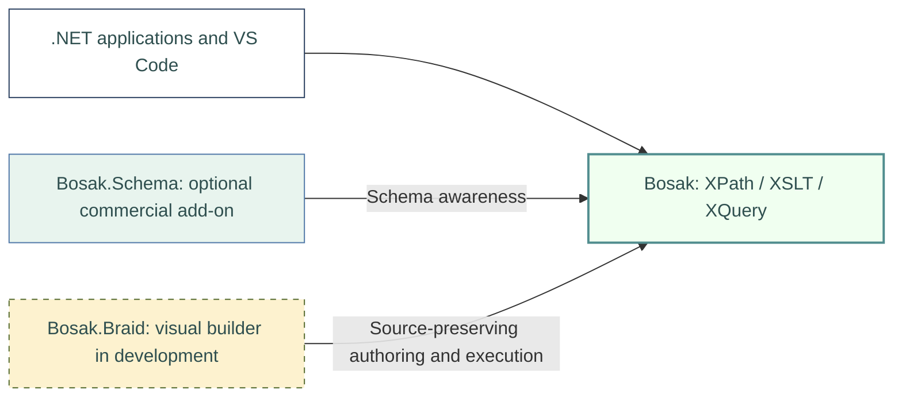

<div align="center">
  
  <br><br><h1>Bosak</h1>
  <p>Query XML. Transform documents. Build visual XSLT workflows.</p>
</div>

**K02 wider audit — 27 October 2026:** [Schema/import inventory](docs/conformance/k02-schema-inventory/README.md) blocks normal adoption: 324 eligible original cases yield 251 retained passes, 72 regressions and one environment-exception-to-pass transition. All 1,584 metadata/paired/boundary processes complete without timeouts. Two corrections remain open: schema constructor registration after import (68 observed regressions), then relative schema-import base URI (four). Guarded loading stays default-off; no source, skip, baseline or version change. Next: K02-C01 constructor registration. Candidate 1.26.6 unpublished/public 1.26.3; REQ-126 remains Complete. Earlier narrow-sample results remain historical evidence.


**K02 guarded loader diagnostics — 27 October 2026:** [Implemented guarded mode](docs/conformance/k02-schema-loader/README.md) delegates eligible schemas to actual query imports only when explicitly enabled for diagnostics; normal eager loading stays the default. All 66 actual-harness diagnostic runs match independent expectations, including wrong-assertion failures and preserved source/profile boundaries. All 21,825 solution tests and both normal gates pass at 31,144/0/677 and 8,436/0/1,894; all 677 QT3 skips/reasons are unchanged. Candidate 1.26.6 is unpublished. K02 profile/capability and wider applicability work remain open; no admission or baseline change. Earlier checkpoints are historical.


**K02 bounded diagnostic correction — 27 October 2026:** [Duration-schema investigation](docs/conformance/k02-schema-duration/README.md) reproduces the unavailable schema duration types and corrects the public aggregated schema-import error to XQST0012. All 9 regressions pass (baseline 4 failed/5 passed). The original public query reaches its declared error alternative, but the QT3 environment still fails before query execution; validateexpr-28 remains skipped. No XSD 1.1 capability, skip, fixture or baseline change. Candidate 1.26.5 is unpublished; public 1.26.3 and REQ-126 acceptance are unchanged. Earlier checkpoints are historical.


**K01 complete; approved QT3 baseline — 27 October 2026:** [Exact two-case adoption](docs/conformance/k01-schema-list/BASELINE-ADOPTION.md) removes only CastAs-ListType-20 and -28 from known skips. The fresh full QT3 gate passes **31,144/0/677**; qt4 remains 8,436/0/1,894. The owner approval and original receipts are preserved; no fixture/assertion/filter change. Source candidate 1.26.4 remains unpublished and REQ-126 remains Complete. Earlier totals and pending-approval notices are historical.


**K01 schema-list correction — 27 October 2026:** [Correction and evidence](docs/conformance/k01-schema-list/README.md) fixes legacy typed bindings reporting XPTY0004 instead of XPST0051 for invalid list item types. All 18 regressions pass (baseline 6 failed/12 passed); direct original QT3 cases CastAs-ListType-20 and -28 now both pass. Both skips and frozen totals stay unchanged pending a separate baseline-policy approval. Source candidate 1.26.4 is unpublished; public 1.26.3 and REQ-126 bounded acceptance are unchanged. Earlier checkpoints are historical.


**REQ-126 complete for the accepted bounded catalog — 26 October 2026:** [Owner acceptance](docs/xpath40-catalog/CATALOG-ACCEPTANCE.md) closes C13 and all 13 workpackages; zero remain open. AC-01 through AC-04 are explicitly accepted for 76 entries/235 bounded contract groups; AC-05 maintained. All 38 catalog dispositions are accepted while all 48 unmet batch observations and original technical exit criteria remain unchanged. No full current-draft compliance, engine fix, gate change or release follows. Earlier open-state notices are historical.


**REQ-126 C13 review prepared — 26 October 2026:** [Final closure review](docs/xpath40-catalog/FINAL-CLOSURE-REVIEW.md) consolidates 76 entries, 235 bounded contract groups and 38 proposed disposition records. All 3,172 fresh documentation tests pass. Six Known Uses sections now state their evidence/gate boundary directly. The [acceptance proposal](docs/xpath40-catalog/C13-ACCEPTANCE-PROPOSAL.md) would close the documentation catalog with explicit limits and open technical follow-ups; it is not approved. All 48 unmet batch observations remain unmet. C13 remains open, AC-01 through AC-04 unchecked and REQ-126 In Progress; no engine, fixture, gate, version or release change. Earlier checkpoints are historical.


**REQ-126 C12 complete — 26 October 2026:** [Final semantic/evidence batch](docs/xpath40-catalog/SEMANTIC-REVIEW-BATCH-4.md) reviews 19 entries/57 contract groups with 369 exact catalog cases and six dedicated walkthroughs. All 5,595 fresh tests pass; independent diagnostics retain 167 matching and eight unmet controls. Choice coercion and switch comparison remain explicit blockers. All 76 entries now have C09-C12 bounded reviews. One workpackage remains: C13 blocker disposition and owner acceptance. REQ-126 stays In Progress; no engine, fixture, profile, gate or release change. Earlier checkpoints are historical.


**REQ-126 C11 complete — 26 October 2026:** [Third semantic/evidence batch](docs/xpath40-catalog/SEMANTIC-REVIEW-BATCH-3.md) reviews 19 entries/56 contract groups and 874 exact linked cases. All 3,756 fresh tests pass; all 26 sample blocks have verification paths, including seven independently executed inline queries. Of 99 supplemental observations, 77 controls match, 20 retain known requirements and two record URI type behavior. Destructuring, spelling, focus and epoch-profile caveats remain explicit. Two workpackages remain; C12 is next. No final acceptance, engine, fixture, profile, gate or release change; earlier checkpoints are historical.

**REQ-126 C10 complete — 26 October 2026:** [Second semantic/evidence batch](docs/xpath40-catalog/SEMANTIC-REVIEW-BATCH-2.md) reviews 19 entries/55 contract groups with 892 exact linked cases and 82 sample blocks. All 3,469 fresh tests pass. Supplemental observations retain 60 matching controls, 10 known draft mismatches, two disputed highest-example controls and two URI observations. The source/example reading issue stays separate from an engine-defect diagnosis. Three packages remain; C11 is next. No final acceptance, engine, fixture, profile, gate or release change; earlier checkpoints are historical.

**REQ-126 C09 complete — 26 October 2026:** [First semantic/evidence batch](docs/xpath40-catalog/SEMANTIC-REVIEW-BATCH-1.md) reviews 19 entries/67 contract groups and 536 distinct linked cases. All 3,447 fresh existing tests pass; 116 sample +8 walkthrough blocks have explicit verification paths. Of 54 independent profile controls, 46 match and eight retain known model/extrema/partial-apply boundaries. Scan sample queries are separated and executed verbatim. Four closure workpackages remain; C10 is next. No final acceptance, engine, fixture, profile, gate or release change; earlier checkpoints are historical.

**REQ-126 C08 complete — 26 October 2026:** [Historical adoption research](docs/xpath40-catalog/ADOPTION-HISTORY-RESEARCH.md) checks all 28 original records through 16 delivery trees, 16 retained PR heads, 58 matching historical commits and 16 PR records. No exact adoption pin was recovered. The owner explicitly approved 26 legacy provenance exceptions and two non-adoption dispositions, retaining all original nulls. C08 is complete; five packages remain open, with C09 next. Earlier receipts, defects and semantic acceptance remain open. No engine, profile, gate or release change; earlier checkpoints are historical.

**REQ-126 C07 complete — 26 October 2026:** [Lifecycle/disposition review](docs/xpath40-catalog/LIFECYCLE-RECONCILIATION.md) reconciles all 76 classifications and 19 original/wider decision groups. All 3,519 fresh existing tests and 113 profile controls pass. Current compound-pattern wording, method-call boundaries and a malformed delivery link are corrected with original receipts retained. Six closure workpackages remain; C08 historical adoption evidence is next. All 28 missing adoption pins, earlier defects and semantic acceptance remain open. No feature/profile/gate promotion or release; skips, Braid and extension work stay deferred. Earlier checkpoints are historical.

**REQ-126 C06 complete — 26 October 2026:** [Host/profile review](docs/xpath40-catalog/HOST-PROFILE-RECONCILIATION.md) reconciles the final three grammar rows; all 18 now have bounded reviews, not semantic acceptance. All 376 focused tests and 3,148 catalog examples pass. Of 154 probe observations, 133 controls match, two retain a switch comparison mismatch, and 19 record context boundaries. Seven closure workpackages remain; C07 is next. Static-mode and loader/adoption limits remain explicit. No engine, profile, gate or release change; skips, Braid and extension work stay deferred. Earlier checkpoints are historical.

**REQ-126 C05 complete — 26 October 2026:** [Type/collection/pattern review](docs/xpath40-catalog/TYPE-COLLECTION-PATTERN-RECONCILIATION.md) reconciles nine type/collection/pattern rows and 49 selected production names. All 2,457 focused tests pass. Of 275 independent controls, 259 match; 16 retain choice-coercion, record-destructuring and known generic-model gaps. Delivered union/EQName fixes remain closed. Eight closure workpackages remain; C06 is next. No engine or executable example changes, acceptance waiver, profile/gate promotion or release. Skips, Braid and extension work stay deferred; earlier checkpoints are historical.

**REQ-126 C04 complete — 26 October 2026:** [Expression/call/focus review](docs/xpath40-catalog/EXPRESSION-CALL-FOCUS-RECONCILIATION.md) reconciles six expression/call/focus rows and 33 selected production/token names. All 880 focused tests pass; 209 controls match, ten retain current-draft spelling/placeholder/mapping-focus gaps, and eight late-binding observations remain separate. Nine closure workpackages remain; C05 is next. No engine or executable example changes, gate/profile promotion, acceptance waiver or release. C02's atomic-annotation defect remains open. Skips, Braid and extension work stay deferred; earlier checkpoint counts are historical.

**REQ-126 C03 complete — 26 October 2026:** [Constructor/type review](docs/xpath40-catalog/CONSTRUCTOR-TYPE-RECONCILIATION.md) reconciles eight entries and all 49 focus constructors. All 1,333 asserted controls match across 1,357 observations; 245 focused schema/API/host tests pass. Bounded nominal defaults/static fields are now evidenced. Generic wide casts, decimal precision, schema/host context and broader conversion remain explicit boundaries; C02's atomic-annotation defect remains open. Ten closure workpackages remain; C04 is next. No engine/test/example/version/gate change or acceptance waiver; skips/Braid/extension work stays deferred. Earlier checkpoint counts are historical.

**REQ-126 C02 complete — 26 October 2026:** [Function/options reconciliation](docs/xpath40-catalog/FUNCTION-OPTIONS-RECONCILIATION.md) reconciles 30 entries/74 function surfaces with explicit supported boundaries and 14 follow-up groups. Release build and all 21,798 solution tests pass; all 3,148 catalog examples pass separately. The 195 added profile observations include 118 matching controls, two unmet controls for the new `atomic-type-annotation(())` defect, and 75 diagnostics. Eleven closure workpackages remain; C03 is next. C02 closes review scope, not AC-01–04 or the retained defects. Skip fixes, Braid and extension work remain deferred. Original receipts and frozen gates are preserved; no engine/version/release change.

**REQ-126 C01 complete — 26 October 2026:** [Current inventory and ownership record](docs/xpath40-catalog/FUNCTION-INVENTORY-REFRESH.md) refreshes 316 names against published 1.26.3 and pinned current draft b4723ff5: 119 registered 4.0-only names (70 non-constructors, 49 focus constructors), plus 197 existing names. The retained inventory missed `array:members` and `array:of-members`. All 1,581 profile lookup observations completed without probe errors; four changed declarations and remaining semantic/default/empty/error reviews have explicit C02/C03/C06 owners. Twelve closure workpackages remain open; REQ-126 and AC-01–04 remain partial. Finish these packages before skip fixes, Braid or VS Code extension work. Engine, APIs, tests, version and frozen gates are unchanged; existing passing source/gate evidence is inherited. Earlier counts and checkpoint notices are historical.

Bosak 1.26.3 is available on NuGet, including abs, floor and ceiling integer-preservation corrections. Visual/source editors can wrap supported output elements in a condition, edit the condition and unwrap them with exact source and graph provenance. [Verified release](docs/RELEASE-1.26.3-PUBLICATION.md) and [authoring API](docs/REQ-138-IMPLEMENTATION.md).

REQ-126 now has a [13-workpackage closure plan](docs/xpath40-catalog/CLOSURE-PLAN.md) and a separate [conformance skip triage](docs/xpath40-catalog/CONFORMANCE-SKIP-TRIAGE.md). The catalog remains in progress; frozen conformance policy and public installation are unchanged.


---

<details>
<summary>About FYTALA: the people and purpose behind Bosak</summary>

## About FYTALA

**FYTALA — Feeling Young, Thriving, Active, Learning Always** — is a personal initiative founded after retirement, driven by the belief that curiosity, enthusiasm, and learning have no age limit.

It is about staying engaged, exploring new ideas, and sharing the excitement of technology and innovation with others. A special ambition of FYTALA is to spark that enthusiasm in young people and encourage them to discover how fascinating technology can be—not just by talking about technology, but by making it visible, tangible, surprising, and fun.

My dream captures that ambition perfectly: **to walk into a classroom one day, side by side with a humanoid robot, and make my enthusiasm for technology and innovation contagious.**

If that experience inspires even a few young minds to start asking questions, experimenting, building, programming, or imagining what might be possible, FYTALA has achieved something worthwhile.

Technology, after all, is not just about machines, electronics, or software. It is about curiosity, creativity, and turning ideas into reality. FYTALA therefore takes a deliberately broad perspective, embracing software, electronics, engineering, science, artificial intelligence, robotics, and whatever comes next.

> Experimenting matters.
>
> Making mistakes matters.
>
> Understanding *why* something works matters even more.

Every project is an opportunity to learn something new and, hopefully, to help someone else learn as well.

The cable-stayed bridge in the FYTALA logo represents that philosophy. A bridge connects places, but it can also connect people, ideas, generations, and fields of knowledge. Its strength comes from many individual elements working together—much like technology itself.

FYTALA wants to help build those bridges: between experience and youthful curiosity, theory and practice, and imagination and real-world creation. It encourages looking beyond the obvious, asking questions, taking things apart, and building them again in new ways.

Above all, FYTALA is about keeping the desire to discover alive—and passing that desire on to the next generation.

> Because we never have to stop being curious.
>
> We never have to stop creating.
>
> And we are never too old—or too young—to learn something new.

</details>

---

**Bosak brings XPath 3.1, XSLT 3.0 and XQuery 3.1 to .NET 10**, on one shared XQuery Data Model (XDM). Embed queries and transformations in your application, work in VS Code, or explore the visual-authoring foundation in Bosak.Braid.

The engine is **free and open source under Apache-2.0**. Optional commercial products extend the ecosystem: **Bosak.Schema** adds XSD complex-type schema awareness, and **Bosak.Braid** is developing a bidirectional visual/source XSLT builder.

[Get started](#quick-start) | [Integration guide](docs/INTEGRATION.md) | [Worked examples](docs/xpath40-catalog/worked-examples/README.md) | [Latest release](https://github.com/Fytala-Charles/Bosak/releases/latest)

## Why and when to use XSLT

Keep document-mapping rules together, test them against real inputs and reuse them across your .NET applications.

| Your task | What you can build |
|---|---|
| Business document exchange | Map supplier invoices into ERP XML, validate fields and produce exception reports. |
| Publishing | Transform XML manuals into HTML while retaining headings, inline content and cross-references. |
| Reporting and migration | Group records, calculate totals and move older XML vocabularies to new formats. |
| Data interchange | Query XML and produce XML, HTML, JSON or text through explicit transformation rules. |

Start with the [invoice-to-ERP walkthrough](docs/xpath40-catalog/worked-examples/invoice-to-erp/README.md), [manual publishing](docs/xpath40-catalog/worked-examples/manual-to-html/README.md) or [order reconciliation](docs/xpath40-catalog/worked-examples/order-reconciliation/README.md). They include source documents, stylesheets, expected output and executable checks. PDF output from XSL-FO requires a separate formatter.

## Why Bosak

- **One engine for three languages.** XPath, XSLT and XQuery share the same XDM types and expression runtime. Maps, arrays, higher-order functions and JSON processing fit alongside XML.
- **Compile once, evaluate repeatedly.** Reuse compiled expressions and transformations; connect existing XML or custom `IXdmNode` providers through the layered .NET APIs.
- **Control execution and resources.** Supported preview/capture APIs provide explicit resource policies, output capture, provenance and cooperative execution limits. See the [integration guide](docs/INTEGRATION.md) for supported profiles and boundaries.
- **Preserve source while authoring.** Engine-issued inspection and edit candidates retain original bytes outside declared changes, supporting reviewable visual-authoring workflows. Create bounded output containers, populate them through reviewed text/value-of operations, replace an existing literal text body, delete a supported text instruction, or create, update and delete supported literal result attributes; see the [authoring guide](docs/REQ-135-IMPLEMENTATION.md).
- **Explore newer language features explicitly.** XPath/XSLT 4.0 support is opt-in and bounded to the documented implemented draft features; default XPath compilation remains 3.1. See [4.0 coverage](docs/REQ-118-xpath-xslt-40.md).

## Quick start

Install the [.NET 10 SDK](https://dotnet.microsoft.com/download/dotnet/10), then create a console application:

```bash
dotnet new console -n BosakDemo
cd BosakDemo
dotnet add package Bosak.XPath.Api --version 1.26.3
```

Replace `Program.cs` with:

```csharp
using Bosak.XPath.Api;
using Bosak.XPath.Runtime.Vm;

var expression = XPathExpression.Compile("sum((10, 20, 30))");
var result = expression.Evaluate(new EvaluationContext());
Console.WriteLine(result.IntegerValue); // 60
```

Run it with `dotnet run`. Reuse `expression` for subsequent evaluations. For transformation or query applications, choose the matching package:

| Package | Use it for |
|---|---|
| [Bosak.XPath.Api](https://www.nuget.org/packages/Bosak.XPath.Api/1.26.3) | Compile and evaluate XPath. |
| [Bosak.Xslt](https://www.nuget.org/packages/Bosak.Xslt/1.26.3) | Compile stylesheets and transform documents. |
| [Bosak.XQuery](https://www.nuget.org/packages/Bosak.XQuery/1.26.3) | Compile and evaluate XQuery. |

Continue with the [API integration guide](docs/INTEGRATION.md) and [feature catalog](docs/xpath40-catalog/README.md).

## Bosak.Schema: let your schemas guide transformations

**Bosak.Schema is the optional commercial add-on for XSD complex-type schema awareness.** It plugs into the core's schema extension interfaces, adding schema import and typed validation without maintaining a separate engine fork.

Use named complex types with `instance of` and `treat as`, import schemas with `xsl:import-schema`, and construct schema-validated output in the supported profile. That helps catch structural mistakes at a schema boundary and lets transformations work with typed XML rather than relying entirely on manual field checks. The free core retains its built-in simple-type support and works without activating the add-on.

See the [Schema integration and licensing guide](https://fytala-charles.github.io/Bosak.Docs/) or [request a trial](https://licensing.fytala.com/api/trial). Confirm package access and compatibility for your Bosak version with [Fytala](mailto:charles.korthout@fytala.com); the add-on has its own release and licensing lifecycle.

## Bosak.Braid: a visual/source XSLT builder taking shape

**Development of the bidirectional GUI/source XSLT builder has started.** Bosak.Braid connects the source, a visual containment view and engine-owned editing operations so you can inspect a transformation and review a change before applying it.

The delivered foundation includes source/outline navigation in both directions, highlighted source review, reviewed expression edits, bounded `xsl:value-of` and literal `xsl:text` insertion, value-of deletion, and one-step Undo/Redo. Validation, preview, restricted new-file export and reopen workflows support checking the result against expected output.

The larger goal is synchronized free-form source editing and richer visual composition. Full live bidirectional editing and arbitrary structural construction are still under development; the current workflow uses individually supported, reviewed operations. Braid is a separate application with its own licensing and delivery gates. Read the [ecosystem and builder overview](docs/ECOSYSTEM.md), explore the [engine authoring roadmap](docs/STRUCTURAL-AUTHORING-ROADMAP.md), or [contact Fytala](mailto:charles.korthout@fytala.com) about Braid.

<a id="bosak-ecosystem"></a>



<p class="fytala-figure-caption"><strong>The Bosak ecosystem.</strong> The open-source engine supports applications, the Schema add-on and Braid's developing visual-authoring workflow.</p>

## Work in VS Code

Install [Bosak XPath / XSLT](https://marketplace.visualstudio.com/items?itemName=fytala.vscode-bosak) for syntax highlighting, diagnostics, completion, hover, navigation and evaluate/run commands. The extension has its own bundled-engine release cycle; consult the [extension guide](vscode-bosak/README.md) for installation and version details.

## Documentation and development

| Start here | What you will find |
|---|---|
| [Architecture](docs/ARCHITECTURE.md) | Layers, execution pipeline and extension points. |
| [Integration](docs/INTEGRATION.md) | Public APIs, supported profiles and consumer guidance. |
| [Roadmap](ROADMAP.md) and [feature requests](docs/FEATURE_REQUESTS.md) | Planned work and current delivery status. |
| [1.26.3 release notes](docs/RELEASE-NOTES-1.26.3.md) | Release scope, compatibility and limitations. |
| [Development history](docs/DEVELOPMENT_HISTORY.md) | Archived implementation checkpoints and the former README reference material. |

Build and test from a source checkout with the .NET 10 SDK:

```bash
git submodule update --init --recursive
dotnet build Bosak.sln
dotnet test Bosak.sln
```

Selected XSLT 4.0 native runs support a configurable Windows timeout and retained receipts; see the [harness guide](docs/XSLT40-HARNESS-HARDENING.md).

Language-server tests and manual conformance gates have separate commands in [AGENTS.md](AGENTS.md). Use the [release verification record](docs/RELEASE-1.19.0-PUBLICATION.md) for exact test counts and artifact provenance.

## Support and contribute

Ask questions in [Discussions](https://github.com/Fytala-Charles/Bosak/discussions), report bugs in [Issues](https://github.com/Fytala-Charles/Bosak/issues), or support development through [GitHub Sponsors](https://github.com/sponsors/Fytala-Charles). [Commercial support](COMMERCIAL.md) is available through Fytala. The engine remains [Apache-2.0](license.md); commercial add-ons have their own terms.
