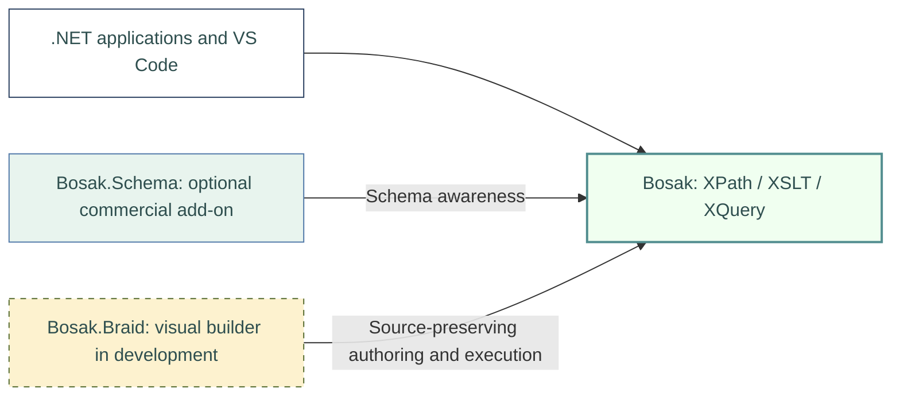

<div align="center">
  
  <br><br><h1>Bosak</h1>
  <p>Query XML. Transform documents. Build visual XSLT workflows.</p>
</div>

Source 1.26.1 remains unpublished. Its latest [atomic function conversion correction](docs/xpath40-catalog/ATOMIC-FUNCTION-CONVERSION.md) makes `abs` handle recursively atomized arrays and enforce singleton cardinality while preserving named-function identity; 366 new regressions and unchanged frozen gates are verified. Public 1.26.0 remains current.

Bosak 1.26.0 is available on NuGet. Visual/source editors can wrap supported output elements in a condition, edit the condition and unwrap them with exact source and graph provenance. [Verified release](docs/RELEASE-1.26.0-PUBLICATION.md) and [authoring API](docs/REQ-138-IMPLEMENTATION.md).


---

<details>
<summary>About FYTALA: the people and purpose behind Bosak</summary>

## About FYTALA

**FYTALA — Feeling Young, Thriving, Active, Learning Always** — is a personal initiative founded after retirement, driven by the belief that curiosity, enthusiasm, and learning have no age limit.

It is about staying engaged, exploring new ideas, and sharing the excitement of technology and innovation with others. A special ambition of FYTALA is to spark that enthusiasm in young people and encourage them to discover how fascinating technology can be—not just by talking about technology, but by making it visible, tangible, surprising, and fun.

My dream captures that ambition perfectly: **to walk into a classroom one day, side by side with a humanoid robot, and make my enthusiasm for technology and innovation contagious.**

If that experience inspires even a few young minds to start asking questions, experimenting, building, programming, or imagining what might be possible, FYTALA has achieved something worthwhile.

Technology, after all, is not just about machines, electronics, or software. It is about curiosity, creativity, and turning ideas into reality. FYTALA therefore takes a deliberately broad perspective, embracing software, electronics, engineering, science, artificial intelligence, robotics, and whatever comes next.

> Experimenting matters.
>
> Making mistakes matters.
>
> Understanding *why* something works matters even more.

Every project is an opportunity to learn something new and, hopefully, to help someone else learn as well.

The cable-stayed bridge in the FYTALA logo represents that philosophy. A bridge connects places, but it can also connect people, ideas, generations, and fields of knowledge. Its strength comes from many individual elements working together—much like technology itself.

FYTALA wants to help build those bridges: between experience and youthful curiosity, theory and practice, and imagination and real-world creation. It encourages looking beyond the obvious, asking questions, taking things apart, and building them again in new ways.

Above all, FYTALA is about keeping the desire to discover alive—and passing that desire on to the next generation.

> Because we never have to stop being curious.
>
> We never have to stop creating.
>
> And we are never too old—or too young—to learn something new.

</details>

---

**Bosak brings XPath 3.1, XSLT 3.0 and XQuery 3.1 to .NET 10**, on one shared XQuery Data Model (XDM). Embed queries and transformations in your application, work in VS Code, or explore the visual-authoring foundation in Bosak.Braid.

The engine is **free and open source under Apache-2.0**. Optional commercial products extend the ecosystem: **Bosak.Schema** adds XSD complex-type schema awareness, and **Bosak.Braid** is developing a bidirectional visual/source XSLT builder.

[Get started](#quick-start) | [Integration guide](docs/INTEGRATION.md) | [Worked examples](docs/xpath40-catalog/worked-examples/README.md) | [Latest release](https://github.com/Fytala-Charles/Bosak/releases/latest)

## Why and when to use XSLT

Keep document-mapping rules together, test them against real inputs and reuse them across your .NET applications.

| Your task | What you can build |
|---|---|
| Business document exchange | Map supplier invoices into ERP XML, validate fields and produce exception reports. |
| Publishing | Transform XML manuals into HTML while retaining headings, inline content and cross-references. |
| Reporting and migration | Group records, calculate totals and move older XML vocabularies to new formats. |
| Data interchange | Query XML and produce XML, HTML, JSON or text through explicit transformation rules. |

Start with the [invoice-to-ERP walkthrough](docs/xpath40-catalog/worked-examples/invoice-to-erp/README.md), [manual publishing](docs/xpath40-catalog/worked-examples/manual-to-html/README.md) or [order reconciliation](docs/xpath40-catalog/worked-examples/order-reconciliation/README.md). They include source documents, stylesheets, expected output and executable checks. PDF output from XSL-FO requires a separate formatter.

## Why Bosak

- **One engine for three languages.** XPath, XSLT and XQuery share the same XDM types and expression runtime. Maps, arrays, higher-order functions and JSON processing fit alongside XML.
- **Compile once, evaluate repeatedly.** Reuse compiled expressions and transformations; connect existing XML or custom `IXdmNode` providers through the layered .NET APIs.
- **Control execution and resources.** Supported preview/capture APIs provide explicit resource policies, output capture, provenance and cooperative execution limits. See the [integration guide](docs/INTEGRATION.md) for supported profiles and boundaries.
- **Preserve source while authoring.** Engine-issued inspection and edit candidates retain original bytes outside declared changes, supporting reviewable visual-authoring workflows. Create bounded output containers, populate them through reviewed text/value-of operations, replace an existing literal text body, delete a supported text instruction, or create, update and delete supported literal result attributes; see the [authoring guide](docs/REQ-135-IMPLEMENTATION.md).
- **Explore newer language features explicitly.** XPath/XSLT 4.0 support is opt-in and bounded to the documented implemented draft features; default XPath compilation remains 3.1. See [4.0 coverage](docs/REQ-118-xpath-xslt-40.md).

## Quick start

Install the [.NET 10 SDK](https://dotnet.microsoft.com/download/dotnet/10), then create a console application:

```bash
dotnet new console -n BosakDemo
cd BosakDemo
dotnet add package Bosak.XPath.Api --version 1.26.0
```

Replace `Program.cs` with:

```csharp
using Bosak.XPath.Api;
using Bosak.XPath.Runtime.Vm;

var expression = XPathExpression.Compile("sum((10, 20, 30))");
var result = expression.Evaluate(new EvaluationContext());
Console.WriteLine(result.IntegerValue); // 60
```

Run it with `dotnet run`. Reuse `expression` for subsequent evaluations. For transformation or query applications, choose the matching package:

| Package | Use it for |
|---|---|
| [Bosak.XPath.Api](https://www.nuget.org/packages/Bosak.XPath.Api/1.26.0) | Compile and evaluate XPath. |
| [Bosak.Xslt](https://www.nuget.org/packages/Bosak.Xslt/1.26.0) | Compile stylesheets and transform documents. |
| [Bosak.XQuery](https://www.nuget.org/packages/Bosak.XQuery/1.26.0) | Compile and evaluate XQuery. |

Continue with the [API integration guide](docs/INTEGRATION.md) and [feature catalog](docs/xpath40-catalog/README.md).

## Bosak.Schema: let your schemas guide transformations

**Bosak.Schema is the optional commercial add-on for XSD complex-type schema awareness.** It plugs into the core's schema extension interfaces, adding schema import and typed validation without maintaining a separate engine fork.

Use named complex types with `instance of` and `treat as`, import schemas with `xsl:import-schema`, and construct schema-validated output in the supported profile. That helps catch structural mistakes at a schema boundary and lets transformations work with typed XML rather than relying entirely on manual field checks. The free core retains its built-in simple-type support and works without activating the add-on.

See the [Schema integration and licensing guide](https://fytala-charles.github.io/Bosak.Docs/) or [request a trial](https://licensing.fytala.com/api/trial). Confirm package access and compatibility for your Bosak version with [Fytala](mailto:charles.korthout@fytala.com); the add-on has its own release and licensing lifecycle.

## Bosak.Braid: a visual/source XSLT builder taking shape

**Development of the bidirectional GUI/source XSLT builder has started.** Bosak.Braid connects the source, a visual containment view and engine-owned editing operations so you can inspect a transformation and review a change before applying it.

The delivered foundation includes source/outline navigation in both directions, highlighted source review, reviewed expression edits, bounded `xsl:value-of` and literal `xsl:text` insertion, value-of deletion, and one-step Undo/Redo. Validation, preview, restricted new-file export and reopen workflows support checking the result against expected output.

The larger goal is synchronized free-form source editing and richer visual composition. Full live bidirectional editing and arbitrary structural construction are still under development; the current workflow uses individually supported, reviewed operations. Braid is a separate application with its own licensing and delivery gates. Read the [ecosystem and builder overview](docs/ECOSYSTEM.md), explore the [engine authoring roadmap](docs/STRUCTURAL-AUTHORING-ROADMAP.md), or [contact Fytala](mailto:charles.korthout@fytala.com) about Braid.

<a id="bosak-ecosystem"></a>



<p class="fytala-figure-caption"><strong>The Bosak ecosystem.</strong> The open-source engine supports applications, the Schema add-on and Braid's developing visual-authoring workflow.</p>

## Work in VS Code

Install [Bosak XPath / XSLT](https://marketplace.visualstudio.com/items?itemName=fytala.vscode-bosak) for syntax highlighting, diagnostics, completion, hover, navigation and evaluate/run commands. The extension has its own bundled-engine release cycle; consult the [extension guide](vscode-bosak/README.md) for installation and version details.

## Documentation and development

| Start here | What you will find |
|---|---|
| [Architecture](docs/ARCHITECTURE.md) | Layers, execution pipeline and extension points. |
| [Integration](docs/INTEGRATION.md) | Public APIs, supported profiles and consumer guidance. |
| [Roadmap](ROADMAP.md) and [feature requests](docs/FEATURE_REQUESTS.md) | Planned work and current delivery status. |
| [1.26.0 release notes](docs/RELEASE-NOTES-1.26.0.md) | Release scope, compatibility and limitations. |
| [Development history](docs/DEVELOPMENT_HISTORY.md) | Archived implementation checkpoints and the former README reference material. |

Build and test from a source checkout with the .NET 10 SDK:

```bash
git submodule update --init --recursive
dotnet build Bosak.sln
dotnet test Bosak.sln
```

Selected XSLT 4.0 native runs support a configurable Windows timeout and retained receipts; see the [harness guide](docs/XSLT40-HARNESS-HARDENING.md).

Language-server tests and manual conformance gates have separate commands in [AGENTS.md](AGENTS.md). Use the [release verification record](docs/RELEASE-1.19.0-PUBLICATION.md) for exact test counts and artifact provenance.

## Support and contribute

Ask questions in [Discussions](https://github.com/Fytala-Charles/Bosak/discussions), report bugs in [Issues](https://github.com/Fytala-Charles/Bosak/issues), or support development through [GitHub Sponsors](https://github.com/sponsors/Fytala-Charles). [Commercial support](COMMERCIAL.md) is available through Fytala. The engine remains [Apache-2.0](license.md); commercial add-ons have their own terms.
