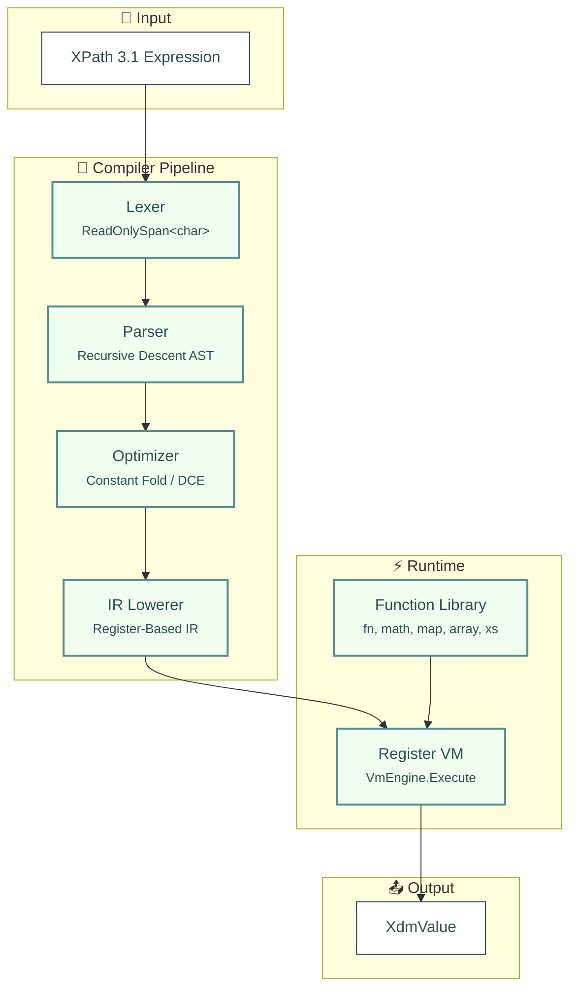

<div align="center">
  
  <br><br>
  <h1>Bosak XPath</h1>
  <p>A high-performance, XDM-first XPath 3.1, XSLT 3.0 and XQuery 3.1 engine for .NET — with opt-in XPath/XSLT 4.0</p>
</div>

<div align="center">

[](https://dotnet.microsoft.com/)
[](license.md)
[]()
[](https://www.nuget.org/packages/Bosak.XPath.Api)
[](https://github.com/Fytala-Charles/Bosak/actions/workflows/ci.yml)
[](docs/ARCHITECTURE.md)

</div>

**1.1.0 published 2026-10-11:** supported authoring, controlled validation/preview, and executable reference chapters. See [release notes](docs/RELEASE-NOTES-1.1.md) for compatibility and coverage restrictions.

The [REQ-126 completeness audit](docs/xpath40-catalog/COMPLETENESS-AUDIT.md)
records the remaining catalog gaps and prioritized documentation work.
**1.1.1 published 2026-10-11:** effective-version XPath40 propagation in XSLT is corrected across all ten public packages. See [patch release notes](docs/RELEASE-NOTES-1.1.1.md). Verification: **4,103 tests passed**, unchanged QT3 gate and zero qt4 gated failures. The complete verification record is in [the compatibility dossier](docs/REQ-118-XSLT-XPATH40-COMPATIBILITY.md). The [routing chapter](docs/xpath40-catalog/worked-examples/order-routing/README.md) now includes a self-contained 4.0 stylesheet alongside the published-1.1.0 integration alternative.

The reference catalog now includes [product-map indexing](docs/xpath40-catalog/functions/product-map-index.md), [array import batches](docs/xpath40-catalog/functions/import-array-batches.md), and [order-export selection](docs/xpath40-catalog/functions/order-sequence-selection.md). These explain complete cases, 3.1 alternatives and verified edge contracts. There are 66 entries and 774 executable documentation checks; the audit records remaining coverage and the 1.1.1 map result-shape differences corrected in source 1.1.2.

**1.1.2 published 2026-10-11:** corrects `map:entries` to return a sequence of single-entry maps and `map:items` to concatenate value items. See [the correction and migration guide](docs/REQ-118-MAP-RESULT-SHAPES.md). All ten packages are published and verified; see [patch release notes](docs/RELEASE-NOTES-1.1.2.md).

[Shipment-event sequence checks](docs/xpath40-catalog/functions/shipment-event-sequences.md) explain complete histories, adjacent processing rules and identity/presence guards, with exact reports and XPath 3.1 comparisons. The audit now assigns 117 of 117 registered names, leaving 0 for further coverage.

The catalog and audit also link primary specifications, draft history, and upstream
tests; individual feature entries provide direct specification-section references.

--- 
## About FYTALA

**FYTALA — Feeling Young, Thriving, Active, Learning Always** — is a personal initiative founded after retirement, driven by the belief that curiosity, enthusiasm, and learning have no age limit.

It is about staying engaged, exploring new ideas, and sharing the excitement of technology and innovation with others. A special ambition of FYTALA is to spark that enthusiasm in young people and encourage them to discover how fascinating technology can be—not just by talking about technology, but by making it visible, tangible, surprising, and fun.

My dream captures that ambition perfectly: **to walk into a classroom one day, side by side with a humanoid robot, and make my enthusiasm for technology and innovation contagious.**

If that experience inspires even a few young minds to start asking questions, experimenting, building, programming, or imagining what might be possible, FYTALA has achieved something worthwhile.

Technology, after all, is not just about machines, electronics, or software. It is about curiosity, creativity, and turning ideas into reality. FYTALA therefore takes a deliberately broad perspective, embracing software, electronics, engineering, science, artificial intelligence, robotics, and whatever comes next.

> Experimenting matters.
>
> Making mistakes matters.
>
> Understanding *why* something works matters even more.

Every project is an opportunity to learn something new and, hopefully, to help someone else learn as well.

The cable-stayed bridge in the FYTALA logo represents that philosophy. A bridge connects places, but it can also connect people, ideas, generations, and fields of knowledge. Its strength comes from many individual elements working together—much like technology itself.

FYTALA wants to help build those bridges: between experience and youthful curiosity, theory and practice, and imagination and real-world creation. It encourages looking beyond the obvious, asking questions, taking things apart, and building them again in new ways.

Above all, FYTALA is about keeping the desire to discover alive—and passing that desire on to the next generation.

> Because we never have to stop being curious.
>
> We never have to stop creating.
>
> And we are never too old—or too young—to learn something new.


---

## Overview

**Bosak** is a ground-up .NET implementation of **XPath 3.1** (with forward-compatibility for 4.0), with full **XSLT 3.0** and **XQuery 3.1** processors built on the same expression engine.

**XPath/XSLT 4.0 (opt-in, 1.0).** Bosak 1.0 ships the first complete adoption wave of the XPath/XSLT 4.0 drafts behind a version gate: `CompileOptions.Compatibility = XPathCompatibility.XPath40` opts in to 4.0-only F&O functions, keyword arguments, string templates, the `??`/`->`/`=!>` operators, focus functions, enum/choice/record item types, `for member`/`for key value` bindings, and the XSLT 4.0 surfaces (`xsl:note`, `xsl:if` then/else, separators, `xsl:map` select/duplicates, `xsl:array`, `xsl:switch`) — with XPath 3.1 behavior bit-identical by default (QT3 31,142/0/679 preserved exactly). See `docs/REQ-118-xpath-xslt-40.md`.

The project is named for **Jon Bosak**, who chaired the W3C working groups that created XSLT and XPath and donated the XML logo to the community — the standards this engine implements.

Unlike `System.Xml.XPath`, Bosak is built on the **W3C XQuery Data Model (XDM)** from day one. Expressions are compiled once to an intermediate representation (IR) and executed many times on a lightweight, register-based virtual machine. XSLT and XQuery reuse the same XPath engine for all expression evaluation.

## Why and when to use XSLT

XSLT turns structured XML into another document or data format using reusable transformation rules. XPath selects the information to process; XSLT templates describe how to reshape it. This is useful when the transformation must handle namespaces, repeated records, optional fields, or documents that mix text and markup.

| Situation | Practical transformation |
|---|---|
| Business document exchange | Map a supplier's invoice into the XML structure expected by an ERP system, converting dates, grouping tax lines, and preserving document identifiers. |
| Publishing and technical documentation | Turn an XML manual into HTML pages, preserving headings, inline emphasis, cross-references, and a generated table of contents. |
| Reporting and reconciliation | Group order lines by customer or product, calculate totals, and produce a report plus a separate exception document for incomplete records. |
| Maintaining document formats | Convert an older XML vocabulary into a newer one while retaining content that does not need to change. |
| Data interchange | Extract XML records into JSON or text for another application, with explicit rules for missing values and repeated elements. |

Choose XSLT when the rules follow the structure of the document and need to be reused across many inputs. Template matching suits publishing: a rule can render a paragraph wherever it appears while preserving its surrounding text. Explicit field selection suits integration: a rule can map an invoice line into a target schema. Stylesheets keep these rules together and make them independently testable with representative input and expected output. Outputting XSL-FO is also possible; producing a PDF from it requires a separate formatter.

Bosak provides these transformations within a .NET application, with XPath and XQuery available on the same data model. See the [integration guide](docs/INTEGRATION.md) for the public APIs and supported behavior.

### Catalogs as a reference guide

The examples' stylesheets also serve as teaching material: file-level contracts,
documented helpers, and template comments explain the decisions alongside the
executable rules. See the [annotated invoice stylesheet](docs/xpath40-catalog/worked-examples/invoice-to-erp/invoice-to-erp.xsl).

The [XPath/XSLT feature catalog](docs/xpath40-catalog/README.md) is intended to grow into a book or reference guide: chapters that explain problems, practical solutions, and the reasons for choosing a feature. Entries should work both as a learning path and as a quick lookup during development. Examples will use realistic documents and tasks, with sample input, expected output, edge cases, and compatibility notes. Start with [supplier invoices to ERP XML](docs/xpath40-catalog/worked-examples/invoice-to-erp/README.md), a complete XSLT 3.0 mapping with fixtures, expected outputs, and executable checks. Its optional XPath 4.0 comparison illustrates migration without changing the mapping's requirements. Continue with [XML manual publishing](docs/xpath40-catalog/worked-examples/manual-to-html/README.md) and [order reconciliation](docs/xpath40-catalog/worked-examples/order-reconciliation/README.md). Each chapter README explains the case in depth, shows complete input and output documents, and maps the source fields and XSLT elements to their responsibilities. The catalog now has 38 entries and [104 executable feature cases](docs/xpath40-catalog/examples/README.md), including earlier-version baselines and edge outcomes. Continue with [order validation and routing](docs/xpath40-catalog/worked-examples/order-routing/README.md), which combines explicit XPath40 planning with portable XSLT output. Wider feature inventory remains in progress.

### Key Features

- **XDM-First Architecture** — All inputs are adapted to `IXdmNode`; no proprietary DOM lock-in
- **Compile Once, Execute Many** — Parse → Optimize → Lower to IR → VM execution
- **Zero-Allocation Sequences** — Lazy struct enumerators avoid `IEnumerable<T>` boxing on hot paths
- **Pluggable Backends** — Works with `XDocument`, `XmlDocument`, streaming readers, or custom `IXdmNode` providers
- **XPath 3.1 Complete** — Maps, arrays, higher-order functions, arrow expressions (`=>`), string concat (`||`), FLWOR, JSON functions
- **XPath/XSLT 4.0 (opt-in)** — 4.0-only F&O functions (`fn:replicate`, `fn:slice`, `fn:parse-uri`, `map:build`, `fn:parse-csv`, `fn:element-to-map`, `fn:jtree`/`fn:jkey`/`fn:jvalue`, …), keyword arguments, string templates, `??`/`->`/`=!>`, focus functions, enum/choice/record item types, `for member`/`for key value`, JNode path navigation (`E/"key"`, `E/2`, `E/{expr}`), and XSLT 4.0 instructions (`xsl:note`, `xsl:array`, `xsl:switch`, …) behind `CompileOptions.Compatibility`; default 3.1 behavior is bit-identical
- **XSD Regex with Pinned Unicode 9.0** — Full `\p{X}`/`\P{X}` category and `\p{IsBlock}` support, class subtraction, astral-safe matching
- **XSLT 3.0 Transform Engine** — Template matching, sequence constructors, `xsl:copy`/`xsl:copy-of`, `xsl:for-each-group`, `xsl:analyze-string`, `xsl:where-populated`, `xsl:on-empty`, `xsl:iterate`/`xsl:break`, `fn:transform()`
- **Source-Preserving Authoring API** — `Bosak.Xslt.Authoring` (REQ-124) gives visual designers engine-owned, source-aware state: byte-exact original export, source maps with expression-slot contexts, validated expression edits as isolated candidates (splice-only emission), a static `AuthoringCapabilities` descriptor (encodings, limits, version policy — no exception probing), and a classified failure taxonomy — untouched XSLT is never re-serialized (powers the Bosak.Braid visual designer)
- **Controlled Preview APIs** — `Bosak.Xslt.Validation` (static validation over authoring envelopes: Valid/Invalid/InvalidSource/UnsupportedCoverage/Refused/Cancelled with real static context, never a silent pass), `Bosak.XPath.Runtime.Resources` (opt-in controlled resource policy: 14 acquisition routes under one host authority, XV0004/XV0005 refusals, SHA-256 provenance receipts with digest-validated cache hits), `Bosak.Xslt.Capture` (principal + secondary output identities and serialization bytes with no disk writes, incremental byte-bounded serialization with explicit unsupported profiles, XTDE1490 collisions), and execution limits/cancellation via `ExecutionGate` (token, wall-clock, exact operation budget, unconditional completion checks — all classified, never thrown) — the supported public surface behind the Bosak.Braid designer preview (REQ-125, all four slices; opt-in, default bit-identical)
  Byte-bounded profiles and refusals are documented in the [integration guide](docs/INTEGRATION.md#req-125-consumer-review-corrections-2026-10-11); C-F1/D-F1 are closed; Braid accepted the documented contract on 2026-10-11.
- **Burst-Mode Streaming Input** — `XmlStreamingProvider` + `XsltExecutable.TransformStreaming`/`TransformStreamingToString` process multi-GB record documents in bounded memory (verified at 500k records); forward-only with loud errors instead of silent data loss; pre-root comment/PI parity with the in-memory provider; push-style streaming accumulators (`xsl:accumulator` works over the stream)
- **XQuery 3.1 (Phase 4)** — full core FLWOR, direct and computed constructors, switch/typeswitch, `validate` (`strict`/`lax`/`type QName`), output declarations and serialization, user-defined functions and variables, library modules (`import module` with %public/%private visibility), schema-aware user-defined simple types, QName/NOTATION preservation and ID/IDREF detection, higher-order function item instance-of over element kind tests, empty `document-node()` matching, constructed-element `xs:anyType` annotations, QName accessor singleton-sequence XPTY0004, function return-type atomization for user-defined schema types, keywords as unprefixed function names, instance-of type-hierarchy semantics for user-defined schema types; schema-aware `fn:json-to-xml` with `validate:=true()` against the W3C schema-for-JSON; QT3 wired (31,142/0/679 strict — 100% of runnable)

---

## Quick Start

```bash
dotnet add package Bosak.XPath.Api    # XPath entry point
# or: dotnet add package Bosak.Xslt   # XSLT 3.0 transforms
# or: dotnet add package Bosak.XQuery  # XQuery 3.1 queries
```

```csharp
using Bosak.XPath.Api;
using Bosak.XPath.Core.Xdm;

// Compile once (XPathExpression is the version-neutral entry point;
// XPath31Expression remains fully supported)
var expr = XPathExpression.Compile("$price * (1 + $taxRate)");

// Execute many times with different inputs
var ctx = new EvaluationContext()
    .WithVariable("price", XdmValue.FromDecimal(100.00m))
    .WithVariable("taxRate", XdmValue.FromDecimal(0.21m));

var result = expr.Evaluate(ctx);
Console.WriteLine(result.DecimalValue); // 121.00
```

### XPath/XSLT 4.0 opt-in

```csharp
// Opt into the XPath 4.0 surfaces (default stays XPath 3.1, bit-identical)
var expr40 = XPathExpression.Compile(
    "fn:substring('hello', start := 2)",
    new CompileOptions { Compatibility = XPathCompatibility.XPath40 });
```

### Conditional Expressions

```csharp
var expr = XPath31Expression.Compile(
    "if ($score ge 90) then 'A' else if ($score ge 80) then 'B' else 'C'");
```

### Sequence & Range

```csharp
var expr = XPath31Expression.Compile("1 to 5");
// Returns: [1, 2, 3, 4, 5]
```

### XQuery 3.1

```csharp
using Bosak.XQuery.Api;
using Bosak.XPath.Core.Xdm;

var query = new XQueryCompiler().Compile("for $i in 1 to 3 return $i * $i");
var result = query.Evaluate(new XQueryContext());

foreach (var item in XdmSequence.FromSource(result.SequenceValue!))
    Console.WriteLine(item.IntegerValue);
// => 1 4 9
```

---

## Architecture



### Layer Stack

| Layer | Project | Responsibility |
|-------|---------|----------------|
| **Public API** | `Bosak.XPath.Api` | `XPathExpression` (version-neutral), `XPath31Expression`, `CompileOptions`, `EvaluationContext` |
| **Standard Library** | `Bosak.XPath.Standard` | `fn:*`, `math:*`, `map:*`, `array:*`, `xs:*` constructors |
| **Runtime / VM** | `Bosak.XPath.Runtime` | `VmEngine`, function dispatch, sequence operators |
| **Compiler / IR** | `Bosak.XPath.Compiler` | `XPathOptimizer`, `IrLowerer`, bytecode emitter |
| **Parser** | `Bosak.XPath.Parser` | `XPathLexer`, `XPathParser`, AST nodes |
| **XDM Core** | `Bosak.XPath.Core` | `XdmValue`, `IXdmNode`, `XdmSequence`, axis kinds |
| **Node Providers** | `Bosak.XPath.Providers` | `XDocument`, `XmlDocument`, burst-mode streaming (`XmlStreamingProvider`) |
| **XSLT** | `Bosak.Xslt` | `XsltCompiler`, `TransformEngine`, `fn:transform()` |
| **XQuery** | `Bosak.XQuery` | `XQueryCompiler`, `XQueryExecutable`, `XQueryParser`, `XQueryStaticContext`; full core FLWOR + direct and computed constructors + switch/typeswitch + output declarations and serialization + user-defined functions/variables + library modules + schema-aware user-defined simple types; QT3 wired (31,142/0/679 strict — 100% of runnable) |
| **Language Server** | `Bosak.LanguageServer` | LSP server for XPath / XSLT / XQuery — diagnostics, completions, hover, go-to-definition, document outline, semantic tokens, code actions, code lens |
| **VS Code Extension** | `vscode-bosak/` | TypeScript client for the language server |

---

## Performance Strategy

| Technique | Application |
|-----------|-------------|
| `ReadOnlySpan<char>` | Lexer, string comparisons, name tests |
| Struct enumerators | `XdmSequence`, axis iteration |
| `ArrayPool<T>` | Temporary buffers during sorting / materialization |
| Lazy evaluation | Sequences, predicates, path steps |
| Register VM | Expression execution (better cache locality than tree walking) |
| IL JIT *(future)* | Hot expression compilation to `DynamicMethod` |

---

## Roadmap

| Phase | Deliverable | Status |
|-------|-------------|--------|
| 1 | XPath 3.1 Core — compiler + VM + standard functions | ✅ Complete |
| 2 | XSLT 2.0/3.0 — template matching, sequence constructors, `fn:transform()` | ✅ Complete — full option surface + QT3 Tier-2m (117/124 passed, 7 skipped) |
| 3 | XQuery 3.1 — prolog parser, static context, prolog-less queries, full core FLWOR | 🚧 Phase 4 (constructors, modules, serialization, HOF, `fn:load-xquery-module`, schema-aware user-defined simple types, `validate`, QName/NOTATION/ID support, QName accessor singleton-sequence XPTY0004, function return-type atomization for user-defined schema types, schema-aware `fn:json-to-xml`); QT3 wired (31,142/0/679 strict — 100% of runnable) |
| 4 | Streaming — `XmlReader`-backed `IXdmNode` | ✅ Phases A+B+C+D — burst-mode streaming input (`XmlStreamingProvider`, `TransformStreaming`, `TransformStreamingToString`) + push-style streaming accumulators + `streamable="yes"` (§19 analyzer + runtime posture); provider batch: per-node wrapper cache, pre-root comment/PI surfacing, `fn:copy-of` deep-copy guard; PC-1 streaming conformance cluster closed (REQ-117 — all 26 FAIL→PASS, schema-aware sweep 11,054/1, 2026-10-02) |
| 5 | Database backends — XML database adapters | 🚧 **In Progress — Slice 2 done: basex/exist/marklogic REST scheme registry** (`Bosak.XPath.Providers.Database`; `Bosak.` NuGet prefix **reserved 2026-10-05**); dossier `docs/REQ-120-database-backends.md` |
| 6 | XPath/XSLT 4.0 adoption (REQ-118 / REQ-123) | 🚧 **Wave 1 landed in 1.0.0 (slices S0–S8)** — stabilized draft features behind the default-3.1 version gate: 4.0-only F&O functions, keyword arguments, string templates, `??`/`->`/`=!>`, focus functions, enum/choice/record item types, `for member`/`for key value`, and XSLT 4.0 instructions (`xsl:note`, `xsl:if` then/else, separators, `xsl:map` select/duplicates, `xsl:array`, `xsl:switch`); **'4.0 Experimental' level (REQ-123) S1 landed** — opt-in `XPathCompatibility.XPath40Experimental` tier above the frozen `XPath40` level exposes not-yet-stabilized draft additions (first: `fn:scan`); **S2 landed** — qt4tests wired as the 4.0 conformance harness (`tests/Bosak.XPath.Conformance40`, GatedSets gate, baseline 25,774/5,933 exploratory/15,278 skipped); **fn:op landed** — F&O 4.0 §18.4 operator accessor at the frozen level, all 31 operators sharing semantics with the infix dispatch via `VmEngine.ApplyBinaryOperator` (qt4tests fn-op 34/0/1); **parse-csv landed** — F&O 4.0 §17.5 `fn:parse-csv`/`fn:csv-to-xml`/`fn:csv-doc` at the frozen level plus the bare `{…}` map constructor and multi-clause 4.0 FLWOR (qt4tests 124/0/0, 68/0/2, 20/0/0); **element-to-map landed** — F&O 4.0 §17.6 `fn:element-to-map`/`fn:map-to-element`/`fn:element-to-map-plan`/`fn:jvalue` at the frozen level (layout inference, plan-driven typing with integer→decimal→double promotion, PR2688 map path navigation `E/"key"`/`E//"key"`/`E//QName`) plus the recursive entity-decode harness convention (qt4tests fn-element-to-map 174/0/40 dep-skips, fn-map-to-element, fn-element-to-map-plan); **atomic-equal landed** — F&O 4.0 §2.2.1 `fn:atomic-equal` (map-key equality exposed: exact-magnitude numerics, collation-free strings, timezone-presence date/times, PR2168 hex/base64 mutual comparison) plus two 4.0 parser companions (arrow targets accept the quantifier keywords — `$s => every()`; braced `if` branches with omittable `else`), qt4tests fn-atomic-equal 29/0/1 dep-skip, fn-while-do 30/0/0; **focus constructors landed** — every built-in `xs:*` constructor gains the 4.0 arity-0 form taking the context item (`'42' ! xs:integer()`, spec PR661; arity-aware version gate keeps the arity-1 forms 3.1-legal), qt4tests misc-FocusConstructors 153/0/0; **sort-with cluster landed** — F&O 4.0 `fn:compare` PR909 upgrade at the frozen level (comparands relaxed to `xs:anyAtomicType?`: exact cross-numeric ordering — `(double)3.1 > (decimal)3.1`, `(float)3.1 < (decimal)3.1`; NaN < −INF and NaN = NaN; booleans; hex/base64 by decoded octets; QName by {namespace URI, local}; durations of all subtypes by the un-normalized (months, days, seconds) tuple — `P2Y > P1000D`; g* types on the UTC instant) plus `fn:sort-with` comparator validation before the empty-input shortcut, new `array:sort-with#2`, `fn:is-NaN#1`, and the `fn:atomic-type-annotation#1` record (kind-inferred type names for unannotated literals; `variety`/`matches`/`constructor` members; hierarchy `base-type()`/`primitive-type()` closures); parser PR2962 `$map?$var` lookup keys; DependencyFilter40 marks `typedData` unsupported (no PSVI-typed source nodes); qt4tests fn-sort-with + array-sort-with 49/0/0, fn-is-NaN 14/0/2 dep-skips, fn-atomic-type-annotation 2/0/4 dep-skips, fn-compare 220/13 exploratory (was 107 failures: remaining = `#Q{}` literals, destructuring `let`, UCA collation) — gate now 215 sets; **compare-tail cluster landed** — Unicode case-insensitive collation `…/collation/unicode-case-insensitive` (PR1945) across the whole engine (value/general comparison via `CompareStrings`, collation-key sort keys, contains/starts-with/ends-with/substring-before/after/index-of, XSLT sort/group, XQuery prolog, order-by allow-list — invariant-culture `IgnoreCase` as the Unicode simple-case-folding approximation); keyword-argument rows `collation-key(value, collation)`, `contains-token(value, token, collation)`, `node-name(node)`, `min/max(values, collation)` with 4.0 empty-`()`-selects-default collation (PR197, 3.1 keeps XPTY0004); new `fn:collation-available#1` (4.0-only, resolves against base URI); `#` QName literals (PR1976/PR2227 — `#local`, `#prefix:local` static-context resolution with xml/fn/map/array/math fallback, `#Q{uri}local` retaining the lexical prefix, whitespace/comments after `#` per PR1982, XPST0081 unresolvable prefix, XPST0154 prefix-with-empty-URI, XPST0003 in 3.1) lowered to `fn:QName(ns, lexical)`; `fn:min`/`fn:max` order xs:QName by {URI, local} codepoint in 4.0 (PR2256, 3.1 keeps FORG0006); qt4tests fn-collation-key 37/0/0, fn-contains-token 48/0/0, fn-collation-available 8/0/0 (all promoted into the gate), fn-compare 231/4 exploratory (remaining 4 = destructuring `let`), fn-node-name/fn-min/fn-max collateral green — gate now 218 sets; **JNode cluster landed** — F&O 4.0 §17.7 JNode model at the frozen level (new `XdmValueKind.JNode` + `XdmJNode` wrapper over any item; `fn:jtree#1`, `fn:jkey`/`fn:jvalue` #0+#1; `jnode()`/`jnode(K)`/`jnode(K,T)` type matching; JNode-aware atomization/coercion; navigation rework — map entries/array members/sequence items become keyed child JNodes, NameTest-as-key, integer-literal step `E/2`, PR2667 braced selector `E/{expr}`, `?` unwrap; serializer + deep-equal recurse on jvalues; ⚠ the element-to-map slice's minimal `fn:jvalue#1` is superseded by the §17.7 accessor — XPTY0004 on non-JNode); qt4tests fn-jtree 30/0/0, fn-jkey 14/0/0, fn-jvalue 14/0/0 promoted into the gate, element-to-map family collateral green — gate now 221 sets; **destructuring-let landed** — XPath 4.0 destructuring let bindings (qt4cg PR1131) at the frozen level: `let $($x, $y) := …` (positional from a sequence; the LAST variable takes all remaining items, surplus variables bind `()`), `let $[$a, $b] := …` (positional from a single array; surplus members discarded, surplus variables FOAY0001), `let ${$x} := …` (map key = variable local name; missing keys bind `()`, record-typed patterns reject undeclared variables) with optional per-variable and whole-pattern `as` types (whole type must match the container family; RHS must be a single array/map even under `?`); typed let bindings at XP40+ use XPath 4.0 §3.4.2 coercion including PR 254 relabeling to derived integer types (42 → xs:short; 2.5 → xs:integer stays XPTY0004); lexical let scoping via new SaveVariables/RestoreVariables VM opcodes (a trailing `$var` outside the let's body raises XPST0008); qt4tests prod-LetClause 137/0/52 (XQ-only dependency skips) + fn-compare 233/0/2 promoted into the gate — gate now 223 sets; next: `fn:parse-html`; dossier `docs/REQ-118-xpath-xslt-40.md` |

**1.0 (GA):** ✅ **shipped 2026-10-09** — the within-major SemVer commitment now applies; see [ROADMAP.md](ROADMAP.md) and the [v1.0.0 release notes](docs/RELEASE-NOTES-1.0.md). The commercial Bosak.Schema 1.0 tags as the paired release (see the Bosak.Schema roadmap).

---

## Support

The open-source library is **community-supported and free forever** (Apache-2.0):

- **Questions & usage help** → [GitHub Discussions](https://github.com/Fytala-Charles/Bosak/discussions) (Q&A category)
- **Bugs & feature requests** → [GitHub Issues](https://github.com/Fytala-Charles/Bosak/issues)
- **Engine correctness work** — conformance fixes and correctness improvements are always done in the open; they are never paywalled

For guaranteed response times, direct engineering access, priority triage, or custom development, Fytala offers [commercial support contracts](COMMERCIAL.md). A future "Bosak Pro" add-on is planned for advanced schema-awareness scenarios; the conformant engine core stays Apache-2.0 regardless.

---

## Sponsorship

Bosak is free and open source (Apache-2.0) — and stays that way. Core conformance fixes and correctness work are always done in the open; they are never paywalled. If Bosak is useful to you, consider supporting its development through [GitHub Sponsors](https://github.com/sponsors/Fytala-Charles). Sponsorship does two things:

1. **Keeps Bosak moving** — conformance hardening, the VS Code extension, XQuery depth, and the road to a 1.0 release. Sponsors get a voice: roadmap votes and priority issue triage.
2. **Funds a mission close to Fytala's heart** — sparking enthusiasm for technology and innovation in young people, showing the next generation that building deep, beautiful software is something they can do too.

| Tier | Name | Benefits |
|------|------|----------|
| €3 / month | ☕ Supporter | Support Bosak and the youth-technology mission; your GitHub handle listed as a supporter in release notes |
| €10 / month | 🚀 Enthusiast | Everything above, plus votes on roadmap priorities and priority issue triage |
| €25 / month | 💎 Professional | Everything above, plus a direct line for integration questions and early input on new features |
| €100 / month | 🏢 Organization | Everything above, plus your logo and link in the Bosak README and release notes |

Every contribution, however small, is genuinely appreciated. Current sponsors are listed in [SPONSORS.md](SPONSORS.md) and acknowledged in release notes.

---

## VS Code Extension

A Language Server Protocol (LSP) implementation and VS Code extension provide IDE features for XPath, XSLT, and XQuery development — syntax highlighting, semantic tokens, diagnostics, completion, hover, go-to-definition, document outline, code actions (quick fixes), code lens for `.xpath`/`.xq`/`.xqy`/`.xquery` results, XSLT **Run XSLT transformation** and **Run initial template** lenses, `workspace/executeCommand` evaluation, and evaluate/run commands.

### Quick Install

```bash
# 1. Build the language server
dotnet build src/Bosak.LanguageServer/Bosak.LanguageServer.csproj

# 2. Build the extension
cd vscode-bosak
npm install
npm run compile

# 3. Open in VS Code and press F5 to launch the Extension Development Host
```

The extension is published on the VS Code Marketplace as [**Bosak XPath / XSLT**](https://marketplace.visualstudio.com/items?itemName=fytala.vscode-bosak) (`fytala.vscode-bosak`, 0.1.5, 2026-10-07). See [`vscode-bosak/README.md`](./vscode-bosak/README.md) for full installation options (Marketplace, VSIX, custom server path, troubleshooting).

---

## Building

```bash
dotnet build Bosak.sln
dotnet test Bosak.sln
```

Target framework: **.NET 10**.

Documentation follow-up baseline before the compatibility fix (2026-10-11): **4,068 unit tests pass / 0 failures / 0 skipped**, including 123 catalog/chapter checks. No engine behavior changed.

Release verification: **4,039 unit tests pass / 0 failures / 0 skipped** across the 10 assemblies in `Bosak.sln`, including 94 reference-guide/catalog checks. The separate Bosak.LanguageServer test project is outside this solution run.

---

## Conformance Testing

Bosak includes a W3C QT3 test suite harness for measuring XPath 3.1 standards compliance.

### Running the Harness

```bash
# Build the conformance runner
dotnet build tests/Bosak.XPath.Conformance/Bosak.XPath.Conformance.csproj

# Run against the full QT3 suite (~32,000 tests across 428 test sets)
dotnet run --project tests/Bosak.XPath.Conformance/Bosak.XPath.Conformance.csproj
```

The harness:
1. Discovers all test sets from `tests/qt3tests/catalog.xml`
2. Filters out unsupported features (schema-aware, XSLT streaming-only, serialization, static typing)
3. Routes XQuery-syntax tests through the `Bosak.XQuery` pipeline; evaluates the rest via the public `XPath31Expression.Compile(expr).Evaluate(ctx)` API
4. Executes each test with environment-defined namespaces, variables, and context documents wired in
5. Compares results against QT3 assertions (`assert-eq`, `assert-true`, `assert-xml`, etc.) with strict error-code matching

### Current Results

| Metric | Value |
|--------|-------|
| **XPath/XQuery (QT3)** | 428 test sets, ~32,000 tests |
| Pass Rate (XPath+XQuery) | **31,142 passed / 0 failed / 679 skipped** (97.87%) with strict error-code matching (2026-10-02 re-run, bit-identical to the 2026-09-09 baseline) — **100%** of runnable tests pass |
| **XSLT 3.0** | 224 test sets, 14,601 tests |
| Pass Rate (XSLT, basic sweep) | **10,242 passed / 0 failed / 4,359 skipped** (100.0% of runnable, harness 3.73, 2026-10-06 — the 26 formerly-failing tests are upstream catalog artifacts, skipped with reason per `docs/BASIC_SWEEP_TRIAGE.md` / w3c/xslt30-test#90) |
| Pass Rate (XSLT, schema-aware sweep) | **11,054 passed / 1 failed / 3,546 skipped** (100.0% of non-skipped, final gate 2026-10-03) — the single failure is `type-functions-0401` (DateTimeOffset year < −1, documented platform limitation); the non-streaming + streaming conformance tail is fully closed |
| unicode-90 set | **1,365 passed / 0 failed / 95 skipped** (skips are upstream test/data defects) |
| Unsupported Features | Complex-type schema awareness ships via the commercial **Bosak.Schema** add-on (Beta, `v0.2.0`); the free core raises XTSE1650 for `xsl:import-schema` unless the schema-aware seam is activated — see `COMMERCIAL.md`. XQuery-only dependencies |

> **Strict error matching** — Both conformance harnesses now require the declared
> `<error code="...">` to match the raised exception; previously any error satisfied an error
> expectation. The XSLT strict count (2026-09-01) exposed 147 tests that passed with a wrong
> error code (lenient figure 7,627/103/6,870). The QT3 strict tightening (2026-09-07) exposed
> 1,200 wrong-code passes; the triage fixed ~970 of them — cast-matrix error codes, static
> XPST0003/XPST0081/XPST0008 checks at parse/compile time, XQDY0054 dynamic detection,
> FOER0000 structural matching — leaving 233 triaged failures (documented engine gaps:
> schema list-type casts, extreme date/time ranges, JSON parse error-code granularity). No
> genuinely passing test was lost in either sweep.

### Known Limitations

| Assertion | Status | Impact |
|-----------|--------|--------|
| `assert-eq` | ✅ Implemented | Core value comparison |
| `assert-count` | ✅ Implemented | Sequence cardinality |
| `assert-deep-eq` | ✅ Implemented | Recursive XDM comparison |
| `assert-xml` | ⚠️ Partial | ~1,840 tests skipped |
| `assert-permutation` | ❌ Not implemented | ~92 tests skipped |
| Schema-aware | ⚠️ Opt-in (REQ-097) | ~5,000+ tests skipped — XSLT schema-aware compilation compiles `xsl:import-schema` and supports user-defined simple types via `SchemaAware` / `SchemaResolver` / `SchemaSet`; complex-type typed construction and runtime validation (`validation`/`@type`, XTTE15xx family) are implemented in the core behind the same opt-in (REQ-098–REQ-117 — last schema-aware sweep **11,054 passed / 1 failed / 3,546 skipped**; the single failure is type-functions-0401, a documented DateTimeOffset year platform limitation) |

### Adding New Tests

The harness is intentionally thin — it validates the **public API surface** end-to-end rather than calling internal layers directly. This ensures that parser, compiler, VM, and standard-library fixes are all exercised together.

---

<div align="center" style="background:#2F4F4F; color:#F0FFF0; padding:1rem; border-radius:12px; margin-top:2rem;">
  <p style="margin:0; font-family:Poppins,Segoe UI,sans-serif;">
    <strong>© Fytala</strong> — Bosak XPath Engine
  </p>
</div>

**REQ-125 delivery traceability (2026-10-11):** Bosak correction revision `0ff33163ba985bf8562722424db7e66c37e3566d` is accepted within the documented coverage and restricted byte-bounded profiles. Bosak.Braid adopted this exact immutable revision in commit `9423d41b52a5f3a3c1206df370c7998f7ad88886`. Its Release build passed with 0 errors, all **192 tests passed / 0 failed / 0 skipped** (including six public-contract checks), and the strict documentation gate passed. The bootstrap also rejects solution/manifest revision mismatches before checkout preparation. Both repositories have local commits; remote publication awaits explicit push authorization. Production preview adapter/worker integration remains separate product work.

[Ordered queue prefix](docs/xpath40-catalog/functions/ordered-queue-prefix.md) supplies take-while/drop-while with complete input/output, an XPath 3.1 comparison and 18 boundary/callback cases. Current coverage: 66 entries, 750 feature checks plus 24 chapter checks (774 total), and 117 assigned / 0 unassigned registered names. REQ-126 remains In Progress; source/public version remains 1.1.2. Bounded loop processing is now supplied by the reference below; dependency traversal and partial application are now supplied below.

[Bounded retry state](docs/xpath40-catalog/functions/bounded-retries.md) documents while-do/do-until using invoice-submission response fixtures, complete input/output, a bounded XPath 3.1 fold, and 25 executable normal/edge/error cases. It explains precondition versus postcondition evaluation, explicit attempt limits, zero-budget guarding, and whole-state callback values. Current coverage is 66 entries and 774 documentation checks (750 feature checks plus 24 chapter checks); 117 of 117 registered names have entries, leaving 0. REQ-126 remains In Progress; source/public version stays 1.1.2. Dependency traversal and partial application are supplied by this delivery.

[Product dependency closure](docs/xpath40-catalog/functions/product-dependency-closure.md) and [configured label callbacks](docs/xpath40-catalog/functions/configured-label-callbacks.md) add two complete references for transitive-closure, partial-apply and identity, with full input/output, XPath 3.1 comparisons and 37 executable cases. Shared dependencies, cycles, node identity/document order, unresolved references, argument order and callback binding limits are explicit. Current coverage: 66 entries, 750 feature checks plus 24 chapter checks (774 total), and 117 assigned / 0 unassigned registered names. REQ-126 remains In Progress; source/public version stays 1.1.2.

[Month-end cutoffs](docs/xpath40-catalog/functions/month-end-cutoffs.md) and [timestamp deadlines](docs/xpath40-catalog/functions/timestamp-deadlines.md) add full scheduling references for build-dateTime, days-in-month, unix-dateTime, seconds and duration-to-seconds. Complete inputs/reports, XPath 3.1 comparisons and 36 executable cases explain Gregorian leap rules, numeric timezone offsets, stamp types, epoch milliseconds, signed/fractional durations and explicit budget boundaries. Coverage is 66 entries, 750 feature checks plus 24 chapter checks (774 total), and 117 assigned / 0 unassigned registered names. REQ-126 remains In Progress; source/public stays 1.1.2. URI parsing/construction and encoding are supplied by the reference below.

[Invoice API URIs](docs/xpath40-catalog/functions/invoice-api-uris.md) supplies parse-uri, build-uri and decode-from-uri with full request input/output, a scoped XPath 3.1 construction comparison and 28 executable cases. It explains segment boundaries, query form decoding versus literal plus, repeated keys, permissive malformed-input decoding, component precedence and textual roundtrip limits. Coverage: 66 entries, 750 feature checks plus 24 chapter checks (774 total), and 117 assigned / 0 unassigned names. REQ-126 remains In Progress; source/public stays 1.1.2. Unicode/text cleanup and substring references are supplied below.

[Customer text cleanup](docs/xpath40-catalog/functions/customer-text-cleanup.md) and [import file names](docs/xpath40-catalog/functions/import-file-names.md) add eight function names with full input/output, scoped XPath 3.1 comparisons and 35 executable cases. They distinguish codepoints from grapheme clusters and display width, preserve interior whitespace, and explain final-delimiter/overlap rules. Bosak grapheme segmentation is approximate; complete Unicode segmentation remains outside the verified coverage. Current coverage: 66 entries, 750 feature checks plus 24 chapter checks (774 total), and 117 assigned / 0 unassigned registered names. REQ-126 remains In Progress; source/public stays 1.1.2. Ranking, numeric diagnostics and utility references are supplied below.

[Supplier offer ranking](docs/xpath40-catalog/functions/supplier-offer-ranking.md), [numeric import diagnostics](docs/xpath40-catalog/functions/numeric-import-diagnostics.md) and [payload fingerprints](docs/xpath40-catalog/functions/payload-fingerprints.md) add the final eight registered function names with 41 executable cases. Current coverage: 66 entries, 750 feature checks plus 24 chapter checks (774 total); all 117 registered names have family entries. This completes name assignment, not REQ-126 acceptance: signatures/options, grammar/disposition provenance and conformance limits remain. Computed-key boundary ties require explicit filtering in the business example and follow-up specification/engine reconciliation. Source/public stays 1.1.2; REQ-126 remains In Progress.

[Supplementary coverage audit](docs/xpath40-catalog/SUPPLEMENTARY-COVERAGE-AUDIT.md) (2026-10-12) records registered arities, changed existing-function contracts and wider grammar/disposition gaps. REQ-126 remains In Progress; current coverage is 66 entries and 774 checks. Typed measurement comparison with `fn:compare` is now supplied; min/max references are now supplied; sorting references are now supplied; URI option contracts and component precedence are now supplied; next: XQuery 4.0 / Streaming 4.0 scope review. Source/public version remains 1.1.2.

[Typed measurement comparison](docs/xpath40-catalog/functions/measurement-comparison.md) adds 27 executable cases for changed `fn:compare` behavior, with complete input/output and an explicit 3.1 double-normalization policy that differs at a decimal boundary. The runner verifies declared default-mode results or evaluation errors for existing functions. Keyword drift (`comparand1`/`comparand2` versus reviewed `value1`/`value2`) and legacy binary/empty-collation behavior are explicit. Current coverage: 66 entries, 750 feature plus 24 chapter checks (774 total); the 117-name assignment is unchanged. REQ-126 remains In Progress; source/public stays 1.1.2. Min/max references are now supplied; sorting references are now supplied; URI option contracts and component precedence are now supplied; next: XQuery 4.0 / Streaming 4.0 scope review.

[Batch extrema and component codes](docs/xpath40-catalog/functions/batch-extrema.md) adds 29 executable cases for `fn:min`/`fn:max`: complete batch input/output, explicit decimal normalization, namespace/local-name QName boundaries and a 3.1 fold comparison. Mixed numeric promotion/result-type and plain-duration limits remain explicit observed gaps against the pinned draft; these fixtures do not claim conformance. Current coverage: 66 entries, 750 feature plus 24 chapter checks (774 total); all 117 registered names remain assigned. REQ-126 remains In Progress; source/public stays 1.1.2. Sorting references are now supplied; URI option contracts and component precedence are now supplied; next: XQuery 4.0 / Streaming 4.0 scope review.

[Warehouse pick sorting](docs/xpath40-catalog/functions/warehouse-pick-sorting.md) adds 28 cases for retained `fn:sort`/`array:sort`: complete input/output, a portable 3.1 comparison, stable composite location keys and preserved multi-item array members. Mixed numeric promotion, input-dependent NaN order and missing empty-key defaults and unknown-collation acceptance are explicit observed boundaries. Exact fn-sort/array-sort gate membership is recorded without claiming full conformance. Coverage: 66 entries, 750 feature plus 24 chapter checks (774 total); all 117 names remain assigned. REQ-126 stays In Progress; source/public remains 1.1.2. URI option policy is now supplied; next: XQuery 4.0 / Streaming 4.0 scope review.

**Historical session close (2026-10-12, before URI review):** PR #173 merged after CI passed. Current reference coverage is 57 entries and 499 documentation checks (475 feature plus 24 chapter); all 117 registered names are assigned. Latest implementation validation: 4,497 tests passed across ten assemblies. REQ-126 remains In Progress; released/source version remains 1.1.2. Resume with URI options and component precedence; see [the handover](docs/AGENT_HANDOVER.md).


**URI option review — 2026-10-12:** [Archive and partner URI policy](docs/xpath40-catalog/functions/uri-option-policy.md) adds complete input/output, a scoped 3.1 comparison and 28 executable cases. Boolean options, UNC spelling, raw/structured authority and path/query precedence are explicit. Non-Boolean option truthiness and empty-query-map fallback remain observed draft gaps. Coverage: 66 entries, 750 feature plus 24 chapter checks (774 total); all 117 names remain assigned. REQ-126 stays In Progress; source/public version remains 1.1.2. Next: XQuery 4.0 / Streaming 4.0 scope review.

**Computed XPath constructor disposition — 2026-10-12:** [Deferred node construction](docs/xpath40-catalog/deferred/computed-node-constructors.md) separates the draft XPath feature from Bosak XQuery 3.1 support. Complete invoice input, refused XPath, 3.1 report and XSLT receipt output accompany 30 executable checks: 25 refusals across compatibility modes, three reports and two XML outputs. Current coverage: 66 entries, 750 feature plus 24 chapter checks (774 total); all 117 names remain assigned. Version stays 1.1.2; REQ-126 remains In Progress. Named XSLT declaration dispositions are now supplied; enclosing modes are now supplied; capturing accumulator disposition is now supplied; fn:apply-templates disposition is now supplied; next: XQuery 4.0 / Streaming 4.0 scope review.

**Named XSLT declaration review — 2026-10-12:** [xsl:item-type](docs/xpath40-catalog/deferred/xslt-item-type.md) and [xsl:record-type](docs/xpath40-catalog/deferred/xslt-record-type.md) add full invoice cases, pinned disposition evidence and 28 executable boundary/alternative checks. Unused 4.0 declarations are ignored, not implemented; named bindings and constructors fail. Portable map validation and inline enums are verified. Structural-record XSLT `@as` raises XTTE0570; explicit XPath cast in `select` plus `as="map(*)"` is the verified workaround. Catalog: 66 entries, 750 feature plus 24 chapter checks (774 total); all 117 names assigned. REQ-126 remains In Progress, version 1.1.2. Next: XQuery 4.0 / Streaming 4.0 scope review.

**Enclosing-mode review — 2026-10-12:** [Deferred enclosing modes](docs/xpath40-catalog/deferred/enclosing-modes.md) supplies a full invoice export/audit case, pinned draft/source evidence and 20 executable checks. Nested mode templates refuse with XTSE0260; top-level named rules provide supported dispatch, without enclosing-rule isolation. Explicit mode, #current and lexical defaults, empty/reordered input and namespace identity are verified. Catalog: 66 entries, 750 feature plus 24 chapter checks (774 total); all 117 names remain assigned. Version remains 1.1.2; REQ-126 In Progress. Next: XQuery 4.0 / Streaming 4.0 scope review.

**Capturing-accumulator review — 2026-10-12:** [Deferred capturing accumulators](docs/xpath40-catalog/deferred/capturing-accumulators.md) adds full invoice input/output and 16 executable cases. Accepted capture=yes retains source identity rather than a draft-required snapshot; invalid/start-phase capture is tolerated in tested 4.0 forms. Ordinary accumulators, explicit snapshots and scalar projection are verified separately in memory, without streaming or special annotation-copy claims. Catalog: 66 entries, 750 feature plus 24 chapter checks (774 total); all 117 names assigned. REQ-126 remains In Progress, version 1.1.2. Next: XQuery 4.0 / Streaming 4.0 scope review.

**fn:apply-templates review — 2026-10-12:** [Deferred function and invoice alternatives](docs/xpath40-catalog/deferred/fn-apply-templates.md) adds 28 executable checks. Calls/references refuse with XPST0017; instruction availability is separate from function availability. Full invoice input/output verifies named-mode dispatch and a stylesheet-function wrapper with ordinary/tunnel parameters, empty/reordered input and explicit joining. Draft dynamic options/public-mode validation remain deferred. Catalog: 66 entries, 750 feature plus 24 chapter checks (774 total); all 117 names assigned. Version 1.1.2, REQ-126 In Progress. Next: XQuery 4.0 / Streaming 4.0 scope review.

**Serialization parameter review — 2026-10-12:** [Nine draft additions and invoice export](docs/xpath40-catalog/deferred/serialization-parameters.md) adds 52 executable cases. XSLT JSON solidus control works; fn:serialize ignores the new keys. JSON Lines, canonicalization, layout controls and CSV serialization remain deferred; fn CSV fallback and XSLT sequence-as-array are explicit boundaries. Complete portable JSON Lines input/output includes empty/reordered cases. Catalog: 66 entries, 750 feature plus 24 chapter checks (774 total); all 117 names assigned. Version 1.1.2, REQ-126 In Progress. Next: XQuery 4.0 / Streaming 4.0 scope review.

**External-input function review — 2026-10-12:** [Five function boundaries and partner invoices](docs/xpath40-catalog/deferred/external-input-functions.md) adds 55 checks. parse-html, html-doc, invisible-xml, unparsed-binary and xsd-validator remain absent/out of the original implementation scope. Pinned contracts and per-function dependency/ownership rationale accompany complete normalized XML, fixed-record, binary-value and business-guard alternatives. These do not implement HTML recovery, arbitrary grammar parsing, binary acquisition or XSD factory validation. Catalog: 66 entries, 750 feature plus 24 chapter checks (774 total); all 117 registered names assigned. Version 1.1.2, REQ-126 In Progress. Next: XQuery 4.0 / Streaming 4.0 scope review.

**GNode/JNode scope review — 2026-10-12:** [Partial model and invoice navigation](docs/xpath40-catalog/data-model/jnode-template-boundary.md) replaces blanket exclusion with shipped JNode support and a deferred remainder. Eighteen added checks verify full invoice navigation/portable reports and broader node()/xnode()/identity gaps. Full generic-model and stylesheet built-in behavior remain uncertified. Catalog: 66 entries, 750 feature plus 24 chapter checks (774 total); all 117 registered names assigned. Version 1.1.2, REQ-126 In Progress. Next: XQuery 4.0 / Streaming 4.0 scope review.
