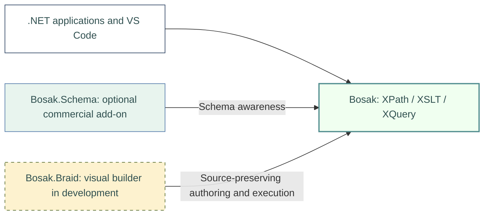

<div align="center">
  
  <br><br><h1>Bosak</h1>
  <p>Query XML. Transform documents. Build visual XSLT workflows.</p>
</div>

**K04-C27 resource/module audit (2026-10-28):** [All 13 remaining originals reviewed](docs/conformance/k04-context-resource-review/README.md) through actual resource/module machinery: normal direct execution gives 4 passes/9 skips; isolated context routing gives 11 passes/2 failures. The complete isolated set is **42/2/0**, so admission is unqualified. Both failures lose the library prefix `u`; independent controls expose declaring-context/type-identity and built-in-alias issues (**8 passed/4 failed**). Normal context sets remain **4/0/40** and **0/0/53**. Source, guards, fixtures, baselines and version remain unchanged. C26's 23,822 solution passes and gates **31,165/0/656**, **8,939/0/1,920** (230 sets) are inherited, not fresh full runs. Candidate 1.30.0 unpublished/public 1.26.3. Next: C28 constraint-scope/identity correction before any guard proposal; Bosak.Schema retains XSD 1.1 ownership.

**K04-C26 main context initialization (2026-10-28):** [Bounded main-module implementation](docs/conformance/k04-main-context/README.md) adds typed context values, external/default selection, singleton focus, global dependencies/cycles and host-focus restoration. All **52 new regressions**, **31 bounded original assertions**, 18 controls and five library controls pass. Fresh solution: **23,822 tests**. Normal admission is unchanged: context sets **4/0/40** and **0/0/53**, full gates **31,165/0/656** and **8,939/0/1,920**, 230 gated sets, identical skip mappings. Explicit-context sequence results are stabilized before focus restoration; queries without a declaration retain their prior result path. Candidate **1.30.0** unpublished/public **1.26.3**. Next: audit the 13 resource/module-bearing original boundaries before any guard or baseline proposal; Bosak.Schema owns staged XSD 1.1.

**K04-C25 duplicate context declaration corrected (2026-10-28):** [Narrow library parser fix](docs/conformance/k04-context-duplicate-fix/README.md) reports XQST0099 for duplicate context declarations while retaining XQST0113 for library initializers/defaults and the dynamic-loader wrapper. All 24 new public regressions and **23,770 solution tests** pass. All five library probes pass; the 80 C24 original/control results and 97 filter assessments are unchanged, so main-module declaration support remains open. Fresh gates stay **31,165/0/656**, **8,939/0/1,920**, with 230 gated sets and identical skip names/reasons. Candidate **1.29.3** unpublished/public **1.26.3**. No routing, fixture, baseline, schema or release change. Next: main-module context declaration implementation.

**K04-C24 context declarations reviewed (2026-10-28):** [Bounded XQuery diagnosis](docs/conformance/k04-context-declaration-review/README.md) inventories 97 originals and executes 31 resource-free QT3 cases: public XQuery gives 1 syntax-error pass/30 failures; the actual executor gives 1 pass/30 skips. Three baseline controls pass, while 15 declaration controls fail at parsing. Four of five library parser controls pass; duplicate declarations incorrectly report XQST0113 instead of XQST0099. Fresh normal sets remain **4/0/40** (QT3) and **0/0/53** (qt4). No guard/source/admission/baseline/version change. Next: narrow duplicate error correction before main-module implementation. C23's 23,746 solution passes and gates **31,165/0/656**, **8,939/0/1,920** (230 sets) are inherited, not fresh full-suite runs. Candidate 1.29.2 unpublished/public 1.26.3.

**K04-C23 normalization adopted (2026-10-28):** The owner-approved exact patch at ee19ebbf is applied. [Fresh actual normal receipts](docs/conformance/k04-normalization-admission/adoption/BASELINE-ADOPTION.md) verify QT3 **31,165/0/656** (only repaired positive `cbcl-fn-normalize-unicode-006` leaves skips), qt4 **8,939/0/1,920** and **230 gated sets** (normalization adds 44 passes and six existing dependency skips). Complete normalization sets are **43/0/5** and **44/0/6**; all skip mappings match approved rehearsal exactly, including retained conditional negatives. AGENTS requires the new QT3 baseline. Fresh full solution: **23,746 passing tests**, including 8,196 XSLT tests. Candidate 1.29.2 unpublished/public 1.26.3; no engine, filter, fixture, schema or release change. Earlier proposal notices are historical.

**K04-C23 normalization admission review (2026-10-28):** [Exact three-file proposal](docs/conformance/k04-normalization-admission/BASELINE-UPDATE-PROPOSAL.md) awaits owner approval; normal runners and AGENTS remain unchanged. Complete isolated gates pass QT3 **31,165/0/656** (only repaired positive `cbcl-fn-normalize-unicode-006` leaves skips) and qt4 **8,939/0/1,920**, promoting only the 44-pass normalization set with its six existing dependency exclusions (230 proposed gated sets). Every retained skip reason is identical; conditional negatives remain excluded. Normalization sets are **43/0/5** and **44/0/6**; no assertion is changed. C22's 23,746 solution passes are inherited source-identical evidence, not a fresh unit run. Candidate 1.29.2 unpublished/public 1.26.3; no engine, filter, fixture, schema or release change.

**K04-C22 normalization options (2026-10-28):** Candidate **1.29.2** applies XML-whitespace form-name normalization, adds NFC defaults for an explicit empty-sequence form in 4.0/Experimental and supplies `value`/`form` keyword metadata. XPath 3.1 retains its explicit-empty type error and keyword refusal; an empty-string form still disables normalization. All 246 new regressions and 62 review controls pass; original qt4 normalization is now **44/0/6**. Complete solution: **23,746 passing tests**. Frozen gates remain QT3 **31,164/0/657**, qt4 **8,895/0/1,914**, 229 gated sets, with identical skip names/reasons. No admission or release; public **1.26.3**. See [scope and receipts](docs/conformance/k04-normalization-options-fix/README.md).

**K04-C21 ? FULLY-NORMALIZED conversion (2026-10-28):** Candidate **1.29.1** implements conversion with a pinned Unicode 17 NFC backend and first-scalar composing-character classification. The 135 new regression rows pass; all ten solution projects are green in aggregate (**23,500 tests**, with the Standard project rerun after an assertion-rendering correction). Unicode corpus and scalar audits report zero mismatches. Frozen QT3 **31,164/0/657** and qt4 **8,895/0/1,914** retain every skip name/reason and 229 gated sets. Other normalization forms retain the platform backend; form-name whitespace, 4.0 empty-form defaults and keyword metadata remain open. No skip adoption or release; public version remains **1.26.3**. See [implementation and evidence](docs/conformance/k04-normalization-fix/README.md).

**K04-C20 normalization review ? 28 October 2026:** [Contract/capability diagnosis](docs/conformance/k04-normalization-review/README.md) finds a FULLY-NORMALIZED conversion/classifier defect and confirms that the Bengali fixture's leading space is required; QT3 currently mislabels it as an upstream defect. Conditional unsupported-form negatives remain excluded. Eight original probes yield 2 passes/6 diagnostic failures; 62 controls give 33 passes/29 failures. Fresh normal sets are **42/0/6** (QT3) and **41/3/6** (qt4), separating conversion from 4.0 empty-form/keyword gaps. Next: adopted scalar-aware conversion before admission or known-skip removal. No engine, filter, fixture/assertion, version or baseline change. Inherited source-identical validation: 23,365 solution passes, QT3 **31,164/0/657**, qt4 gate **8,895/0/1,914**; no fresh full-suite claim. Candidate 1.29.0 unpublished/public 1.26.3; Bosak.Schema owns staged XSD 1.1 and REQ-126 remains Complete.

**K04-C19 optional date-formatting calls ? 28 October 2026:** [Typed 4.0 arities/keywords and qualified promotion](docs/conformance/k04-date-optional-fix/README.md) implements arities 3/4 and keyword defaults for date/dateTime/time, preserving 3.1 arities 2/5 and refusal of 3/4. All 1,167 focused checks, eight originals and 96 review controls pass. Complete sets **135/0/3**, **79/0/15**, **94/0/4** qualify for promotion: qt4 now **229 sets, 8,895/0/1,914**, retaining all 1,892 previous skip reasons and adding only 22 existing exclusions from the promoted sets. QT3 stays **31,164/0/657**, with identical skip reasons. Twelve live catalog expectations now verify availability/arity while retaining 3.1 checks; historical REQ-126 records and all 48 unmet batch observations remain unchanged. All **23,365 solution tests** pass, including **8,196 XSLT tests**. Candidate **1.29.0** unpublished/public **1.26.3**; no frozen fixture/assertion, dependency filter, schema or release change. Bosak.Schema owns staged XSD 1.1; REQ-126 remains Complete. Next: retained FULLY-NORMALIZED contract review.

**K04-C18 empty date-formatting correction ? 28 October 2026:** [Shared helper and metadata fix](docs/conformance/k04-date-empty-fix/README.md) returns a true empty sequence for empty values in existing arities 2/5 across all profiles/shared XSLT mode. All 729 focused checks pass (348 new regressions plus 381 calendar checks); exactly 30 C17 empty-value failures become passes, leaving 21 call-surface failures and all eight original missing-arity failures open. Fresh exploratory scopes remain **208/6/18** and **92/2/4**, with every failure and skip reason unchanged. Complete normal gates stay **31,164/0/657** and **8,587/0/1,892**. All **22,927 solution tests** pass, including **8,196 XSLT tests**. Candidate **1.28.2** unpublished/public **1.26.3**; no catalog fixture/assertion, harness/admission, GatedSets or schema change. Next: separate 4.0 optional arities/keyword implementation. Bosak.Schema owns staged XSD 1.1; REQ-126 remains Complete. Earlier checkpoints are historical.

**K04-C17 optional date-arity review ? 28 October 2026:** [Pinned contract and diagnosis](docs/conformance/k04-date-arity-review/README.md) covers format-date, format-dateTime and format-time. Eight originals fail with missing arities 3/4; 96 controls give 45 passes/51 failures, separating 30 existing empty-value failures from 21 missing 4.0 call-surface outcomes. Fresh normal exploratory scopes remain **208/6/18** (date/dateTime) and **92/2/4** (time); all eight failures are retained. Next: correct shared empty-result semantics before separate 4.0 registrations/keywords. No engine, admission, version or GatedSets change. Inherited source-identical validation: 22,579 solution passes, QT3 **31,164/0/657**, qt4 gate **8,587/0/1,892**; no fresh full-suite claim. Candidate 1.28.1 unpublished/public 1.26.3; Bosak.Schema owns staged XSD 1.1 and REQ-126 remains Complete.

**K04-C16 adopted ? 27 October 2026:** Owner approved the exact proposal at 6df9a58b. [Fresh normal adoption receipt](docs/conformance/k04-calendar-admission/adoption/BASELINE-ADOPTION.md) records QT3 **31,164/0/657**, with only the two original CB skips removed and all 657 retained reasons identical. The qt4 gate stays **8,587/0/1,892**; combined exploratory date/dateTime is **208/6/18**, preserving all six failures and 18 other skips, with no promotion. All four originals, 364 production filter controls and 40 projected controls match approval. AGENTS now requires **31,164/0/657**. All **22,579 solution tests** pass, including **8,196 XSLT tests**. Engine, fixtures/assertions, 226 GatedSets, schema and version remain unchanged. Candidate 1.28.1 unpublished/public 1.26.3; Bosak.Schema owns staged XSD 1.1 and REQ-126 remains Complete. Next: missing date-formatting arities 3/4 contract review. Earlier pending-proposal notices are historical.

**K04-C16 CB admission proposal ? 27 October 2026:** [Exact three-file proposal](docs/conformance/k04-calendar-admission/BASELINE-UPDATE-PROPOSAL.md) is ready for owner disposition. The complete isolated QT3 rehearsal passes **31,164/0/657**, removing only the two original CB skips with 657 retained reasons identical. The qt4 gate stays **8,587/0/1,892**; combined exploratory date/dateTime improves **206/6/20 ? 208/6/18**, retaining all six failures and 18 other skips, with no promotion. All four originals and 364 filter controls verify the bounded rule; all 25 diagnostic/rehearsal processes complete without timeout. Normal filters and AGENTS remain **31,162/0/659** pending explicit approval. K04-C15 source-identical 22,579 solution passes are inherited, not a fresh unit run. Candidate 1.28.1 unpublished/public 1.26.3; no engine, fixture/assertion, GatedSets, schema or release change. Bosak.Schema owns staged XSD 1.1; REQ-126 remains Complete. Earlier checkpoints are historical.

**K04-C15 calendar fallback correction ? 27 October 2026:** [Bounded implementation](docs/conformance/k04-calendar-fix/README.md) separates listed unsupported calendars from invalid names, adds one AD fallback indication per output and retains shared XSLT policy. All 381 final regressions and 58 original/control diagnostics pass, including four original CB assertions. The pre-existing empty-value XPTY0004 defect remains separately documented. Normal gates remain **31,162/0/659** and **8,587/0/1,892**, with identical skip names/reasons. All **22,579 solution tests** pass, including **8,196 XSLT tests**. Candidate **1.28.1** unpublished/public **1.26.3**; no admission, fixture/assertion, GatedSets or schema change. Next: bounded CB capability admission review before any exact-baseline proposal. Bosak.Schema owns staged XSD 1.1; REQ-126 remains Complete. Earlier checkpoints remain historical.

**K04-C14 calendar review ? 27 October 2026:** [Contract and correction scope](docs/conformance/k04-calendar-review/README.md) separates listed unsupported calendars from invalid names. Four unchanged originals and 54 controls produce 30 passes/28 failures without timeouts: CB/AH fallback errors and missing namespaced fallback indications remain open. Next: pin affected 4.0 semantics, adopt and implement bounded fallback with one indication per output, preserving invalid-name and shared XSLT behavior. No engine/admission/baseline/version change. Inherited validation: 22,198 solution passes, QT3 **31,162/0/659**, qt4 **8,587/0/1,892**; no fresh complete gate claim. Candidate 1.28.0 unpublished/public 1.26.3; Bosak.Schema owns staged XSD 1.1 and REQ-126 remains Complete.

**K04-C13 negative capability review ? 27 October 2026:** [Bounded review](docs/conformance/k04-negative-capability-review/README.md) inventories all 78,806 catalog cases and 75 effective negative declarations. Twelve original diagnostics yield four language fallback passes, four calendar FOFD1340 failures and four normalization failures (expected FOCH0003 but succeeded). All production admission decisions remain unchanged. Next: pin and review unsupported-calendar fallback semantics before correction; language admission and FULLY-NORMALIZED remain separate findings. Inherited source-identical validation: 22,198 solution passes, QT3 **31,162/0/659**, qt4 **8,587/0/1,892**; no fresh complete gate claim. Candidate 1.28.0 unpublished/public 1.26.3; Bosak.Schema retains XSD 1.1 ownership and REQ-126 remains Complete.

**K04-C12 adopted - 27 October 2026:** Owner approved the exact proposal at e924a708. [Normal adoption receipt](docs/conformance/k04-sequence-admission/adoption/BASELINE-ADOPTION.md) records fresh gates **31,162/0/659** and **8,587/0/1,892**;only format-integer-042 leaves each skip set,with all retained659/1,892 names/reasons identical. All22,198solution tests pass. Both originals pass normally and288production filter controls match the approved prototype. AGENTS.md now requires31,162/0/659. Engine,fixtures/assertions,schema,version and226GatedSets are unchanged. Candidate1.28.0 unpublished/public1.26.3;Bosak.Schema owns staged XSD1.1;REQ-126 remains Complete. Earlier pending-proposal notices are historical checkpoints.

**K04-C12 unsupported-sequence proposal - 27 October 2026:** [Exact baseline review](docs/conformance/k04-sequence-admission/BASELINE-UPDATE-PROPOSAL.md) verifies original format-integer-042 assertions in both profiles. Actual formatter mechanism and16expression controls prove decimal fallback for unsupported U+FBF4;288filter controls preserve other policy. Complete isolated rehearsals pass **31,162/0/659** and **8,587/0/1,892**,with only042removed and all retained skip reasons identical. Normal source and AGENTS stay **31,161/0/660** / **8,586/0/1,893** pending explicit owner approval of the exact three-file patch. Source-identical22,198solution passes are inherited,not a fresh unit run. Candidate1.28.0 unpublished/public1.26.3;no engine,fixture/assertion,schema or GatedSets change. Bosak.Schema owns staged XSD1.1;REQ-126 remains Complete. Earlier K04 notices are historical checkpoints.

**K04-C11 parse-integer implementation - 27 October 2026:** [Bounded parser and promotion](docs/conformance/k04-parse-integer-fix/README.md) adds4.0-only arities1/2,typed optional/default arguments,keywords and exact Int64 parsing/errors. All47 parse originals,the formatter round trip and46 profile controls pass;new87 regression rows and all22,198 solution tests pass. Fresh complete sets47/0/0 and101/0/1 qualify for promotion:qt4 now **226sets,8,586/0/1,893**. All1,892 prior qt4 skips remain;only the existing format-integer-042 skip is newly covered. QT3 stays **31,161/0/660**,with identical reasons. Candidate **1.28.0** unpublished/public1.26.3. No fixture/assertion,filter,schema or QT3 baseline change. Bosak.Schema owns staged XSD1.1;REQ-126 remains Complete. Next:review the negative numbering-sequence dependency on format-integer-042 before any exact-baseline proposal. Earlier K04 notices are historical checkpoints.

**K04-C10 parse-integer review - 27 October 2026:** [Parser-function contract review](docs/conformance/k04-parse-integer-review/README.md) reproduces47 original parse failures plus the formatter round trip,all caused by missing registration. The frozen catalog requires4.0-only arities1/2,typed optional arguments/default10,keywords and distinct FORG0011/FORG0012/FOCA0003 handling. Seven originals allow implementation-size errors;an explicit Int64 result bound is feasible. Accepted46 controls isolate profiles,defaults,typing,lexical/range behavior and keyword metadata;one corrected3.1 keyword expectation is preserved. No source/admission/version change. Inherited22,111 solution passes and gates **31,161/0/660** / **8,438/0/1,892** are not fresh full-suite claims. Candidate1.27.0 unpublished/public1.26.3;Bosak.Schema owns staged XSD1.1;REQ-126 remains Complete. Next: explicit semantic adoption and bounded parse-integer implementation. Earlier K04 notices are historical checkpoints.

**K04-C09 radix formatter - 27 October 2026:** [Bounded radix implementation](docs/conformance/k04-radix-fix/README.md) fixes14 formatter-only originals and preserves the two caret-grouping cases. The exploratory set improves to **100/1/1**;case012 now exposes missing parse-integer#2 and stays failed/ungated. New68 regression rows pass (53failed before);all22,111 solution tests pass. Frozen gates/skips remain **31,161/0/660** and **8,438/0/1,892**. The4.0-only path preserves3.1 behavior and existing public Int64 input bounds. Explicit pre-implementation adoption uses the frozen qt4cg revision;candidate **1.27.0** unpublished/public1.26.3. No harness,fixture/assertion,GatedSets,schema or QT3 baseline change. Bosak.Schema owns staged XSD1.1;REQ-126 remains Complete. Next: separate parse-integer contract review. Earlier K04 notices are historical checkpoints.

**K04-C08 radix review - 27 October 2026:** [Radix contract review](docs/conformance/k04-radix-review/README.md) reproduces17 original radix cases (two existing passes/15 failures),34 profile controls and the normal102-case exploratory result **86/15/1**. The failures separate into14 formatter-only cases and one round trip that also needs the unavailable parse-integer#2. The exact frozen qt4cg specification revision is pinned for review; no semantic adoption or source change. Caret-grouping compatibility, original-value ordinal suffixes and the existing Int64 input boundary are explicit. Next: adopt and implement a4.0-only radix formatter;keep parse-integer/case012 separate. Source-identical22,043 solution passes and gates **31,161/0/660** / **8,438/0/1,892** are inherited,not fresh full-suite claims. Candidate1.26.12 unpublished/public1.26.3; Bosak.Schema owns staged XSD1.1; REQ-126 remains Complete. Earlier K04 notices are historical checkpoints.

**K04-C07 bounded CLDR admission - 27 October 2026:** [CLDR admission](docs/conformance/k04-cldr-admission/README.md) enables the four repaired original qt4 cases through normal admission. The full102-case exploratory set improves from82/15/5 to **86/15/1**; all15 failure names/messages and the remaining dependency skip are retained. The set stays ungated. All242 before/after filter controls and six normal original checks pass. Fresh22,043 solution tests pass; exact gates/skips remain **31,161/0/660** and **8,438/0/1,892**. No engine/version, fixture/assertion, GatedSets, schema or QT3 baseline change. Candidate1.26.12 unpublished/public1.26.3; Bosak.Schema owns staged XSD1.1; REQ-126 remains Complete. Next: immutable-spec review of the15 remaining XPath4 radix-picture errors. Earlier K04 notices are historical checkpoints.

**K04-C06 formatter correction - 27 October 2026:** [Bounded integer-variation fix](docs/conformance/k04-cldr-fix/README.md) accepts cardinal variations and preserves known German named ordinal endings using pinned F&O/CLDR semantics. All six original assertions and22 diagnostic controls pass. The new36 regression rows pass in both compatibility paths (21failed before). Fresh solution validation passes **22,043 tests**; gates remain **31,161/0/660** and **8,438/0/1,892**, with every skip name/reason unchanged. Candidate **1.26.12** remains unpublished/public1.26.3. No qt4 CLDR admission, fixture/assertion, GatedSets, schema or QT3 baseline change. Bosak.Schema owns staged XSD1.1; REQ-126 remains Complete. Next: separate bounded qt4 CLDR admission review. Earlier K04 notices are historical checkpoints.

**K04-C05 CLDR review - 27 October 2026:** [CLDR diagnosis](docs/conformance/k04-cldr-review/README.md) preserves the original two QT3 passes, two qt4 direct passes and two qt4 FODF1310 failures. Normal qt4 still dependency-skips all four cases. Focused controls isolate rejected named-cardinal modifiers and lost German named-ordinal endings; initial control-expectation mistakes are preserved separately. No source/admission/baseline change. Inherited source-identical results:22,007 solution passes, QT3 **31,161/0/660**, qt4 gated **8,438/0/1,892**; no fresh full-suite claim. Next: pin immutable specification/CLDR semantics and implement a bounded formatter correction before reviewing admission. Candidate1.26.11 unpublished/public1.26.3; Bosak.Schema owns staged XSD1.1; REQ-126 remains Complete. Earlier K04 notices are historical checkpoints.

**K04-C04 bounded collation admission - 27 October 2026:** [Collation review](docs/conformance/k04-collation-admission/README.md) admits existing non-codepoint collation routes in qt4. The original compare-010 assertion passes; the normal qt4 gate improves to **8,438/0/1,892**, with only that gated skip removed and all retained reasons unchanged. Four exploratory original assertions also pass; eight XQuery-only cases remain dependency-skipped, with their direct diagnostic failures preserved. Seven expression controls and248 before/after filter controls pass. Fresh solution validation passes **22,007 tests**. Normal QT3 remains **31,161/0/660**. No engine, fixture/assertion, GatedSets, schema or QT3 baseline change. Candidate1.26.11 unpublished/public1.26.3; Bosak.Schema retains XSD1.1 ownership; REQ-126 remains Complete. Next: bounded review of four qt4 CLDR format-integer declarations. Earlier K04 notices are historical checkpoints.

**K04-C03 explicit feature admission - 27 October 2026:** [Capability inventory](docs/conformance/k04-feature-inventory/README.md) records all 78,806 catalog cases and 55 feature/profile rows. Both filters now reject unrecognized feature names for either polarity and preserve explicit legacy admissions (19 QT3/17 qt4), without certifying full support. All 222 before/after controls pass; current feature decisions and all skip names/reasons remain unchanged. Fresh solution validation passes **22,007 tests**. Fresh gates remain **31,161/0/660** and **8,437/0/1,893**. Bosak.Schema retains staged XSD 1.1 ownership. Candidate1.26.11 unpublished/public1.26.3; REQ-126 remains Complete. Next: original-assertion review of the single gated qt4 non-codepoint-collation skip. Earlier K04 notices are historical checkpoints.

**K04-C02 bounded polarity correction - 27 October 2026:** [Profile review](docs/conformance/k04-profile-review/README.md) makes negative spec/default-language predicates invert their existing positive predicates in both harnesses, with 74 before/after controls. An inventory of 31,821 QT3 and all 46,985 qt4 cases finds no current negative declaration of either kind. Fresh solution validation passes **22,007 tests**. Fresh gates remain **31,161/0/660** and **8,437/0/1,893**, retaining every skip name/reason. Schema comments now distinguish frozen admission from Bosak.Schema's staged XSD 1.1 implementation; admission is unchanged. F03 broader capabilities and F04 integration remain open. Candidate1.26.11 unpublished/public1.26.3; REQ-126 remains Complete. Next: explicit feature/capability inventory, beginning with unknown-positive fallback. Earlier K04 notices are historical checkpoints.

**K04-C01 adopted ? 27 October 2026:** Owner approved the exact 16-case quote-routing change proposed at `d0ca0741`. The complete normal QT3 gate passes **31,161/0/660**; exactly the 16 approved cases leave the skip set and all 660 retained names/reasons are unchanged. The qt4 gated run passes **8,437/0/1,893**, with 11 Experimental passes. Fresh solution validation passes **22,007 tests** across all 10 projects. All broader routing/schema/dependency guards remain unchanged. Candidate 1.26.11 remains unpublished; public version is 1.26.3. Bosak.Schema retains XSD 1.1 ownership; REQ-126 remains Complete. Next: the remaining K04 dependency-profile/polarity review. See [adoption receipt](docs/conformance/k04-quote-routing/adoption/BASELINE-ADOPTION.md) for approval and fresh validation. Earlier proposal notices are historical.

**K04-C01 quote-routing proposal — 27 October 2026:** [Exact adoption review](docs/conformance/k04-quote-routing/BASELINE-UPDATE-PROPOSAL.md) verifies all16 original candidate assertions in an isolated corrected harness. Full rehearsal passes31,161/0/660, with exactly those16 skips removed and all660 retained names/reasons unchanged. Eleven boundary cases and13 lexical controls preserve broader guards. Normal source/baseline stays31,145/0/676 pending owner approval; no tracked engine/harness/filter change. Candidate1.26.11 unpublished/public1.26.3;22,007 solution passes and qt4 8,437/0/1,893 are inherited unchanged-engine evidence. Bosak.Schema XSD1.1 ownership and REQ-126 Complete are unchanged.


**K04 applicability audit — 27 October 2026:** [Current dependency/routing review](docs/conformance/k04-dependency-audit/README.md) reproduces all619 QT3 and1,893 gatedqt4 dependency skips through actual filters. Of619 QT3 cases,246 satisfy XQuery dependencies but fail syntax routing;16 are triple-quote candidates. Thirty-two bounded execution probes yield six public-XQuery assertion passes and ten retained failures;62 synthetic predicate assessments expose profile/polarity questions. No engine, filter or baseline change. Next K04-C01: quote-aware routing with complete candidate and rehearsal evidence before any QT3 admission proposal. Candidate1.26.11 unpublished/public1.26.3; inherited22,007 solution passes and gates31,145/0/676 and8,437/0/1,893. Bosak.Schema owns XSD1.1; REQ-126 remains Complete.


**K03 name-storage integration — 27 October 2026:** [Bounded core completion](docs/conformance/k03-name-storage/README.md) preserves Unicode map/provider names, literal values and namespace/copy metadata. All47 new regressions and22,007 solution tests pass. The original map-to-element-053 assertion now passes; qt4 improves to8,437/0/1,893 with exactly that skip removed and all1,893 retained reasons unchanged. QT3 remains31,145/0/676 with identical676 skips. No fixture, assertion, harness filter or gated-set change. Candidate1.26.11 unpublished/public1.26.3. Parser-edition/current-draft limits remain explicit; Bosak.Schema retains XSD1.1 ownership and REQ-126 remains Complete. Next: K04 dependency/routing applicability audit. Earlier open Unicode findings are historical checkpoints.


**K03-C02 serialization — 27 October 2026:** [Content-preserving name decoding](docs/conformance/k03-serialization/README.md) restores encoded element/attribute name tokens while preserving existing literal node content, namespace URIs and declarations. All40 focused regressions and21,960 solution tests pass; QT3 remains31,145/0/676 with identical676 skips, and qt4 remains8,436/0/1,894. The original supplementary-name skip remains. Candidate1.26.10 unpublished/public1.26.3. Next: reversible name-storage integration with loader/accessor/copy round-trip verification; no public API, baseline or XSD1.1 ownership change. REQ-126 remains Complete.


**K03-C01 XML-name validation — 27 October 2026:** [Scalar validation correction](docs/conformance/k03-name-validation/README.md) replaces category/surrogate-pair approximation with explicit XML name ranges and rejects malformed UTF-16. All78 focused tests pass (baseline18 failures), all21,920 solution tests pass, and gates stay QT3 31,145/0/676 and qt4 8,436/0/1,894. All676 QT3 skip names/reasons are unchanged. Original supplementary construction and literal-content serialization findings remain open; next is K03-C02 serialization preservation before provider storage integration. Candidate1.26.9 unpublished/public1.26.3; no baseline or XSD1.1 capability change. REQ-126 remains Complete.


**K03 Unicode-name trace — 27 October 2026:** [Bounded investigation](docs/conformance/k03-unicode-names/README.md) reproduces map-to-element-053 and separates three open corrections: scalar NCName validation, reversible provider name storage, and serialization that preserves literal sentinel text. All 30 isolated diagnostics complete without timeouts; no engine or baseline change. Next: K03-C01 name-validation regressions/correction, followed by serialization preservation before map storage integration. QT3 remains31,145/0/676 and qt4 remains8,436/0/1,894; solution21,842 and gates are inherited unchanged-source evidence. Candidate1.26.8 unpublished/public1.26.3; REQ-126 remains Complete. Bosak.Schema XSD1.1 ownership is unchanged.


**K02 adopted — 27 October 2026:** [Owner-approved normal-runner adoption](docs/conformance/k02-admission-review/BASELINE-ADOPTION.md) is complete. The fresh normal QT3 gate passes **31,145/0/676**; only validateexpr-28 leaves the skip set through its original XQST0012 error alternative, and all 676 retained names/reasons match. AGENTS now requires this exact baseline. The normal runner selects the existing guard; standalone TestExecutor defaults and all profile/structural exclusions remain unchanged. Engine/candidate1.26.8 unchanged and unpublished; public1.26.3. Solution21,842 and qt4 8,436/0/1,894 are inherited source-identical validation. Bosak.Schema owns XSD1.1. REQ-126 remains Complete; earlier pending/default-off notices are historical checkpoints.


**K02 admission review — 27 October 2026:** [Guarded-runner proposal](docs/conformance/k02-admission-review/BASELINE-UPDATE-PROPOSAL.md) is ready for owner approval. Two full actual-runner rehearsals verify current 31,144/0/677 and guarded 31,145/0/676, with only validateexpr-28 leaving the skip set through its existing XQST0012 alternative; all 676 retained names/reasons match. Normal runner, AGENTS policy and baseline remain unchanged pending approval. Candidate 1.26.8 is unpublished/public 1.26.3. Unit21,842 and qt4 8,436/0/1,894 receipts are inherited from unchanged source; no new XSD1.1 capability. Bosak.Schema REQ-009 owns that track; REQ-126 remains Complete.


**K02-C02 relative schema imports — 27 October 2026:** [File-backed source URI correction](docs/conformance/k02-relative-schema-uri/README.md) fixes the four remaining guarded regressions. All 324 eligible original cases now pass in guarded diagnostics; 17 declined-boundary cases remain unchanged. All 21,842 solution tests and both required gates pass: QT3 31,144/0/677 (all 677 skip names/reasons unchanged), qt4 8,436/0/1,894. Guarded loading stays default-off; admission/baseline review is separate. Candidate 1.26.8 is unpublished/public 1.26.3. Bosak.Schema REQ-009 owns XSD 1.1; this slice adds no public API or backend. REQ-126 remains Complete. Earlier failure counts are historical evidence.


**K02-C01 constructor registration — 27 October 2026:** [First-evaluation correction](docs/conformance/k02-constructor-registration/README.md) fixes all 68 constructor regressions in the wider audit. All 11 focused tests and 21,836 solution tests pass; QT3 remains 31,144/0/677 and the qt4 gate 8,436/0/1,894. The 324-case paired sweep leaves four relative-import failures for K02-C02, with no new failures; 17 declined boundaries are unchanged. Guarded loading stays default-off. Candidate 1.26.7 is unpublished/public 1.26.3. Bosak.Schema REQ-009 owns XSD 1.1; no new public schema seam or capability is introduced. REQ-126 remains Complete. Earlier audit counts are historical evidence.


**K02 wider audit — 27 October 2026:** [Schema/import inventory](docs/conformance/k02-schema-inventory/README.md) blocks normal adoption: 324 eligible original cases yield 251 retained passes, 72 regressions and one environment-exception-to-pass transition. All 1,584 metadata/paired/boundary processes complete without timeouts. Two corrections remain open: schema constructor registration after import (68 observed regressions), then relative schema-import base URI (four). Guarded loading stays default-off; no source, skip, baseline or version change. Next: K02-C01 constructor registration. Candidate 1.26.6 unpublished/public 1.26.3; REQ-126 remains Complete. Earlier narrow-sample results remain historical evidence.


**K02 guarded loader diagnostics — 27 October 2026:** [Implemented guarded mode](docs/conformance/k02-schema-loader/README.md) delegates eligible schemas to actual query imports only when explicitly enabled for diagnostics; normal eager loading stays the default. All 66 actual-harness diagnostic runs match independent expectations, including wrong-assertion failures and preserved source/profile boundaries. All 21,825 solution tests and both normal gates pass at 31,144/0/677 and 8,436/0/1,894; all 677 QT3 skips/reasons are unchanged. Candidate 1.26.6 is unpublished. K02 profile/capability and wider applicability work remain open; no admission or baseline change. Earlier checkpoints are historical.


**K02 bounded diagnostic correction — 27 October 2026:** [Duration-schema investigation](docs/conformance/k02-schema-duration/README.md) reproduces the unavailable schema duration types and corrects the public aggregated schema-import error to XQST0012. All 9 regressions pass (baseline 4 failed/5 passed). The original public query reaches its declared error alternative, but the QT3 environment still fails before query execution; validateexpr-28 remains skipped. No XSD 1.1 capability, skip, fixture or baseline change. Candidate 1.26.5 is unpublished; public 1.26.3 and REQ-126 acceptance are unchanged. Earlier checkpoints are historical.


**K01 complete; approved QT3 baseline — 27 October 2026:** [Exact two-case adoption](docs/conformance/k01-schema-list/BASELINE-ADOPTION.md) removes only CastAs-ListType-20 and -28 from known skips. The fresh full QT3 gate passes **31,144/0/677**; qt4 remains 8,436/0/1,894. The owner approval and original receipts are preserved; no fixture/assertion/filter change. Source candidate 1.26.4 remains unpublished and REQ-126 remains Complete. Earlier totals and pending-approval notices are historical.


**K01 schema-list correction — 27 October 2026:** [Correction and evidence](docs/conformance/k01-schema-list/README.md) fixes legacy typed bindings reporting XPTY0004 instead of XPST0051 for invalid list item types. All 18 regressions pass (baseline 6 failed/12 passed); direct original QT3 cases CastAs-ListType-20 and -28 now both pass. Both skips and frozen totals stay unchanged pending a separate baseline-policy approval. Source candidate 1.26.4 is unpublished; public 1.26.3 and REQ-126 bounded acceptance are unchanged. Earlier checkpoints are historical.


**REQ-126 complete for the accepted bounded catalog — 26 October 2026:** [Owner acceptance](docs/xpath40-catalog/CATALOG-ACCEPTANCE.md) closes C13 and all 13 workpackages; zero remain open. AC-01 through AC-04 are explicitly accepted for 76 entries/235 bounded contract groups; AC-05 maintained. All 38 catalog dispositions are accepted while all 48 unmet batch observations and original technical exit criteria remain unchanged. No full current-draft compliance, engine fix, gate change or release follows. Earlier open-state notices are historical.


**REQ-126 C13 review prepared — 26 October 2026:** [Final closure review](docs/xpath40-catalog/FINAL-CLOSURE-REVIEW.md) consolidates 76 entries, 235 bounded contract groups and 38 proposed disposition records. All 3,172 fresh documentation tests pass. Six Known Uses sections now state their evidence/gate boundary directly. The [acceptance proposal](docs/xpath40-catalog/C13-ACCEPTANCE-PROPOSAL.md) would close the documentation catalog with explicit limits and open technical follow-ups; it is not approved. All 48 unmet batch observations remain unmet. C13 remains open, AC-01 through AC-04 unchecked and REQ-126 In Progress; no engine, fixture, gate, version or release change. Earlier checkpoints are historical.


**REQ-126 C12 complete — 26 October 2026:** [Final semantic/evidence batch](docs/xpath40-catalog/SEMANTIC-REVIEW-BATCH-4.md) reviews 19 entries/57 contract groups with 369 exact catalog cases and six dedicated walkthroughs. All 5,595 fresh tests pass; independent diagnostics retain 167 matching and eight unmet controls. Choice coercion and switch comparison remain explicit blockers. All 76 entries now have C09-C12 bounded reviews. One workpackage remains: C13 blocker disposition and owner acceptance. REQ-126 stays In Progress; no engine, fixture, profile, gate or release change. Earlier checkpoints are historical.


**REQ-126 C11 complete — 26 October 2026:** [Third semantic/evidence batch](docs/xpath40-catalog/SEMANTIC-REVIEW-BATCH-3.md) reviews 19 entries/56 contract groups and 874 exact linked cases. All 3,756 fresh tests pass; all 26 sample blocks have verification paths, including seven independently executed inline queries. Of 99 supplemental observations, 77 controls match, 20 retain known requirements and two record URI type behavior. Destructuring, spelling, focus and epoch-profile caveats remain explicit. Two workpackages remain; C12 is next. No final acceptance, engine, fixture, profile, gate or release change; earlier checkpoints are historical.

**REQ-126 C10 complete — 26 October 2026:** [Second semantic/evidence batch](docs/xpath40-catalog/SEMANTIC-REVIEW-BATCH-2.md) reviews 19 entries/55 contract groups with 892 exact linked cases and 82 sample blocks. All 3,469 fresh tests pass. Supplemental observations retain 60 matching controls, 10 known draft mismatches, two disputed highest-example controls and two URI observations. The source/example reading issue stays separate from an engine-defect diagnosis. Three packages remain; C11 is next. No final acceptance, engine, fixture, profile, gate or release change; earlier checkpoints are historical.

**REQ-126 C09 complete — 26 October 2026:** [First semantic/evidence batch](docs/xpath40-catalog/SEMANTIC-REVIEW-BATCH-1.md) reviews 19 entries/67 contract groups and 536 distinct linked cases. All 3,447 fresh existing tests pass; 116 sample +8 walkthrough blocks have explicit verification paths. Of 54 independent profile controls, 46 match and eight retain known model/extrema/partial-apply boundaries. Scan sample queries are separated and executed verbatim. Four closure workpackages remain; C10 is next. No final acceptance, engine, fixture, profile, gate or release change; earlier checkpoints are historical.

**REQ-126 C08 complete — 26 October 2026:** [Historical adoption research](docs/xpath40-catalog/ADOPTION-HISTORY-RESEARCH.md) checks all 28 original records through 16 delivery trees, 16 retained PR heads, 58 matching historical commits and 16 PR records. No exact adoption pin was recovered. The owner explicitly approved 26 legacy provenance exceptions and two non-adoption dispositions, retaining all original nulls. C08 is complete; five packages remain open, with C09 next. Earlier receipts, defects and semantic acceptance remain open. No engine, profile, gate or release change; earlier checkpoints are historical.

**REQ-126 C07 complete — 26 October 2026:** [Lifecycle/disposition review](docs/xpath40-catalog/LIFECYCLE-RECONCILIATION.md) reconciles all 76 classifications and 19 original/wider decision groups. All 3,519 fresh existing tests and 113 profile controls pass. Current compound-pattern wording, method-call boundaries and a malformed delivery link are corrected with original receipts retained. Six closure workpackages remain; C08 historical adoption evidence is next. All 28 missing adoption pins, earlier defects and semantic acceptance remain open. No feature/profile/gate promotion or release; skips, Braid and extension work stay deferred. Earlier checkpoints are historical.

**REQ-126 C06 complete — 26 October 2026:** [Host/profile review](docs/xpath40-catalog/HOST-PROFILE-RECONCILIATION.md) reconciles the final three grammar rows; all 18 now have bounded reviews, not semantic acceptance. All 376 focused tests and 3,148 catalog examples pass. Of 154 probe observations, 133 controls match, two retain a switch comparison mismatch, and 19 record context boundaries. Seven closure workpackages remain; C07 is next. Static-mode and loader/adoption limits remain explicit. No engine, profile, gate or release change; skips, Braid and extension work stay deferred. Earlier checkpoints are historical.

**REQ-126 C05 complete — 26 October 2026:** [Type/collection/pattern review](docs/xpath40-catalog/TYPE-COLLECTION-PATTERN-RECONCILIATION.md) reconciles nine type/collection/pattern rows and 49 selected production names. All 2,457 focused tests pass. Of 275 independent controls, 259 match; 16 retain choice-coercion, record-destructuring and known generic-model gaps. Delivered union/EQName fixes remain closed. Eight closure workpackages remain; C06 is next. No engine or executable example changes, acceptance waiver, profile/gate promotion or release. Skips, Braid and extension work stay deferred; earlier checkpoints are historical.

**REQ-126 C04 complete — 26 October 2026:** [Expression/call/focus review](docs/xpath40-catalog/EXPRESSION-CALL-FOCUS-RECONCILIATION.md) reconciles six expression/call/focus rows and 33 selected production/token names. All 880 focused tests pass; 209 controls match, ten retain current-draft spelling/placeholder/mapping-focus gaps, and eight late-binding observations remain separate. Nine closure workpackages remain; C05 is next. No engine or executable example changes, gate/profile promotion, acceptance waiver or release. C02's atomic-annotation defect remains open. Skips, Braid and extension work stay deferred; earlier checkpoint counts are historical.

**REQ-126 C03 complete — 26 October 2026:** [Constructor/type review](docs/xpath40-catalog/CONSTRUCTOR-TYPE-RECONCILIATION.md) reconciles eight entries and all 49 focus constructors. All 1,333 asserted controls match across 1,357 observations; 245 focused schema/API/host tests pass. Bounded nominal defaults/static fields are now evidenced. Generic wide casts, decimal precision, schema/host context and broader conversion remain explicit boundaries; C02's atomic-annotation defect remains open. Ten closure workpackages remain; C04 is next. No engine/test/example/version/gate change or acceptance waiver; skips/Braid/extension work stays deferred. Earlier checkpoint counts are historical.

**REQ-126 C02 complete — 26 October 2026:** [Function/options reconciliation](docs/xpath40-catalog/FUNCTION-OPTIONS-RECONCILIATION.md) reconciles 30 entries/74 function surfaces with explicit supported boundaries and 14 follow-up groups. Release build and all 21,798 solution tests pass; all 3,148 catalog examples pass separately. The 195 added profile observations include 118 matching controls, two unmet controls for the new `atomic-type-annotation(())` defect, and 75 diagnostics. Eleven closure workpackages remain; C03 is next. C02 closes review scope, not AC-01–04 or the retained defects. Skip fixes, Braid and extension work remain deferred. Original receipts and frozen gates are preserved; no engine/version/release change.

**REQ-126 C01 complete — 26 October 2026:** [Current inventory and ownership record](docs/xpath40-catalog/FUNCTION-INVENTORY-REFRESH.md) refreshes 316 names against published 1.26.3 and pinned current draft b4723ff5: 119 registered 4.0-only names (70 non-constructors, 49 focus constructors), plus 197 existing names. The retained inventory missed `array:members` and `array:of-members`. All 1,581 profile lookup observations completed without probe errors; four changed declarations and remaining semantic/default/empty/error reviews have explicit C02/C03/C06 owners. Twelve closure workpackages remain open; REQ-126 and AC-01–04 remain partial. Finish these packages before skip fixes, Braid or VS Code extension work. Engine, APIs, tests, version and frozen gates are unchanged; existing passing source/gate evidence is inherited. Earlier counts and checkpoint notices are historical.

Bosak 1.26.3 is available on NuGet, including abs, floor and ceiling integer-preservation corrections. Visual/source editors can wrap supported output elements in a condition, edit the condition and unwrap them with exact source and graph provenance. [Verified release](docs/RELEASE-1.26.3-PUBLICATION.md) and [authoring API](docs/REQ-138-IMPLEMENTATION.md).

REQ-126 now has a [13-workpackage closure plan](docs/xpath40-catalog/CLOSURE-PLAN.md) and a separate [conformance skip triage](docs/xpath40-catalog/CONFORMANCE-SKIP-TRIAGE.md). The catalog remains in progress; frozen conformance policy and public installation are unchanged.


---

<details>
<summary>About FYTALA: the people and purpose behind Bosak</summary>

## About FYTALA

**FYTALA — Feeling Young, Thriving, Active, Learning Always** — is a personal initiative founded after retirement, driven by the belief that curiosity, enthusiasm, and learning have no age limit.

It is about staying engaged, exploring new ideas, and sharing the excitement of technology and innovation with others. A special ambition of FYTALA is to spark that enthusiasm in young people and encourage them to discover how fascinating technology can be—not just by talking about technology, but by making it visible, tangible, surprising, and fun.

My dream captures that ambition perfectly: **to walk into a classroom one day, side by side with a humanoid robot, and make my enthusiasm for technology and innovation contagious.**

If that experience inspires even a few young minds to start asking questions, experimenting, building, programming, or imagining what might be possible, FYTALA has achieved something worthwhile.

Technology, after all, is not just about machines, electronics, or software. It is about curiosity, creativity, and turning ideas into reality. FYTALA therefore takes a deliberately broad perspective, embracing software, electronics, engineering, science, artificial intelligence, robotics, and whatever comes next.

> Experimenting matters.
>
> Making mistakes matters.
>
> Understanding *why* something works matters even more.

Every project is an opportunity to learn something new and, hopefully, to help someone else learn as well.

The cable-stayed bridge in the FYTALA logo represents that philosophy. A bridge connects places, but it can also connect people, ideas, generations, and fields of knowledge. Its strength comes from many individual elements working together—much like technology itself.

FYTALA wants to help build those bridges: between experience and youthful curiosity, theory and practice, and imagination and real-world creation. It encourages looking beyond the obvious, asking questions, taking things apart, and building them again in new ways.

Above all, FYTALA is about keeping the desire to discover alive—and passing that desire on to the next generation.

> Because we never have to stop being curious.
>
> We never have to stop creating.
>
> And we are never too old—or too young—to learn something new.

</details>

---

**Bosak brings XPath 3.1, XSLT 3.0 and XQuery 3.1 to .NET 10**, on one shared XQuery Data Model (XDM). Embed queries and transformations in your application, work in VS Code, or explore the visual-authoring foundation in Bosak.Braid.

The engine is **free and open source under Apache-2.0**. Optional commercial products extend the ecosystem: **Bosak.Schema** adds XSD complex-type schema awareness, and **Bosak.Braid** is developing a bidirectional visual/source XSLT builder.

[Get started](#quick-start) | [Integration guide](docs/INTEGRATION.md) | [Worked examples](docs/xpath40-catalog/worked-examples/README.md) | [Latest release](https://github.com/Fytala-Charles/Bosak/releases/latest)

## Why and when to use XSLT

Keep document-mapping rules together, test them against real inputs and reuse them across your .NET applications.

| Your task | What you can build |
|---|---|
| Business document exchange | Map supplier invoices into ERP XML, validate fields and produce exception reports. |
| Publishing | Transform XML manuals into HTML while retaining headings, inline content and cross-references. |
| Reporting and migration | Group records, calculate totals and move older XML vocabularies to new formats. |
| Data interchange | Query XML and produce XML, HTML, JSON or text through explicit transformation rules. |

Start with the [invoice-to-ERP walkthrough](docs/xpath40-catalog/worked-examples/invoice-to-erp/README.md), [manual publishing](docs/xpath40-catalog/worked-examples/manual-to-html/README.md) or [order reconciliation](docs/xpath40-catalog/worked-examples/order-reconciliation/README.md). They include source documents, stylesheets, expected output and executable checks. PDF output from XSL-FO requires a separate formatter.

## Why Bosak

- **One engine for three languages.** XPath, XSLT and XQuery share the same XDM types and expression runtime. Maps, arrays, higher-order functions and JSON processing fit alongside XML.
- **Compile once, evaluate repeatedly.** Reuse compiled expressions and transformations; connect existing XML or custom `IXdmNode` providers through the layered .NET APIs.
- **Control execution and resources.** Supported preview/capture APIs provide explicit resource policies, output capture, provenance and cooperative execution limits. See the [integration guide](docs/INTEGRATION.md) for supported profiles and boundaries.
- **Preserve source while authoring.** Engine-issued inspection and edit candidates retain original bytes outside declared changes, supporting reviewable visual-authoring workflows. Create bounded output containers, populate them through reviewed text/value-of operations, replace an existing literal text body, delete a supported text instruction, or create, update and delete supported literal result attributes; see the [authoring guide](docs/REQ-135-IMPLEMENTATION.md).
- **Explore newer language features explicitly.** XPath/XSLT 4.0 support is opt-in and bounded to the documented implemented draft features; default XPath compilation remains 3.1. See [4.0 coverage](docs/REQ-118-xpath-xslt-40.md).

## Quick start

Install the [.NET 10 SDK](https://dotnet.microsoft.com/download/dotnet/10), then create a console application:

```bash
dotnet new console -n BosakDemo
cd BosakDemo
dotnet add package Bosak.XPath.Api --version 1.26.3
```

Replace `Program.cs` with:

```csharp
using Bosak.XPath.Api;
using Bosak.XPath.Runtime.Vm;

var expression = XPathExpression.Compile("sum((10, 20, 30))");
var result = expression.Evaluate(new EvaluationContext());
Console.WriteLine(result.IntegerValue); // 60
```

Run it with `dotnet run`. Reuse `expression` for subsequent evaluations. For transformation or query applications, choose the matching package:

| Package | Use it for |
|---|---|
| [Bosak.XPath.Api](https://www.nuget.org/packages/Bosak.XPath.Api/1.26.3) | Compile and evaluate XPath. |
| [Bosak.Xslt](https://www.nuget.org/packages/Bosak.Xslt/1.26.3) | Compile stylesheets and transform documents. |
| [Bosak.XQuery](https://www.nuget.org/packages/Bosak.XQuery/1.26.3) | Compile and evaluate XQuery. |

Continue with the [API integration guide](docs/INTEGRATION.md) and [feature catalog](docs/xpath40-catalog/README.md).

## Bosak.Schema: let your schemas guide transformations

**Bosak.Schema is the optional commercial add-on for XSD complex-type schema awareness.** It plugs into the core's schema extension interfaces, adding schema import and typed validation without maintaining a separate engine fork.

Use named complex types with `instance of` and `treat as`, import schemas with `xsl:import-schema`, and construct schema-validated output in the supported profile. That helps catch structural mistakes at a schema boundary and lets transformations work with typed XML rather than relying entirely on manual field checks. The free core retains its built-in simple-type support and works without activating the add-on.

See the [Schema integration and licensing guide](https://fytala-charles.github.io/Bosak.Docs/) or [request a trial](https://licensing.fytala.com/api/trial). Confirm package access and compatibility for your Bosak version with [Fytala](mailto:charles.korthout@fytala.com); the add-on has its own release and licensing lifecycle.

## Bosak.Braid: a visual/source XSLT builder taking shape

**Development of the bidirectional GUI/source XSLT builder has started.** Bosak.Braid connects the source, a visual containment view and engine-owned editing operations so you can inspect a transformation and review a change before applying it.

The delivered foundation includes source/outline navigation in both directions, highlighted source review, reviewed expression edits, bounded `xsl:value-of` and literal `xsl:text` insertion, value-of deletion, and one-step Undo/Redo. Validation, preview, restricted new-file export and reopen workflows support checking the result against expected output.

The larger goal is synchronized free-form source editing and richer visual composition. Full live bidirectional editing and arbitrary structural construction are still under development; the current workflow uses individually supported, reviewed operations. Braid is a separate application with its own licensing and delivery gates. Read the [ecosystem and builder overview](docs/ECOSYSTEM.md), explore the [engine authoring roadmap](docs/STRUCTURAL-AUTHORING-ROADMAP.md), or [contact Fytala](mailto:charles.korthout@fytala.com) about Braid.

<a id="bosak-ecosystem"></a>



<p class="fytala-figure-caption"><strong>The Bosak ecosystem.</strong> The open-source engine supports applications, the Schema add-on and Braid's developing visual-authoring workflow.</p>

## Work in VS Code

Install [Bosak XPath / XSLT](https://marketplace.visualstudio.com/items?itemName=fytala.vscode-bosak) for syntax highlighting, diagnostics, completion, hover, navigation and evaluate/run commands. The extension has its own bundled-engine release cycle; consult the [extension guide](vscode-bosak/README.md) for installation and version details.

## Documentation and development

| Start here | What you will find |
|---|---|
| [Architecture](docs/ARCHITECTURE.md) | Layers, execution pipeline and extension points. |
| [Integration](docs/INTEGRATION.md) | Public APIs, supported profiles and consumer guidance. |
| [Roadmap](ROADMAP.md) and [feature requests](docs/FEATURE_REQUESTS.md) | Planned work and current delivery status. |
| [1.26.3 release notes](docs/RELEASE-NOTES-1.26.3.md) | Release scope, compatibility and limitations. |
| [Development history](docs/DEVELOPMENT_HISTORY.md) | Archived implementation checkpoints and the former README reference material. |

Build and test from a source checkout with the .NET 10 SDK:

```bash
git submodule update --init --recursive
dotnet build Bosak.sln
dotnet test Bosak.sln
```

Selected XSLT 4.0 native runs support a configurable Windows timeout and retained receipts; see the [harness guide](docs/XSLT40-HARNESS-HARDENING.md).

Language-server tests and manual conformance gates have separate commands in [AGENTS.md](AGENTS.md). Use the [release verification record](docs/RELEASE-1.19.0-PUBLICATION.md) for exact test counts and artifact provenance.

## Support and contribute

Ask questions in [Discussions](https://github.com/Fytala-Charles/Bosak/discussions), report bugs in [Issues](https://github.com/Fytala-Charles/Bosak/issues), or support development through [GitHub Sponsors](https://github.com/sponsors/Fytala-Charles). [Commercial support](COMMERCIAL.md) is available through Fytala. The engine remains [Apache-2.0](license.md); commercial add-ons have their own terms.
