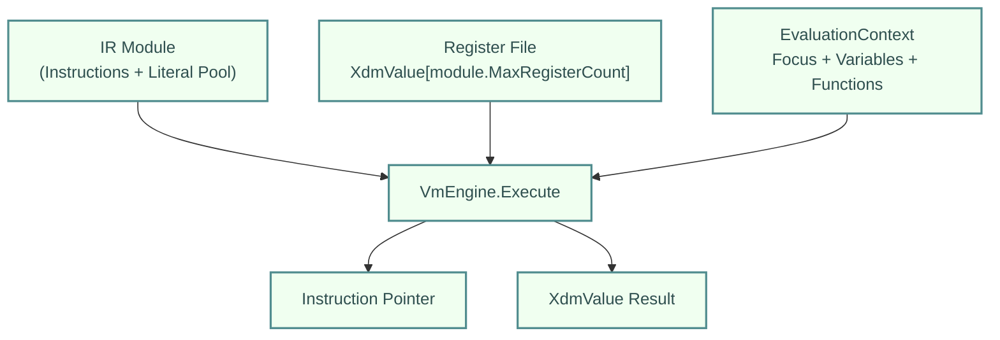
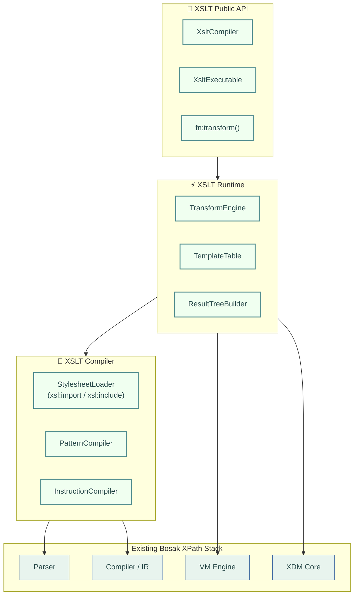
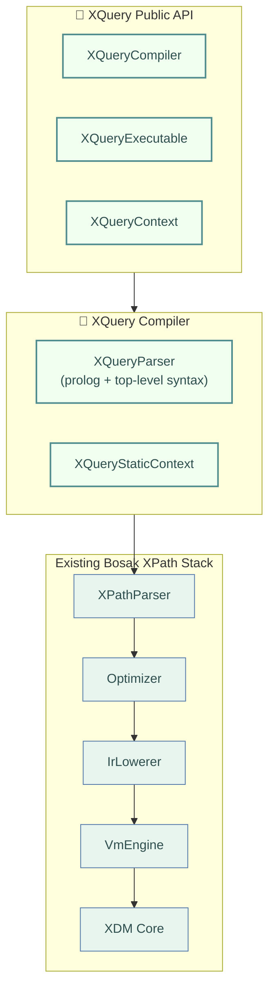

<div align="center">
  
  <br><br>
  <h1>Bosak XPath Architecture</h1>
  <p>Technical design document — XPath 3.1 register-VM engine</p>
</div>

**1.2.0 published — 2026-10-13:** [Release](https://github.com/Fytala-Charles/Bosak/releases/tag/v1.2.0) from `56486e96`. All ten .NET 10 packages are available on nuget.org; the release workflow passes 7,676 tests with zero failures/skips, and a fresh-cache consumer restored exclusively from nuget.org passes 45 checks. REQ-125 acceptance is included. See [release notes](RELEASE-NOTES-1.2.0.md). Earlier preparation and slice entries below are historical. Additional focused fixes, authoring-context alignment and a new XSLT 4.0 contribution-area batch follow this release; REQ-126 and independent contribution acceptance retain their recorded status.


---

## Overview

A high-performance .NET implementation of **XPath 3.1** (with forward-compatibility for 4.0), serving as the expression-engine foundation for the XSLT 3.0 processor and the planned XQuery 3.1 processor.

## Guiding Principles

1. **XDM-First**: XPath operates on the W3C XQuery Data Model (XDM), not raw XML DOM. All inputs are adapted to XDM.
2. **Compile Once, Execute Many**: Expressions are parsed into an AST, optimized, lowered to an Intermediate Representation (IR), and then compiled to a register-based VM. Hot paths can be JIT-compiled to IL.
3. **Zero-Allocation Sequences**: Sequences are lazily evaluated using struct enumerators. We avoid `IEnumerable<T>` boxing on hot paths.
4. **Value Semantics**: XDM values are immutable. Small values (integers, doubles, booleans) are unboxed structs.
5. **Pluggable Backends**: XML can be sourced from `XDocument`, `XmlDocument`, streaming readers, databases, or custom implementations without copying into a proprietary DOM.
6. **Standards Compliance**: XPath 3.1 and XDM 3.1 are the baseline. The type system and function signature model must support higher-order functions and JSON literals for XPath 3.1.

---

## High-Level Architecture

```mermaid
flowchart TB
    subgraph API["📢 Public API"]
        EXP["XPathExpression (v1.0.0)"]
        EXP31["XPath31Expression"]
        COMP["XPathCompiler"]
        ECTX["EvaluationContext"]
    end

    subgraph STD["📚 Standard Library"]
        FN["fn:*"]
        MATH["math:*"]
        MAP["map:*"]
        ARR["array:*"]
        XS["xs:* constructors"]
    end

    subgraph RT["⚡ Runtime / VM"]
        VM["Register VM"]
        FD["Function Dispatch"]
        SO["Sequence Operators"]
    end

    subgraph CP["🔧 Compiler / IR"]
        ASTO["AST Optimizer"]
        IRL["IR Lowerer"]
        JIT["IL JIT (optional)"]
    end

    subgraph PR["📝 Parser"]
        LEX["Lexer (Span-based)"]
        PAR["Recursive-Descent Parser"]
        AST["AST"]
    end

    subgraph XC["🧱 XDM Core"]
        XV["XdmValue"]
        XN["IXdmNode"]
        XSQ["XdmSequence"]
        XAV["XdmAtomicValue"]
    end

    subgraph NP["🌐 Node Providers"]
        XD["XDocument"]
        XMLD["XmlDocument"]
        X11["XML 1.1 loader"]
        STR["Streaming"]
        CUST["Custom"]
    end

    API --> STD
    STD --> RT
    RT --> CP
    CP --> PR
    PR --> XC
    XC --> NP

    classDef current fill:#F0FFF0,stroke:#518D8F,color:#2F4F4F,stroke-width:2px
    classDef external fill:#FFFFFF,stroke:#293F5F,color:#2F4F4F
    classDef planned fill:#FDF2CF,stroke:#556B2F,color:#2F4F4F,stroke-dasharray:5 5

    class EXP,COMP,ECTX,FN,MATH,MAP,ARR,XS,VM,FD,SO,ASTO,IRL,LEX,PAR,AST,XV,XN,XSQ,XAV,XD,XMLD,X11,STR current
    class JIT planned
    class CUST external
```

<a id="architecture-layer-stack"></a>



<p class="fytala-figure-caption"><strong>Layer stack.</strong> Dependency direction across the Bosak XPath engine, from the public API down to pluggable node providers; burst-mode streaming input is delivered (Phase A), IL JIT remains planned.</p>

---

## Layer Details

### 1. XDM Core (`Bosak.XPath.Core`)

The XQuery Data Model is the foundation. Every XPath expression evaluates to an XDM value.

#### `XdmValue` (Struct)
A discriminated-union struct representing any XDM value:
- **Atomic**: `xs:string`, `xs:integer`, `xs:decimal`, `xs:double`, `xs:boolean`, `xs:date`, etc.
- **Node**: A handle to an `IXdmNode`.
- **Sequence**: A lazy sequence of `XdmValue`.
- **Function**: Function items (higher-order functions in XPath 3.1).
- **External**: Opaque .NET objects passed into the query.

```csharp
public readonly struct XdmValue
{
    private readonly XdmValueKind _kind;
    private readonly object? _reference; // Nodes, sequences, functions, strings
    private readonly ulong _bits;       // Union overlay for numerics/bools
    // ~32 bytes total
}
```

**Performance notes**:
- Small integers, booleans, and doubles are stored inline in `_bits` (unboxed).
- Strings and larger objects use the `_reference` field.
- Sequences are **not** `List<XdmValue>`. They are lazy `IXdmSequence` objects.

**Effective boolean value**: `XdmValue.GetEffectiveBooleanValue()` follows XPath 3.1 rules — empty sequence is `false`, a singleton sequence delegates to its item, a multi-item sequence is `true` only if it contains a node, and a multi-item purely atomic sequence raises `FORG0006`.

#### `IXdmNode` (Interface)
An abstraction over any XML node. Implementations are provided for `XDocument`, `XmlDocument`, streaming, etc.

```csharp
public interface IXdmNode
{
    XdmNodeKind NodeKind { get; }
    string LocalName { get; }
    string NamespaceUri { get; }
    string Prefix { get; }
    string StringValue { get; }
    string BaseUri { get; }
    string DocumentUri { get; }  // separate from BaseUri; empty for temporary trees

    // DTD properties (for fn:id / fn:idref / fn:element-with-id and serialization)
    bool HasDocumentType => false;
    string DocumentTypeName => string.Empty;
    string PublicId => string.Empty;
    string SystemId => string.Empty;
    string InternalSubset => string.Empty;

    // PSVI / is-id accessor (used by fn:id and fn:element-with-id)
    bool IsId => false;

    IXdmNode? Parent { get; }
    XdmSequence Children(XdmNodeKind kind = XdmNodeKind.All);
    XdmSequence Attributes(string? localName = null, string? namespaceUri = null);

    // Axis navigation returns lazy sequences
    XdmSequence Axis(XdmAxis axis);
}
```

#### `XdmSequence` (Struct + Enumerator Pattern)
A lazy, struct-backed sequence with zero-allocation enumeration.

```csharp
public readonly struct XdmSequence
{
    private readonly IXdmSequence? _source;
    
    public Enumerator GetEnumerator() => new(_source);
    
    public struct Enumerator : IEnumerator<XdmValue>
    {
        // Struct enumerator: no allocation
    }
}
```

**Why not `IEnumerable<XdmValue>`?**
- Boxing on foreach is unacceptable for high-performance path evaluation.
- Struct enumerators give us C# `foreach` syntax with zero allocations.
- LINQ-style operators (`Where`, `Select`) are reimplemented as struct-returning methods.

---

### 2. Parser (`Bosak.XPath.Parser`)

A hand-written, recursive-descent parser using `ReadOnlySpan<char>` for zero-allocation tokenization.

**Why hand-written?**
- XPath grammar is small but context-sensitive (e.g., `*` can be multiply or `any-name`).
- `ReadOnlySpan<char>` gives us O(1) substring slicing without `Substring` allocations.
- Full control over error messages and recovery.

**Pipeline**:
1. **Lexer**: Tokenizes the XPath string. Tokens contain `(TokenKind, ReadOnlySpan<char>)`.
2. **Parser**: Recursive descent into an AST.
3. **AST**: A simple immutable tree of `XPathAstNode` records.

---

### 3. Compiler (`Bosak.XPath.Compiler`)

Transforms the AST into an executable form.

#### Phase 1: AST Optimizer
- Constant folding (`1 + 2` → `3`), preserving XPath 1.0 negative-zero semantics for unary minus on integer zero
- Predicate analysis (`[1]` → `First()`, `[last()]` → `Last()`)
- Axis merging (`child::foo` + `child::bar` where possible)
- Dead code elimination

#### Phase 2: IR Lowerer
Lowers the AST to a **register-based intermediate representation** (`IrInstruction`). This is similar to LLVM IR but domain-specific for XPath.


Example IR for `//book[price > 10]`:
```
LOAD_CONTEXT     r0
DESCENDANT_AXIS  r1, r0, "book"
FILTER           r2, r1, label_1
RETURN           r2

label_1:
CHILD_AXIS       r3, r0, "price"
ATOMIC_VALUE     r4, r3
GREATER_THAN     r5, r4, 10
RETURN           r5
```

#### Phase 3: Bytecode Emitter
Emits the IR into a compact format. `IrInstruction` is an 11-byte struct (`IrOpCode` + 3×`ushort` registers + `int` operand) with `Pack=1`.

#### Phase 4: IL JIT (Optional / Future)
For expressions executed frequently (>N times), the IR can be compiled to a `DynamicMethod` using `System.Linq.Expressions` or `System.Reflection.Emit` for near-native performance.

---

### 4. Runtime / VM (`Bosak.XPath.Runtime`)

A lightweight, register-based virtual machine.



**Design**:
- Dynamically-sized `XdmValue` register array sized to the module's max register count (up to 65,536 registers).
- Instruction pointer walks the bytecode.
- Axis instructions delegate to the `IXdmNode` provider.
- Function calls dispatch through a vtable in `EvaluationContext`.
- `FunctionSignature` may supply a `DynamicImplementation` used only when the function is invoked through a function item (named reference or partial application) rather than a static call. The XSLT layer uses this to raise the spec-mandated dynamic errors (`XTDE1061`/`XTDE1071`/`XTDE3480`/`XTDE3510`) for dynamic calls on `current-group`, `current-grouping-key`, `current-merge-group`, and `current-merge-key`, whose context components are not retained in function-item closures.
- `EvaluationContext.ImplicitTimezoneOffsetMinutes` supplies the dynamic context's implicit timezone (default UTC) for date/time comparisons and `adjust-*-to-timezone#1`.
- `EvaluationContext.Collections` maps collection names (empty string for the default collection) to the URIs or file paths of their documents, used by `fn:collection` and `fn:uri-collection`.

**Performance features**:
- **Sequence pipelining**: Axis results are not buffered unless required by sorting or positional predicates.
- **Predicate short-circuiting**: Predicates are evaluated lazily; `//a[b and c]` stops at first false.
- **Document-order preservation**: Maintained by the node provider, not by sorting after the fact.

---

### 5. Standard Library (`Bosak.XPath.Standard`)

Implementation of:
- **fn namespace**: All XPath 3.1 functions (`fn:string`, `fn:concat`, `fn:current-dateTime`, etc.)
- **math namespace**: Trigonometric and logarithmic functions.
- **map namespace**: `map:merge`, `map:get`, etc.
- **array namespace**: `array:size`, `array:get`, etc.
- **xs constructors**: Type constructors cast/validate values.
- **JSON functions**: `fn:json-to-xml` and `fn:xml-to-json` are implemented in `FunctionLibrary`. `fn:json-to-xml` embeds the W3C schema-for-JSON (`src/Bosak.XPath.Standard/Resources/schema-for-json.xsd`) and, when `validate:=true()` is supplied, validates the generated `XDocument` through `XDocumentProvider.ValidateXDocument`, producing PSVI annotations. `element(name, type)` and `document-node(schema-element(...))` kind tests in `VmEngine.ValueMatchesType` consume those PSVI annotations.

Each function is implemented as a static method conforming to a delegate signature:
```csharp
public delegate XdmValue XPathFunction(EvaluationContext context, ReadOnlySpan<XdmValue> arguments);
```

Functions are registered in a `FunctionLibrary` that supports runtime extensibility. Functions that accept numeric arguments in XPath 1.0 backwards-compatible mode (e.g. `fn:subsequence`) coerce strings, untyped atomics, and nodes to `xs:double` instead of raising `XPTY0004`.

#### Regular-expression support

Regular expressions are centralized in `RegexHelper` (`src/Bosak.XPath.Standard/Functions/RegexHelper.cs`). It is used by `fn:matches`, `fn:replace`, `fn:tokenize`, `fn:analyze-string`, and `xsl:analyze-string` to:

- Parse `i`, `m`, `s`, `x`, and `q` flags.
- Validate XSD regex syntax and reject invalid patterns (`FORX0002`).
- Translate XSD-specific constructs (e.g. ambiguous backreferences, category escapes) to .NET `Regex` syntax.
- Translate XPath/XSD replacement strings for `fn:replace`.
- Detect patterns that match the empty string (`FORX0003`).
- Build capturing-group parent maps so `fn:analyze-string` emits the correctly nested `<group>` tree required by the spec.

XSD character classes are handled by a dedicated engine rather than .NET's Unicode-category support, because .NET tracks the runtime's Unicode version while XPath/XSD pins specific code-point sets:

- `XsdCharClasses` (`src/Bosak.XPath.Standard/Functions/XsdCharClasses.cs`) is a range-set engine that parses XSD class expressions — `\p{X}` / `\P{X}` (all 38 general categories, including the grouped `LC`), `\p{IsBlock}` script blocks, `\d \D \w \W \s \S \i \I \c \C`, ranges, negation, unions, and class subtraction (`[A-[B]]`, one level of nesting) — and emits .NET-compatible patterns. Astral ranges are emitted as surrogate-pair alternations so matches/replacements never split a supplementary character. `\w` follows the XSD definition `[^\p{P}\p{Z}\p{C}]` (so e.g. emoji of category `So` are word characters). `\i`/`\c` use the explicit XML 1.0 (5th edition) `NameStartChar`/`NameChar` range tables required by XSD 1.1 (these deliberately include code points such as U+212E that are not Unicode letters). XSD 1.1 hyphen rules are honored: `-` is a subtraction operator only when immediately followed by `[`; elsewhere it is a range operator or a literal hyphen (`[a-d-b-c]` = `{a-d, '-', b-c}`, negated or not), and a range endpoint may not be an unescaped hyphen (`[a--b]` → `FORX0002`).
- `UnicodeData90` (`src/Bosak.XPath.Standard/Functions/UnicodeData90.cs`) pins **Unicode 9.0.0** general-category and block ranges as flat sorted `int[]` tables, generated from `DerivedGeneralCategory-9.0.0.txt` / `Blocks-9.0.0.txt`. This satisfies the W3C XSLT 3.0 `unicode-90` conformance set, which requires Unicode 9.0 semantics exactly (e.g. `\p{Nd}` = 580 code points, Adlam block = U+1E900..U+1E95F).
- Both the XSD→.NET pattern translation and the constructed `Regex` objects are cached (keyed by the short original pattern) in `RegexHelper`, so hot loops that evaluate the same literal pattern millions of times pay only a small dictionary lookup. Compiled regexes are used throughout: `RegexOptions.NonBacktracking` was evaluated but rejected because it both refused large alternations and silently mis-matched U+000A on some patterns.
- `fn:codepoints-to-string` validates its input against the XML 1.1 `Char` production (`#x1-#xD7FF|#xE000-#xFFFD|#x10000-#x10FFFF`; Bosak is XML 1.1-capable); noncharacters such as U+FDD0..U+FDEF and astral `xFFFE`/`xFFFF` planes are legal, while surrogates, U+FFFE/U+FFFF, and NUL raise `FOCH0001`.

---

### 6. Public API (`Bosak.XPath.Api`)

The user-facing surface, modeled after `System.Xml.XPath` but modernized.

```csharp
// Compile once
var expr = XPath31Expression.Compile("//book[price gt 10]/title");

// Execute many times against different documents
var result = expr.Evaluate(document);
foreach (var title in result.AsNodes())
{
    Console.WriteLine(title.StringValue);
}

// With context (variables, namespaces, functions)
var ctx = new EvaluationContext()
    .WithNamespace("p", "http://example.com")
    .WithVariable("minPrice", new XdmValue(10.0m));

var result2 = expr.Evaluate(document, ctx);

// With default element namespace (XSLT xpath-default-namespace)
var options = new CompileOptions
{
    Namespaces = new Dictionary<string, string> { ["p"] = "http://example.com" },
    DefaultElementNamespace = "http://example.com"
};
var expr3 = XPath31Expression.Compile("//book", options);

// The XML default namespace of the element containing the expression is tracked
// separately so that XSLT's fn:element-available() can expand unprefixed QNames
// per the XSLT specification, independent of xpath-default-namespace.
options = new CompileOptions
{
    DefaultElementNamespace = null,
    DefiningElementDefaultNamespace = "http://www.w3.org/1999/XSL/Transform"
};
```

### 7. Node Providers (`Bosak.XPath.Providers`)

The provider layer adapts external XML object models to the XDM `IXdmNode` interface.

- **`XDocumentNode`** – adapter for `System.Xml.Linq.XDocument`. This is the default provider used by the API, the XSLT compiler, and the test harness.
- **`Xml11Loader` / `Xml11NameCodec`** – because .NET's `System.Xml` stack only accepts XML 1.0 names, the XML 1.1 provider rewrites XML 1.1 declarations, encodes XML 1.1-only name characters as private-use sentinel sequences, and stores them in `XName`. On output, names are decoded again and C0/C1 controls are serialized as numeric references. Prefixed namespace undeclarations (`xmlns:prefix=""`) are preserved via a placeholder URI and a `PrefixedNamespaceUndeclarations` annotation. `Xml11Loader` also scans the document's DTD for `<!ELEMENT>` declarations and annotates elements declared with element-only content (`EMPTY` or a content model without `#PCDATA`) with a `DtdElementOnlyAnnotation`, which the XSLT processor uses for default whitespace stripping.
- **Planned providers** – `XmlDocument` adapter and database-backed nodes.
- **`XmlStreamingProvider`** (`Streaming/`) – burst-mode streaming input: presents an `XmlReader` source as a forward-only document node. The root start-tag is read into a shell document immediately; the root's top-level records are materialized one at a time as detached `XElement`s (reusing `XDocumentNode` internally) as the engine enumerates them, and released once processing moves on. Comments/PIs before the root element are captured into the shell document and surfaced as document-node children before the root. Parent/document chains are re-rooted at the streaming root/document nodes, node identity and document order delegate to the underlying `XObject`s (records are `RegisterTree`'d in arrival order), `StreamingNode` wrappers are cached per underlying node in a `ConditionalWeakTable` (navigation allocates per node, not per access; wrappers are evicted with their record, preserving bounded memory), and second enumerations raise a loud `StreamingException`. See `docs/INTEGRATION.md` §3.2a for the memory contract.

All XML parsing in the XSLT pipeline (stylesheets, source documents, `doc()`, `parse-xml()`, `parse-xml-fragment()`, `fn:transform()`, and the conformance harness) now routes through `Xml11Loader` so XML 1.1 constructs are accepted everywhere.

---

## Performance Strategy

| Technique | Application |
|-----------|-------------|
| `ReadOnlySpan<char>` | Lexer, string comparisons, name tests |
| Struct enumerators | `XdmSequence`, axis iteration |
| `ArrayPool<T>` | Temporary buffers during sorting, sequence materialization |
| Lazy evaluation | Sequences, predicates, path steps |
| Register VM | Expression execution (better cache locality than tree walking) |
| General-comparison integer sets | `=`/`!=` between a single `xs:integer` and a large all-integer sequence uses a cached `HashSet<long>` (e.g. `$validrange[not(. = $c)]` in the unicode-90 tests: 1.1M × 2k pairwise comparisons collapse to O(n)) |
| Cached regex translation/compilation | XSD→.NET pattern translation and `Regex` objects cached by original pattern; compiled regexes reused across millions of `fn:matches`/`fn:replace` calls |
| Persistent map storage | `XdmMap` is backed by `ImmutableDictionary<XdmValue, XdmValue>` plus an order list/index so `map:remove`, `map:put`, and `map:merge` share structure while preserving insertion-order iteration |
| IL JIT (future) | Hot expression compilation to `DynamicMethod` |
| QName interning | `StringPool` for element/attribute names |
| Avoid `System.Xml.XmlNode` | `IXdmNode` adapter pattern prevents DOM locking |

---

## Extensibility Roadmap

| Priority | Phase | Deliverable | Status | Notes |
|----------|-------|-------------|--------|-------|
| 1 | 4 | **XQuery 3.1** | 🚧 In Progress — Phase 4 | Full core FLWOR (`order by`/`count`/`group by`/`window`), direct and computed constructors with constructor-local namespaces, switch/typeswitch, `validate`, output declarations and serialization, user-defined functions and variables (`declare function`/`declare variable` with function-item coercion and strict declared-type enforcement), library modules (`module namespace`/`import module` with %public/%private visibility), try/catch with named error codes and `err:*` variables, string constructors, ordering features (`ordered`/`unordered`, ordering declarations), spec-correct name tests and constructor in-scope namespaces, namespace undeclaration and declaration static errors (XQST0033/XQST0070, two-phase prolog ordering), inline-function annotations and function-test annotation assertions, character/entity reference validation, map constructors in step position with key disambiguation, `allowing empty` for clauses, computed namespace constructors in content, higher-order function conformance (conversions, absent focus, base-URI capture), duration subtype arithmetic, stable order-by and full switch semantics, `fn:load-xquery-module` (URI resolution with location hints, transitive import closure, external-variable/context-item binding, public-declarations result map; schema imports in the loaded module are propagated to its evaluation context so `validate` and schema-aware expressions work), `declare decimal-format` and `declare boundary-space` (with module-local formats), and the full HTML/XHTML serialization matrix (version-dependent void lists, boolean attributes, raw-text elements, CDATA XML islands, XHTML prefix normalization); QT3 harness routes supported XQuery tests (31,148/0/673, 97.89%). Remaining: none — all runnable tests pass. |
| 2 | — | **XSLT 3.0 packages** | ✅ Implemented | `xsl:package` root parsing, `xsl:use-package` resolution to registered packages, `xsl:expose` static validation and runtime visibility, `xsl:accept` visibility enforcement and runtime checks, accept/override visibility for functions/variables/parameters, diamond-import conflict handling, per-package lazy-global isolation, package-version range matching, `xsl:use-package` in imported modules (`XTSE3008`), library-package absent-focus globals (`XPDY0002`), `xsl:original` for attribute-set overrides, override scope propagation (`xsl:override` variables/functions are visible inside used-package components and `xsl:original(...)` dispatches to the overridden function), and package-scope `fn:function-lookup` (the declaring package's own declarations are returned; `xsl:original` is hidden from lookup) are implemented. `ResolvePackageLocation` uses `PackageVersion.Parse`, `VersionMatches`, and `PackageVersionResolutionStrategy` (`Highest`/`Lowest`). W3C clusters (strict error-code matching): `package` 62/10/0, `accept` 35/15/0, `expose` 41/1/0, `use-package` 49/4/1, `override` 41/58/4, `function-lookup` 8/0/0. Residual: `$xsl:original` variable references, `xsl:original#N` named references, `xsl:original` partial application, and `xsl:call-template name="xsl:original"` are not yet implemented. |
| 3 | REQ-070 | **Schema awareness / XSD validation** | ✅ Implemented (Phase 4) | User-defined schema simple-type constructor functions (`Q{uri}local#1`), `cast as`, `instance of`, and `ValueMatchesType`/`ApplyFunctionConversion` matching against prefixed user-defined types; schema-validated typed values keep integer kind for integer-derived types and remain date/time typed. `schema-element()`/`schema-attribute()` kind tests are evaluated against the compiled schema set, including substitution-group traversal and nillability checks. Lexical timezone offsets are preserved for schema-validated `xs:date`, `xs:time`, `xs:dateTime`, `xs:dateTimeStamp`, and `g*` typed values via `XmlConvert.ToDateTimeOffset`. QName/NOTATION values retain their lexical prefix and schema-type annotation; `xsi:type='xs:ID'` and `xsi:type='xs:IDREF'/'xs:IDREFS'` are honoured for ID/IDREF semantics even without a schema. **REQ-097 (2026-09-22) — XSLT schema-awareness seam H1/H2:** `XsltCompiler.SchemaAware` opts in to schema-aware compilation (default off, bit-identical basic processor); `xsl:import-schema` declarations (inline / `SchemaResolver` / `schema-location` / host `SchemaSet`) compile into one merged `XmlSchemaSet` (import-precedence merge, XTSE0215/XTSE0220) that is folded into `EvaluationContext.SchemaSet` before function-library population, so the REQ-070 machinery (constructors, kind tests) works from stylesheet-declared schemas. Runtime semantics of `validation`/`@type` (hook H4) remain open for the Bosak.Schema commercial track. **REQ-098 (2026-09-22) — XSLT schema-awareness seam H3 (typed construction / annotation API):** `XdmSchemaAnnotator` in `Bosak.XPath.Providers` (`ValidateSubtree` validates an in-memory subtree in place with PSVI attached to the live XObjects — deep-clone + document-order copy-back when the subtree is attached, so node identity is preserved; `Annotate` attaches a host-built `IXmlSchemaInfo`; result type `XdmSubtreeValidationResult` with optional `XmlSchemaValidationException` throw) plus two null-conditional `Action<IXdmNode>` processors on `EvaluationContext` — `ConstructedElementProcessor` fires once per constructed element after content completion, bottom-up (`xsl:element`, literal result elements, `xsl:copy` element results), and `ConstructedDocumentProcessor` fires at result-document boundaries. Core behavior is bit-identical when unset, so hosts can drive validated construction without the engine knowing schemas at construction time. **REQ-099 (2026-09-22) — XSLT schema-awareness seam H4 (validation service + `validation`/`@type` semantics):** `XdmSchemaAnnotator` generalized into a mode-aware validation service (`XdmValidationMode` Strict/Lax/Strip/Preserve, `XdmValidationOptions`; `Validate`/`ValidateAttribute` port the XQuery validate algorithms — lax `xs:anyType` root augmentation, named-type `xsi:type` injection/removal, document-shape checks); TransformEngine reads per-instruction `validation`/`type` (LREs: `xsl:validation`/`xsl:type`; `default-validation` inherited per module) and validates constructed content when a schema set is in scope, raising the XTTE15xx family; PSVI preserved across `xsl:copy`/`xsl:copy-of`; `xsl:strip-type-annotations`/`input-type-annotations="strip"` honored. All four seam hooks H1–H4 are landed; with no schema set in scope the engine is bit-identical. **REQ-100 (2026-09-23) — schema kind tests in match patterns:** `schema-element(N)` / `schema-attribute(N)` in `match` patterns (single, path-step, axis-step, and `@`-attribute positions) are evaluated by the pattern compiler against the schema set captured in the validation context — declaration lookup, substitution-group walk, nilled nillability, `IsDerivedFrom` type-annotation compatibility — mirroring the REQ-070 VM semantics; with no schema set they never match and never throw. **REQ-104 (2026-09-24) — schema kind tests visible in every XPath static context (PA-2):** `CompileOptions.SchemaSet` carries the in-scope compiled schema set into XPath compilation — the parser accepts unprefixed kind-test names in schema-aware mode and the static name-test validator checks the name argument against the set's global declarations (XPST0008 when absent) — and the transform threads its merged set through every XPath compilation (`CompileXPath` options, bare select/catch/copy sites, `xsl:evaluate`, AVTs, patterns), clearing the sweep's XPST0008 cluster; companions: PSVI-typed atomization in variable/parameter coercion (subtype substitution), DateTime-kind g* values in `ValueMatchesType`, and the embedded schema-for-JSON bound by locationless import of the XPath functions namespace. **REQ-105 (2026-09-24) — typed pattern dispatch (PA-3):** the type argument of `element(N,T)`/`element(*,T)`/`attribute(N,T)`/`attribute(*,T)` match patterns is enforced at match time when a schema set is in scope (name resolution + `XmlSchemaType.IsDerivedFrom`, built-in types via the System.Xml.Schema table, nilled elements only against nillable types, unprefixed type names via the xpath-default-namespace); typed forms take default priority 0.25 per XSLT 3.0 §6.4; `schema-element(N)`/`schema-attribute(N)` matching reads the post-compilation `ElementSchemaType`/`AttributeSchemaType`; validated constructed attributes keep their PSVI through sequence-constructor harvesting; validated simple-typed content is whiteSpace-facet normalized (XDM §3.3.2). Without a schema set the type argument stays a no-op (basic processors bit-identical). **REQ-106 (2026-09-24) — NOTATION surface + nested schema imports (PA-3):** casts to NOTATION-derived types annotate `xs:NOTATION` (the namespace-sensitive cast branch dropped the annotation) and enforce the §19.3 stringish-source rule; `xs:QName()` accepts QName-kind input (NOTATION→QName, XPath 3.0); unprefixed type names in `instance of` resolve against no-namespace schema types; grouping keys and `xsl:key` values atomize schema-annotated nodes to their PSVI typed value; `SchemaSetBuilder` eagerly loads locationful nested `xs:import`/`xs:include` targets (`XmlSchemaSet.Compile` fetches nothing with a null resolver in .NET 10). **REQ-107 (2026-09-24) — no-namespace named-type validation + canonical PSVI typed-value forms (PA-3):** named-type validation of no-namespace user types writes unprefixed `xsi:type` on the assessment clone (a generated prefix bound to the empty namespace threw ArgumentException) and drops the clone's default-namespace declaration; `xsl:value-of` atomizes schema-validated nodes via the PSVI typed value (`ConstructValueOfString`/`NodeAtomizedString`, nilled elements contributing no slot); `ConvertSchemaValue` canonicalizes duration lexical forms (`TryCanonicalizeDuration`: months→years fold, zero-component omission, fraction trim, `PT0S`), strips decimal trailing zeros, and keeps `xs:anyURI` lexical verbatim; `HasNoTypedValue` is true only for element-only content (XDM §2.7.2). The type-identity family (as-2002/2101/1806–1809) is tracked as REQ-108. **REQ-108 (2026-09-25) — PSVI user-defined type identity + derivation-aware `instance of` (PA-3):** `XdmValue` carries a second, optional `_userSchemaTypeName` annotation (`Q{uri}local`, public `UserSchemaTypeName`) alongside the untouched built-in base name in `SchemaTypeName`; both `ConvertSchemaValue` paths (XDocumentNode PSVI, VmEngine cast — incl. the QName/NOTATION namespace-sensitive branch) tag user-defined-typed results; `ValueMatchesType`'s user-defined branch requires the value's own type annotation and answers via `IsSchemaTypeSubtype` (exact-QName fallback without a schema set) — castable-but-untyped values are no longer instances of user-defined types, while PSVI/constructor/coercion-typed values match their user type and built-in base; complex-type-with-simple-content values normalize to their simple content base before tagging; annotations survive the bool/float/double/date/time conversion arms; URI promotion still converts-and-loses the user type per XSD 1.0 (no XDM 3.1 anyURI<:string). Schema-aware sweep 10,874/208 → 10,883/199/3,518 (+9 FAIL→PASS, zero pass→fail). **REQ-109 (2026-09-29) — PA-3 tail, `strip-type-annotations` cluster:** out-of-range XSD years no longer collapse date/time typed values to untagged strings (`GetTypedValue` re-parses into `XPathDateTime` via new annotated `FromDate`/`FromTime` overloads; g* types stay annotated strings); mixed-content typed values are tagged `xs:untypedAtomic` (XDM §2.7.2); stripping snapshots is-id/is-idref onto a new internal `XdmIdProperties` marker so `fn:id`/`fn:idref` keep working (XSLT 3.0 §3.13). Bonus: as-1701 flips — `as` set **187/0**. Schema-aware sweep 10,883/199 → 10,889/193/3,518 (+6 FAIL→PASS, zero pass→fail). **REQ-110 (2026-09-30) — PA-3 residuals, `match` set closed:** `xsl:mode/@typed` is now the enum `ModeTyped { Unspecified, Strict, Lax, Untyped }` (was a yes/no parse — `strict`/`lax`/`unspecified` threw XTSE0020); strict/lax modes rewrite top-level QName pattern branches to `schema-element(QName)` via per-rule variant predicates (lax falls back to name matching without a declaration); strict + unannotated node → XTTE3100 at dispatch; strict-mode undeclared QName → static XTSE3105; untyped mode + schema-dependent pattern + annotated node → XTTE3110; `element-with-id(X[,S])` allowed at pattern start; top-level `..` steps → XTSE0340; deep-copy/`CopyNodeToResult` attribute branches carry PSVI (`IXmlSchemaInfo` + `XdmIdProperties`). Schema-aware sweep 10,889/193 → 10,907/175/3,518 (+18 FAIL→PASS, zero pass→fail); `match` set 271/15 → **286/0**. **REQ-111 (2026-09-30) — PA-4 (C7) closed, `@as` coercion namespace context:** unprefixed sequence-type QNames in variable/param/function-result `@as` coercion (`ConvertVariableValue`) now resolve against the declaring instruction's in-scope `xpath-default-namespace` (published on the context for the coercion duration, ~19 call sites) instead of the transform-wide context, which never carries a default element namespace; `element(N)` accepts name matches over lax-`xs:any` content with no global declaration, unprefixed user-defined type names in `@as` resolve and REQ-108 identity accepts the PSVI value; `schema-element(N)` still requires a real declaration. Schema-aware sweep 10,907/175 → 10,909/173/3,518 (+2 FAIL→PASS, zero pass→fail); `import-schema` set 176/28/1. **REQ-112 (2026-09-30) — PA-5 (C5) harness skip-list, no engine change:** schemas using XSD 1.1 `xs:assert`/`xs:alternative` cannot compile on the XSD 1.0 stack; the conformance harness now detects them by a prefix-agnostic raw-text scan of environment schemas (per-URI cache; catalog `xsd-version` pins untrustworthy — books.xsd is wrongly pinned 1.0) plus an inline-schema check on the loaded stylesheet, skipping 28 tests with an explicit reason. Feature `XSD_1.1` deliberately stays out of `SkipFeatures` to preserve the silent skips of the four `satisfied="false"` XSD-1.0-only probes. Schema-aware sweep 10,909/173 → 10,909/145/3,546 (exactly the 28 FAIL→SKIP, zero pass→fail); basic sweep bit-identical. **REQ-113 (2026-09-30) — PB-2 (C8) closed, XTTE15xx completion:** schema-aware validation now partitions element-level vs document-level identity-constraint errors per XSLT §25.4.1.3 vs §25.4.2 — ID/IDREF constraint failures are suppressed during element-level assessment and surfaced only at document level as XTTE1555 (`HasDocumentLevelConstraintFailure` on `XdmSubtreeValidationResult` + internal `XdmSchemaAnnotator.CheckDocumentIdentityConstraints` walking duplicate IDs and dangling IDREF/IDREFS; `ValidateConstructedElement` gained a `documentLevel` parameter threaded into `XdmValidationOptions`, with internal `DocumentEpisode` skipping the container re-shape check); unresolvable `xsi:type` raises XTTE1510 under lax (`HasUnresolvableXsiType`); Strip/Preserve dispatch precedes the XTTE1550 shape check; implicit result-tree validation neutralized per W3C bug 30211; XTDE1490 duplicate-URI check kept transformation-scoped (`_resultDocumentUris`; a stack-scoped variant regressed try-021 and was reverted in 6.90); `ExecuteResultDocument` isolates the streaming `__xdm_seq__` accumulator; copied-attribute type failures report XTTE1510/XTTE1515; harness typed-tree re-validation scoped to kind-test asserts (`_currentResultNeedsTypedTree`); companions: xml:lang union-with-empty-string (attribute-1502), XTSE0010 on multiple inline xs:schema children (import-schema-157), InternalsVisibleTo for Providers.Tests (7 new `XdmSchemaAnnotatorTests`). ~44 previously-failing schema-aware tests now pass, zero regressions. Schema-aware sweep 10,909/145 → **10,954/100/3,546** (45 FAIL→PASS, zero pass→fail); basic sweep 10,220/55 → **10,221/54/4,325** (1 FAIL→PASS — si-result-document-008 — zero pass→fail); unit 2,721/2,721 across 10 assemblies; QT3 31,142/0/679 unchanged; new baselines `basic-after-req113.txt` / `schema-aware-after-req113.txt`. **REQ-114 (2026-10-01) — PB-3 (C9) closed, schema-aware long tail:** two waves (2026-09-30 interrupted, 2026-10-01 resumed and gated; PR #43 merged `a831e09`). List-typed sequence flattening in general comparisons + function conversion (XPTY0004 cardinality kept for singular targets); parameterized `document-node(element(E[,T]))` KindTest end-to-end (parser keeps the inner test; pattern compiler + VM enforce exactly-one-element/no-text; XPST0081 on undeclared prefixes); built-in `xs:` typed patterns enforced without an in-scope schema set (conflict-resolution-1402; user-defined type names in basic mode still ignored); schema-set loading via `XmlUrlResolver` (chameleon includes/redefines resolve at compile, XTSE0220 on IO errors, import-precedence shadowing recorded so the host-set merge skips losers); `xpath-default-namespace`/`default-collation` whitelisted on variable/param/with-param; XTSE0020 for lax/strict default-validation below 3.0; XTSE0770 user-function vs type-constructor collision; deferred semantic XTSE3070 type identity; pre-E36 `#arity` suffix tolerated; `PreserveSchemaAnnotations` (§25.1.1) wired end-to-end (`PreserveConstructedElementAnnotations` + `promotePreserveShell` — preserve shells xs:anyType, xsl:copy-of passes false so preserved untyped trees stay xs:untyped); RC3 ref+use-site default/fixed pre-injection; xdt→xs untypedAtomic normalization; item-separator honored by the serializer; `xsl:evaluate @schema-aware` yes/no AVT (XTSE0020/XTDE0030/XTDE3160) + fn:document stubs; merge per-input-sequence XTDE2220 sortedness, sort-before-merge collation, codepoint default merge keys; document-node `[xsl:]type` corrected (wave-1 blanket XTTE1540 throws removed — XTTE1550 shape check, then single-root named-type validation: XTTE1540 content / XTTE1512 undeclared / valid succeeds); deferred strict-declaration errors recorded and re-thrown as XTTE1512 (the ancestor's XTTE1510 keeps precedence); XTTE0950 namespace-sensitive attribute copy (XSLT §11.8.2 — `CheckNamespaceSensitiveAttributeCopy` + `XdmValidationOptions.ExtraNamespaceBindings` 0.3 + `ImportInScopeNamespaces` in XdmSchemaAnnotator.Validation 1.0); strip-space never strips simple-content whitespace (`HasSchemaSimpleContent`); error-0030a → XTDE0030; harness Program.cs 3.59. Schema-aware sweep 10,954/100 → **11,015/39/3,546** (+61 FAIL→PASS, zero pass→fail, skips identical); basic sweep 10,221/54 → **10,228/47/4,325** (+7 FAIL→PASS — evaluate-048, merge-072/074/079/097s, package-021err, package-022err — zero pass→fail); unit 2,683/2,683 across 9 solution assemblies + LanguageServer 72/72 (separate); QT3 31,142/0/679 unchanged; new baselines `basic-after-req114.txt` / `schema-aware-after-req114.txt` / `qt3-after-req114.txt`. **REQ-115 (2026-10-01) — target-fix wave for the REQ-114 tail:** 11 of the 12 remaining named non-streaming failures fixed (catalog-001, mode-1506, non-stream-006, non-stream-201, override-misc-007, sf-avg-100, sf-insert-before-011, sf-reverse-001, sf-xml-to-json-004, type-functions-0304, validation-0202); validation-0201 characterized, left for dedicated investigation. Axis-aware Normalize rework (RegisterC flag on the opcode — 1 = forward-axis/non-axis step, 0 = reverse axis — + `VmEngine.MixesDetachedNodes` for materialized mixed rooted/parentless inputs only, lazy streams never enumerated; IrLowerer 1.45, VmEngine 2.162/2.163) cleared ~70 streaming regressions the REQ-114 blanket suppression had introduced while keeping reverse-axis sort correctness; sibling xsl:import modules share an XTSE0545 precedence level via `Stylesheet.ImportDepth` grouping (Stylesheet 2.121 — mode-1506; new ModeConflictResolutionTests); FODC0005 raw-backslash URI check relocated from `EvaluationContext.LoadDocument` to the fn:document entry + `xsl:source-document` non-streamable branch (EvaluationContext 2.31, FunctionLibrary 5.122, TransformEngine 6.97; harness fallback gating reverted, Program.cs 3.60); streamed env sources schema-validated per record via RecordPostProcessor (Program.cs 3.61); fn:resolve-uri RFC 3986 IRI-tolerant char scan (FunctionLibrary 5.121); fn:sum xs:untypedAtomic→xs:double FORG0001 cast (FunctionLibrary 5.120); key-index schema-element() pattern compiled with the evaluation context + mixed-content indentation (KeyIndex 0.11, ResultTreeSerializer — validation-0202); `SourceDocument` helper emits file:/// URIs (StreamingSourceDocumentTests 0.2); fn:distinct-values O(n²) → codepoint fast path — ordinal HashSets for string-family values under default/codepoint collation (`collation.Length == 0 || codepoint URI` — DefaultCollation defaults to string.Empty), untypedAtomic/anyURI join membership, pairwise fallback; sf-distinct-values-001 481 s → ~2 s (FunctionLibrary 5.123, FunctionLibraryTests 2.42 +3); harness CS0136 fix (3.62) + `--resume-file <path>` kill-resilient chunked sweeps (3.63). Schema-aware sweep 11,015/39 → **11,027/28/3,546** (+11 FAIL→PASS, ZERO pass→fail; remaining-failures list `.sweep-baselines/schema-aware-after-target-fixes.txt`); gate-repair tail: QT3 CombinedErrorCodes FORG0002 regression from the resolve-uri char scan fixed (FunctionLibrary 5.124 percent-encoding validation, FunctionLibraryTests 2.43 +3, Program.cs 3.64) — final QT3 31,142/0/679, basic sweep 10,236/40/4,325 bit-identical; unit 2,702/2,702 across 9 solution assemblies + LanguageServer 72/72 (separate) = 2,774 combined;  **REQ-116 (2026-10-02) — validation-0201 dedicated fix, §11.9 scoping split + Saxon 9.x indenter:** validation of constructed/result trees is scoped to the components imported into the stylesheet per XSLT 3.0 §11.9 — `SchemaSetBuilder.Build` emits a second imported-only compiled set (fresh `XmlSchema` instances per winner; host stylesheet-import schemas included; synthesized xml-namespace schema whenever any import-schema declaration exists) and `TransformEngine` validates against `Stylesheet.ImportedOnlySchemaSet ?? builtInOnly` instead of the merged context set; host **secondary** schemas move to the new public `XsltCompiler.EnvironmentSchemaSet` (compile-time + source-validation visibility only). method=xhtml indent=yes ports the Saxon 9.x HTMLIndenter event model (3-space levels, XHTML-namespace inline/formatted classification, SameLine/afterInline/afterFormatted adjacency rules, newline folding with space absorption, 80-column wrapping); html/xml methods untouched. Harness honors golden-file XML-prolog encodings and splits environment schemas by catalog role. Schema-aware sweep 28 → 27 remaining failures (validation-0201 fixed, zero pass→fail); unit 2,714/2,714 + LanguageServer 72/72; uncommitted working tree. **REQ-117 (2026-10-02) — PC-1 streaming conformance cluster closed (premise corrected: not schema-on-streaming — 24 of 26 failed bit-identically in the basic sweep):** nine root causes fixed in waves W1–W7 on branch `fix/pc1-streaming-w1-w2` (8 commits on main `9e40a97`; TransformEngine 6.96→6.99, Program.cs 3.66→3.69, StreamabilityAnalyzer 0.6→0.8, Stylesheet 2.123, PatternCompiler 3.11→3.12, IrLowerer 1.46): unprefixed `xsl:assert`/`@error-code` values are no-namespace local names per XSLT 3.0 §5.2 (engine + harness Clark matching); FODC0002/0005 error mapping on the streamable `xsl:source-document` branch; StreamabilityAnalyzer `xsl:map` key/value atomization-usage rule, grounded-group `current-group()` in nested for-each/source-document/iterate, `xsl:fork` at-most-one-streaming-prong rule, shallow-descent arity-0 → XTSE3155 past the fail-open wrapper, absorbing-result constructor-feed exception, next-match with-param transmission; `key()` context-dependent 2nd pattern arg per §10.1.4; runtime absorbing grounding (absorbing functions get deep-materialized snapshot args, VM call-site conversion skipped for absorbing callees); `ExecuteXslIterate` body loop `Nodes()` not `Elements()` (si-iterate-005); IrLowerer descendant-step merge with non-positional predicates (positional `//product[1]` stays unmerged — documented StreamingException); streamed `group-starting-with` predicate patterns `self::node()[pred]` on `IStreamingNode` candidates; result-document `@type` PSVI validation on the streaming accumulator path. Two gate-caught regressions repaired in-flight (W2 rooted platform paths in the backslash check; W7-1 `RunRawTransform` initial-match-selection restore — 12 pass→fail on the full-sweep gate, fixed before PR). Schema-aware sweep 11,028/27 → **11,054/1/3,546** (all 26 PC-1 FAIL→PASS, zero pass→fail; only type-functions-0401 remains — documented platform limitation); basic sweep 10,236/40 → **10,250/26/4,325** (+14, zero pass→fail); unit 2,729/2,729 + LanguageServer 72/72; QT3 31,142/0/679 baseline preserved (IrLowerer touched → re-run); new baselines `basic-after-req117.txt` / `schema-aware-after-req117.txt`. Known deviation recorded: positional `group-starting-with` patterns over streams silently collapse to one group — candidate future XTSE3430 analyzer check. |
| 4 | 5 | **Streaming** | ✅ Phases A+B+C+D | Phase A (burst-mode input): `XmlStreamingProvider` + `XsltExecutable.TransformStreaming`, record-at-a-time processing in bounded memory; VM/XSLT single-pass paths gated on `ISinglePassSequence`. Phase B: push-style streaming accumulators. Phase C (2026-09-17): `xsl:supports-streaming` = "yes"; streamable `xsl:source-document`; compile-time XTSE3430 streamability analyzer (`StreamabilityAnalyzer`) per §19 (106/113 corpus static-error cases caught). Phase D (2026-09-17): runtime posture enforcement — fused single-pass eager helpers (EBV, instance-of, treat-as, cardinality), XSLT 3.0 §11.7.3 content-evaluation semantics, `fn:snapshot` grounding of streamed nodes, opt-in record retention (`StreamingLoadOptions.RetainRecords` / `IStreamingDocument.TryEnableReplay`) giving tee/replay for crawling union/except/intersect/fork/map shapes (document-size memory on that path only; the public `TransformStreaming` default stays bounded), streaming DTD/unparsed entities. si-fork residual batch (2026-09-21): group context isolated on template invocation (XTDE1061/1071 in call-template/apply-templates callees), static XTSE3430 for out-of-scope current-group(), generate-id stability across fork prongs, XTDE3365 duplicate map keys inside xsl:fork. Provider batch (2026-09-21): `StreamingNode` wrapper cache (per-node `ConditionalWeakTable`), pre-root comment/PI surfacing on the document axes, `fn:copy-of` provider-agnostic deep-copy guard for streamed nodes, `XsltExecutable.TransformStreamingToString`. su-filter/su-unclassified analyzer batch (2026-09-21): boolean-typed lone-variable filter predicates, positional motionless predicates on striding steps (§19.8.8.9 rule 5), and unclassified-function atomic-param atomization in any argument position (§19.8.5.1). si-iterate XTSE3120 batch (2026-09-21): xsl:break/xsl:next-iteration permitted as the last instruction of xsl:if inside xsl:iterate (§8.4). si-message batch (2026-09-21): conformance harness assert-message matching is non-positional (each assert claims a distinct message; extra messages allowed per the catalog schema). sx-MapExpr map-constructor batch (2026-09-21): `xsl:map` content merges all entries of each map in the content sequence (the spurious single-entry XTTE3365 check is gone; non-map content still raises XTTE3375), and duplicate map-constructor keys inside streamable `xsl:source-document` content raise XTDE3365 (the InStreamingMapContext flag now covers source-document bodies, not only xsl:fork branches). sx-treat/sx-instance-of braced-EQName batch (2026-09-21, parser): braced-URI function calls in step position (`A ! Q{uri}fn(...)`) were misparsed as kind-test steps; `ParseStepExpr` now never treats a `Q{`-prefixed name as a kind test. xml-to-json package-namespace batch (2026-09-21): template-rule `xsl:sequence/@select` is compiled with the instruction's in-scope namespaces (was a bare `XPath31Expression.Compile`), so package-private functions called from used-package template rules resolve against the package's own prefix bindings, not the using stylesheet's. Final full sweep **10,220/55/4,325**; W3C `decl/accumulator` **102/0/5**. PC-1 streaming conformance cluster closed (REQ-117, 2026-10-02): all 26 streaming failures FAIL→PASS (premise corrected — not schema-on-streaming; 24 of 26 failed bit-identically in the basic sweep); analyzer/runtime fixes across xsl:map/group/fork/shallow-descent rules, key() context-dependent pattern args, absorbing grounding, iterate text-node children, descendant-step merge; two gate-caught regressions repaired in-flight; schema-aware sweep **11,054/1/3,546** (only type-functions-0401 remains), basic sweep **10,250/26/4,325**, zero pass→fail on every gate. |
| 5 | — | **Custom decimal + date-time types** | 🔮 Planned | Replaces .NET `decimal`/`DateTimeOffset` to clear platform-limitation skips. Large effort, low test impact. |
| 6 | 6 | **Database backends** | 🔮 Scoped — [REQ-120](./REQ-120-database-backends.md) | REST/HTTP URI-scheme adapters need zero engine changes (public `DocumentLoader`/`StreamingDocumentLoader`); collection seam + foreign-provider friction as the engine slice; DB-native `IXdmNode` deferred. |
| 7 | — | **XPath / XSLT 2.0 legacy certification** | 🔮 Lowest | 3.1/3.0 are supersets; no separate mode planned unless a specific customer requires it. |
| 8 | — | **XPath 4.0 / XSLT 4.0** | 🔮 Lowest | W3C specs are still drafts; wait for Recommendation status. |

---

## XSLT Architecture & Roadmap

XSLT is implemented as a **thin compiler/runtime layer** on top of the existing XPath stack. The XPath engine (parser, compiler, VM, XDM) handles all expression evaluation; XSLT adds stylesheet parsing, pattern compilation, template dispatch, and result-tree construction.

<a id="architecture-xslt-layer"></a>



<p class="fytala-figure-caption"><strong>XSLT layer.</strong> The XSLT compiler and runtime sit as a thin layer on the shared Bosak XPath stack.</p>

### XSLT Project Structure

```
src/
  Bosak.Xslt/
    Stylesheet/          Stylesheet DOM, template rule table, import/include resolution
    Patterns/            Pattern AST, pattern compiler, match predicate generation
    Instructions/        XSLT instruction compiler (apply-templates, for-each, value-of, etc.)
    Runtime/             Transform engine, result-tree builder, built-in template rules
    Api/                 XsltCompiler, XsltExecutable, public surface
    Authoring/           Source-preserving authoring API (REQ-124): retained-byte envelopes,
                         inspection snapshots, source maps, expression-slot contexts
```

### Source-Preserving Authoring API (REQ-124)

`Bosak.Xslt.Authoring` (Slices A+B+C landed 2026-10-10) is the additive seam for the Bosak.Braid visual designer. It follows a **retained-envelope + splice** architecture: `AuthoringSource` keeps the original module bytes, detected encoding, and base URI; the parsed `XDocument` is derived working state from which compilation is derived; and untouched source is never re-serialized — `AuthoringSnapshot.ExportOriginal` returns the exact original bytes. `XsltAuthoring.Inspect` classifies failures (structure / encoding / resolver — never throws for bad source) or returns an opaque snapshot with ordered per-module descriptors: QName'd element trees with full source extents, attribute slot classification (Expression / Pattern / AVT / QName / Plain), entity-spelling-preserving raw literals, line/column-primary coordinates with derived byte offsets, opaque expression-slot contexts (namespaces, xpath-default-namespace, base URI, version), and controlled module resolution (unresolved edges, cycles, duplicate-URI reuse). `ProposeExpressionEdit` (Slice B) validates a replacement expression against the slot's real static context and returns an immutable candidate: splice-only emitted bytes (only the attribute value span changes), affected ranges, paired-DFS node correspondence, compilability diagnostics, and derived `Compile()` — input snapshots are never mutated. `AuthoringCapabilities` (Slice C) is the static capability descriptor consumers query instead of probing with exceptions: inspection / Expression-slot-edit availability, lossless-only fidelity, the seven supported encodings with their BOM/declaration detection rules, the 256-module bound and documented limits (internal-DTD refusal, XML 1.1 split), version policy (3.0/3.1 first, 4.0 gated), and engine assembly identity. The lifecycle contract is remarks-documented on the surface: no disposal, candidates valid only against their deriving snapshot, immutable thread-safe sharing, snapshot-scoped node identity. See `docs/REQ-124-source-preserving-xslt-authoring.md`.

### Controlled Validation, Capture and Execution Controls (REQ-125)

**Current status:** Implemented and accepted by Bosak.Braid on 2026-10-11 within the declared coverage and restricted byte-bounded profiles. The correction source is committed and its immutable revision has been adopted and verified by Bosak.Braid; see delivery traceability below.


All four REQ-125 slices landed 2026-10-10 (status Implemented, pending Bosak.Braid whole-request acceptance) — the supported public surface behind the designer's preview, composing with the REQ-124 authoring envelopes. Everything is **opt-in with a null-gated default: zero policy, no capture options, and no gate leaves every existing code path bit-identical.**

- **`Bosak.Xslt.Validation`** — static validation without execution. `XsltValidation.Validate(...)` walks every resolved module and checks every declared Expression/Pattern/AVT slot (including templates never executed) plus an IO-free structural pass (unknown XSLT-namespace instructions, placement, must-be-empty, XTSE0090/0805 attribute rules) against the slot's real static context (variable scoping incl. declaration-order parameter defaults, prefix bindings → XPST0081, xpath-default-namespace, xml:base, effective version), with `use-when="false()"` elision per §3.13. Outcomes Valid / Invalid / InvalidSource / UnsupportedCoverage / Refused / **Cancelled** — explicit coverage gaps (import-schema, packages, non-literal use-when) degrade to UnsupportedCoverage, never a silent Valid; never throws for bad source; diagnostics carry stable codes (spec + XV0001–XV0003, XV0013), module URI, message, source range.
- **`Bosak.XPath.Runtime.Resources`** — controlled resource policy. A single host `IControlledResourceAuthority` governs 14 `ControlledResourceRoute`s (document/json-doc/unparsed-text/-lines/collection + availability probes + schema-import + source-document + streaming + extension-function(permanently unsupported → XV0005) + transform-inherit). The policy decision runs **before** cache service; the cache key carries (URI, load policy, policy instance, route) and entries carry SHA-256 + effective URI — **digest-validated hits** (`ControlledResourceReceipt.ServedFromCache`, v0.3) keep receipt and consumed content in permanent agreement. Static-phase acquisition requests the `StaticEvaluation` purpose route with `ConcreteRoute` preserved. Refusals XV0004/XV0005; receipts are per-access with credential-redacted URIs.
- **`Bosak.Xslt.Capture`** — captured output contract. `XsltExecutable.CaptureTransform(...)` returns principal + secondary (`xsl:result-document`) identities (resolved URIs; principal = base output URI even when unnamed) and exact serialization bytes under each output's effective properties, reusing the engine's internal result-document capture — **no disk writes in capture mode**. Bounded production (count/per-output/aggregate-byte/message caps enforced during production), XTDE1490 collisions, classified partial failures; outcomes Success/Partial/Failed/**Cancelled** with XV0006–XV0014.
- **Execution limits and cancellation** — internal `ExecutionGate` (CancellationToken + wall-clock deadline amortized over 64-checkpoint batches + exact-decrement operation budget) checked at XSLT instruction dispatch, template invocation, result-document production, message emission, and principal capture; the VM dispatch loop is untouched and a null gate costs one branch. Nested `fn:transform` inherits the same gate instance; the gate is stamped only when none is inherited and cleared in `finally` (sequential + concurrent run isolation). Cooperative, not preemptive — documented in XML remarks.

**2026-10-11 C-F1/D-F1 corrections (accepted by Braid within declared profiles):** Byte-bounded capture streams text (including character maps), XML, HTML and XHTML. It refuses JSON/adaptive, text Unicode normalization, non-text character maps and non-XDocument markup provider fallbacks before serialization as `UnsupportedSerializationProfile` / `XV0014`. Unbounded capture keeps the established serializers for those profiles. Encoding/BOM bytes count against per-output and remaining aggregate budgets; fixed-size encoding lookahead is discarded on overflow. Result-tree construction, normalization and XPath working memory are outside these byte budgets; the host worker process remains the hard memory/wall-clock control.

Cancellation/deadlines are observed unconditionally before and after serialization and before publishing the capture result; bounded encoding also observes controls between chunks. These observations neither consume engine operations nor reset the 64-checkpoint hot-loop batch. Cancellation is `Cancelled` / `XV0013`; deadline expiry is a non-success `XV0011` result, with earlier completed outputs retained.

The capture path uses `BoundedSerializationWriter` (incremental Encoder + bounded retained bytes), `CaptureDecodingStream` (fixed-size XmlWriter decoding bridge) and `CaptureMarkupWriter` (bounded lexical lookahead preserving empty tags, attribute whitespace and numeric references). HTML/XHTML reuse writer-based serializer bodies. The unbounded/default serializer routes remain intact.

See `docs/REQ-125-controlled-validation-and-preview.md` and the delivery record in its §6.

### XSLT Implementation Phases

#### Phase 1 — EDI Conversion Core (XSLT 2.0 subset)
**Goal:** Unblock Customer A EDI transforms (Canonical XML ↔ BOD).

| Feature | Status | Notes |
|---------|--------|-------|
| `xsl:stylesheet` / `xsl:transform` | 🎯 Phase 1 | Root element parsing |
| `xsl:template` with `match` | 🎯 Phase 1 | Pattern compilation for element names, wildcards, predicates, union |
| `xsl:template` with `name` | 🎯 Phase 1 | Named template invocation |
| `xsl:apply-templates` | 🎯 Phase 1 | Default mode, `select` attribute |
| `xsl:call-template` | 🎯 Phase 1 | Named template calls with `xsl:with-param` |
| `xsl:value-of` | 🎯 Phase 1 | Text node construction |
| `xsl:copy` | 🎯 Phase 1 | Shallow copy; `@select` attribute support |
| `xsl:copy-of` | 🎯 Phase 1 | Deep copy to result tree |
| `xsl:for-each` | 🎯 Phase 1 | Iteration over sequence |
| `xsl:if` / `xsl:choose` | 🎯 Phase 1 | Conditional logic |
| `xsl:variable` / `xsl:param` | ✅ Implemented | Scoped variables and parameters; static variables/parameters supported with external override; compile-time validation of required/disallowed attributes and `required`/`select` combinations |
| `xsl:element` / `xsl:attribute` | 🎯 Phase 1 | Dynamic element/attribute construction |
| `xsl:text` | 🎯 Phase 1 | Literal text output |
| Built-in template rules | 🎯 Phase 1 | Default handling for text, attributes, elements |
| `xsl:import` / `xsl:include` | 🎯 Phase 1 | **Required for Customer A:** modular stylesheets, shared function libraries |
| `xsl:output` | ✅ Implemented | Serialization method, encoding, indentation, doctype, CDATA sections, URI escaping, content-type meta, byte-order-mark, html-version, suppress-indentation, `use-character-maps` |
| `xsl:sort` | ✅ Implemented | Sorting within `xsl:apply-templates` / `xsl:for-each` |
| `xsl:number` | ✅ Implemented | Number formatting |
| `xsl:key` / `key()` | ✅ Implemented | Indexed lookup |
| Modes (named) | ✅ Implemented | `mode="foo"`, `xsl:apply-templates mode` |
| `xsl:function` | ✅ Implemented | User-defined XPath functions in XSLT; `@name` and `@_name` AVTs are resolved to expanded QNames at parse time using the stylesheet static context (including externally supplied static parameters), with duplicate-name and invalid-name validation |
| Shadow attributes (`_{attr}` static AVTs) | ✅ Implemented | Underscore-prefixed XSLT attributes (e.g. `_version`, `_href`, `_use-when`, `_xpath-default-namespace`, `_static`, `_select`) are evaluated as AVTs at compile time in the current static context and replace the corresponding non-underscore attributes. Shadow attributes on literal result elements are ignored. |
| `fn:transform()` | ✅ Implemented | XPath function invoking XSLT from expressions; full option surface (`stylesheet-location`/`node`/`text`, `package-name`/`package-version` via a package registry, `initial-match-selection`, `initial-template`/`initial-mode`/`default-mode`, `delivery-format` document/raw/serialized, `stylesheet-params`/`template-params`/`tunnel-params`/`static-params`, `global-context-item`, `xslt-version`, `base-output-uri`, `serialization-params`, secondary result-document capture into the result map); callable in static expressions; W3C `fn-transform` set 117/124 passed (7 skipped) |
| Tunnel parameters | ✅ Implemented | `tunnel="yes"` propagation |
| `xsl:mode` | ✅ Implemented | `on-no-match`, `on-multiple-match`, `warning-on-no-match`, `warning-on-multiple-match`, `visibility`, `typed`, `streamable`, `default-mode`, duplicate-declaration checks, and `#unnamed` normalization |
| `xsl:analyze-string` | ✅ Implemented | Regex matching/non-matching children; `regex-group()`; XSLT 3.0 zero-length match semantics |
| `xsl:try` / `xsl:catch` | ✅ Implemented | Error variables (`err:code`, `err:description`, `err:value`, ...); global-variable errors propagate uncaught |
| `xsl:result-document` | ✅ Implemented | Secondary result documents, URI conflict detection, nested principal output, `rollback-output` handling |
| `xsl:iterate` | ✅ Implemented | Stateful iteration with `xsl:param`, `xsl:next-iteration`, `xsl:break`, and `xsl:on-completion` in result-tree and function-body contexts; `iterate` conformance cluster 44/44 |
| XSLT 3.0 packages | ✅ Implemented | `xsl:package` root parsing, `xsl:use-package` resolution to registered packages, `xsl:expose` static validation and runtime visibility, `xsl:accept` visibility enforcement and runtime checks, accept/override visibility for functions/variables/parameters, CollectingScope-aware global collection and conflict validation, diamond-import same-name public variables, per-package lazy-global isolation, package-version range matching, `xsl:use-package` in imports/includes (`XTSE3008`), library-package absent-focus globals (`XPDY0002`), `xsl:original` for attribute-set overrides, override scope propagation (`xsl:override` variables/functions visible inside used-package components; `xsl:original(...)` dispatches to the overridden function; `XTSE0770` for duplicate overriding functions), and package-scope `fn:function-lookup` via `EvaluationContext.FunctionLookupInterceptor` (own declarations returned, `xsl:original` hidden) are implemented. W3C clusters (strict error-code matching): `package` 62/10/0, `accept` 35/15/0, `expose` 41/1/0, `use-package` 49/4/1, `override` 41/58/4, `function-lookup` 8/0/0; `ResolvePackageLocation` selects the highest matching version by default. Residual: `$xsl:original` variable references, `xsl:original#N` named references, `xsl:original` partial application, and `xsl:call-template name="xsl:original"` are not yet implemented. |
| Streaming | ✅ Phases A+B+C+D | Burst-mode streaming input via `XsltExecutable.TransformStreaming`/`TransformStreamingToString` + `XmlStreamingProvider` (record-at-a-time, bounded memory by default; forward-only root children with loud errors; pre-root comments/PIs surfaced as document children; per-node wrapper cache) and push-style streaming accumulators (W3C `decl/accumulator` 102/0/5). Phase C: `xsl:supports-streaming` = "yes", streamable `xsl:source-document`, XTSE3430 streamability analysis per §19 (`StreamabilityAnalyzer`, fail-open wrapper in `Stylesheet`). Phase D: analyzer-accepted constructs execute — fused single-pass eager helpers, §11.7.3 content semantics, `fn:snapshot` grounding, opt-in record retention (tee/replay) for crawling multi-operand shapes, streaming DTD support. `fn:copy-of` deep-copies streamed nodes into grounded copies. Group context is isolated across template invocation; duplicate map-constructor keys raise XTDE3365 both inside xsl:fork branches and inside streamable `xsl:source-document` content. Full sweep 10,220/55/4,325 |

Package-version resolution is handled by `XsltFunctionLibrary.ResolvePackageLocation`, which parses registered package versions (`PackageVersion.Parse`) and matches them against the `xsl:use-package` `@package-version` attribute with `VersionMatches`. The supported syntax includes exact versions, wildcard prefixes (`1.*`), hyphen and `to` ranges (`1.0-2.0`, `1.0 to 2.0`), minimum bounds (`1.5+`), comma-separated alternatives, and `*` / empty for any version. When multiple registered versions match, `PackageVersionResolutionStrategy.Highest` selects the highest version (the XSLT 3.0 default); `Lowest` is available for consumers that need deterministic lower-bound selection.

> **Implementation note:** `TransformEngine.ExecuteXsltInstruction` treats `xsl:fallback`, `xsl:sort`, `xsl:on-empty`, `xsl:on-non-empty`, and `xsl:assert` as no-ops when reached directly. `xsl:sort` is consumed by its parent sorting instruction; `xsl:on-empty`/`xsl:on-non-empty` are handled by dedicated sequence-constructor processing; `xsl:fallback` is processed only as a child of an unrecognized/extension instruction; `xsl:assert` is accepted but not yet evaluated (pending an enable-assertions switch).
>
> **Serialization:** `ResultTreeSerializer` honours `xsl:output`/`xsl:result-document` properties including `method` (`xml`, `html`, `xhtml`, `text`, `json`), `encoding`, `indent`, `omit-xml-declaration`, `standalone`, `version`, `doctype-system`, `doctype-public`, `cdata-section-elements`, `escape-uri-attributes`, `include-content-type`, `media-type`, `byte-order-mark`, `html-version`, `suppress-indentation`, `use-character-maps`, `normalization-form`, `json-node-output-method`, `allow-duplicate-names`, `escape-solidus`, `item-separator`, and `parameter-document`. Named `xsl:output` declarations are resolved across imports/includes by import precedence (higher-precedence definitions override lower ones; equal-precedence definitions are merged). `xsl:character-map` definitions are parsed and merged; multiple maps are applied in declaration order with the first definition winning for duplicate characters. Characters that cannot be represented in the selected `encoding` are emitted as decimal numeric character references, and CDATA sections are split around such characters. Tab, line-feed, and carriage-return characters inside XML attribute values are also written as decimal numeric character references, because .NET's `XmlWriter` emits them literally and XML attribute-value normalization would otherwise turn them into spaces on parsing. For XHTML (`method="xhtml"`), `doctype-public` without `doctype-system` is ignored. XHTML 1.0 (`html-version="1.0"`) uses the HTML 4 empty-element list for self-closing tags; XHTML5 (`html-version="5.0"`) strips the XHTML namespace prefix, serializes HTML5 void elements as empty tags, and preserves root-element case in the DOCTYPE. DOCTYPE literal values are quoted with the delimiter that does not occur in the value, and a default `<!DOCTYPE html>` is emitted only for `html` roots in the HTML/XHTML namespace (or no namespace for HTML). Multiple `xsl:output` declarations are merged (later values override earlier ones; `cdata-section-elements`, `suppress-indentation`, and `use-character-maps` are unioned), and a principal `xsl:result-document`'s properties are captured so `TransformToString` serializes with the correct encoding, character maps, and Unicode normalization. For `method="json"`, top-level maps/arrays produced by the transformation are collected as raw XDM items and serialized through `XdmJsonSerializer`; nested nodes are first serialized using the effective `json-node-output-method` and then JSON-escaped. The same raw-item collection is used for `xsl:result-document` with `method="json"`, `method="adaptive"`, or `build-tree="no"`. For XML, HTML, XHTML, and text methods, maps, arrays, functions, attribute nodes, or namespace nodes at the top level raise serialization error `SENR0001`. The W3C conformance harness also supports the `serialization-matches` assertion by matching the serialized result against a regular expression, including nested `<all-of>` / `<any-of>` combinations. The `text` method serializes only the string-value of text nodes — comment and processing-instruction nodes contribute nothing. When the harness reparses HTML output for tree assertions it first self-closes HTML void elements, and `assert-xml` comparisons strip the serialization-injected Content-Type `meta` element, which is a serialization artifact rather than part of the result tree. Unnamed `xsl:output` declarations are merged across the import/include tree by import precedence via `Stylesheet.EffectiveOutputProperties` (mirroring the named-declaration merge). The HTML serializer minimizes recognized boolean attributes (e.g. `checked` instead of `checked="checked"`) using an allowlist so other attributes always keep their explicit value; `escape-uri-attributes` defaults to true for both the `html` and `xhtml` methods. Method inference honours the XSLT 3.0 backwards-compatibility rule: a stylesheet with `version="1.0"` building an *implicit* result tree (no `xsl:result-document`) whose root is `html` in the XHTML namespace defaults to the `xml` method (tracked via `OutputProperties.StylesheetVersion` / `ExplicitResultDocument`). `xsl:merge` raises `XTDE2210` when corresponding `xsl:merge-key` attributes (`lang`, `order`, `collation`, `case-order`, `data-type`) are present on one source and absent on another, and `xsl:include`/`xsl:import` hrefs resolve against each element's base URI so modules pulled in through DTD external entities resolve nested references correctly.
>
> **JSON / raw collection:** `XdmJsonSerializer` treats array and map members as sequences, so a single node serializes as a JSON string, multiple items as a nested array, and an empty member as `null`. `TransformEngine.IsRawCollectionTopLevel` is scoped to the actual principal or secondary result-document container, preventing raw-item collection from swallowing literal elements inside typed `xsl:variable` bodies.
>
> **Sequence constructors:** `EvaluateSequenceConstructorToItems` uses a placeholder accumulator so sequence-producing instructions (e.g. `xsl:sequence`, `xsl:document`) keep their document order relative to text nodes and literal elements. Zero-length text nodes produced by `xsl:text` and empty text-value templates are preserved as items during sequence collection; they are discarded only when the result is copied into a result tree, where they still break adjacent atomic-value spacing. `CopyToResult` carries over the preceding atomic state when processing a sequence so the first atomic value is correctly separated from a preceding atomic sibling.
>
> **Backwards compatibility:** XSLT 1.0 backwards-compatible mode (`xsl:version < 2.0`) is honoured at compile time and runtime. `CompileOptions.BackwardsCompatible` causes the optimizer to promote integer arithmetic to `xs:double`; the runtime applies first-item rules to function arguments, `xsl:number/@value`, and `to` operands; general comparisons use XPath 1.0 coercion (node-set ↔ boolean, numeric relational comparisons); and `xsl:value-of` without an explicit `separator` outputs only the first item. Key values are stored as strings under BC so that `key()` lookups behave like XPath 1.0.
>
> **Copied-attribute namespace fixup:** When `xsl:copy` or `xsl:copy-of` adds an attribute in a non-default namespace to an element, `TransformEngine` materialises an explicit `xmlns:*` declaration for the namespace. This guarantees that `name()` returns a distinct prefixed name for attributes that share a local name but have different namespace URIs (e.g. `p1:aaa` and `p2:aaa`), matching XSLT semantics.

#### Pattern Compilation Strategy

XSLT **patterns** (`match` attributes) are *not* XPath expressions. They use a restricted syntax:
- `foo` → matches element `foo` (child axis implied)
- `*` → matches any element
- `@*` → matches any attribute
- `foo[bar]` → matches `foo` with a `bar` child
- `a | b` → union of two patterns

The PatternCompiler transforms patterns into **XPath predicates** evaluated against the current node. For example:
- `match="foo"` → compile to `self::foo` predicate
- `match="foo[bar]"` → compile to `self::foo[child::bar]` predicate
- Union patterns compile to a disjunction of predicates
- `match="doc('uri')"` / `match="document('uri')"` → the literal URI is resolved against the stylesheet base URI and compared with the candidate document node's `DocumentUri`

This lets us reuse the existing XPath compiler and VM for pattern matching.

#### Instruction Compilation Strategy

XSLT instructions compile to a **higher-level IR** that the Transform Engine interprets:
- `xsl:apply-templates` → `ApplyTemplates(select, mode)` instruction
- `xsl:for-each` → `ForEach(select, body)` instruction
- `xsl:value-of` → `ValueOf(select)` instruction
- `xsl:element` → `Element(name, namespace, body)` instruction

The Transform Engine walks this instruction tree, evaluating XPath expressions via the VM and building the result tree via `ResultTreeBuilder`.

---

## XQuery Architecture & Roadmap

XQuery 3.1 is implemented as a **thin compiler layer** on top of the existing XPath stack. The XPath engine (parser, optimizer, IR lowerer, VM, and XDM) handles all expression evaluation; XQuery adds a top-level parser for the prolog and query body, a static context, and (in later phases) constructors and serialization.

<a id="architecture-xquery-layer"></a>



<p class="fytala-figure-caption"><strong>XQuery layer.</strong> The XQuery prolog parser and static context compile down to the shared Bosak XPath stack.</p>

### XQuery Project Structure

```
src/
  Bosak.XQuery/
    Parser/              XQueryParser and XQueryStaticContext
    Compiler/            Static context and prolog analysis helpers
    Api/                 XQueryCompiler, XQueryExecutable, XQueryContext
```

### XQuery Implementation Phases

#### Phase 1 — Foundation (current)
**Goal:** Compile and execute prolog-less XQuery expressions by delegating the query body to the XPath pipeline.

| Feature | Status | Notes |
|---------|--------|-------|
| `XQueryCompiler` / `XQueryExecutable` / `XQueryContext` | ✅ Implemented | Public API wired to XPath parser, optimizer, IR lowerer, and VM |
| `XQueryParser` | ✅ Implemented | Parses version declaration and basic prolog declarations; delegates `Expr` to `XPathParser` |
| `XQueryStaticContext` | ✅ Implemented | Holds namespaces, default element/function namespace, default collation, base URI, declared variables, and declared functions |
| Prolog-less queries (`for`/`let`/`where`/`return`) | ✅ Implemented | Reuses XPath 3.1 FLWOR support |

#### Phase 2 — Full core FLWOR
**Goal:** Add `order by`, `group by`, `count`, and `window` clauses.

| Feature | Status | Notes |
|---------|--------|-------|
| `order by` | ✅ Implemented | Tuple-based lowering with `OrderBy`/`TupleBind` opcodes; supports ascending/descending, empty least/greatest, and collation |
| `count` | ✅ Implemented | Compiler-managed integer counters during tuple construction/post-`order by` iteration; no new VM opcode |
| `group by` | ✅ Implemented | `GroupBy` opcode merges the tuple stream by grouping-key equality; `:=` specs lowered as synthetic lets; post-group `order by` via a re-keying pass |
| `window` | ✅ Implemented | `Window` opcode; tumbling/sliding windows with start/end condition blocks and current/positional/previous/next vars, `only end` |

#### Phase 3 — Constructors and XQuery-specific expressions
**Goal:** Support direct and computed constructors, `typeswitch`, `switch`, and `validate`.

| Feature | Status | Notes |
|---------|--------|-------|
| Direct element/attribute constructors | ✅ Implemented | Lexer constructor mode + `ConstructElement` opcode; computed attributes/content, constructor-local namespaces, copy semantics |
| Computed constructors | ✅ Implemented | `ConstructComputed` opcode + shared content accumulator; static EQName or computed `{expr}` names; all seven forms (`element`/`attribute`/`document`/`text`/`comment`/`processing-instruction`/`namespace`) |
| `switch` / `typeswitch` | ✅ Implemented | Desugared in the lowerer to `let` + `if`/`eq`/`instance-of` chains; sequence-type unions in case clauses |
| `validate` | ✅ Implemented | Parses as a contextual XQuery keyword; `validate { Expr }`/`validate strict { Expr }`/`validate lax { Expr }` lower to a `ValidateNode` IR opcode. `validate lax` with no schema returns the operand unchanged; `validate strict`/plain `validate` without a schema raises `XQST0075`; invalid operands raise `XQTY0030`; validation failure raises `XQDY0027`.

#### Phase 4 — Modules, serialization, and advanced features
**Goal:** Library modules, `import module`, and serialization.

| Feature | Status | Notes |
|---------|--------|-------|
| Serialization | ✅ Implemented | All six output methods (`xml`, `xhtml`, `html`, `text`, `json`, `adaptive`) with full Serialization 3.1 parameter fidelity; ser/* sets and fn/serialize all green |
| Output declarations | ✅ Implemented | `declare option output:*` with static parameter merging and `output:parameter-document` |
| Library modules | ✅ Implemented | `module namespace`, `import module` with location hints, transitive import graph, %public/%private visibility, per-module static contexts |
| Advanced prolog options | 🔮 Phase 4 | Boundary-space, construction mode, ordering mode, copy-namespaces, decimal formats, context-item declaration |

### Parser Layering Strategy

`XQueryParser` owns the XQuery top-level grammar (version declaration, prolog, and query body) but delegates all `Expr` parsing to the proven `XPathParser`. This keeps the XPath lexer/parser free of XML-like tokenization rules and avoids regressions in XPath conformance. The XQuery AST is a separate `XQueryAstNode` hierarchy that wraps XPath AST nodes where appropriate.

---

## Project Structure

```
src/
  Bosak.XPath.Core/         XDM types, sequences, atomic values
  Bosak.XPath.Parser/       Lexer, parser, AST
  Bosak.XPath.Compiler/     Optimizer, IR, bytecode emitter
  Bosak.XPath.Runtime/      Register VM, execution context, function dispatch
  Bosak.XPath.Api/          Public API, expression compilation, navigator
  Bosak.XPath.Standard/     Standard function library (fn, math, map, array, xs, JSON)
  Bosak.XPath.Providers/    XDocument adapter (XDocumentNode), XML 1.1 loader/codec, burst-mode streaming input (XmlStreamingProvider); XmlDocument adapter planned
  Bosak.Xslt/         XSLT 2.0/3.0 processor (stylesheet compiler, transform engine)
  Bosak.XQuery/       XQuery 3.1 processor (query compiler, static context, prolog parser, FLWOR engine)
  Bosak.LanguageServer/   LSP server for XPath / XSLT / XQuery diagnostics, completions, hover, go-to-definition, document symbols, semantic tokens, code actions, code lens for XPath/XQuery results and XSLT transformations, and an XSLT initial-template runner (OmniSharp 0.19.9)

tests/
  Bosak.XPath.Core.Tests/
  Bosak.XPath.Parser.Tests/
  Bosak.XPath.Runtime.Tests/
  Bosak.XPath.Api.Tests/
  Bosak.XPath.Standard.Tests/
  Bosak.Xslt.Tests/   XSLT transform and pattern-matching tests
  Bosak.XQuery.Tests/ XQuery placeholder tests
```

The published NuGet package will likely be a single `Bosak.XPath` assembly (produced via ILMerge or source consolidation) to simplify deployment, while development maintains the layered project separation.

---

<div align="center" style="background:#2F4F4F; color:#F0FFF0; padding:1rem; border-radius:12px; margin-top:2rem;">
  <p style="margin:0; font-family:Poppins,Segoe UI,sans-serif;">
    <strong>© Fytala</strong> — Bosak XPath Engine Architecture
  </p>
</div>

**REQ-125 delivery traceability (2026-10-11):** Bosak correction revision `0ff33163ba985bf8562722424db7e66c37e3566d` is accepted within the documented coverage and restricted byte-bounded profiles. Bosak.Braid adopted this exact immutable revision in commit `9423d41b52a5f3a3c1206df370c7998f7ad88886`. Its Release build passed with 0 errors, all **192 tests passed / 0 failed / 0 skipped** (including six public-contract checks), and the strict documentation gate passed. The bootstrap also rejects solution/manifest revision mismatches before checkout preparation. Both repositories have local commits; remote publication awaits explicit push authorization. Production preview adapter/worker integration remains separate product work.

### Executable reference-guide examples (REQ-126)

The [invoice chapter](xpath40-catalog/worked-examples/invoice-to-erp/README.md) uses the existing public compiler/capture pipeline without engine changes. `Bosak.Xslt.Tests` copies the published XML/XSLT/XPath assets into its test output and verifies those exact files through `InvoiceReferenceGuideTests`. Chapter evidence supplements feature/conformance evidence; it does not promote new 4.0 surfaces or claim completion of the catalog. A separate XPath compilation with `XPathCompatibility.XPath40` verifies the optional migration example.

The publishing and reconciliation chapters use the same public pipeline through
`WorkedExampleTests`. `CatalogExampleTests` executes 81 published cases and
earlier-version baselines with explicit compatibility/result/error expectations.
Fixtures are copied from the documentation tree into test output; engine source
and conformance gate membership are unchanged. Publishing comparisons retain
mixed-content whitespace, while business XML comparisons ignore lexical namespace
declaration placement. The HTML fixture comparison is limited to these authored
pages, not a general HTML parser.

## 1.1.0 release packaging

All ten public library packages share version 1.1.0 through `src/Directory.Build.props`. Authoring, validation, and capture remain in Bosak.Xslt; controlled resource contracts remain in Bosak.XPath.Runtime. No new package boundary is introduced. See [release notes](RELEASE-NOTES-1.1.md) for the release scope and coverage restrictions.

## REQ-126 routing reference workflow (2026-10-11)

The [order-routing chapter](xpath40-catalog/worked-examples/order-routing/README.md) demonstrates explicit `XPathCompatibility.XPath40` planning through `XPath31Expression`, then a required XDM map parameter supplied by `XsltCaptureOptions.Context.WithVariable` to portable XSLT 3.0. Published 1.1.0 does not propagate a version 4.0 declaration to transformation-time expression compilation; source 1.1.1 fixes this boundary. This example uses existing APIs; no engine layer or public API changed. The catalog now has 67 entries and 802 executable documentation checks; [provenance](xpath40-catalog/PROVENANCE.md) distinguishes immutable Bosak deliveries from unavailable historical specification snapshots.

## Effective-version expression profiles (source 1.1.1)

The [compatibility correction](REQ-118-XSLT-XPATH40-COMPATIBILITY.md) selects frozen XPath40 for expression owners with effective XSLT version at least 4.0. Earlier elements retain XPath31; literal `xsl:version`, imported/included modules and nested evaluation keep their own boundaries. Static expressions, AVTs/text templates and `xsl:evaluate` use the selected profile. Frozen signatures are registered once and hidden from older expression profiles; experimental functions remain unavailable through stylesheet version. The default public XPath API remains XPath31. [Standalone routing](xpath40-catalog/worked-examples/order-routing/order-routing-40.xsl) needs no plan parameter; check capture success before publishing either output. Published [1.1.1](https://github.com/Fytala-Charles/Bosak/releases/tag/v1.1.1) contains this correction; release revision `d35cf1d4bd1d1b7143ccb9ab304812f781dc0d50`. All ten public package artifacts and a fresh-cache public-package consumer smoke (four checks) are verified.

## Map/array and sequence-selection reference coverage

The catalog now has 67 entries and 802 executable documentation checks; 117 of 117 registered names have family entries and 0 remain unassigned. New [map indexing](xpath40-catalog/functions/product-map-index.md), [array batching](xpath40-catalog/functions/import-array-batches.md) and [sequence selection](xpath40-catalog/functions/order-sequence-selection.md) entries include real cases, complete inputs/outputs, 3.1 comparisons and 40 added checks. The [audit](xpath40-catalog/COMPLETENESS-AUDIT.md) records two confirmed 1.1.1 map result-shape gaps, corrected by the separately gated source-1.1.2 REQ-118 slice. Documentation coverage does not imply complete draft conformance.

## Map result sequence correction (source 1.1.2)

[REQ-118 correction](REQ-118-MAP-RESULT-SHAPES.md): `map:entries` now returns a
sequence of single-entry maps, including an empty sequence for an empty map.
`map:items` concatenates entry value sequences, omitting empty values while
retaining nested maps/arrays as items. Entry order and complete values inside
single-entry maps are preserved. Replace 1.1.1's `map:entries($map)?*` adapter
with a direct call, and array indexing of that result with sequence predicates.
Default XPath31 refusal and dynamic lookup isolation remain enforced, including
after nested stylesheet calls. No public API is added. Published [1.1.2](https://github.com/Fytala-Charles/Bosak/releases/tag/v1.1.2) contains this correction; release revision
`3aebf76a24b28af7d40aa42e6eaf714b3a596838`. All ten public artifacts and eight
fresh-cache consumer checks are verified. Version 1.1.1 has the documented prior shapes.

## Shipment-event sequence reference coverage

[Shipment-event sequence checks](xpath40-catalog/functions/shipment-event-sequences.md)
add a complete reference entry for all-equal and contiguous segment/prefix/suffix
matching, with full XML histories, report outputs, XPath31 comparisons and
27 normal/edge/comparator checks. The guide distinguishes adjacency from sparse
event occurrence and uses explicit presence/count guards for identities and
codes. Catalog coverage is 42 entries and 195 documentation checks; 86 of 117
registered names are assigned, leaving 31. Published/source version remains
1.1.2; this documentation delivery changes no engine, API or gate membership.

[Ordered queue prefix](xpath40-catalog/functions/ordered-queue-prefix.md) supplies take-while/drop-while with complete input/output, an XPath 3.1 comparison and 18 boundary/callback cases. Current coverage: 67 entries, 778 feature checks plus 24 chapter checks (802 total), and 117 assigned / 0 unassigned registered names. REQ-126 remains In Progress; source/public version remains 1.1.2. Bounded loop processing is now supplied by the reference below; dependency traversal and partial application are now supplied below.

[Bounded retry state](xpath40-catalog/functions/bounded-retries.md) documents while-do/do-until using invoice-submission response fixtures, complete input/output, a bounded XPath 3.1 fold, and 25 executable normal/edge/error cases. It explains precondition versus postcondition evaluation, explicit attempt limits, zero-budget guarding, and whole-state callback values. Current coverage is 67 entries and 802 documentation checks (778 feature checks plus 24 chapter checks); 117 of 117 registered names have entries, leaving 0. REQ-126 remains In Progress; source/public version stays 1.1.2. Dependency traversal and partial application are supplied by this delivery.

[Product dependency closure](xpath40-catalog/functions/product-dependency-closure.md) and [configured label callbacks](xpath40-catalog/functions/configured-label-callbacks.md) add two complete references for transitive-closure, partial-apply and identity, with full input/output, XPath 3.1 comparisons and 37 executable cases. Shared dependencies, cycles, node identity/document order, unresolved references, argument order and callback binding limits are explicit. Current coverage: 67 entries, 778 feature checks plus 24 chapter checks (802 total), and 117 assigned / 0 unassigned registered names. REQ-126 remains In Progress; source/public version stays 1.1.2.

[Month-end cutoffs](xpath40-catalog/functions/month-end-cutoffs.md) and [timestamp deadlines](xpath40-catalog/functions/timestamp-deadlines.md) add full scheduling references for build-dateTime, days-in-month, unix-dateTime, seconds and duration-to-seconds. Complete inputs/reports, XPath 3.1 comparisons and 36 executable cases explain Gregorian leap rules, numeric timezone offsets, stamp types, epoch milliseconds, signed/fractional durations and explicit budget boundaries. Coverage is 67 entries, 778 feature checks plus 24 chapter checks (802 total), and 117 assigned / 0 unassigned registered names. REQ-126 remains In Progress; source/public stays 1.1.2. URI parsing/construction and encoding are supplied by the reference below.

[Invoice API URIs](xpath40-catalog/functions/invoice-api-uris.md) supplies parse-uri, build-uri and decode-from-uri with full request input/output, a scoped XPath 3.1 construction comparison and 28 executable cases. It explains segment boundaries, query form decoding versus literal plus, repeated keys, permissive malformed-input decoding, component precedence and textual roundtrip limits. Coverage: 67 entries, 778 feature checks plus 24 chapter checks (802 total), and 117 assigned / 0 unassigned names. REQ-126 remains In Progress; source/public stays 1.1.2. Unicode/text cleanup and substring references are supplied below.

[Customer text cleanup](xpath40-catalog/functions/customer-text-cleanup.md) and [import file names](xpath40-catalog/functions/import-file-names.md) add eight function names with full input/output, scoped XPath 3.1 comparisons and 35 executable cases. They distinguish codepoints from grapheme clusters and display width, preserve interior whitespace, and explain final-delimiter/overlap rules. Bosak grapheme segmentation is approximate; complete Unicode segmentation remains outside the verified coverage. Current coverage: 67 entries, 778 feature checks plus 24 chapter checks (802 total), and 117 assigned / 0 unassigned registered names. REQ-126 remains In Progress; source/public stays 1.1.2. Ranking, numeric diagnostics and utility references are supplied below.

[Supplier offer ranking](xpath40-catalog/functions/supplier-offer-ranking.md), [numeric import diagnostics](xpath40-catalog/functions/numeric-import-diagnostics.md) and [payload fingerprints](xpath40-catalog/functions/payload-fingerprints.md) add the final eight registered function names with 41 executable cases. Current coverage: 67 entries, 778 feature checks plus 24 chapter checks (802 total); all 117 registered names have family entries. This completes name assignment, not REQ-126 acceptance: signatures/options, grammar/disposition provenance and conformance limits remain. Computed-key boundary ties require explicit filtering in the business example and follow-up specification/engine reconciliation. Source/public stays 1.1.2; REQ-126 remains In Progress.

[Supplementary coverage audit](xpath40-catalog/SUPPLEMENTARY-COVERAGE-AUDIT.md) (2026-10-12) records registered arities, changed existing-function contracts and wider grammar/disposition gaps. REQ-126 remains In Progress; current coverage is 67 entries and 802 checks. Typed measurement comparison with `fn:compare` is now supplied; min/max references are now supplied; sorting references are now supplied; URI option contracts and component precedence are now supplied; next: catalog close-out and prioritized follow-up review. Source/public version remains 1.1.2.

[Typed measurement comparison](xpath40-catalog/functions/measurement-comparison.md) adds 27 executable cases for changed `fn:compare` behavior, with complete input/output and an explicit 3.1 double-normalization policy that differs at a decimal boundary. The runner verifies declared default-mode results or evaluation errors for existing functions. Keyword drift (`comparand1`/`comparand2` versus reviewed `value1`/`value2`) and legacy binary/empty-collation behavior are explicit. Current coverage: 67 entries, 778 feature plus 24 chapter checks (802 total); the 117-name assignment is unchanged. REQ-126 remains In Progress; source/public stays 1.1.2. Min/max references are now supplied; sorting references are now supplied; URI option contracts and component precedence are now supplied; next: catalog close-out and prioritized follow-up review.

[Batch extrema and component codes](xpath40-catalog/functions/batch-extrema.md) adds 29 executable cases for `fn:min`/`fn:max`: complete batch input/output, explicit decimal normalization, namespace/local-name QName boundaries and a 3.1 fold comparison. Mixed numeric promotion/result-type and plain-duration limits remain explicit observed gaps against the pinned draft; these fixtures do not claim conformance. Current coverage: 67 entries, 778 feature plus 24 chapter checks (802 total); all 117 registered names remain assigned. REQ-126 remains In Progress; source/public stays 1.1.2. Sorting references are now supplied; URI option contracts and component precedence are now supplied; next: catalog close-out and prioritized follow-up review.

[Warehouse pick sorting](xpath40-catalog/functions/warehouse-pick-sorting.md) adds 28 cases for retained `fn:sort`/`array:sort`: complete input/output, a portable 3.1 comparison, stable composite location keys and preserved multi-item array members. Mixed numeric promotion, input-dependent NaN order and missing empty-key defaults and unknown-collation acceptance are explicit observed boundaries. Exact fn-sort/array-sort gate membership is recorded without claiming full conformance. Coverage: 67 entries, 778 feature plus 24 chapter checks (802 total); all 117 names remain assigned. REQ-126 stays In Progress; source/public remains 1.1.2. URI option policy is now supplied; next: catalog close-out and prioritized follow-up review.

**Historical session close (2026-10-12, before URI review):** PR #173 merged after CI passed. Current reference coverage is 57 entries and 499 documentation checks (475 feature plus 24 chapter); all 117 registered names are assigned. Latest implementation validation: 4,497 tests passed across ten assemblies. REQ-126 remains In Progress; released/source version remains 1.1.2. Resume with URI options and component precedence; see [the handover](AGENT_HANDOVER.md).


**URI option review — 2026-10-12:** [Archive and partner URI policy](xpath40-catalog/functions/uri-option-policy.md) adds complete input/output, a scoped 3.1 comparison and 28 executable cases. Boolean options, UNC spelling, raw/structured authority and path/query precedence are explicit. Non-Boolean option truthiness and empty-query-map fallback remain observed draft gaps. Coverage: 67 entries, 778 feature plus 24 chapter checks (802 total); all 117 names remain assigned. REQ-126 stays In Progress; source/public version remains 1.1.2. Next: catalog close-out and prioritized follow-up review.

**Computed XPath constructor disposition — 2026-10-12:** [Deferred node construction](xpath40-catalog/deferred/computed-node-constructors.md) separates the draft XPath feature from Bosak XQuery 3.1 support. Complete invoice input, refused XPath, 3.1 report and XSLT receipt output accompany 30 executable checks: 25 refusals across compatibility modes, three reports and two XML outputs. Current coverage: 67 entries, 778 feature plus 24 chapter checks (802 total); all 117 names remain assigned. Version stays 1.1.2; REQ-126 remains In Progress. Named XSLT declaration dispositions are now supplied; enclosing modes are now supplied; capturing accumulator disposition is now supplied; fn:apply-templates disposition is now supplied; next: catalog close-out and prioritized follow-up review.

**Named XSLT declaration review — 2026-10-12:** [xsl:item-type](xpath40-catalog/deferred/xslt-item-type.md) and [xsl:record-type](xpath40-catalog/deferred/xslt-record-type.md) add full invoice cases, pinned disposition evidence and 28 executable boundary/alternative checks. Unused 4.0 declarations are ignored, not implemented; named bindings and constructors fail. Portable map validation and inline enums are verified. Structural-record XSLT `@as` raises XTTE0570; explicit XPath cast in `select` plus `as="map(*)"` is the verified workaround. Catalog: 67 entries, 778 feature plus 24 chapter checks (802 total); all 117 names assigned. REQ-126 remains In Progress, version 1.1.2. Next: catalog close-out and prioritized follow-up review.

**Enclosing-mode review — 2026-10-12:** [Deferred enclosing modes](xpath40-catalog/deferred/enclosing-modes.md) supplies a full invoice export/audit case, pinned draft/source evidence and 20 executable checks. Nested mode templates refuse with XTSE0260; top-level named rules provide supported dispatch, without enclosing-rule isolation. Explicit mode, #current and lexical defaults, empty/reordered input and namespace identity are verified. Catalog: 67 entries, 778 feature plus 24 chapter checks (802 total); all 117 names remain assigned. Version remains 1.1.2; REQ-126 In Progress. Next: catalog close-out and prioritized follow-up review.

**Capturing-accumulator review — 2026-10-12:** [Deferred capturing accumulators](xpath40-catalog/deferred/capturing-accumulators.md) adds full invoice input/output and 16 executable cases. Accepted capture=yes retains source identity rather than a draft-required snapshot; invalid/start-phase capture is tolerated in tested 4.0 forms. Ordinary accumulators, explicit snapshots and scalar projection are verified separately in memory, without streaming or special annotation-copy claims. Catalog: 67 entries, 778 feature plus 24 chapter checks (802 total); all 117 names assigned. REQ-126 remains In Progress, version 1.1.2. Next: catalog close-out and prioritized follow-up review.

**fn:apply-templates review — 2026-10-12:** [Deferred function and invoice alternatives](xpath40-catalog/deferred/fn-apply-templates.md) adds 28 executable checks. Calls/references refuse with XPST0017; instruction availability is separate from function availability. Full invoice input/output verifies named-mode dispatch and a stylesheet-function wrapper with ordinary/tunnel parameters, empty/reordered input and explicit joining. Draft dynamic options/public-mode validation remain deferred. Catalog: 67 entries, 778 feature plus 24 chapter checks (802 total); all 117 names assigned. Version 1.1.2, REQ-126 In Progress. Next: catalog close-out and prioritized follow-up review.

**Serialization parameter review — 2026-10-12:** [Nine draft additions and invoice export](xpath40-catalog/deferred/serialization-parameters.md) adds 52 executable cases. XSLT JSON solidus control works; fn:serialize ignores the new keys. JSON Lines, canonicalization, layout controls and CSV serialization remain deferred; fn CSV fallback and XSLT sequence-as-array are explicit boundaries. Complete portable JSON Lines input/output includes empty/reordered cases. Catalog: 67 entries, 778 feature plus 24 chapter checks (802 total); all 117 names assigned. Version 1.1.2, REQ-126 In Progress. Next: catalog close-out and prioritized follow-up review.

**External-input function review — 2026-10-12:** [Five function boundaries and partner invoices](xpath40-catalog/deferred/external-input-functions.md) adds 55 checks. parse-html, html-doc, invisible-xml, unparsed-binary and xsd-validator remain absent/out of the original implementation scope. Pinned contracts and per-function dependency/ownership rationale accompany complete normalized XML, fixed-record, binary-value and business-guard alternatives. These do not implement HTML recovery, arbitrary grammar parsing, binary acquisition or XSD factory validation. Catalog: 67 entries, 778 feature plus 24 chapter checks (802 total); all 117 registered names assigned. Version 1.1.2, REQ-126 In Progress. Next: catalog close-out and prioritized follow-up review.

**GNode/JNode scope review — 2026-10-12:** [Partial model and invoice navigation](xpath40-catalog/data-model/jnode-template-boundary.md) replaces blanket exclusion with shipped JNode support and a deferred remainder. Eighteen added checks verify full invoice navigation/portable reports and broader node()/xnode()/identity gaps. Full generic-model and stylesheet built-in behavior remain uncertified. Catalog: 67 entries, 778 feature plus 24 chapter checks (802 total); all 117 registered names assigned. Version 1.1.2, REQ-126 In Progress. Next: catalog close-out and prioritized follow-up review.

**Language/streaming scope review — 2026-10-12:** [Existing APIs and separate 4.0 deltas](xpath40-catalog/deferred/language-streaming-scope.md) adds 28 cases through XQuery, XPath, ordinary XSLT and actual streaming APIs. Corrects stale XPath where exclusion and distinguishes REQ-087 Done from historical residual reports. Full XQuery/Streaming 4.0 remains unclaimed. Catalog: 67 entries, 778 feature plus 24 chapter checks (802 total); all 117 names assigned. Version 1.1.2, REQ-126 In Progress. Next: catalog close-out and prioritized follow-up review.


Catalog signature audit (2026-10-12): **67 entries, 1,791 feature + 24 chapter checks = 1,815**; four worked chapters and all 117 registered names assigned. REQ-126 remains In Progress, version 1.1.2. The [prioritized review](xpath40-catalog/CLOSEOUT-REVIEW.md) identifies constructor/signature/grammar and acceptance work, with engine follow-ups tracked separately. All 49 focus constructors now have representative lexical/type/context/error checks and paired delivery-import examples. D2 now supplies a first metadata matrix and selected behavior checks; full contracts remain partial. Next: review missing keyword metadata and defaults/options family by family.


The [signature contract audit](xpath40-catalog/SIGNATURE-CONTRACT-AUDIT.md) compares 68 new-name families and 20 selected existing functions, records 148 exact registrations and distinguishes availability from keyword/default/type/option behavior. Its invoice-fingerprint examples reproduce spelling, default and expression-shape boundaries. REQ-126 remains In Progress; no engine or release change.


The [text/Unicode contract review](xpath40-catalog/TEXT-CONTRACT-REVIEW.md) adds 83 keyword/default/empty/invalid/option and full import-report checks for eight families. Their keyword metadata remains absent; 29 other absent-metadata families still need targeted review. D2 remains partial. Next: sequence selection/repetition contracts.


The [sequence selection/repetition review](xpath40-catalog/SEQUENCE-CONTRACT-REVIEW.md) adds 65 checks and paired normal/empty/reordered batch exports. Five more absent-keyword families are reviewed; 13 of 37 now have targeted review and 24 remain, with metadata unchanged. slice keywords/defaults work in the sampled forms; typed-position/coercion boundaries remain explicit. Next: sequence equality/distinctness/subsequence predicates.


**Predicate contract review — 2026-10-12:** [Equality/distinctness/subsequence contracts and complete shipment reports](xpath40-catalog/PREDICATE-CONTRACT-REVIEW.md) add 102 checks: 15 keyword/mode refusals, 79 positional/default/type/callback checks and eight normal/empty/reordered/duplicate-event reports in 3.1/4.0. Targeted absent-keyword review now covers 18 of 37 families, with 19 remaining; metadata remains absent. Map acceptance in atomic-signature equality functions and numeric/empty-string collation processing remain engine follow-ups. Current catalog: 67 entries, 1,723 feature + 24 chapter checks = 1,747. Version 1.1.2, REQ-126 In Progress, D2 partial. This snapshot supersedes earlier counts and next-step queues. Next: duplicate-values/highest/lowest/index-where comparison and selection contracts.


**Comparison/selection contract review — 2026-10-12:** [Four-family review and detailed warehouse reports](xpath40-catalog/SELECTION-CONTRACT-REVIEW.md) add 68 checks: 12 keyword/mode cases, 50 focused default/type/callback/keyword-validation checks and six complete 3.1/4.0 warehouse reports. Three more absent-keyword families reviewed: 21 of 37 supplied, 16 remaining, metadata unchanged. index-where keywords succeed. Map atomization and extrema NaN ordering remain explicit follow-ups. Current catalog: 67 entries, 1,791 feature + 24 chapter checks = 1,815; version 1.1.2, REQ-126 In Progress, D2 partial. This snapshot supersedes earlier counts and queues. Next: map:entries/map:items/map:filter and array:build/array:items/array:empty container contracts.


**REQ-127 compact authoring inspection — 2026-10-12:** published **1.1.3** corrects lexical extent calculation for immediately nested elements and compact siblings. Inspection retains exact original bytes, encoding/BOM and URI; no source normalization or new API/edit capability is introduced. 206 regressions cover layout/encoding/ranges/mixed content and isolated middle-sibling Expression edits. Verification passed: 6,019 full tests, QT3 31,142/0/679, zero qt4 gated failures. Implementation CI passed and Braid verification was reported by the user. See [criterion-level evidence and Braid adoption](REQ-127-compact-source-inspection.md) and [patch notes](RELEASE-NOTES-1.1.3.md). All ten 1.1.3 packages are published and verified; 29 fresh-cache consumer checks pass. REQ-126 stays In Progress; its next catalog slice is deferred behind this consumer defect.


**1.1.3 release decision — 2026-10-12:** The user reports that Braid verified REQ-127 and explicitly authorized publication of 1.1.3. This records consumer verification without inventing its exact adopted pin or test totals. Existing fix CI passed; final documentation CI, merge/tag, Trusted Publishing and public-package verification are the remaining release steps. No additional features are included.


**1.1.3 publication verified — 2026-10-12:** Published [1.1.3](https://github.com/Fytala-Charles/Bosak/releases/tag/v1.1.3) on 2026-10-12 from `636a2f4d64c757a1f3c00bcf7ec1387416530ccc`. [Trusted Publishing](https://github.com/Fytala-Charles/Bosak/actions/runs/38271538007) passed. All ten public .NET 10 packages were downloaded and verified for version, internal dependencies, net10 DLLs, README/license and SHA-256 records. A fresh-cache consumer restored only from nuget.org and passed 29 compact-inspection/source-range/encoding, isolated sibling-edit and malformed-refusal checks. Braid verification was reported by the user; its exact adopted pin and consumer test totals were not supplied. REQ-126 remains In Progress; resume the map/array container contract review.


**Container contract review — 2026-10-12:** [Six-family review and detailed stock-feed reports](xpath40-catalog/CONTAINER-CONTRACT-REVIEW.md) 89 new checks: 18 keyword/mode refusals, 65 focused member/item/default/type/callback checks and six complete XPath 3.1/4.0 stock-feed reports. Targeted absent-keyword review: 27 of 37 families supplied, 10 remaining; metadata unchanged. map:filter accepts tested string/numeric predicate results despite its boolean result signature; dedicated conversion/enforcement review remains. Current catalog: 67 entries, 1,880 feature + 24 chapter checks = 1,904; four worked chapters, 117 names assigned. Version 1.1.3, REQ-126 In Progress, D2 partial; no engine/API/harness change or release. This snapshot supersedes earlier counts and queues. Next: build-dateTime, days-in-month, unix-dateTime, seconds and duration-to-seconds contracts.


**Date/time contract review — 2026-10-12:** [Five-family review and detailed receipt-retention reports](xpath40-catalog/DATE-TIME-CONTRACT-REVIEW.md) 108 new checks: 15 keyword/mode refusals, 87 focused Gregorian/timezone/unit/type/cardinality checks and six full XPath 3.1/4.0 receipt-retention reports. Targeted absent-keyword review: 32 of 37 supplied, five remaining; metadata unchanged. Malformed string/multi-item tolerance, record conversion and fractional-component precision remain explicit follow-ups. Current catalog: 67 entries, 1,988 feature + 24 chapter checks = 2,012; four worked chapters, 117 names assigned. Version 1.1.3, REQ-126 In Progress, D2 partial; no engine/API/harness change or release. This snapshot supersedes earlier counts and queues. Next: build-uri, decode-from-uri, collation-available, identity and is-NaN.


**URI/import utility contract review — 2026-10-12:** [Five-family review and detailed import/link reports](xpath40-catalog/URI-UTILITY-CONTRACT-REVIEW.md) 105 new checks: 15 keyword/mode refusals, 82 focused URI/option/decoding/collation/identity/NaN checks and eight complete XPath 3.1/4.0 import/link reports. All 37 originally absent-keyword families now have targeted review; zero await that first review, but all 37 still lack metadata. Boolean-option and record-field tolerance, empty query-map precedence and context-dependent collation boundaries remain follow-ups. Current catalog: 67 entries, 2,093 feature + 24 chapter checks = 2,117; four worked chapters, 117 names assigned. Version 1.1.3, REQ-126 In Progress, D2 partial; no engine/API/harness change or release. This snapshot supersedes earlier counts and queues. Next: exhaustively inventory changed existing 3.1 function contracts; the current matrix samples only twenty.


**Complete baseline-name inventory — 2026-10-12:** [Existing 3.1 contract inventory](xpath40-catalog/CHANGED-31-CONTRACT-INVENTORY.md) The complete 197-name fn/math/map/array baseline inventory is now supplied, with dated W3C 3.1 declarations, pinned F&O e7ee4ab8 declarations and fresh 3.1/4.0 evidence. Added 353 checks: 320 exact-arity lookups, 17 named-reference refusals, ten focused defaults/behavior checks and six complete stock reports. Thirteen families have positional arity declaration differences; seventeen draft arities are unavailable in the fresh standard context. Type/prose differences remain candidates for semantic review, not certified behavioral changes. Empty substring/subsequence lengths have distinct observed 3.1 and 4.0 results. Empty sort keys and map:merge options refuse XPTY0004. Catalog: 67 entries, 2,446 feature + 24 chapter checks = 2,470; four chapters, 117 assigned names. All 37 reviewed keyword families still lack metadata. REQ-126 stays In Progress, D2 partial; version 1.1.3, no engine/API/harness change or release. Next: fn:sort, array:sort, fn:min, fn:max and map:merge defaults/conversion contracts. Prose classification, D3/D4, historical adoption pins and AC-03 remain open.


**Ordering/default review — 2026-10-12:** [Five-family review and supplier reports](xpath40-catalog/ORDER-DEFAULT-CONTRACT-REVIEW.md) Targeted review of fn:sort, array:sort, fn:min, fn:max and map:merge adds 132 checks (126 focused, six complete supplier reports), preserving source declarations and exact 3.1/4.0/experimental keyword boundaries. min/max have no key callback parameter. Explicit empty sort keys and merge options, unknown sort collations, NaN ordering and malformed merge input/option cardinality remain engine follow-ups. Supplier rankings use numeric price plus stable ID and explicit duplicate combine; normal/reordered results match. Current catalog: 67 entries, 2,578 feature + 24 chapter checks = 2,602; four worked chapters, 117 assigned names. Version 1.1.3, REQ-126 In Progress, D2 partial. All 37 reviewed keyword families still lack metadata; no engine/API/harness change or release. Next: distinct-values, index-of, deep-equal, compare and contains-token equality/collation contracts. Earlier counts and queues are historical; normative prose impact, D3/D4, historical pins and AC-03 remain open.


**Upstream contribution adapter — 2026-10-12:** [Local setup and contribution workflow](XSLT40_UPSTREAM_TESTING.md) Upstream XSLT 4.0 contribution setup now takes priority over the next equality/collation catalog slice. Independent ignored xslt40-test checkout at pin 6205faf9f32ace6338ac245c41f8eb9a1447926f retains native catalogs/schema/tests; Bosak supplies an explicit --xslt40 adapter mode, bounded runner with revision/status receipts and failure/zero-execution exit status, catalog validator and four adapter controls. Initial upstream select evidence: 157/0/1. Existing XSLT40+ JSON case executes and fails (-0 versus expected -0e0); it remains a visible finding. No upstream tests or expected results changed, no upstream PR/message and no release. Version 1.1.3; REQ-126 In Progress, prior D2/D3/D4 and provenance/metadata limits retained.


**New-element contribution priority — 2026-10-12:** The [contribution priority queue](XSLT40_CONTRIBUTION_QUEUE.md) now starts with new XSLT 4.0 elements: array/member, select, switch, named item types and named records. Likely use is estimated, not measured; structural stylesheet counts are not semantic coverage. Next: N01 native array-case audit and a small nonduplicate order-export/member batch. Schema-awareness and inherited JSON findings remain secondary triage. Version 1.1.3; REQ-126 In Progress; no engine change or upstream submission.


**First upstream test batch — 2026-10-12:** N01 now has a [six-case native array/member batch](../contributions/xslt40/array-member-boundaries/README.md), committed locally on bosak/array-member-review at e72f1b0e8511f78478e66c112201317cfe7b7ad1. Five exact new cases pass; array-032 exposes missing XTTE4060 enforcement and returns A|B. Normative expectations are retained. A portable mail patch, source/expected-outcome mapping, clean-commit receipts and an upstream PR draft preserve the work; no upstream submission or independent processor confirmation yet. Version 1.1.3, REQ-126 In Progress, no Bosak engine/API/adapter change. Next: independent assertion review and separate error triage before submission.


**Array/member correction — 2026-10-12:** The [array/member assertion review](../contributions/xslt40/array-member-boundaries/ASSERTION_REVIEW.md) confirms the six native expectations. Bosak now preserves existing core JNode wrappers in both XSLT evaluation paths, unwraps member values at array construction, and raises XTTE4060 for multi-item per-focus results containing a JNode. All six unchanged native cases pass; the original five-pass/one-failure receipts remain historical. Five additional regression checks cover direct, empty, conditional and variable-carried errors plus valid grouped/nested wrappers. Source candidate 1.1.4 is unpublished; 1.1.3 remains the published version. N01 and REQ-126 stay In Progress; independent processor confirmation and upstream submission remain outstanding.


**Upstream submission — 2026-10-12:** The first six-case native array/member batch is [submitted as xslt40-test PR #22](https://github.com/qt4cg/xslt40-test/pull/22). All six exact cases pass with Bosak; specification review is recorded. No second processor was run: independent cross-check was requested in the PR. [Submission details](../contributions/xslt40/array-member-boundaries/SUBMISSION.md) explain the Saxon PE/EE and partial-for-each limitation and the decision to seek upstream review without making local independent execution a prerequisite. Review/acceptance remain pending; N01 and REQ-126 stay In Progress. Bosak fix PR #202 merged after CI 38295568498 passed (6811 unit tests); source 1.1.4 remains unpublished, public release 1.1.3 unchanged.


**Remaining priority element batches — 2026-10-12:** Four additional native batches are submitted: [select PR #23](https://github.com/qt4cg/xslt40-test/pull/23), [switch PR #24](https://github.com/qt4cg/xslt40-test/pull/24), [item-type PR #25](https://github.com/qt4cg/xslt40-test/pull/25), [record-type PR #26](https://github.com/qt4cg/xslt40-test/pull/26). Eight new cases validate against native catalog schemas: switch 2 pass; select 2 fail (empty select results), item-type 2 fail (XPST0051), record-type/field 2 fail (constructor XPST0017). Normative outputs are retained, with [portable patches and detailed example/evidence pages](../contributions/xslt40/README.md). No independent processor was run; reviewer cross-check requested in each PR. These are initial priority-family contributions, not complete XSLT 4.0 coverage. N02–N05 and REQ-126 stay In Progress while upstream review and engine triage are pending. Source 1.1.4 remains unpublished; public release 1.1.3.


**Select body evaluation — 2026-10-12:** Bosak now recognizes and evaluates xsl:select body XPath in template, function, simple-content and accumulator-rule paths, preserving literal newlines/CDATA and current focus without TVT expansion. Declared result coercion, collation restoration, fallback/content validation and streamed-body analysis are covered by 14 focused regressions. Both unchanged native contribution cases pass; [post-fix evidence](../contributions/xslt40/select-boundaries/POST_FIX_RESULTS.json) retains the broader seqtor result 78/5/9. The five remaining failures concern expression-body namespace declarations, so complete select conformance is not claimed. Original failed receipts and upstream PR #23 remain unchanged; independent confirmation/acceptance are pending. Source candidate is 1.2.0 under the Minor-for-new-features convention, unpublished; public release remains 1.1.3. N02 and REQ-126 stay In Progress.


**Enumeration alias slice — 2026-10-12:** Bosak source candidate 1.2.0 (unpublished) now resolves xsl:item-type enumeration aliases in XPath instance-of and treat expressions, including AVTs, namespace rebinding, EQNames and occurrence indicators. Both unchanged native cases type-alias-023/024 pass; broader type-alias-filter run is 3 pass/29 fail/0 skip (includes inherited related cases). Other alias types, named XSLT @as conversion, package exposure and complete recursive/schema-collision validation remain unsupported. Duplicate winning declarations raise XTSE4030; lower-precedence definitions remain overridable. Original failure receipts are preserved; upstream PR #25 review and independent confirmation are pending. N04 and REQ-126 remain In Progress; public release remains 1.1.3. Next: generated nominative record constructors, with wider alias support and select namespace declarations tracked separately.


**Named record constructor slice — 2026-10-13:** Bosak source candidate 1.2.0 (unpublished) now recognizes xsl:record-type/xsl:field and registers constructor=yes functions. Constructors retain field order and empty entries, convert field values, supply trailing defaults and exclude static fields from arguments. Records carry declaration identity: constructed values satisfy named @as and instance-of tests; same-shaped other types and plain maps do not. Both unchanged native cases record-026/027 pass. The wider record substring sweep is 12 pass/52 fail/1 skip, including inherited structural/subtype cases. Plain-map coercion/casts, recursive record definitions, complete package exposure/function signatures and streaming conformance remain follow-ups. N05 and REQ-126 remain In Progress; original failed receipts and upstream PR #26 remain unchanged, with review/independent confirmation pending. Public release remains 1.1.3; no publication. Next: prioritize the wider named-type/coercion gaps and select body namespace declarations after checking this slice's CI.

The stylesheet caches winning declarations and one `XdmRecordType` annotation per named record. Generated functions attach that annotation to their immutable map result. An internal `EvaluationContext` registry maps expanded names to these identities; the VM compares annotation identity for nominal type tests. Package entry and exit save and restore the registry alongside functions. This adds no public API or Core representation, and leaves structural record tests on their existing path.


**Select namespace follow-up — 2026-10-13:** Source candidate 1.2.0 (unpublished) now supports expression-local XPath 4.0 namespace declarations in the XPath API and xsl:select bodies. Prefix bindings override host bindings; an optional default element namespace must come first. Default ##any matches unprefixed element axis name tests across namespaces while preserving attribute/kind-test boundaries and XML Schema item type resolution. Namespace contexts restore after success or failure. All unchanged native seqtor-140–146 cases pass; the broader seqtor-filter run is 83 pass/0 fail/9 skip. The nine known harness skips, independent confirmation and upstream PR #23 acceptance remain outstanding, so this does not establish complete XSLT 4.0 conformance. N02 and REQ-126 remain In Progress; public release remains 1.1.3. See [current namespace evidence](../contributions/xslt40/select-boundaries/NAMESPACE_RESULTS.json) and the [pinned XPath namespace declaration source](https://github.com/qt4cg/qtspecs/blob/e7ee4ab8cb6c6c0f6f60014e2367f1a90909e69e/specifications/xquery-40/src/expressions.xml). Twenty-three regressions were added; catalogue entry/check counts are unchanged. Next: named item-type conversion and remaining record coercion gaps, after this slice passes CI. Earlier select counts are historical.


**Enumeration binding follow-up — 2026-10-13:** Source candidate 1.2.0 (unpublished) now converts named enumeration aliases at XSLT variable, parameter and result boundaries. Namespace/EQName aliases and occurrence indicators resolve from the declaring instruction; atomization and membership use XPath function conversion rules. Direct/dynamic function metadata uses the same definitions; private package aliases are isolated and restored. Sixteen regressions cover valid values, membership/cardinality errors, source attributes, record fields, template/select/function boundaries and mixed-version refusal. The invoice currency fixture now returns EUR; invalid XYZ still raises XTTE0570. Original native type-alias-023/024 still pass; broader filtered family remains 3/29/0, with structural/recursive/schema/package gaps outstanding. N04 and REQ-126 stay In Progress; no complete alias or package-conformance claim. Public release remains 1.1.3. See [binding evidence](../contributions/xslt40/item-type-boundaries/BINDING_RESULTS.json) and [XSLT 4.0 named item types](https://qt4cg.org/specifications/xslt-40/Overview.html#named-item-types). Catalogue counts remain 67 entries / 2,578 feature + 24 chapter checks. Next: structural aliases and remaining named-record coercion, after CI. Earlier named-enumeration binding refusals are historical.


**Atomic and array binding follow-up — 2026-10-13:** Source candidate 1.2.0 (unpublished) supports atomic and array item-type aliases at XSLT declaration and function boundaries. Array member types can use forward aliases, nested arrays, optional member sequences and enumeration aliases. Definition namespace bindings are preserved; outer occurrence indicators apply to arrays rather than their members. Supported direct/indirect recursive aliases raise XTSE4035. XPath 4.0 array coercion converts member sequences without atomizing the outer array; the XPath 3.1 path remains unchanged. Native type-alias-001/002 now pass; the filtered family is 6 pass/26 fail/0 skip, including unchanged contribution cases 023/024. Non-enumeration aliases in XPath instance-of/treat, general map/function/choice aliases, complete recursive validation, schema collisions and package exposure remain follow-ups. N04/REQ-126 remain In Progress. Public release remains 1.1.3. See [separate evidence](../contributions/xslt40/item-type-boundaries/ARRAY_BINDING_RESULTS.json). Existing catalogue counts and expected outcomes are unchanged. Earlier slice results are historical. Next: structural aliases in XPath type expressions, other structural alias forms, then remaining named-record coercion.


**Atomic and array type-expression follow-up — 2026-10-13:** Source candidate 1.2.0 (unpublished) resolves the supported atomic and array xsl:item-type aliases in XPath instance-of and treat expressions, including AVTs and expression-local namespace declarations. Tests preserve alias occurrences and definition namespaces, distinguish type checking from conversion, and isolate private package definitions from same-named caller aliases. Mixed XPath 3.1 instructions still refuse these aliases. Fourteen new regressions pass; the public EnumerationItemTypes option retains its enum-only contract. General map/function/choice aliases, aliases nested in arbitrary XPath structural type syntax, complete schema/package semantics and remaining named-record coercion remain follow-ups. N04/REQ-126 remain In Progress. Public release remains 1.1.3. The native filtered family remains 6 pass/26 fail/0 skip; original 023/024 still pass. See [separate evidence](../contributions/xslt40/item-type-boundaries/EXPRESSION_RESULTS.json). Catalogue counts and expected outcomes remain unchanged. Earlier slice results are historical. Next: other structural alias forms and nested references, then remaining named-record coercion.

The XPath API carries fully expanded host aliases in internal `CompileOptions.ItemTypeAliases`, accessible to `Bosak.Xslt` through an assembly friend declaration. The API rewrites instance-of/treat AST type operands using the existing parser before lowering; the runtime receives concrete types. Inline namespace-context copies retain the host dictionary. XSLT supplies its package-local binding definitions to normal expression and AVT compilation. No public API is added.


**Typed map aliases and nested references — 2026-10-13:** Source candidate 1.2.0 (unpublished) supports typed map xsl:item-type aliases and nested alias references inside array/map types at XSLT binding/function boundaries and XPath instance-of/treat operands. Shared expansion respects declaration/use namespaces, occurrence indicators, quoted enumeration members, EQName URI delimiters, whitespace and nested comments. XPath 4.0 typed-map coercion recursively converts keys and values, rejects converted key collisions, preserves entry order and retains already-matching maps/record identity. The new coercion path excludes wildcard map types; their existing behavior is preserved. Twenty new regressions cover these boundaries and the documented sensor example. Function/choice/structural-record aliases, arbitrary type syntax, complete schema/package semantics and remaining named-record coercion remain follow-ups. N04/REQ-126 remain In Progress; public release remains 1.1.3. Broader native type-alias results remain 6/26/0; original 023/024 pass. See [separate evidence](../contributions/xslt40/item-type-boundaries/MAP_RESULTS.json). Catalogue counts/outcomes and original native assertions remain unchanged. Earlier slice results are historical. Next: function and choice alias forms, then remaining named-record coercion.

Internal `ItemTypeAliasExpansion` shares array/map sequence-type traversal between the XPath API and XSLT host. QName resolution is supplied by the declaring stylesheet or expression static context; literal members and URI punctuation are preserved. Stylesheet registration resolves forward aliases, detects supported cycles and validates concrete expanded types through the existing compiler. The VM typed-map conversion path is gated to XPath 4.0 and reuses existing atomic/value conversion. Public compile options remain unchanged.


**Function and choice aliases — 2026-10-13:** Source candidate 1.2.0 (unpublished) now expands function signatures and ordered choice xsl:item-type aliases, including nested references, parameter/result occurrences and outer function-item occurrences. Existing binding conversion wraps function results and tries choice alternatives in declaration order; instance-of/treat checks do not coerce. XPath 4.0 function instance-of now uses cardinality-aware matching, safely rejecting non-functions and handling empty sequences. Nineteen new regressions cover these boundaries, cycles, mixed-version refusal and a calibration example. Structural-record aliases, remaining named-record coercion and complete schema/package semantics remain follow-ups. N04/REQ-126 remain In Progress; public release remains 1.1.3. Native type-alias improves to 7/25/0: case 011 now passes; original 023/024 remain green. See [separate evidence](../contributions/xslt40/item-type-boundaries/FUNCTION_CHOICE_RESULTS.json). Catalogue counts and original native expectations are unchanged; earlier slice notes are historical. Next: structural-record alias boundaries and remaining named-record coercion.

Shared internal alias expansion recognizes function signatures before stripping occurrences, so a result sequence suffix belongs to the result type. Expanded function aliases are grouped when applying an outer occurrence. Stylesheet registration validates the parsed outer occurrence independently. The XPath 4.0 VM routes function instance-of through its existing sequence-aware matcher; the XPath 3.1 route remains unchanged. No public API was added.


**Structural-record aliases — 2026-10-13:** Source candidate 1.2.0 (unpublished) now expands structural-record aliases and aliases nested in record fields, arrays, choices and function signatures. Quoted field names, default item()* fields, trailing commas, nested comments and declaration namespaces are preserved. Existing structural record coercion converts field values and annotates records; type checks require record values and do not coerce plain maps. Eleven new regressions cover the documented sensor example, nested contracts, function boundaries, invalid fields and cycles. Nominative record coercion, recursive named records and complete schema/package semantics remain follow-ups. N04/REQ-126 remain In Progress; published version remains 1.1.3. See [separate evidence](../contributions/xslt40/item-type-boundaries/RECORD_ALIAS_RESULTS.json). Catalogue counts and original native assertions remain unchanged; earlier slice notes are historical. Next: nominative record coercion boundaries.

ItemTypeAliasExpansion traverses structural record field declarations using the shared quote/nesting-aware splitter, preserving the field-name token while resolving its sequence type. Existing registration, binding conversion and XPath operand expansion consume the resulting concrete record text. The parser and VM record implementation are reused; no public API was added.


**Nominative record coercion — 2026-10-13:** Source candidate 1.2.0 (unpublished) now coerces maps to package-local nominative xsl:record-type declarations at variable and function boundaries. Conversion applies field types, missing-field defaults and static initializers, rejects surplus keys and supplied static fields, preserves declaration order and annotates the result with the target identity. Existing matching records are retained. Type checks still reject plain maps and distinguish same-shaped declarations. Nine new regressions cover sensor defaults, function references, cardinality, invalid bindings and identity; the previous valid-map refusal test now rejects surplus fields. Named casts, recursive named records, nested named-type/static namespace resolution and complete package exposure remain follow-ups. N04/REQ-126 remain In Progress; published version remains 1.1.3. See [separate evidence](../contributions/xslt40/record-type-boundaries/COERCION_RESULTS.json). Catalogue counts remain unchanged; the named-record plain-map fixture now expects INV-2048. Original native assertions remain unchanged; earlier slice notes are historical. Next: named record cast and nested type resolution boundaries.

EvaluationContext carries an internal package-local record coercion callback beside the record identities. VmEngine applies item cardinalities and delegates field construction to the XSLT host, which reuses field initialization and conversion. Package entry/exit snapshots restore the callback together with the type registry. Direct XSLT bindings resolve the declaration QName before invoking this XPath 4.0 path. No public API was added.


**Named record casts and nested references — 2026-10-13:** Source candidate 1.2.0 (unpublished) now supports package-local nominative record cast/castable operations. Casts retain map operands, cast each present field sequence, apply defaults to missing fields, discard surplus keys, protect static fields and attach the target declaration identity. Nested named references in binding/function signatures resolve in their declaration namespace, and nested named record fields reuse casting recursively. Fourteen new regressions cover lexical/type failures, empty/optional inputs, field cardinalities and namespace boundaries. General array/map casts, item-type alias cast expansion, recursive definitions, full package exposure and complete static diagnostics remain follow-ups. N05/REQ-126 remain In Progress; published version remains 1.1.3. See [separate evidence](../contributions/xslt40/record-type-boundaries/CAST_RESULTS.json). Catalogue counts/outcomes and original native assertions remain unchanged. Earlier slice notes are historical. Next: remaining recursive/static type-resolution and cast-container boundaries.

The internal package-local record callback receives a casting/coercion flag. Named Cast/Castable operands bypass map atomization, and the host casts field sequences using existing VM atomic/named-record casts plus cardinality checks. Coercion retains its surplus-key refusal. Binding and function signature expansion preserve named identity by emitting declaration-resolved EQNames rather than expanding nominative types to structural text. No public API was added.


**Finite recursive records and container casts — 2026-10-13:** Source candidate 1.2.0 (unpublished) now casts XPath 4.0 arrays/maps by casting member/key/value sequences, retaining container shape and checking cardinality. Map-key collisions raise XQDY0137; wildcard casts retain the supplied container and empty container types reject nonempty inputs. Named record field casts reuse the shared sequence caster. Record field metadata resolves aliases and finite self/mutual named references in the declaration namespace without expanding nominative identities. Sixteen new regressions cover finite linked lists, recursive array casts, nested containers, invalid members and collisions. Arbitrary-depth resource handling, full recursive/static diagnostics, item-type alias cast expansion and package exposure remain follow-ups. N05/REQ-126 remain In Progress; published version remains 1.1.3. See [separate evidence](../contributions/xslt40/record-type-boundaries/CONTAINER_RESULTS.json). Catalogue counts/outcomes and original native assertions remain unchanged; earlier slice notes are historical. Next: item-type alias cast expansion and static named-type validation.

The VM shared CastSequence helper checks/casts each item and validates occurrence indicators. XPath 4.0 array/map Cast/Castable bypass outer atomization; nested atomic casts retain their normal atomization rules. Container casts are version-gated. TransformEngine reuses the helper for named record fields; Stylesheet stores concrete alias field types and resolved named EQNames, retaining finite recursive identities. No public API was added.


## Item-type alias casts and declaration validation — 2026-10-13

Source candidate 1.2.0 (unpublished) expands named item-type aliases in XPath 4.0 cast and castable targets, including nested container targets and namespace forms. Atomic, enumeration, array, map and structural/nominative record aliases reuse existing casting. Optional targets preserve empty sequences. Function and generic item/node aliases raise XPST0080 as casting targets. Unknown named references in supported alias definitions raise XPST0051 during stylesheet registration; declared record references preserve nominative identity. Eighteen new regressions pass. Full schema validation, unsupported alias grammar, unknown names outside declarations, choice-target eligibility and package exposure remain follow-ups. N04/N05 and REQ-126 remain In Progress; published version stays 1.1.3.

See [cast and validation evidence](../contributions/xslt40/item-type-boundaries/CAST_VALIDATION_RESULTS.json). Native type-alias remains 8/24/0; unchanged contributed cases 023/024 pass. Broader failures and independent processor confirmation remain outstanding.


## Choice casting target validation — 2026-10-13

Source candidate 1.2.0 (unpublished) statically rejects XPath 4.0 cast/castable choices containing syntactically non-atomic alternatives, including arrays, maps, records, functions and node tests. Validation covers direct targets and expanded aliases, follows nested parentheses and preserves quoted separators and EQName text. Atomic/enumeration choices, optional inputs, ordinary container-valued instance-of choices and standalone container casts remain supported. Twenty-one new regressions pass. Schema-defined and nominative QName classification, unknown expression type names, broader alias grammar and package exposure remain follow-ups. N04/N05 and REQ-126 remain In Progress; published version stays 1.1.3.

See [choice casting evidence](../contributions/xslt40/item-type-boundaries/CHOICE_CAST_RESULTS.json). Native type-alias remains 8/24/0; unchanged contributed cases 023/024 pass. Broader failures and independent processor confirmation remain outstanding.


## Host static named-type validation — 2026-10-13

Source candidate 1.2.0 (unpublished) validates package-local named types in supported XPath 4.0 instance-of, treat, cast and castable targets when the XSLT host compiles the expression. Unknown direct/nested names raise XPST0051, including AVT expressions; undeclared prefixes retain XPST0081. Declared nominative record references are canonicalized to their expanded names, and record alternatives in choice cast targets raise XPST0080. Ordinary record-valued type-test choices remain valid. The internal host registry survives inline namespace declarations, recognizes built-in/XDM types and consults in-scope simple schema types. Twenty-one new regressions pass. Binding/field declaration validation, unsupported type grammar, complete schema variety/choice semantics and package exposure remain follow-ups. N04/N05 and REQ-126 remain In Progress; published version stays 1.1.3.

See [static named-type evidence](../contributions/xslt40/item-type-boundaries/STATIC_TYPE_RESULTS.json). Native type-alias remains 8/24/0; unchanged contributed cases 023/024 pass. Broader failures and independent processor confirmation remain outstanding.


## Declaration static named-type validation — 2026-10-13

Candidate 1.2.0 now validates supported XPath 4.0 sequence-type names on XSLT @as declarations at stylesheet registration, including unused variables, parameters, function results and record fields. The check runs after package-local aliases and records are registered and traverses import/include modules with each declaration's namespace context. Unknown direct/nested names raise XPST0051; undeclared binding prefixes raise XPST0081; record registration retains XTSE0280 for unbound field prefixes. Forward aliases, finite recursive record references, default type namespaces and quoted enumeration/field names remain valid. Fourteen new regressions cover these boundaries. XPath 3.1 declarations keep their existing path. Unsupported shared-walker grammar, complete schema variety semantics and package type exposure remain follow-ups; N04/N05 and REQ-126 remain In Progress. Published version remains 1.1.3; no release or gate promotion.

[Verification evidence](../contributions/xslt40/item-type-boundaries/DECLARATION_TYPE_RESULTS.json). Native type-alias: 9 pass/23 fail/0 skip; type-alias-019 newly passes and unchanged contribution cases 023/024 pass. Broader failures and independent processor confirmation remain outstanding.


## Node-kind alias grammar — 2026-10-13

Candidate 1.2.0 supports node-kind aliases whose tests have empty parentheses: element(), attribute(), text(), comment(), processing-instruction(), namespace-node() and document-node(). The shared type walker also accepts whitespace and nested comments around empty tests. These types can appear within supported array/map/record/function/choice types; adjacent unknown names now receive static validation instead of being hidden by an unsupported node-kind branch. Sixteen regressions verify node identity, occurrences, structural nesting, unknown names, binding failures and non-atomic choice cast rejection. Named/wildcard/schema-annotated node tests, fn/named-parameter function type grammar, full schema semantics and package type exposure remain follow-ups. N04/N05 and REQ-126 remain In Progress. Public version remains 1.1.3; candidate 1.2.0 stays unpublished.

[Verification evidence](../contributions/xslt40/item-type-boundaries/NODE_KIND_RESULTS.json). Native type-alias remains 9 pass/23 fail/0 skip; original contribution cases 023/024 pass. Broader failures and independent processor confirmation remain outstanding.


## Named node-type alias grammar — 2026-10-13

Candidate 1.2.0 supports named element/attribute node tests, the complete * wildcard, and document-node(element(...)) inside package-local aliases and supported structural sequence types. Node names resolve in their declaration namespace and remain stable under use-site prefix/default namespace rebinding; unprefixed attributes retain the empty namespace. The host statically rejects unbound node prefixes and validates unknown type names beside named node tests. Explicit Q{}Name matching now checks both namespace and case-sensitive local name. Seventeen new regressions cover matching/mismatches, node identity, nested types, record fields, namespace defaults and static errors. Schema-annotated node tests, partial wildcards, processing-instruction targets, fn/named-parameter function grammar and package exposure remain follow-ups. N04/N05 and REQ-126 remain In Progress. Public version stays 1.1.3; candidate 1.2.0 remains unpublished.

[Verification evidence](../contributions/xslt40/item-type-boundaries/NAMED_NODE_RESULTS.json). Native type-alias remains 9 pass/23 fail/0 skip; original contribution cases 023/024 pass. Broader failures and independent processor confirmation remain outstanding.


## Processing-instruction target aliases — 2026-10-13

Candidate 1.2.0 supports processing-instruction targets in item-type aliases and supported structural sequence types. NCName and quoted-string targets retain case, normalize surrounding whitespace and are never expanded as type QNames. The parser validates targeted sequence-type syntax using a shared target reader; runtime matching compares the actual PI target. Malformed targets raise XPST0003 and quoted targets outside the NCName lexical space raise XPTY0004. Twelve new regressions verify identity, target/case mismatch, nesting, optional occurrences and static diagnostics. Partial wildcards, schema-annotated node tests, fn/named-parameter function grammar and package exposure remain follow-ups. N04/N05 and REQ-126 remain In Progress. Public version stays 1.1.3; candidate 1.2.0 remains unpublished.

[Verification evidence](../contributions/xslt40/item-type-boundaries/PI_TARGET_RESULTS.json). Native type-alias remains 9 pass/23 fail/0 skip; original contribution cases 023/024 pass. Broader failures and independent processor confirmation remain outstanding.


## Partial node wildcard aliases — 2026-10-13

Candidate 1.2.0 supports partial element/attribute name wildcards in aliases and supported structural types: *:Name matches an exact local name in any namespace; prefix:* and Q{uri}* match any local name in the specified namespace. Prefix wildcards retain declaration bindings under use-site rebinding, including document-node(element(...)) nesting. Unbound wildcard prefixes raise XPST0081; adjacent unknown type names retain XPST0051. The ##any declaration default now expands unprefixed element tests to *:Name while unprefixed attributes stay unqualified. Twenty new regressions verify identity, case/namespace mismatches, empty namespaces, nested arrays/documents and diagnostics. Node-name unions, schema-annotated tests, fn/named-parameter function grammar and package exposure remain follow-ups. N04/N05 and REQ-126 remain In Progress. Published version stays 1.1.3; candidate 1.2.0 remains unpublished.

[Verification evidence](../contributions/xslt40/item-type-boundaries/NODE_WILDCARD_RESULTS.json). Native type-alias improves to 11 pass/21 fail/0 skip: wildcard-type-001/002 newly pass and original contribution cases 023/024 still pass. Broader failures and independent processor confirmation remain outstanding.


## Node-name union aliases — 2026-10-13

Candidate 1.2.0 supports node-name unions in element/attribute item-type aliases and supported structural sequence types: element(doctor|nurse) and attribute(price|cost) match any listed name. Each alternative retains declaration namespaces and may use a partial wildcard, including nested document-node(element(...)), arrays and record fields. EQName namespace URIs containing pipe or comma characters remain intact. Empty alternatives raise XPST0003; an undeclared prefix in any alternative raises XPST0081; adjacent unknown type names retain XPST0051. Twenty-two new regressions cover positive/negative matching, identity, declaration prefix rebinding, wildcard combinations, nested types and ##any defaults. Schema-annotated alias traversal, fn/named-parameter function grammar and package exposure remain follow-ups. N04/N05 and REQ-126 remain In Progress. Published version stays 1.1.3; candidate 1.2.0 remains unpublished.

[Verification evidence](../contributions/xslt40/item-type-boundaries/NODE_UNION_RESULTS.json). Native type-alias stays 11 pass/21 fail/0 skip, including wildcard-type-001/002 and original contribution cases 023/024. Broader native failures and independent processor confirmation remain outstanding.


## Schema-annotated node aliases — 2026-10-13

Candidate 1.2.0 supports schema annotations in element/attribute item-type aliases and supported structural sequence types, including node-name unions, nested documents, arrays and record fields. The annotation resolves independently against in-scope schema types and retains declaration namespaces under prefix rebinding; item-type aliases are not substituted into the schema annotation. Built-in and imported simple/complex schema types are accepted. Unknown annotations raise XPST0008; undeclared annotation prefixes raise XPST0081; malformed or empty annotations raise XPST0003. Only element annotations permit the nillable ? marker. The ##any default maps unprefixed schema annotations to the XML Schema namespace. Twenty-eight new regressions cover matching untyped and validated nodes, non-coercion, imported simple/complex types, nillability, namespace identity, nested contracts and unused declarations. fn/named-parameter function grammar, schema-element/schema-attribute alias traversal, document shorthand and package exposure remain follow-ups. N04/N05 and REQ-126 remain In Progress. Published version stays 1.1.3; candidate 1.2.0 remains unpublished.

[Verification evidence](../contributions/xslt40/item-type-boundaries/SCHEMA_NODE_RESULTS.json). Native type-alias stays 11 pass/21 fail/0 skip, including wildcard-type-001/002 and original contribution cases 023/024. Broader native failures and independent processor confirmation remain outstanding.


## Function-type grammar aliases — 2026-10-13

Candidate 1.2.0 accepts fn(...) as a synonym for function(...) and documentary parameter names in supported function-type aliases, direct XPath type operands and XSLT binding signatures. Names do not affect matching or coercion; duplicate expanded names raise XQST0039, including different prefixes bound to the same namespace and unprefixed names paired with Q{} names. Undeclared documentary prefixes raise XPST0081; malformed named parameters raise XPST0003; unknown parameter/result item types retain XPST0051. Named and unnamed parameters may be mixed, with independent name scopes for nested function types. Nested arrays, records and higher-order signatures retain parameter/result sequence occurrences. XPath 3.1 rejects fn type synonyms and named type parameters. Twenty-six new regressions cover callback conversion, wildcard maps/arrays, direct bindings without aliases, direct host evaluation, nesting, namespace identity, diagnostics and version boundaries. Annotated function types, schema-element/schema-attribute alias traversal, document shorthand and package exposure remain follow-ups. N04/N05 and REQ-126 remain In Progress. Published version stays 1.1.3; candidate 1.2.0 remains unpublished.

[Verification evidence](../contributions/xslt40/item-type-boundaries/FUNCTION_GRAMMAR_RESULTS.json). Native type-alias stays 11 pass/21 fail/0 skip, including wildcard-type-001/002 and original contribution cases 023/024. Broader native failures and independent processor confirmation remain outstanding.


## Schema-declaration and document shorthand aliases — 2026-10-13

Candidate 1.2.0 supports schema-element(Name), schema-attribute(Name) and document-node(schema-element(Name)) in item-type aliases and supported structural sequence types. Schema declaration names retain their declaration namespace under prefix rebinding and must resolve to imported global elements/attributes; unknown or unavailable declarations raise XPST0008 and undeclared prefixes raise XPST0081. Wildcards, unions and empty declaration names raise XPST0003. Schema-element under ##any uses no namespace for an unprefixed declaration; unprefixed schema attributes always use no namespace. Document shorthand such as document-node(root|other) normalizes to document-node(element(root|other)), including wildcard and EQName alternatives, and reuses single-root matching. Direct host type operands and alias-free XSLT document/schema bindings normalize the new forms. Twenty-nine new regressions cover node identity, namespace mismatches, imported declarations, substitution members, typed attribute matching, rejection of untyped nodes, nested arrays, ##any defaults, empty documents and static validation of unused bindings. Annotated function types, package exposure and broader native type-alias gaps remain follow-ups. N04/N05 and REQ-126 remain In Progress. Published version stays 1.1.3; candidate 1.2.0 remains unpublished.

[Verification evidence](../contributions/xslt40/item-type-boundaries/SCHEMA_DECLARATION_RESULTS.json). Native type-alias stays 11 pass/21 fail/0 skip, including wildcard-type-001/002 and original contribution cases 023/024. Broader native failures and independent processor confirmation remain outstanding.


## Package named type exposure — 2026-10-13

Candidate 1.2.0 accepts item-type and record-type components in xsl:expose and xsl:accept. Public or exposed named types enter using-package type registries unless accepted as hidden; private dependencies retain the defining package's resolved alias definitions and record metadata. Accept names resolve namespaces on the accept element. Missing component names, incompatible acceptance, invalid declaration visibility and collisions with local types produce static errors. Seventeen regressions cover public declarations, explicit and wildcard exposure, private and hidden names, prefix scope, record constructors, private alias dependencies rejected collisions and public/private visibility through an intermediate package. Native type-alias improves from 11/21/0 to 15/17/0; newly passing cases are 018, 020, 021 and 022. Original contribution cases 023/024 remain green. Broader native failures and independent processor confirmation remain outstanding; N04/N05 and REQ-126 stay In Progress. Published version remains 1.1.3; candidate 1.2.0 remains unpublished.

[Verification evidence](../contributions/xslt40/item-type-boundaries/PACKAGE_EXPOSURE_RESULTS.json). The [XSLT 4.0 named type and package rules](https://qt4cg.org/specifications/xslt-40/Overview.html) define these visibility boundaries.


## Fixed namespace type contexts — 2026-10-13

Candidate 1.2.0 resolves fixed-namespaces for named item/record type names, supported nested type references, static declaration validation and the main XPath compilation paths. Supported tokens include #standard, selected root-native or conventional prefixes, explicit prefix=URI bindings and namespace-document references through the existing stylesheet resolver. Bindings are module-local, cached at compilation, unaffected by descendant rebinding and applied in token order. Invalid bindings or unavailable namespace documents raise XTSE0122. Unprefixed type/node names retain their existing default-namespace rules; fixed bindings do not create native result namespaces. Sixteen regressions cover standard prefixes, nested node contracts, explicit/repeated bindings, namespace documents, include isolation and invalid/unavailable bindings. Native type-alias remains 15/17/0: case 016 now passes namespace resolution but still fails its independent inline-function record conversion contract with XPTY0004. No upstream assertion changes. Fixed namespace coverage of other QName-bearing XSLT attributes, pattern compilation and shadow/static processing remains a follow-up; this is not complete fixed-namespaces support. N04/N05 and REQ-126 remain In Progress. Published version stays 1.1.3; candidate 1.2.0 remains unpublished.

[Verification evidence](../contributions/xslt40/item-type-boundaries/FIXED_NAMESPACE_RESULTS.json). The [XSLT 4.0 fixed-namespaces rules](https://qt4cg.org/specifications/xslt-40/Overview.html#fixed-namespaces) define the namespace token and scope rules.


## Inline function named type contracts — 2026-10-13

Candidate 1.2.0 expands host named types in inline function parameter and return contracts before IR lowering. Both function(...) and fn(...) retain resolved atomic, array, structural record and nominative record types, including occurrence indicators and nested member aliases. Signature resolution uses the expression static namespace context, including defaults, EQNames, inline namespace declarations and fixed bindings; the existing VM conversion rules apply to arguments and results. Unknown supported signature types are rejected statically even when the function is unused. Public EnumerationItemTypes registrations also resolve in inline signatures and remain restricted to single enum item types. Omitted annotations and XPath 3.1 instructions keep their existing behavior. Twenty-five regressions cover record/date updates, argument and return coercion, cardinality errors, namespaces, array members, record identity, AVTs, public enumeration boundaries and mixed-version refusal. Native type-alias improves from 15/17/0 to 16/16/0: case 016 now passes without changing its assertion; original contribution cases 023/024 remain green. Broader record matching, annotated function types, type patterns and remaining native failures stay outstanding. N04/N05 and REQ-126 remain In Progress. Published version stays 1.1.3; candidate 1.2.0 remains unpublished.

[Verification evidence](../contributions/xslt40/item-type-boundaries/INLINE_FUNCTION_RESULTS.json). The [XPath 4.0 inline function rules](https://qt4cg.org/specifications/xquery-40/xpath-40.html#id-inline-func) define parameter and result contracts.


## Direct structural record bindings — 2026-10-13

Candidate 1.2.0 coerces direct structural record(...) and record(*) XSLT binding contracts through the existing XPath 4.0 converter. Supported direct record fields resolve aliases and node/type namespaces in their declaration context. Local/global variables and template parameters preserve record annotations and numeric field conversion; invalid values retain XTTE0570/XTTE0590 binding diagnostics. Required single-record and record-plus conversion now reject empty sequences in both empty-value representations, while optional/star records retain empty-sequence support. Plain maps still do not match annotated record instance tests; record(*) requires an existing annotation. Seventeen regressions cover local/global/default-parameter bindings, occurrence indicators, field aliases and node contracts, empty records, invalid values/extra fields, parameter diagnostics and required inline function returns. The local inline-record40 invoice example now verifies INV-2048|EUR instead of the previously observed XTTE0570. Native type-alias stays 16/16/0: case 050 now gets past XTTE0570 record coercion but still fails its independent result assertion. Upstream assertions remain unchanged. Type patterns, broader native record outcomes and annotated function types remain follow-ups. N04/N05 and REQ-126 stay In Progress. Published version remains 1.1.3; candidate 1.2.0 remains unpublished.

[Verification evidence](../contributions/xslt40/record-type-boundaries/STRUCTURAL_BINDING_RESULTS.json). The [XPath 4.0 structural record rules](https://qt4cg.org/specifications/xquery-40/xpath-40.html#id-record-types) distinguish coercion from annotated membership.


## Template type patterns — 2026-10-13

Candidate 1.2.0 supports standalone XSLT 4.0 template type patterns ~T with zero or more predicates, including parenthesized forms, named item types, structural records and nominative records. The matcher delegates membership to the existing XPath type tests and preserves numeric predicate, singleton focus and dynamic-error-as-nonmatch behavior. Template patterns compile with the declaring package type registry and applicable static namespaces, including fixed-namespaces. Default priorities cover item/node/function/map/array families, built-in atomic derivation depth, enumerations and supported choice types; predicate patterns have priority 0.5 and explicit priorities are retained. xs:anyAtomicType is now recognized in host-supplied static type contexts. Twenty-nine regressions cover these behaviors, invalid syntax, previous-profile rejection, quoted field names, EQName delimiters and package-private alias isolation. Native type-alias advances from 16/16/0 to 18/14/0: cases 008 and 009 now pass with their upstream assertions unchanged. Ordinary wildcard node patterns, full XSLT 4.0 union-pattern priority semantics, schema-defined atomic priority derivation and named-type/fixed-namespace authoring-validation contexts remain follow-ups. Non-template pattern slots have not gained the template declaring-type registry in this slice. Plain maps still do not acquire record annotations through pattern matching; cases 006/010/013 and case 050 result handling remain independent boundaries. N04/N05 and REQ-126 remain In Progress. Published version remains 1.1.3; candidate 1.2.0 remains unpublished.

[Verification evidence](../contributions/xslt40/item-type-boundaries/TYPE_PATTERN_RESULTS.json). The [XSLT 4.0 type-pattern rules](https://qt4cg.org/specifications/xslt-40/Overview.html) and [default priorities](https://qt4cg.org/specifications/xslt-40/Overview.html) define matching and conflict resolution.


## Wildcard node patterns — 2026-10-13

Candidate 1.2.0 matches XSLT 4.0 element(...) and attribute(...) kind-test patterns using namespace wildcards (p:* and Q{uri}*), local-name wildcards (*:local), and supported name unions. Matching applies in standalone, explicit-axis and path steps while retaining schema type checks and distinct element/attribute default namespaces. The 4.0 priority table gives untyped partial wildcards -0.25, typed all-name wildcards 0, typed partial wildcards 0.125 and typed exact names 0.25; name unions use their highest member priority. Supported node type patterns and document-node wrappers reuse those priorities. Explicit priorities are retained, and predicates raise node-pattern priority to 0.5, including explicit-axis kind tests. Earlier profiles retain their existing matching and priority behavior. Node-type schema annotations now tolerate surrounding whitespace; 4.0 pattern EQName URI rewriting and kind-test argument splitting preserve embedded delimiters. Forty-one regressions cover matching/nonmatching namespaces and types, axes/paths, unions, priorities, malformed names, prior-profile compatibility and EQName delimiters. Native type-alias advances from 18/14/0 to 22/10/0: wildcard-type-003–006 newly pass with upstream assertions unchanged. Full XSLT 4.0 union-pattern priority/next-match semantics, other node-pattern priority forms, schema-defined atomic priorities, authoring-validation named-type/fixed-namespace contexts and non-template declaring-type registries remain follow-ups. Remaining record/result cases and annotated function types remain independent boundaries; plain maps do not gain record annotations through pattern matching. N04/N05 and REQ-126 remain In Progress. Published version remains 1.1.3; candidate 1.2.0 remains unpublished.

[Verification evidence](../contributions/xslt40/item-type-boundaries/WILDCARD_PATTERN_RESULTS.json). The [XSLT 4.0 default priority table](https://qt4cg.org/specifications/xslt-40/Overview.html) in section 6.4.3 defines the supported kind-test priorities.


## Node union patterns — 2026-10-13

Candidate 1.2.0 keeps supported XSLT 4.0 node union patterns as one template rule, using the highest default priority of their alternatives even when a lower-priority alternative is the one that matches. xsl:next-match visits that rule once, and overlapping alternatives do not create competing rule identities. Earlier effective profiles retain separate rules and their original per-alternative next-match behavior. Explicit priorities remain unchanged. Priority calculation recognizes pipe and union keyword operators, recursively computes nested alternatives, and preserves strings, predicates and EQName URIs; parenthesized 4.0 matching retains the declaring static namespace/type context. Empty top-level alternatives are rejected with XTSE0340. Twenty-eight regressions verify maximum priority, single visits, duplicate alternatives, failing ambiguity modes, nested/default namespaces, explicit priorities, version overrides, delimiters and invalid alternatives. Native next-match (including si-next-match) remains 46/8/6, and type-alias remains 22/10/0 with all prior wildcard/type-pattern gains retained. Four next-match 4.0 assertions (021a/023a/025a/039a) reference version-2.0 stylesheets and therefore still select the earlier effective profile; their fixtures and assertions remain unchanged. Processor-level selection for those lower-version native fixtures is a separate harness/API boundary. Other node-pattern priority forms, broader pattern grammar, schema-defined atomic priorities, named-type/fixed-namespace authoring contexts, non-template type registries, remaining record/result cases and annotated function types remain follow-ups. N04/N05 and REQ-126 remain In Progress. Published version remains 1.1.3; candidate 1.2.0 remains unpublished.

[Verification evidence](../contributions/xslt40/item-type-boundaries/UNION_PATTERN_RESULTS.json). The [XSLT 4.0 node-pattern priorities](https://qt4cg.org/specifications/xslt-40/Overview.html), section 6.4.3, define the single-rule union behavior.


## Attribute and forward-axis priorities — 2026-10-13

Candidate 1.2.0 computes supported XSLT 4.0 attribute shorthand and forward-axis pattern priorities from the underlying node test. Named attributes (@A and attribute::A) and named element axis tests have priority 0; namespace/local wildcards retain -0.25 and untargeted kind tests retain -0.5. Named processing-instruction axis tests have priority 0 and now match their target in 4.0 child/self/descendant-style node-test compilation. Existing 4.0 typed kind-test priorities, explicit priorities, predicate priority 0.5 and single-rule union behavior are retained. Earlier effective profiles keep their original behavior. Axis recognition for priority and 4.0 matching ignores :: inside EQName URIs. Thirty-three regressions compare default priorities against explicit competitors, verify earlier-profile differences, target nonmatches, attribute-union next-match chains and positive/negative EQName URI cases. Native next-match remains 46/8/6 and type-alias remains 22/10/0; prior wildcard/type-pattern gains remain green and upstream assertions/fixture versions are unchanged. Intersect/except and bare predicate-pattern priorities, broader pattern grammar, lower-version native fixture processor selection, schema-defined atomic priorities, named-type/fixed-namespace authoring contexts, non-template type registries, remaining record/result cases and annotated function types remain follow-ups. N04/N05 and REQ-126 remain In Progress. Published version remains 1.1.3; candidate 1.2.0 remains unpublished.

[Verification evidence](../contributions/xslt40/item-type-boundaries/FORWARD_AXIS_PRIORITY_RESULTS.json). The [XSLT 4.0 node-pattern priorities](https://qt4cg.org/specifications/xslt-40/Overview.html), section 6.4.3, assign priorities independently of supported forward-axis prefixes.


## Set and predicate-pattern priorities — 2026-10-13

Candidate 1.2.0 computes supported XSLT 4.0 intersect/except pattern default priorities from the first operand, including mixed operators, parenthesized operands and union precedence. Bare predicate pattern `.` has priority -1; predicate patterns with one or more predicates have priority +1 even when their expressions contain path slashes or slash string literals. Earlier effective profiles retain their existing behavior. Thirty-four regressions compare explicit competitors, check excluded-node and false-predicate nonmatches, atomic bare-dot matching, comments, adjacent punctuation, operator-name elements and EQName URI operator text. This is a priority calculation slice; broader pattern grammar and set-matching semantics remain separate follow-ups. Native next-match remains 46/8/6 and type-alias remains 22/10/0; prior wildcard/type-pattern gains remain green and upstream assertions/fixture versions are unchanged. Parenthesized item-pattern static validation, broader pattern grammar, lower-version native fixture processor selection, schema-defined atomic priorities, named-type/fixed-namespace authoring contexts, non-template type registries, remaining record/result cases and annotated function types remain follow-ups. N04/N05 and REQ-126 remain In Progress. Published version remains 1.1.3; candidate 1.2.0 remains unpublished.

[Verification evidence](../contributions/xslt40/item-type-boundaries/SET_PREDICATE_PRIORITY_RESULTS.json). The [XSLT 4.0 node-pattern priorities](https://qt4cg.org/specifications/xslt-40/Overview.html), section 6.4.3, use first-operand priorities for intersect/except; section 6.4.1 assigns bare-dot and filtered predicate-pattern priorities.


## Parenthesized item patterns — 2026-10-13

Candidate 1.2.0 admits supported parenthesized predicate and type patterns in the effective XSLT 4.0 profile and restricts those outer XNode patterns to nodes. Atomic values, maps and records therefore do not match a parenthesized item pattern; standalone predicate/type patterns retain their item matching. A prior local quoted-record-field regression incorrectly used a parenthesized type pattern for a map; it now uses the standalone type pattern, and new negative regressions verify the node boundary. Nested compilation retains declaring-package aliases, nominative type registries and applicable namespaces. Contained type priorities are recomputed after alias expansion, including wrapped union operands. Earlier profiles retain parenthesized-predicate rejection. Twenty-seven new regressions cover nesting, predicates, node-only membership, atomic/map negatives, aliases, default namespaces, contained priority and invalid direct item unions. Native next-match remains 46/8/6 and type-alias remains 22/10/0; prior wildcard/type-pattern gains remain green and upstream assertions/fixture versions are unchanged. Parenthesized outer-filter path classification, broader pattern grammar/set semantics, lower-version native fixture processor selection, schema-defined atomic priorities, named-type/fixed-namespace authoring contexts, non-template type registries, remaining record/result cases and annotated function types remain follow-ups. N04/N05 and REQ-126 remain In Progress. Published version remains 1.1.3; candidate 1.2.0 remains unpublished.

[Verification evidence](../contributions/xslt40/item-type-boundaries/PARENTHESIZED_ITEM_PATTERN_RESULTS.json). The [XSLT 4.0 node-pattern priorities](https://qt4cg.org/specifications/xslt-40/Overview.html), section 6.4.3, preserve contained-pattern priorities; section 6.3.4 permits parenthesized item patterns within XNode patterns and restricts XNode patterns to nodes.


## Parenthesized outer-filter paths — 2026-10-13

Candidate 1.2.0 classifies supported XSLT 4.0 parenthesized outer filters using path slashes outside predicates, string literals and EQName namespace URIs. Patterns such as `(.[child/..])[true()]` keep candidate-node focus instead of incorrectly evaluating from the document root. Actual path patterns retain sequence-based positional filtering, including nested parentheses, descendant paths and paths whose EQName URIs contain slashes. Earlier effective profiles retain their existing classification. Twenty-five regressions cover candidate predicates, nested predicates, escaped quotes, URI slashes, aliases, real path positions and nonmatches. The initial twenty-one-case baseline had six failures before the fix; all final twenty-five cases pass. Native next-match remains 46/8/6 and type-alias remains 22/10/0; prior gains remain green and upstream assertions/fixtures are unchanged. Pattern delimiter scanning around quoted parentheses/brackets, broader grammar/set semantics, lower-version native fixture processor selection, schema-defined atomic priorities, fixed namespace/authoring contexts, non-template type registries, remaining record/result cases and annotated function types remain follow-ups. N04/N05 and REQ-126 remain In Progress. Published version remains 1.1.3; candidate 1.2.0 remains unpublished.

[Verification evidence](../contributions/xslt40/item-type-boundaries/PARENTHESIZED_FILTER_PATH_RESULTS.json). See [XSLT 4.0 XNode pattern semantics](https://qt4cg.org/specifications/xslt-40/Overview.html), section 6.3.4.2.


## Pattern delimiter scanning — 2026-10-13

Candidate 1.2.0 matches pattern parentheses and brackets outside string literals and EQName namespace URIs, including doubled quote escapes. Predicate extraction, parenthesized compilation and template normalization/priority share the same lexical delimiter matcher. Static function-call validation ignores parentheses inside EQName URIs. Nineteen regressions cover quoted opening/closing delimiters, nested predicates, escaped single/double quotes, URI parentheses, contained priority, false outer predicates and ordinary earlier-profile node patterns. The baseline was 6/13/0 before the fix; all nineteen now pass. Lexical corrections apply to supported patterns across profiles; existing profile-specific grammar and priority rules remain intact. Native next-match remains 46/8/6 and type-alias remains 22/10/0; prior gains remain green and upstream assertions/fixtures are unchanged. Top-level operator splitting around quoted delimiters, broader grammar/set semantics, lower-version native fixture processor selection, schema-defined atomic priorities, fixed namespace/authoring contexts, non-template type registries, remaining record/result cases and annotated function types remain follow-ups. N04/N05 and REQ-126 remain In Progress. Published version remains 1.1.3; candidate 1.2.0 remains unpublished.

[Verification evidence](../contributions/xslt40/item-type-boundaries/PATTERN_DELIMITER_RESULTS.json). See [XSLT 4.0 XNode pattern semantics](https://qt4cg.org/specifications/xslt-40/Overview.html), sections 6.3.1 and 6.3.4.


## Pattern operator scanning — 2026-10-13

Candidate 1.2.0 splits supported top-level pattern operators outside string literals, doubled quote escapes, EQName namespace URIs and nested expressions. The shared scanner handles pipe unions and union/intersect/except keywords without splitting complete node-name tokens such as pre-except-post, pre_intersect_post or pre.union.post. Earlier-profile union rule expansion and type-choice priority splitting reuse the lexical scanner; existing profile-specific priority and grammar rules remain intact. Twenty-three regressions cover quoted delimiters/operator text, nested predicates, escaped quotes, URI punctuation, complete operator-like names, nonmatches and earlier-profile unions. The baseline was 17/6/0 before the fix; all twenty-three now pass. Native next-match remains 46/8/6 and type-alias remains 22/10/0; prior gains remain green and upstream assertions/fixtures are unchanged. Mixed intersect/except associativity, broader grammar/set semantics, lower-version native fixture processor selection, schema-defined atomic priorities, fixed namespace/authoring contexts, non-template type registries, remaining record/result cases and annotated function types remain follow-ups. N04/N05 and REQ-126 remain In Progress. Published version remains 1.1.3; candidate 1.2.0 remains unpublished.

[Verification evidence](../contributions/xslt40/item-type-boundaries/PATTERN_OPERATOR_RESULTS.json). See [XSLT 4.0 XNode pattern semantics](https://qt4cg.org/specifications/xslt-40/Overview.html), sections 6.3.1 and 6.3.4.


## Set-pattern associativity — 2026-10-13

Candidate 1.2.0 evaluates supported mixed intersect/except pattern chains from left to right in the effective XSLT 4.0 profile. Both operators have equal precedence: `root except missing intersect missing` does not match root, while `root except (missing intersect missing)` does. The matcher preserves parenthesized grouping, union precedence, quoted/URI operator text and existing all-path/all-axis expression evaluation. Missing operands in mixed chains raise XTSE0340. Earlier profiles retain their existing dispatch behavior. Eighteen new regressions cover membership, nonmatches, grouping, union precedence, URI/quoted punctuation, path/axis negatives and earlier-profile behavior. The baseline was 10/8/0 before the fix; focused new plus prior operator checks pass 41/0/0. Native next-match remains 46/8/6 and type-alias remains 22/10/0; prior gains remain green and upstream assertions/fixtures are unchanged. Forward-axis operand focus in 4.0 set patterns, broader grammar/set semantics, lower-version native fixture processor selection, schema-defined atomic priorities, fixed namespace/authoring contexts, non-template type registries, remaining record/result cases and annotated function types remain follow-ups. N04/N05 and REQ-126 remain In Progress. Published version remains 1.1.3; candidate 1.2.0 remains unpublished.

[Verification evidence](../contributions/xslt40/item-type-boundaries/SET_PATTERN_ASSOCIATIVITY_RESULTS.json). See [XSLT 4.0 XNode pattern semantics](https://qt4cg.org/specifications/xslt-40/Overview.html), sections 6.3.1 and 6.3.4.


## Set-pattern axis focus — 2026-10-13

Candidate 1.2.0 matches supported forward-axis operands in XSLT 4.0 intersect/except patterns against the candidate node instead of forcing axis-only chains into document-root XPath evaluation. Mixed axis/path operands use their respective pattern matchers; all-actual-path chains retain sequence evaluation and positional selection. The 4.0 single-pattern classifier reuses lexical path detection so slashes inside predicates or string literals do not turn an axis pattern into a path. Earlier profiles retain existing dispatch. Twenty-two regressions cover self/child/descendant-style axes, attributes, predicates, mixed actual paths, all-path positions, EQName URIs, first-operand priority and earlier-profile behavior. The baseline was 9/13/0 before the fix; all twenty-two now pass. Native next-match remains 46/8/6 and type-alias remains 22/10/0; prior gains remain green and upstream assertions/fixtures are unchanged. Fixed namespace resolution in 4.0 template pattern names, broader grammar/set semantics, lower-version native fixture processor selection, schema-defined atomic priorities, authoring contexts, non-template type registries, remaining record/result cases and annotated function types remain follow-ups. N04/N05 and REQ-126 remain In Progress. Published version remains 1.1.3; candidate 1.2.0 remains unpublished.

[Verification evidence](../contributions/xslt40/item-type-boundaries/SET_PATTERN_AXIS_FOCUS_RESULTS.json). See [XSLT 4.0 XNode pattern semantics](https://qt4cg.org/specifications/xslt-40/Overview.html), sections 6.3.1 and 6.3.4.


## Pattern fixed namespaces — 2026-10-13

Candidate 1.2.0 resolves prefixes in effective XSLT 4.0 template patterns using the declaring applicable static namespace bindings. Fixed bindings now survive native rebinding in node names, attributes, axes, unions, set operands, nested type tests and predicates. Existing EQNames and quoted text are preserved. Without fixed bindings, native declarations remain applicable; earlier profiles retain their native lookup. Twenty-one regressions cover these boundaries; the initial nineteen-test baseline was 3/16/0. Native next-match remains 46/8/6 and type-alias remains 22/10/0; upstream assertions and fixtures are unchanged. Broader pattern grammar, omitted-prefix diagnostics, non-template authoring/static contexts, schema-defined atomic priorities, lower-version native fixture processor selection, record/result cases and annotated function types remain follow-ups. N04/N05 and REQ-126 remain In Progress. Published version remains 1.1.3; candidate 1.2.0 remains unpublished.

[Verification evidence](../contributions/xslt40/item-type-boundaries/PATTERN_FIXED_NAMESPACE_RESULTS.json). See [XSLT 4.0 XNode pattern semantics](https://qt4cg.org/specifications/xslt-40/Overview.html), sections 3.6.1 and 6.3.1.


## Pattern prefix diagnostics — 2026-10-13

Candidate 1.2.0 reports XPST0081 during compilation of effective XSLT 4.0 template patterns when a lexical QName or prefixed wildcard uses an unavailable prefix. This includes native prefixes excluded by fixed-namespaces and undeclared prefixes without fixed bindings. A shared XPath-lexer check covers node names, attributes, axes, paths, union/set operands, function/variable references and nested type patterns; string literals, nested comments and EQName URIs remain protected. Earlier-profile loading retains its existing behavior. Thirty-three regressions cover omitted bindings, Unicode and dotted prefixes, protected text, native bindings across 2.0/3.0/4.0 and a direct lexical check distinguishing spaced map-entry delimiters from prefix wildcards; the initial twenty-four-test baseline was 4/20/0. Native next-match remains 46/8/6 and type-alias remains 22/10/0; upstream assertions and fixtures are unchanged. This bounded check does not perform full eager pattern compilation. String-template interpolation checks, non-template authoring/static contexts, broader pattern grammar, schema-defined atomic priorities, lower-version native fixture processor selection, record/result cases and annotated function types remain follow-ups. N04/N05 and REQ-126 remain In Progress. Published version remains 1.1.3; candidate 1.2.0 remains unpublished.

[Verification evidence](../contributions/xslt40/item-type-boundaries/PATTERN_PREFIX_DIAGNOSTIC_RESULTS.json). See [XSLT 4.0 XNode pattern semantics](https://qt4cg.org/specifications/xslt-40/Overview.html), sections 3.6.1 and 6.3.1.


## 1.2.0 release preparation — 2026-10-13 (historical)

The user froze the 1.2.0 scope on 2026-10-13 and authorized release preparation. The candidate includes the completed XSLT 4.0 array/member, select-body, switch, named item/record type, namespace and template-pattern slices through PR #246 (source tip 8a5164b4). Additional slices, authoring-context alignment and a new upstream test-area batch move after this release. REQ-126 and N01–N05 retain their recorded review/acceptance states; this release does not claim complete XPath/XSLT 4.0 conformance. [Preparation PR #247](https://github.com/Fytala-Charles/Bosak/pull/247) integrated the linear #223–246 stack at `ed785f79` after final candidate CI passed; the superseded slice PRs are closed and their commits are preserved. Release notes, ten coordinated 1.2.0 packages and a package-only fresh-cache consumer are verified before publication. The published version remains 1.1.3 until the final tag/publication action is authorized and completed.

[Release scope and verification](RELEASE-NOTES-1.2.0.md).


**1.2.0 release verification correction — 2026-10-13:** Release verification exposed a timing-dependent REQ-125 cancellation test on Linux CI: CancelAfter(1 ms) could fire after validation completed. The test now cancels deterministically between two template child validation boundaries using test-only descriptor enumeration instrumentation. It verifies XV0013, Cancelled classification and unchanged original bytes, with an uncancelled Valid control; no runtime/API hook or cancellation behavior changes. All twelve execution-control regressions pass. The final full suite passes 7,676/0/0; candidate CI passes and the verified tree is integrated.

**REQ-125 acceptance reconciliation — 2026-10-13:** The Slice A acceptance recorded by PR #141 is already integrated and included in candidate 1.2.0. The review summary now reflects accepted corrections within declared coverage; earlier rejection findings remain historical. Whole-request acceptance and immutable consumer adoption were recorded for 1.1.0. See [consumer delivery evidence](REQ-125-END-TO-END-CONSUMER-REVIEW.md#8-immutable-delivery). No new engine behavior or expanded coverage is claimed; 1.2.0 remains unpublished.

**XSLT 4.0 contribution overview — 2026-10-13:** The [contribution index](../contributions/xslt40/README.md) now separates the published 1.2.0 status from historical implementation snapshots. All 14 first-batch cases pass in Bosak; upstream acceptance and independent processor confirmation remain pending for PRs #22–26. Coverage and REQ acceptance states are unchanged.

## Authoring static namespace alignment — 2026-10-13

Source candidate 1.2.1 (unpublished) now validates XSLT 4.0 expression, AVT and pattern slots using applicable fixed namespace bindings captured during authoring inspection. Fixed-only prefixes are accepted; excluded native prefixes report XPST0081, including pattern wildcards. Invalid/refused fixed bindings report XTSE0122. Namespace documents resolve through the caller-controlled resolver during inspection; validation of the resulting snapshot performs no further resolution. Public native XML namespace descriptors and original source bytes remain unchanged. Eighteen focused regressions pass (initial 14-case baseline: 2 pass/12 fail); all 7,694 unit tests pass, including XSLT 4,808/0/0. Frozen QT3 is exactly 31,142/0/679 and qt4 gate-only is 8,278/0/1,894. Earlier-profile behavior, upstream assertions and gate membership are retained. Declaration-QName alignment, authoring type registration, full eager pattern compilation and string-template interpolation remain follow-ups. REQ-125 acceptance and REQ-126/N01–N05 statuses are unchanged; published version remains 1.2.0. See [verification evidence](XSLT40-AUTHORING-NAMESPACE-RESULTS.json) and [XSLT 4.0 fixed namespaces](https://qt4cg.org/specifications/xslt-40/Overview.html#fixed-namespaces).

## Variable and parameter QName alignment — 2026-10-13

Source candidate 1.2.1 (unpublished) aligns XSLT 4.0 variable, parameter and with-param QName bindings across compilation, execution and authoring scope validation. With fixed-namespaces="#standard p=urn:fixed", name="p:v" binds to urn:fixed even when XML declares p as urn:native; $p:v and supplied parameters now identify the same value. Fixed-only prefixes work, unused excluded-prefix names report XTSE0280 and malformed names report XTSE0020. Explicit EQNames, unprefixed names, declaration-order scope and literal static exclusions remain intact. QName descriptors retain their public SlotContext=null contract and source bytes; declaration namespace documents are captured internally through the caller resolver during inspection, with no new resolution during snapshot validation. All 27 focused regressions pass (original baseline: 9 pass/18 fail). All 7,721 unit tests pass, including XSLT 4,835/0/0; QT3 remains 31,142/0/679 and qt4 gate-only 8,278/0/1,894. Published version remains 1.2.0; no gate promotion or upstream assertion changes. Other component-name paths, mixed-version expression namespace contexts and authoring named-type registration remain follow-ups; REQ-125 acceptance and REQ-126/N01–N05 statuses are unchanged. See [verification evidence](XSLT40-VARIABLE-QNAME-RESULTS.json).

## Named template QName alignment — 2026-10-13

Source candidate 1.2.1 (unpublished) aligns named template declarations and call-template name checks with applicable XSLT 4.0 namespaces. Fixed-only prefixes compile and execute; rebound names agree with explicit EQNames. Excluded prefixes report XTSE0280 and malformed names report XTSE0020 in compilation and authoring validation; template reserved-namespace checks use the effective binding (XTSE0080). Earlier profiles, xsl:initial-template, unprefixed names and literal static exclusion retain their behavior. All 14 focused regressions pass (initial 10-case baseline: 1 pass/9 fail). All 7,735 unit tests pass, including XSLT 4,849/0/0; frozen QT3 remains 31,142/0/679 and qt4 gate-only 8,278/0/1,894. Authoring checks syntax and namespace bindings without validating target existence, duplicate expanded component identities or package linkage. Other component-name paths, mixed-version expression contexts and named-type authoring registration remain follow-ups. Published version remains 1.2.0; REQ-125 acceptance and REQ-126/N01-N05 statuses, upstream assertions and gate membership are unchanged. See [verification evidence](XSLT40-TEMPLATE-QNAME-RESULTS.json).

## Function QName alignment — 2026-10-13

Source candidate 1.2.1 (unpublished) aligns XSLT 4.0 function declaration names with applicable static namespaces and existing runtime calls. Fixed-only and rebound prefixes agree with explicit EQNames; compiled _name string results use the same function-name resolver. Literal declaration names report XTSE0280 for excluded prefixes, XTSE0020 for malformed names, XTSE0740 for names without a namespace and XTSE0080 for reserved namespaces in both compilation and authoring validation. Legacy valid arity suffixes, earlier host profiles and literal static exclusion are preserved. All 19 focused regressions pass (initial 15-case baseline: 4 pass/11 fail). All 7,754 unit tests pass, including XSLT 4,868/0/0; QT3 remains 31,142/0/679 and qt4 gate-only 8,278/0/1,894. Public QName SlotContext and source metadata contracts are unchanged. Authoring function registration and evaluation of shadow-name results, broader shadow-expression static contexts, package linkage, other component-name paths, mixed-version expression contexts and named-type authoring registration remain follow-ups. Published version remains 1.2.0; REQ-125 acceptance and REQ-126/N01-N05 statuses, upstream assertions and gate membership are unchanged. See [verification evidence](XSLT40-FUNCTION-QNAME-RESULTS.json).
