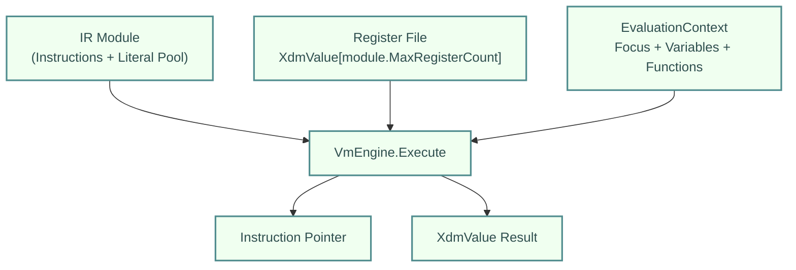
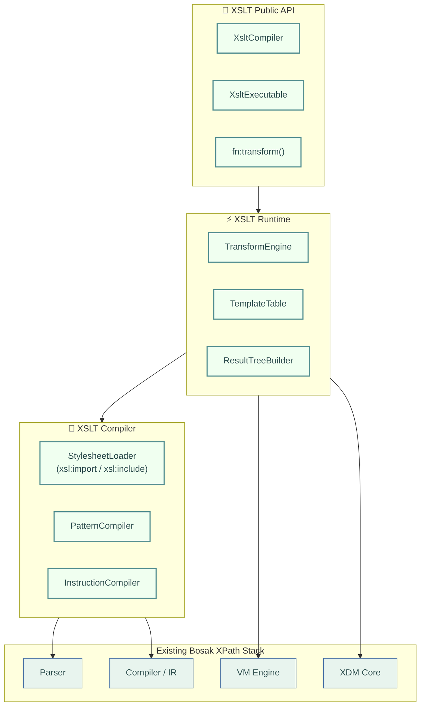
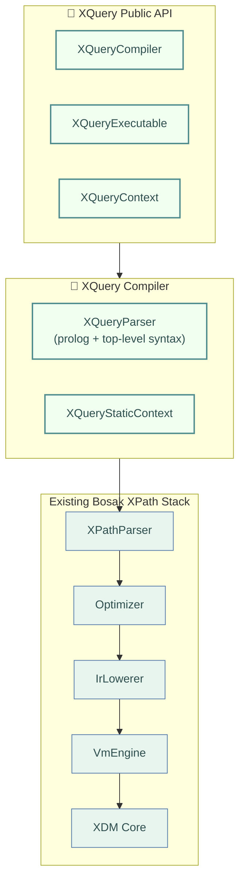

**REQ-126 closure baseline and conformance skip triage — 26 October 2026:** [Closure plan](xpath40-catalog/CLOSURE-PLAN.md) defines 13 open catalog-review/closure workpackages, with all 76 entries assigned to four 19-entry evidence batches. [Skip triage](xpath40-catalog/CONFORMANCE-SKIP-TRIAGE.md) separately tracks six investigations. Fresh QT3 31,142/0/679 and gated qt4 8,436/0/1,894 remain unchanged; all 2,573 skips are inventoried and actual filters checked for 2,512 dependency cases. Twenty-six bounded executor probes yielded 6 passes/8 assertion failures/7 schema exceptions/5 skips outside gate accounting; applicability still governs admission. AC-01–04 remain partial, AC-05 maintained. Public 1.26.3, source, version and gate/filter policy are unchanged. Earlier checkpoints below are historical.

**1.26.3 published and verified — 26 October 2026:** [Publication proof](RELEASE-1.26.3-PUBLICATION.md) pins source `08fbdc31ac79baac04cf00f4773ec6d0b2dd247f`, one Release run with 21,798 solution passes/ten uploads, ten verified signed public packages, and fresh nuget.org-only 153 broad/11,175 focused checks. All 19 assembly identities and signed archive/cache/output provenance match; both dependency audits are clear. All 3,061 added integer-preservation/audit cases are available. Original evidence and the bounded Braid local 1.26.2 adoption snapshot remain preserved; REQ-126 stays partial and no 1.26.3 adoption/native acceptance is inferred. Earlier candidate/unpublished notices below are historical.

**1.26.3 candidate validated — 26 October 2026:** [Pinned source/package proof](RELEASE-1.26.3-CANDIDATE.md) consolidate abs and floor/ceiling integer identity fixes with the completed argument audit at `08fbdc31ac79baac04cf00f4773ec6d0b2dd247f`. Fresh isolated checks pass 21,882 source/LSP tests, unchanged frozen gates, 153 broad and 11,175 focused package checks, including all 3,061 added source cases unchanged. Ten unsigned packages and 19 consumed identities match source/archive/cache/output provenance; both fresh dependency audits are clear. The 802 contract-audit cases required no engine correction. Public 1.26.2 and its previously captured bounded Braid adoption evidence remain current; no 1.26.3 adoption/CI/native acceptance or publication is inferred. REQ-126 stays partial. Earlier notices below are historical.

**Floor/ceiling argument audit — 26 October 2026:** [Contract tests and evidence](xpath40-catalog/FLOOR-CEILING-ARGUMENT-CONTRACT.md) add 802 passing controls for cardinality, recursive arrays, untyped/node conversion, required errors, numeric types, call forms and bounded static backwards-compatible behavior. All pass on the unchanged engine; no implementation correction is claimed. The 798-observation public probe has zero discrepancies. Fresh 21,882 solution/LSP tests pass with unchanged frozen gates. The unpublished 1.26.3 patch now adds 3,061 cases across abs, integer identity and contract audit; public 1.26.2 and its bounded Braid adoption snapshot remain current. REQ-126 remains partial; no new adoption/native acceptance or publication is inferred. Earlier notices below are historical.

**Floor/ceiling integer preservation — 26 October 2026:** [Bounded correction and evidence](xpath40-catalog/FLOOR-CEILING-INTEGER-PRESERVATION.md) retain supported decimal-backed integer values and annotations unchanged in both functions. All 936 new cases pass (baseline: 168 failed); all 21,080 solution/LSP tests pass with unchanged frozen gates. This consolidates with abs into unpublished 1.26.3; public 1.26.2 remains current. Numeric calculations, atomization/conversion and metadata are unchanged; broader floor/ceiling argument contracts remain a separate audit. Braid's prior bounded local 1.26.2 adoption snapshot is retained, with no new adoption/CI/native acceptance inferred or Braid writes. REQ-126 remains partial. Earlier notices below are historical.

**Abs integer preservation and Braid adoption — 26 October 2026:** [Correction and evidence](xpath40-catalog/ABS-INTEGER-PRESERVATION.md) widen Int64.MinValue before absolute-value negation and preserve existing decimal-backed integer identity, retaining plain decimal/floating/conversion behavior. All 1,323 new cases pass (baseline: 288 failed); 20,144 solution/LSP tests pass with unchanged frozen gates. Source 1.26.3 is unpublished; public 1.26.2 stays current. Braid's supplied local 1.26.2 adoption report records 1,876 Release passes, 246 XPath +72 preview cases and 280 overlapping signed-package checks. It explicitly remains uncommitted, with no current-adoption CI or added native UI/accessibility acceptance. No Braid edits. REQ-126 remains partial; general constructors/casts and idiv remain separate. Earlier notices below are historical.

**1.26.2 published and verified — 26 October 2026:** [Publication proof](RELEASE-1.26.2-PUBLICATION.md) pins source `6a3372fc3b91e733b71a426cf40f26feaaeb3bcb`, one Release run with 18,737 solution passes/ten uploads, ten verified signed public packages, and fresh nuget.org-only 153 broad/8,114 focused checks. All 19 assembly identities and signed archive/cache/output provenance match; both dependency audits are clear. All 4,201 new rounding cases are available. Original evidence and the separate 12-expectation correction remain preserved; REQ-126 stays partial. Braid smoke completion is owner-reported, outcome/new adoption/native acceptance not supplied. Earlier candidate/unpublished notices below are historical.

**1.26.2 candidate validated — 26 October 2026:** [Pinned source and package proof](RELEASE-1.26.2-CANDIDATE.md) consolidate extreme precision and exact rounding kernels at `6a3372fc3b91e733b71a426cf40f26feaaeb3bcb`. Fresh isolated checks pass 18,821 source/LSP tests, unchanged frozen gates, 153 broad and 8,114 focused package checks, including all 4,201 added source cases unchanged. Ten unsigned packages and 19 consumed assembly identities match source/archive/cache/output provenance; both fresh dependency audits report no vulnerable packages. The 600 actual historical rounding discrepancies are corrected; 12 mistaken expectations remain separately corrected with original receipts preserved. Public 1.26.1 remains current; no tag/release/upload or signed public verification. Braid smoke completion is owner-reported, with no supplied outcome/acceptance. REQ-126 remains partial. Earlier notices below are historical.

**Exact rounding kernels — 26 October 2026:** [Implementation and corrected evidence](xpath40-catalog/ROUNDING-KERNELS.md) fix decimal scaling, exact floating midpoint decisions, signed zero and wide-integer result identity. All 2,880 new cases pass (same-test baseline: 1,110 failed), with 18,821 solution/LSP tests and unchanged frozen gates. The previous 612 diagnostic discrepancies comprise 600 corrected rounding observations and 12 wrong expectations, now corrected separately with original receipts retained. Both current diagnostic matrices are fully green. Source 1.26.2 remains unpublished; public 1.26.1 stays current. The owner reports Braid's smoke test finished; its outcome/acceptance has not been supplied. REQ-126 remains partial. Earlier notices below are historical.

**Extreme rounding precision — 26 October 2026:** [Audit, bounded correction and remaining findings](xpath40-catalog/ROUNDING-PRECISION-BOUNDARIES.md) admit existing decimal-backed integer precision payloads and handle precision outside +/-1000 before narrowing/power calculations, preserving numeric types, signed zero and special values. Adds 1,321 passing cases (corrected baseline: 1,027 failed); all 15,941 solution/LSP tests pass with unchanged frozen gates. All 1,452 extreme observations match; 612 retained-kernel discrepancies stay explicit and unchanged. Source 1.26.2 is unpublished; public 1.26.1 remains current. The owner reports Braid's 1.26.1 smoke test is underway; no result/acceptance is inferred. REQ-126 remains partial.

**1.26.1 published and verified — 26 October 2026:** [Publication proof](RELEASE-1.26.1-PUBLICATION.md) pins approved source `65417cdb3bff184ca9ff1f624582f55ca4681db9`, one Release run with 14,536 passing solution tests/ten uploads, ten verified signed public packages and fresh nuget.org-only 153 broad/3,913 focused checks with all 19 assembly identities and signed archive/cache/output provenance matching. Neither fresh dependency audit reports vulnerable packages. Atomic/rounding fixes and 2,420 new regressions/controls are available; REQ-126 remains partial and existing Braid 1.26.0 acceptance is unchanged. Earlier unpublished/candidate notices below are historical; no new Braid adoption/native acceptance is inferred.

**1.26.1 candidate validated — 26 October 2026:** [Pinned source and package proof](RELEASE-1.26.1-CANDIDATE.md) records source `65417cdb3bff184ca9ff1f624582f55ca4681db9`, 14,620 source/LSP passes, unchanged frozen gates, ten unsigned packages and 153 broad/3,913 focused PackageReference-only checks. All 19 consumed assembly identities and archive/cache/output bytes agree; fresh dependency audits report no vulnerable packages. The 2,420 added source cases are copied byte-identically into the package consumer. Public 1.26.0 and bounded Braid acceptance remain current; REQ-126 remains partial. No tag, publication or new Braid adoption/native acceptance.

**Rounding argument conversion — 26 October 2026:** [Audit, correction and evidence](xpath40-catalog/ROUNDING-FUNCTION-CONVERSION.md) enforce optional numeric cardinality and integer precision conversion for `round`/`round-half-to-even`, preserving existing coerced function names and supported static backwards-compatible behavior. Adds 1,514 passing cases; the unchanged baseline had 654 failures. All 14,620 solution/LSP tests pass; QT3 and frozen qt4 remain unchanged. The 1,494-observation comparison has 654 corrections and no sampled regressions. Source 1.26.1 remains unpublished, public 1.26.0/Braid acceptance is unchanged, and REQ-126 remains partial. Extreme precision/numerical kernels and broader coercion remain separate.

**Atomic function conversion/cardinality — 25 October 2026:** [Audit, correction and evidence](xpath40-catalog/ATOMIC-FUNCTION-CONVERSION.md) enforce `abs`'s `xs:numeric?` argument contract at its implementation boundary, preserve named-function identity, and retain FOTY0013 for maps/function items in numeric-union conversion. Adds 366 passing cases; all 13,106 solution/LSP tests pass and frozen gates are unchanged. The 576-pair matrix now has zero sampled array/flat-reference discrepancies (36/12 corrected, no regressions). Remaining rounding contracts, metadata/coercion identity and broader conversion remain follow-up scope. Source 1.26.1 stays unpublished; public 1.26.0/Braid acceptance is unchanged; REQ-126 remains partial.

**REQ-137 formal Braid acceptance - 24 October 2026:** [Consumer acceptance receipt](REQ-137-BRAID-ACCEPTANCE.md) pins verified pushed Braid checkpoint d601c05eaf0b6c201683b0786336356231ca0ea7, published1.25.0/c005054b, coordinated Move up/down,1,485 Release /905 signed public-package passes and the owner's explicit "Passed — accepted" focused native report. Disposition: implemented, published and consumer-accepted within the delivered bounded profile. Automated coverage is distinct from human observations; optional/unreported variants and accessibility remain unspecified. Documentation only; no engine/release change. Earlier consumer-pending checkpoints are historical.

<div align="center">
  
  <br><br>
  <h1>Bosak XPath Architecture</h1>
  <p>Technical design document — XPath 3.1 register-VM engine</p>
</div>

**K04-C37 pragma fallback implemented (2026-10-28):** [Raw pragma lexing and statically validated fallback](conformance/k04-pragma-fallback/README.md) recognize no pragma namespaces; well-formed pragmas are ignored, with XQST0079 for missing fallback and XPST0081 for unbound prefixes. Raw contents, declaring-module/constructor scopes and XPath 3.1/4.0 compatibility are covered. Fresh **24,164 solution tests**, **82 regressions** and **24 public controls** pass; all 55 eligible originals pass in the isolated **31,395/0/426** gate. One old exact-XQ10 no-namespace expectation remains an explicitly excluded direct failure. Normal gates/maps remain **31,340/0/481** and **8,939/0/1,920** (230 sets, 11 experimental passes). Normal guards, fixtures, assertions and baseline are unchanged. Candidate **1.33.0** unpublished/public **1.26.3**. Next: C38 separate routing admission qualification. Bosak.Schema owns XSD 1.1, ADR-006/REQ-139 remains pending, and REQ-126 bounded closure/48 historical observations remain.

**K04-C36 remaining-skip/pragma review (2026-10-28):** [All 481 retained skips classified](conformance/k04-pragma-review/README.md): 425 dependency skips partition into 55 routing-only, two routing-plus-independent and 368 independent exclusions; 40 unattended exclusions, ten range/platform/external limits and six existing schema harness errors remain separate. Complete inventory covers 31,821 cases; 57 pragma predicates change, with 60 originals across four sets. Isolated gate **31,348/47/426** (exit 2) does not qualify admission; direct originals give 11 passes/49 failures and public controls eight passes/16 failures. Fresh normal gates and maps remain **31,340/0/481** and **8,939/0/1,920** (230 sets, 11 experimental passes). All 209 final processes are bounded; adopted C35's 24,082 solution passes are inherited. Next: C37 raw pragma lexing and ignored-pragma fallback, retaining normal guards. Source, fixtures, baseline and version remain unchanged; candidate **1.32.0** unpublished/public **1.26.3**. Bosak.Schema owns XSD 1.1, ADR-006/REQ-139 remains separately pending, and REQ-126 bounded closure/48 historical observations remain.

**K04-C35 construction admission adopted (2026-10-28):** [Exact owner-approved 83-case adoption verified](conformance/k04-construction-admission/adoption/BASELINE-ADOPTION.md). Fresh normal QT3 is **31,340/0/481**; the 83 named removals and every retained skip name/reason match qualification, including four independent exact-XQ10 exclusions. Fresh qt4 remains **8,939/0/1,920** (230 sets, 11 experimental passes). All **24,082 solution tests** pass; rebuilt normal routing matches all 31,821 cases and 19 lexical controls. Only the approved TestExecutor refusal/history and AGENTS baseline change; pragma/dependency guards, engine source, fixtures and assertions remain intact. Candidate **1.32.0** unpublished/public **1.26.3**. REQ-126 bounded closure and 48 historical observations remain; Bosak.Schema owns XSD 1.1 and ADR-006/REQ-139 remains separately pending. Next: C36 refresh remaining skips and review the pragma boundary. No release is included.

**K04-C35 construction admission qualified (2026-10-28):** [Exact two-file baseline proposal](conformance/k04-construction-admission/BASELINE-UPDATE-PROPOSAL.md) is ready; **owner approval pending**. All 31,821 cases were inventoried; 87 original assertions pass and exactly 83 eligible skips leave the isolated gate (**31,340/0/481**), with all 481 retained names/reasons and four exact-XQ10 exclusions unchanged. Copy/context assertions (49/43) pass under both executors; 19 lexical controls pass each. Fresh normal gates remain **31,257/0/564** and **8,939/0/1,920** (230 sets, 11 experimental passes). All 450 processes are bounded and successful; C34's 24,082 solution passes are inherited. No production, baseline, fixture, version or release change is applied. Candidate **1.32.0** unpublished/public **1.26.3**; Bosak.Schema XSD 1.1 ownership, separately pending ADR-006/REQ-139, REQ-126 bounded closure and 48 historical observations remain.

**K04-C34 construction implementation (2026-10-28):** [Construction modes and consistent typed copies](conformance/k04-construction-modes/README.md) implement explicit strip/preserve with default preserve, module-scoped IR policy, private copied schema metadata, nil/list/ID behavior and QName/NOTATION safeguards. Core adds nullable construction-policy inputs and copied-attribute source metadata; null direct hooks retain legacy behavior. Required anyType matching, validate-expression precedence and xml:id error mapping are repaired. Fresh **24,082 solution tests**, **73 regressions** and **87 original assertions** pass. Normal gates remain **31,257/0/564** and **8,939/0/1,920** (230 sets); isolated construction routing gives **31,340/0/481**, exactly 83 eligible removals with retained reasons unchanged. Candidate **1.32.0** unpublished/public **1.26.3**. Next: C35 separate admission qualification and owner-approved baseline proposal. REQ-126 bounded closure and 48 historical observations remain; Bosak.Schema owns XSD 1.1 and ADR-006/REQ-139 remains separately pending.

**K04-C33 construction review (2026-10-28):** [All 87 construction/mixed originals reviewed](conformance/k04-construction-mode-review/README.md) across ten sets. The isolated gate gives **31,261/79/481** (exit 2); admission is unqualified. A public typed-copy probe retains the root schema type but loses descendant/attribute types, IDREFS cardinality and nilled state across direct/computed/document copies. Source nodes are unchanged. Default construction is implementation-defined and needs an explicit compatibility policy. Fresh normal gates remain **31,257/0/564** and **8,939/0/1,920** (230 sets); production source, guards, fixtures, baselines and version are unchanged. C32 unit tests are inherited. Next: C34 construction-mode/default/metadata implementation. Bosak.Schema owns XSD 1.1; ADR-006/REQ-139 remains separately proposed/pending. Candidate **1.31.0** unpublished/public **1.26.3**; REQ-126 bounded closure and 48 historical observations remain.

**K04-C32 copy-admission adopted (2026-10-28):** [Exact owner-approved 49-case adoption verified](conformance/k04-copy-namespaces-admission/adoption/BASELINE-ADOPTION.md). Fresh normal QT3 is **31,257/0/564**; every retained skip name/reason is unchanged. Fresh qt4 remains **8,939/0/1,920** (230 sets, 11 experimental passes). All **24,010 solution tests** pass, and rebuilt normal routing matches all 31,821 catalog cases plus 37 lexical controls. Construction, pragma and independent dependency guards remain intact; engine source, fixtures, assertions and version are unchanged. AGENTS.md records the approved baseline. Candidate **1.31.0** unpublished/public **1.26.3**. REQ-126 bounded closure and 48 historical observations remain; Bosak.Schema owns XSD 1.1. Next: separately review construction-mode boundaries.

**K04-C32 copy-admission review (2026-10-28):** [All 31,821 QT3 cases audited](conformance/k04-copy-namespaces-admission/README.md); exactly **49** copy-namespaces admissions qualify across five sets. The full isolated gate passes **31,257/0/564**, with every retained skip name/reason unchanged; all 49 original assertions and 37 lexical controls pass. All 87 construction/mixed predicates and 43 admitted context predicates retain policy. Fresh normal gates remain **31,208/0/613** and **8,939/0/1,920** (230 sets). The exact two-file baseline proposal awaits owner approval; normal source, fixtures, baselines and version are unchanged. C31 solution/focused tests are inherited. Candidate **1.31.0** unpublished/public **1.26.3**; REQ-126 bounded closure and 48 historical observations remain. Bosak.Schema owns XSD 1.1.

**K04-C31 namespace-copy implementation (2026-10-28):** [All four XQuery copy-namespaces modes implemented](conformance/k04-copy-namespaces/README.md), with module-scoped constructor IR, literal/enclosed-content distinction, source isolation and XQST0055 diagnostics. All **76 focused tests**, **24,010 solution tests** and **49 original copy-only cases** pass; the 43 admitted context results are unchanged. Normal gates remain exactly **31,208/0/613** and **8,939/0/1,920** (230 sets). The isolated copy-only gate is **31,257/0/564**, with every retained skip reason unchanged. Construction, normal guards, fixtures and baselines remain unchanged. Candidate **1.31.0** unpublished/public **1.26.3**. Next: separate C32 exact routing-admission review. REQ-126 bounded closure and 48 historical observations remain; Bosak.Schema owns XSD 1.1.

Constructor IR stores copy policy and lexical namespace declarations per declaring module, including closures. The parser retains literal child origin, and provider annotations represent no-inherit/default-namespace absence consistently across namespace axes and prefix/QName functions. Named functions and lazy globals isolate constructor namespace frames and restore caller state.

**K04-C30 prolog-mode review (2026-10-28):** [All 136 construction/copy-namespaces queries reviewed](conformance/k04-prolog-mode-review/README.md) across 13 sets: 75 construction-only, 49 copy-only, 12 mixed. Removing both refusals in isolation yields **31,214/126/481** (exit 2), so admission remains unqualified. Public controls expose missing valid-mode parsing and XQST0055/XQST0067 diagnostics; two declaration-free default namespace witnesses pass. Fresh normal gates remain **31,208/0/613** and **8,939/0/1,920** (230 sets). Source, guards, fixtures, baselines and version are unchanged; C29 solution tests are inherited. Next: C31 copy-namespaces implementation against the 49 copy-only originals, with separate later admission review. Candidate **1.30.1** unpublished/public **1.26.3**. REQ-126 bounded closure and 48 historical observations remain; Bosak.Schema owns XSD 1.1.

**K04-C29 context-routing adoption (2026-10-28):** [Exact owner-approved 43-case admission adopted](conformance/k04-context-routing-review/adoption/BASELINE-ADOPTION.md). Fresh normal QT3 is **31,208/0/613**; all 613 retained skip names/reasons are unchanged. Fresh qt4 remains **8,939/0/1,920** (230 sets, 11 experimental passes). All **23,934 solution tests** pass, and the rebuilt normal runner matches all 31,821 catalog routing decisions plus 30 lexical controls. Construction, copy-namespaces and pragma guards remain intact; fixtures, assertions, engine and version are unchanged. AGENTS.md records the approved baseline. Candidate **1.30.1** unpublished/public **1.26.3**. REQ-126 bounded closure and its 48 historical observations remain; Bosak.Schema owns XSD 1.1. Next: separately audit remaining unsupported-prolog cohorts.

**K04-C29 complete routing review (2026-10-28):** [All 31,821 QT3 cases audited](conformance/k04-context-routing-review/README.md); exactly **43** context-routing admissions are qualified (40 context cases and three variable-default cases). The complete isolated gate passes **31,208/0/613**, with all 613 retained skip names/reasons unchanged. Fresh normal gates remain **31,165/0/656** and **8,939/0/1,920** (230 sets). Thirty lexical controls and all 43 original assertions pass under the prototype. The exact two-file baseline proposal awaits owner approval; normal source, guards, fixtures, baselines, version and release remain unchanged. C28 unit tests are inherited. Candidate **1.30.1** unpublished/public **1.26.3**; REQ-126 bounded closure and 48 historical observations remain. Bosak.Schema owns XSD 1.1.

**K04-C28 library context correction (2026-10-28):** [Declaring-module namespace and type identity repaired](conformance/k04-library-context-fix/README.md); all imported constraints are retained, and dynamic target validation uses its prepared schema context. **112 focused tests** and **23,934 solution tests** pass. All 13 resource/module originals and 12 controls pass; isolated QT3 context set **44/0/0**. Normal gates remain **31,165/0/656** and **8,939/0/1,920** (230 sets). Guards, fixtures and baselines are unchanged. Candidate **1.30.1** unpublished/public **1.26.3**. Next: C29 complete routing/admission review before any baseline proposal. REQ-126 bounded closure and 48 historical unmet observations remain; Bosak.Schema retains XSD 1.1 ownership.

**K04-C27 resource/module audit (2026-10-28):** [All 13 remaining originals reviewed](conformance/k04-context-resource-review/README.md) through actual resource/module machinery: normal direct execution gives 4 passes/9 skips; isolated context routing gives 11 passes/2 failures. The complete isolated set is **42/2/0**, so admission is unqualified. Both failures lose the library prefix `u`; independent controls expose declaring-context/type-identity and built-in-alias issues (**8 passed/4 failed**). Normal context sets remain **4/0/40** and **0/0/53**. Source, guards, fixtures, baselines and version remain unchanged. C26's 23,822 solution passes and gates **31,165/0/656**, **8,939/0/1,920** (230 sets) are inherited, not fresh full runs. Candidate 1.30.0 unpublished/public 1.26.3. Next: C28 constraint-scope/identity correction before any guard proposal; Bosak.Schema retains XSD 1.1 ownership.

**K04-C26 main context initialization (2026-10-28):** [Bounded main-module implementation](conformance/k04-main-context/README.md) adds typed context values, external/default selection, singleton focus, global dependencies/cycles and host-focus restoration. All **52 new regressions**, **31 bounded original assertions**, 18 controls and five library controls pass. Fresh solution: **23,822 tests**. Normal admission is unchanged: context sets **4/0/40** and **0/0/53**, full gates **31,165/0/656** and **8,939/0/1,920**, 230 gated sets, identical skip mappings. Explicit-context sequence results are stabilized before focus restoration; queries without a declaration retain their prior result path. Candidate **1.30.0** unpublished/public **1.26.3**. Next: audit the 13 resource/module-bearing original boundaries before any guard or baseline proposal; Bosak.Schema owns staged XSD 1.1.

XQuery main context declarations now flow through an immutable static-context record and a separately lowered initializer IR module. Evaluation installs an internal semantic-focus resolver while initialization is pending, so globals can refer forward to declared focus and cycles are detected dynamically. Focus snapshots do not invoke the resolver. Declaration-scoped global/body sequences are stabilized before restoring host focus; no-declaration queries use the existing path. This does not alter conformance routing or Bosak.Schema capability boundaries.


**K04-C25 duplicate context declaration corrected (2026-10-28):** [Narrow library parser fix](conformance/k04-context-duplicate-fix/README.md) reports XQST0099 for duplicate context declarations while retaining XQST0113 for library initializers/defaults and the dynamic-loader wrapper. All 24 new public regressions and **23,770 solution tests** pass. All five library probes pass; the 80 C24 original/control results and 97 filter assessments are unchanged, so main-module declaration support remains open. Fresh gates stay **31,165/0/656**, **8,939/0/1,920**, with 230 gated sets and identical skip names/reasons. Candidate **1.29.3** unpublished/public **1.26.3**. No routing, fixture, baseline, schema or release change. Next: main-module context declaration implementation.

**K04-C24 context declarations reviewed (2026-10-28):** [Bounded XQuery diagnosis](conformance/k04-context-declaration-review/README.md) inventories 97 originals and executes 31 resource-free QT3 cases: public XQuery gives 1 syntax-error pass/30 failures; the actual executor gives 1 pass/30 skips. Three baseline controls pass, while 15 declaration controls fail at parsing. Four of five library parser controls pass; duplicate declarations incorrectly report XQST0113 instead of XQST0099. Fresh normal sets remain **4/0/40** (QT3) and **0/0/53** (qt4). No guard/source/admission/baseline/version change. Next: narrow duplicate error correction before main-module implementation. C23's 23,746 solution passes and gates **31,165/0/656**, **8,939/0/1,920** (230 sets) are inherited, not fresh full-suite runs. Candidate 1.29.2 unpublished/public 1.26.3.

**K04-C23 normalization adopted (2026-10-28):** The owner-approved exact patch at ee19ebbf is applied. [Fresh actual normal receipts](conformance/k04-normalization-admission/adoption/BASELINE-ADOPTION.md) verify QT3 **31,165/0/656** (only repaired positive `cbcl-fn-normalize-unicode-006` leaves skips), qt4 **8,939/0/1,920** and **230 gated sets** (normalization adds 44 passes and six existing dependency skips). Complete normalization sets are **43/0/5** and **44/0/6**; all skip mappings match approved rehearsal exactly, including retained conditional negatives. AGENTS requires the new QT3 baseline. Fresh full solution: **23,746 passing tests**, including 8,196 XSLT tests. Candidate 1.29.2 unpublished/public 1.26.3; no engine, filter, fixture, schema or release change. Earlier proposal notices are historical.

**K04-C23 normalization admission review (2026-10-28):** [Exact three-file proposal](conformance/k04-normalization-admission/BASELINE-UPDATE-PROPOSAL.md) awaits owner approval; normal runners and AGENTS remain unchanged. Complete isolated gates pass QT3 **31,165/0/656** (only repaired positive `cbcl-fn-normalize-unicode-006` leaves skips) and qt4 **8,939/0/1,920**, promoting only the 44-pass normalization set with its six existing dependency exclusions (230 proposed gated sets). Every retained skip reason is identical; conditional negatives remain excluded. Normalization sets are **43/0/5** and **44/0/6**; no assertion is changed. C22's 23,746 solution passes are inherited source-identical evidence, not a fresh unit run. Candidate 1.29.2 unpublished/public 1.26.3; no engine, filter, fixture, schema or release change.

**K04-C22 normalization options (2026-10-28):** Candidate **1.29.2** applies XML-whitespace form-name normalization, adds NFC defaults for an explicit empty-sequence form in 4.0/Experimental and supplies `value`/`form` keyword metadata. XPath 3.1 retains its explicit-empty type error and keyword refusal; an empty-string form still disables normalization. All 246 new regressions and 62 review controls pass; original qt4 normalization is now **44/0/6**. Complete solution: **23,746 passing tests**. Frozen gates remain QT3 **31,164/0/657**, qt4 **8,895/0/1,914**, 229 gated sets, with identical skip names/reasons. No admission or release; public **1.26.3**. See [scope and receipts](conformance/k04-normalization-options-fix/README.md).

**K04-C21 ? FULLY-NORMALIZED conversion (2026-10-28):** Candidate **1.29.1** implements conversion with a pinned Unicode 17 NFC backend and first-scalar composing-character classification. The 135 new regression rows pass; all ten solution projects are green in aggregate (**23,500 tests**, with the Standard project rerun after an assertion-rendering correction). Unicode corpus and scalar audits report zero mismatches. Frozen QT3 **31,164/0/657** and qt4 **8,895/0/1,914** retain every skip name/reason and 229 gated sets. Other normalization forms retain the platform backend; form-name whitespace, 4.0 empty-form defaults and keyword metadata remain open. No skip adoption or release; public version remains **1.26.3**. See [implementation and evidence](conformance/k04-normalization-fix/README.md).

**K04-C20 normalization review ? 28 October 2026:** [Contract/capability diagnosis](conformance/k04-normalization-review/README.md) finds a FULLY-NORMALIZED conversion/classifier defect and confirms that the Bengali fixture's leading space is required; QT3 currently mislabels it as an upstream defect. Conditional unsupported-form negatives remain excluded. Eight original probes yield 2 passes/6 diagnostic failures; 62 controls give 33 passes/29 failures. Fresh normal sets are **42/0/6** (QT3) and **41/3/6** (qt4), separating conversion from 4.0 empty-form/keyword gaps. Next: adopted scalar-aware conversion before admission or known-skip removal. No engine, filter, fixture/assertion, version or baseline change. Inherited source-identical validation: 23,365 solution passes, QT3 **31,164/0/657**, qt4 gate **8,895/0/1,914**; no fresh full-suite claim. Candidate 1.29.0 unpublished/public 1.26.3; Bosak.Schema owns staged XSD 1.1 and REQ-126 remains Complete.

**K04-C19 optional date-formatting calls ? 28 October 2026:** [Typed 4.0 arities/keywords and qualified promotion](conformance/k04-date-optional-fix/README.md) implements arities 3/4 and keyword defaults for date/dateTime/time, preserving 3.1 arities 2/5 and refusal of 3/4. All 1,167 focused checks, eight originals and 96 review controls pass. Complete sets **135/0/3**, **79/0/15**, **94/0/4** qualify for promotion: qt4 now **229 sets, 8,895/0/1,914**, retaining all 1,892 previous skip reasons and adding only 22 existing exclusions from the promoted sets. QT3 stays **31,164/0/657**, with identical skip reasons. Twelve live catalog expectations now verify availability/arity while retaining 3.1 checks; historical REQ-126 records and all 48 unmet batch observations remain unchanged. All **23,365 solution tests** pass, including **8,196 XSLT tests**. Candidate **1.29.0** unpublished/public **1.26.3**; no frozen fixture/assertion, dependency filter, schema or release change. Bosak.Schema owns staged XSD 1.1; REQ-126 remains Complete. Next: retained FULLY-NORMALIZED contract review.

**K04-C18 empty date-formatting correction ? 28 October 2026:** [Shared helper and metadata fix](conformance/k04-date-empty-fix/README.md) returns a true empty sequence for empty values in existing arities 2/5 across all profiles/shared XSLT mode. All 729 focused checks pass (348 new regressions plus 381 calendar checks); exactly 30 C17 empty-value failures become passes, leaving 21 call-surface failures and all eight original missing-arity failures open. Fresh exploratory scopes remain **208/6/18** and **92/2/4**, with every failure and skip reason unchanged. Complete normal gates stay **31,164/0/657** and **8,587/0/1,892**. All **22,927 solution tests** pass, including **8,196 XSLT tests**. Candidate **1.28.2** unpublished/public **1.26.3**; no catalog fixture/assertion, harness/admission, GatedSets or schema change. Next: separate 4.0 optional arities/keyword implementation. Bosak.Schema owns staged XSD 1.1; REQ-126 remains Complete. Earlier checkpoints are historical.

**K04-C17 optional date-arity review ? 28 October 2026:** [Pinned contract and diagnosis](conformance/k04-date-arity-review/README.md) covers format-date, format-dateTime and format-time. Eight originals fail with missing arities 3/4; 96 controls give 45 passes/51 failures, separating 30 existing empty-value failures from 21 missing 4.0 call-surface outcomes. Fresh normal exploratory scopes remain **208/6/18** (date/dateTime) and **92/2/4** (time); all eight failures are retained. Next: correct shared empty-result semantics before separate 4.0 registrations/keywords. No engine, admission, version or GatedSets change. Inherited source-identical validation: 22,579 solution passes, QT3 **31,164/0/657**, qt4 gate **8,587/0/1,892**; no fresh full-suite claim. Candidate 1.28.1 unpublished/public 1.26.3; Bosak.Schema owns staged XSD 1.1 and REQ-126 remains Complete.

**K04-C16 adopted ? 27 October 2026:** Owner approved the exact proposal at 6df9a58b. [Fresh normal adoption receipt](conformance/k04-calendar-admission/adoption/BASELINE-ADOPTION.md) records QT3 **31,164/0/657**, with only the two original CB skips removed and all 657 retained reasons identical. The qt4 gate stays **8,587/0/1,892**; combined exploratory date/dateTime is **208/6/18**, preserving all six failures and 18 other skips, with no promotion. All four originals, 364 production filter controls and 40 projected controls match approval. AGENTS now requires **31,164/0/657**. All **22,579 solution tests** pass, including **8,196 XSLT tests**. Engine, fixtures/assertions, 226 GatedSets, schema and version remain unchanged. Candidate 1.28.1 unpublished/public 1.26.3; Bosak.Schema owns staged XSD 1.1 and REQ-126 remains Complete. Next: missing date-formatting arities 3/4 contract review. Earlier pending-proposal notices are historical.

**K04-C16 CB admission proposal ? 27 October 2026:** [Exact three-file proposal](conformance/k04-calendar-admission/BASELINE-UPDATE-PROPOSAL.md) is ready for owner disposition. The complete isolated QT3 rehearsal passes **31,164/0/657**, removing only the two original CB skips with 657 retained reasons identical. The qt4 gate stays **8,587/0/1,892**; combined exploratory date/dateTime improves **206/6/20 ? 208/6/18**, retaining all six failures and 18 other skips, with no promotion. All four originals and 364 filter controls verify the bounded rule; all 25 diagnostic/rehearsal processes complete without timeout. Normal filters and AGENTS remain **31,162/0/659** pending explicit approval. K04-C15 source-identical 22,579 solution passes are inherited, not a fresh unit run. Candidate 1.28.1 unpublished/public 1.26.3; no engine, fixture/assertion, GatedSets, schema or release change. Bosak.Schema owns staged XSD 1.1; REQ-126 remains Complete. Earlier checkpoints are historical.

**K04-C15 calendar fallback correction ? 27 October 2026:** [Bounded implementation](conformance/k04-calendar-fix/README.md) separates listed unsupported calendars from invalid names, adds one AD fallback indication per output and retains shared XSLT policy. All 381 final regressions and 58 original/control diagnostics pass, including four original CB assertions. The pre-existing empty-value XPTY0004 defect remains separately documented. Normal gates remain **31,162/0/659** and **8,587/0/1,892**, with identical skip names/reasons. All **22,579 solution tests** pass, including **8,196 XSLT tests**. Candidate **1.28.1** unpublished/public **1.26.3**; no admission, fixture/assertion, GatedSets or schema change. Next: bounded CB capability admission review before any exact-baseline proposal. Bosak.Schema owns staged XSD 1.1; REQ-126 remains Complete. Earlier checkpoints remain historical.

**K04-C14 calendar review ? 27 October 2026:** [Contract and correction scope](conformance/k04-calendar-review/README.md) separates listed unsupported calendars from invalid names. Four unchanged originals and 54 controls produce 30 passes/28 failures without timeouts: CB/AH fallback errors and missing namespaced fallback indications remain open. Next: pin affected 4.0 semantics, adopt and implement bounded fallback with one indication per output, preserving invalid-name and shared XSLT behavior. No engine/admission/baseline/version change. Inherited validation: 22,198 solution passes, QT3 **31,162/0/659**, qt4 **8,587/0/1,892**; no fresh complete gate claim. Candidate 1.28.0 unpublished/public 1.26.3; Bosak.Schema owns staged XSD 1.1 and REQ-126 remains Complete.

**K04-C13 negative capability review ? 27 October 2026:** [Bounded review](conformance/k04-negative-capability-review/README.md) inventories all 78,806 catalog cases and 75 effective negative declarations. Twelve original diagnostics yield four language fallback passes, four calendar FOFD1340 failures and four normalization failures (expected FOCH0003 but succeeded). All production admission decisions remain unchanged. Next: pin and review unsupported-calendar fallback semantics before correction; language admission and FULLY-NORMALIZED remain separate findings. Inherited source-identical validation: 22,198 solution passes, QT3 **31,162/0/659**, qt4 **8,587/0/1,892**; no fresh complete gate claim. Candidate 1.28.0 unpublished/public 1.26.3; Bosak.Schema retains XSD 1.1 ownership and REQ-126 remains Complete.

**K04-C12 adopted - 27 October 2026:** Owner approved the exact proposal at e924a708. [Normal adoption receipt](conformance/k04-sequence-admission/adoption/BASELINE-ADOPTION.md) records fresh gates **31,162/0/659** and **8,587/0/1,892**;only format-integer-042 leaves each skip set,with all retained659/1,892 names/reasons identical. All22,198solution tests pass. Both originals pass normally and288production filter controls match the approved prototype. AGENTS.md now requires31,162/0/659. Engine,fixtures/assertions,schema,version and226GatedSets are unchanged. Candidate1.28.0 unpublished/public1.26.3;Bosak.Schema owns staged XSD1.1;REQ-126 remains Complete. Earlier pending-proposal notices are historical checkpoints.

**K04-C12 unsupported-sequence proposal - 27 October 2026:** [Exact baseline review](conformance/k04-sequence-admission/BASELINE-UPDATE-PROPOSAL.md) verifies original format-integer-042 assertions in both profiles. Actual formatter mechanism and16expression controls prove decimal fallback for unsupported U+FBF4;288filter controls preserve other policy. Complete isolated rehearsals pass **31,162/0/659** and **8,587/0/1,892**,with only042removed and all retained skip reasons identical. Normal source and AGENTS stay **31,161/0/660** / **8,586/0/1,893** pending explicit owner approval of the exact three-file patch. Source-identical22,198solution passes are inherited,not a fresh unit run. Candidate1.28.0 unpublished/public1.26.3;no engine,fixture/assertion,schema or GatedSets change. Bosak.Schema owns staged XSD1.1;REQ-126 remains Complete. Earlier K04 notices are historical checkpoints.

**K04-C11 parse-integer implementation - 27 October 2026:** [Bounded parser and promotion](conformance/k04-parse-integer-fix/README.md) adds4.0-only arities1/2,typed optional/default arguments,keywords and exact Int64 parsing/errors. All47 parse originals,the formatter round trip and46 profile controls pass;new87 regression rows and all22,198 solution tests pass. Fresh complete sets47/0/0 and101/0/1 qualify for promotion:qt4 now **226sets,8,586/0/1,893**. All1,892 prior qt4 skips remain;only the existing format-integer-042 skip is newly covered. QT3 stays **31,161/0/660**,with identical reasons. Candidate **1.28.0** unpublished/public1.26.3. No fixture/assertion,filter,schema or QT3 baseline change. Bosak.Schema owns staged XSD1.1;REQ-126 remains Complete. Next:review the negative numbering-sequence dependency on format-integer-042 before any exact-baseline proposal. Earlier K04 notices are historical checkpoints.

**K04-C10 parse-integer review - 27 October 2026:** [Parser-function contract review](conformance/k04-parse-integer-review/README.md) reproduces47 original parse failures plus the formatter round trip,all caused by missing registration. The frozen catalog requires4.0-only arities1/2,typed optional arguments/default10,keywords and distinct FORG0011/FORG0012/FOCA0003 handling. Seven originals allow implementation-size errors;an explicit Int64 result bound is feasible. Accepted46 controls isolate profiles,defaults,typing,lexical/range behavior and keyword metadata;one corrected3.1 keyword expectation is preserved. No source/admission/version change. Inherited22,111 solution passes and gates **31,161/0/660** / **8,438/0/1,892** are not fresh full-suite claims. Candidate1.27.0 unpublished/public1.26.3;Bosak.Schema owns staged XSD1.1;REQ-126 remains Complete. Next: explicit semantic adoption and bounded parse-integer implementation. Earlier K04 notices are historical checkpoints.

**K04-C09 radix formatter - 27 October 2026:** [Bounded radix implementation](conformance/k04-radix-fix/README.md) fixes14 formatter-only originals and preserves the two caret-grouping cases. The exploratory set improves to **100/1/1**;case012 now exposes missing parse-integer#2 and stays failed/ungated. New68 regression rows pass (53failed before);all22,111 solution tests pass. Frozen gates/skips remain **31,161/0/660** and **8,438/0/1,892**. The4.0-only path preserves3.1 behavior and existing public Int64 input bounds. Explicit pre-implementation adoption uses the frozen qt4cg revision;candidate **1.27.0** unpublished/public1.26.3. No harness,fixture/assertion,GatedSets,schema or QT3 baseline change. Bosak.Schema owns staged XSD1.1;REQ-126 remains Complete. Next: separate parse-integer contract review. Earlier K04 notices are historical checkpoints.

**K04-C08 radix review - 27 October 2026:** [Radix contract review](conformance/k04-radix-review/README.md) reproduces17 original radix cases (two existing passes/15 failures),34 profile controls and the normal102-case exploratory result **86/15/1**. The failures separate into14 formatter-only cases and one round trip that also needs the unavailable parse-integer#2. The exact frozen qt4cg specification revision is pinned for review; no semantic adoption or source change. Caret-grouping compatibility, original-value ordinal suffixes and the existing Int64 input boundary are explicit. Next: adopt and implement a4.0-only radix formatter;keep parse-integer/case012 separate. Source-identical22,043 solution passes and gates **31,161/0/660** / **8,438/0/1,892** are inherited,not fresh full-suite claims. Candidate1.26.12 unpublished/public1.26.3; Bosak.Schema owns staged XSD1.1; REQ-126 remains Complete. Earlier K04 notices are historical checkpoints.

**K04-C07 bounded CLDR admission - 27 October 2026:** [CLDR admission](conformance/k04-cldr-admission/README.md) enables the four repaired original qt4 cases through normal admission. The full102-case exploratory set improves from82/15/5 to **86/15/1**; all15 failure names/messages and the remaining dependency skip are retained. The set stays ungated. All242 before/after filter controls and six normal original checks pass. Fresh22,043 solution tests pass; exact gates/skips remain **31,161/0/660** and **8,438/0/1,892**. No engine/version, fixture/assertion, GatedSets, schema or QT3 baseline change. Candidate1.26.12 unpublished/public1.26.3; Bosak.Schema owns staged XSD1.1; REQ-126 remains Complete. Next: immutable-spec review of the15 remaining XPath4 radix-picture errors. Earlier K04 notices are historical checkpoints.

**K04-C06 formatter correction - 27 October 2026:** [Bounded integer-variation fix](conformance/k04-cldr-fix/README.md) accepts cardinal variations and preserves known German named ordinal endings using pinned F&O/CLDR semantics. All six original assertions and22 diagnostic controls pass. The new36 regression rows pass in both compatibility paths (21failed before). Fresh solution validation passes **22,043 tests**; gates remain **31,161/0/660** and **8,438/0/1,892**, with every skip name/reason unchanged. Candidate **1.26.12** remains unpublished/public1.26.3. No qt4 CLDR admission, fixture/assertion, GatedSets, schema or QT3 baseline change. Bosak.Schema owns staged XSD1.1; REQ-126 remains Complete. Next: separate bounded qt4 CLDR admission review. Earlier K04 notices are historical checkpoints.

**K04-C05 CLDR review - 27 October 2026:** [CLDR diagnosis](conformance/k04-cldr-review/README.md) preserves the original two QT3 passes, two qt4 direct passes and two qt4 FODF1310 failures. Normal qt4 still dependency-skips all four cases. Focused controls isolate rejected named-cardinal modifiers and lost German named-ordinal endings; initial control-expectation mistakes are preserved separately. No source/admission/baseline change. Inherited source-identical results:22,007 solution passes, QT3 **31,161/0/660**, qt4 gated **8,438/0/1,892**; no fresh full-suite claim. Next: pin immutable specification/CLDR semantics and implement a bounded formatter correction before reviewing admission. Candidate1.26.11 unpublished/public1.26.3; Bosak.Schema owns staged XSD1.1; REQ-126 remains Complete. Earlier K04 notices are historical checkpoints.

**K04-C04 bounded collation admission - 27 October 2026:** [Collation review](conformance/k04-collation-admission/README.md) admits existing non-codepoint collation routes in qt4. The original compare-010 assertion passes; the normal qt4 gate improves to **8,438/0/1,892**, with only that gated skip removed and all retained reasons unchanged. Four exploratory original assertions also pass; eight XQuery-only cases remain dependency-skipped, with their direct diagnostic failures preserved. Seven expression controls and248 before/after filter controls pass. Fresh solution validation passes **22,007 tests**. Normal QT3 remains **31,161/0/660**. No engine, fixture/assertion, GatedSets, schema or QT3 baseline change. Candidate1.26.11 unpublished/public1.26.3; Bosak.Schema retains XSD1.1 ownership; REQ-126 remains Complete. Next: bounded review of four qt4 CLDR format-integer declarations. Earlier K04 notices are historical checkpoints.

**K04-C03 explicit feature admission - 27 October 2026:** [Capability inventory](conformance/k04-feature-inventory/README.md) records all 78,806 catalog cases and 55 feature/profile rows. Both filters now reject unrecognized feature names for either polarity and preserve explicit legacy admissions (19 QT3/17 qt4), without certifying full support. All 222 before/after controls pass; current feature decisions and all skip names/reasons remain unchanged. Fresh solution validation passes **22,007 tests**. Fresh gates remain **31,161/0/660** and **8,437/0/1,893**. Bosak.Schema retains staged XSD 1.1 ownership. Candidate1.26.11 unpublished/public1.26.3; REQ-126 remains Complete. Next: original-assertion review of the single gated qt4 non-codepoint-collation skip. Earlier K04 notices are historical checkpoints.

**K04-C02 bounded polarity correction - 27 October 2026:** [Profile review](conformance/k04-profile-review/README.md) makes negative spec/default-language predicates invert their existing positive predicates in both harnesses, with 74 before/after controls. An inventory of 31,821 QT3 and all 46,985 qt4 cases finds no current negative declaration of either kind. Fresh solution validation passes **22,007 tests**. Fresh gates remain **31,161/0/660** and **8,437/0/1,893**, retaining every skip name/reason. Schema comments now distinguish frozen admission from Bosak.Schema's staged XSD 1.1 implementation; admission is unchanged. F03 broader capabilities and F04 integration remain open. Candidate1.26.11 unpublished/public1.26.3; REQ-126 remains Complete. Next: explicit feature/capability inventory, beginning with unknown-positive fallback. Earlier K04 notices are historical checkpoints.

**K04-C01 adopted ? 27 October 2026:** Owner approved the exact 16-case quote-routing change proposed at `d0ca0741`. The complete normal QT3 gate passes **31,161/0/660**; exactly the 16 approved cases leave the skip set and all 660 retained names/reasons are unchanged. The qt4 gated run passes **8,437/0/1,893**, with 11 Experimental passes. Fresh solution validation passes **22,007 tests** across all 10 projects. All broader routing/schema/dependency guards remain unchanged. Candidate 1.26.11 remains unpublished; public version is 1.26.3. Bosak.Schema retains XSD 1.1 ownership; REQ-126 remains Complete. Next: the remaining K04 dependency-profile/polarity review. See [adoption receipt](conformance/k04-quote-routing/adoption/BASELINE-ADOPTION.md) for approval and fresh validation. Earlier proposal notices are historical.

**K04-C01 quote-routing proposal — 27 October 2026:** [Exact adoption review](conformance/k04-quote-routing/BASELINE-UPDATE-PROPOSAL.md) verifies all16 original candidate assertions in an isolated corrected harness. Full rehearsal passes31,161/0/660, with exactly those16 skips removed and all660 retained names/reasons unchanged. Eleven boundary cases and13 lexical controls preserve broader guards. Normal source/baseline stays31,145/0/676 pending owner approval; no tracked engine/harness/filter change. Candidate1.26.11 unpublished/public1.26.3;22,007 solution passes and qt4 8,437/0/1,893 are inherited unchanged-engine evidence. Bosak.Schema XSD1.1 ownership and REQ-126 Complete are unchanged.


**K04 applicability audit — 27 October 2026:** [Current dependency/routing review](conformance/k04-dependency-audit/README.md) reproduces all619 QT3 and1,893 gatedqt4 dependency skips through actual filters. Of619 QT3 cases,246 satisfy XQuery dependencies but fail syntax routing;16 are triple-quote candidates. Thirty-two bounded execution probes yield six public-XQuery assertion passes and ten retained failures;62 synthetic predicate assessments expose profile/polarity questions. No engine, filter or baseline change. Next K04-C01: quote-aware routing with complete candidate and rehearsal evidence before any QT3 admission proposal. Candidate1.26.11 unpublished/public1.26.3; inherited22,007 solution passes and gates31,145/0/676 and8,437/0/1,893. Bosak.Schema owns XSD1.1; REQ-126 remains Complete.


**K03 name-storage integration — 27 October 2026:** [Bounded core completion](conformance/k03-name-storage/README.md) preserves Unicode map/provider names, literal values and namespace/copy metadata. All47 new regressions and22,007 solution tests pass. The original map-to-element-053 assertion now passes; qt4 improves to8,437/0/1,893 with exactly that skip removed and all1,893 retained reasons unchanged. QT3 remains31,145/0/676 with identical676 skips. No fixture, assertion, harness filter or gated-set change. Candidate1.26.11 unpublished/public1.26.3. Parser-edition/current-draft limits remain explicit; Bosak.Schema retains XSD1.1 ownership and REQ-126 remains Complete. Next: K04 dependency/routing applicability audit. Earlier open Unicode findings are historical checkpoints.


**K03-C02 serialization — 27 October 2026:** [Content-preserving name decoding](conformance/k03-serialization/README.md) restores encoded element/attribute name tokens while preserving existing literal node content, namespace URIs and declarations. All40 focused regressions and21,960 solution tests pass; QT3 remains31,145/0/676 with identical676 skips, and qt4 remains8,436/0/1,894. The original supplementary-name skip remains. Candidate1.26.10 unpublished/public1.26.3. Next: reversible name-storage integration with loader/accessor/copy round-trip verification; no public API, baseline or XSD1.1 ownership change. REQ-126 remains Complete.


**K03-C01 XML-name validation — 27 October 2026:** [Scalar validation correction](conformance/k03-name-validation/README.md) replaces category/surrogate-pair approximation with explicit XML name ranges and rejects malformed UTF-16. All78 focused tests pass (baseline18 failures), all21,920 solution tests pass, and gates stay QT3 31,145/0/676 and qt4 8,436/0/1,894. All676 QT3 skip names/reasons are unchanged. Original supplementary construction and literal-content serialization findings remain open; next is K03-C02 serialization preservation before provider storage integration. Candidate1.26.9 unpublished/public1.26.3; no baseline or XSD1.1 capability change. REQ-126 remains Complete.


**K03 Unicode-name trace — 27 October 2026:** [Bounded investigation](conformance/k03-unicode-names/README.md) reproduces map-to-element-053 and separates three open corrections: scalar NCName validation, reversible provider name storage, and serialization that preserves literal sentinel text. All 30 isolated diagnostics complete without timeouts; no engine or baseline change. Next: K03-C01 name-validation regressions/correction, followed by serialization preservation before map storage integration. QT3 remains31,145/0/676 and qt4 remains8,436/0/1,894; solution21,842 and gates are inherited unchanged-source evidence. Candidate1.26.8 unpublished/public1.26.3; REQ-126 remains Complete. Bosak.Schema XSD1.1 ownership is unchanged.


**K02 adopted — 27 October 2026:** [Owner-approved normal-runner adoption](conformance/k02-admission-review/BASELINE-ADOPTION.md) is complete. The fresh normal QT3 gate passes **31,145/0/676**; only validateexpr-28 leaves the skip set through its original XQST0012 error alternative, and all 676 retained names/reasons match. AGENTS now requires this exact baseline. The normal runner selects the existing guard; standalone TestExecutor defaults and all profile/structural exclusions remain unchanged. Engine/candidate1.26.8 unchanged and unpublished; public1.26.3. Solution21,842 and qt4 8,436/0/1,894 are inherited source-identical validation. Bosak.Schema owns XSD1.1. REQ-126 remains Complete; earlier pending/default-off notices are historical checkpoints.


**K02 admission review — 27 October 2026:** [Guarded-runner proposal](conformance/k02-admission-review/BASELINE-UPDATE-PROPOSAL.md) is ready for owner approval. Two full actual-runner rehearsals verify current 31,144/0/677 and guarded 31,145/0/676, with only validateexpr-28 leaving the skip set through its existing XQST0012 alternative; all 676 retained names/reasons match. Normal runner, AGENTS policy and baseline remain unchanged pending approval. Candidate 1.26.8 is unpublished/public 1.26.3. Unit21,842 and qt4 8,436/0/1,894 receipts are inherited from unchanged source; no new XSD1.1 capability. Bosak.Schema REQ-009 owns that track; REQ-126 remains Complete.


**K02-C02 relative schema imports — 27 October 2026:** [File-backed source URI correction](conformance/k02-relative-schema-uri/README.md) fixes the four remaining guarded regressions. All 324 eligible original cases now pass in guarded diagnostics; 17 declined-boundary cases remain unchanged. All 21,842 solution tests and both required gates pass: QT3 31,144/0/677 (all 677 skip names/reasons unchanged), qt4 8,436/0/1,894. Guarded loading stays default-off; admission/baseline review is separate. Candidate 1.26.8 is unpublished/public 1.26.3. Bosak.Schema REQ-009 owns XSD 1.1; this slice adds no public API or backend. REQ-126 remains Complete. Earlier failure counts are historical evidence.


**K02-C01 constructor registration — 27 October 2026:** [First-evaluation correction](conformance/k02-constructor-registration/README.md) fixes all 68 constructor regressions in the wider audit. All 11 focused tests and 21,836 solution tests pass; QT3 remains 31,144/0/677 and the qt4 gate 8,436/0/1,894. The 324-case paired sweep leaves four relative-import failures for K02-C02, with no new failures; 17 declined boundaries are unchanged. Guarded loading stays default-off. Candidate 1.26.7 is unpublished/public 1.26.3. Bosak.Schema REQ-009 owns XSD 1.1; no new public schema seam or capability is introduced. REQ-126 remains Complete. Earlier audit counts are historical evidence.


**K02 wider audit — 27 October 2026:** [Schema/import inventory](conformance/k02-schema-inventory/README.md) blocks normal adoption: 324 eligible original cases yield 251 retained passes, 72 regressions and one environment-exception-to-pass transition. All 1,584 metadata/paired/boundary processes complete without timeouts. Two corrections remain open: schema constructor registration after import (68 observed regressions), then relative schema-import base URI (four). Guarded loading stays default-off; no source, skip, baseline or version change. Next: K02-C01 constructor registration. Candidate 1.26.6 unpublished/public 1.26.3; REQ-126 remains Complete. Earlier narrow-sample results remain historical evidence.


**K02 guarded loader diagnostics — 27 October 2026:** [Implemented guarded mode](conformance/k02-schema-loader/README.md) delegates eligible schemas to actual query imports only when explicitly enabled for diagnostics; normal eager loading stays the default. All 66 actual-harness diagnostic runs match independent expectations, including wrong-assertion failures and preserved source/profile boundaries. All 21,825 solution tests and both normal gates pass at 31,144/0/677 and 8,436/0/1,894; all 677 QT3 skips/reasons are unchanged. Candidate 1.26.6 is unpublished. K02 profile/capability and wider applicability work remain open; no admission or baseline change. Earlier checkpoints are historical.


**K02 bounded diagnostic correction — 27 October 2026:** [Duration-schema investigation](conformance/k02-schema-duration/README.md) reproduces the unavailable schema duration types and corrects the public aggregated schema-import error to XQST0012. All 9 regressions pass (baseline 4 failed/5 passed). The original public query reaches its declared error alternative, but the QT3 environment still fails before query execution; validateexpr-28 remains skipped. No XSD 1.1 capability, skip, fixture or baseline change. Candidate 1.26.5 is unpublished; public 1.26.3 and REQ-126 acceptance are unchanged. Earlier checkpoints are historical.


**K01 complete; approved QT3 baseline — 27 October 2026:** [Exact two-case adoption](conformance/k01-schema-list/BASELINE-ADOPTION.md) removes only CastAs-ListType-20 and -28 from known skips. The fresh full QT3 gate passes **31,144/0/677**; qt4 remains 8,436/0/1,894. The owner approval and original receipts are preserved; no fixture/assertion/filter change. Source candidate 1.26.4 remains unpublished and REQ-126 remains Complete. Earlier totals and pending-approval notices are historical.


**K01 schema-list correction — 27 October 2026:** [Correction and evidence](conformance/k01-schema-list/README.md) fixes legacy typed bindings reporting XPTY0004 instead of XPST0051 for invalid list item types. All 18 regressions pass (baseline 6 failed/12 passed); direct original QT3 cases CastAs-ListType-20 and -28 now both pass. Both skips and frozen totals stay unchanged pending a separate baseline-policy approval. Source candidate 1.26.4 is unpublished; public 1.26.3 and REQ-126 bounded acceptance are unchanged. Earlier checkpoints are historical.


**REQ-126 complete for the accepted bounded catalog — 26 October 2026:** [Owner acceptance](xpath40-catalog/CATALOG-ACCEPTANCE.md) closes C13 and all 13 workpackages; zero remain open. AC-01 through AC-04 are explicitly accepted for 76 entries/235 bounded contract groups; AC-05 maintained. All 38 catalog dispositions are accepted while all 48 unmet batch observations and original technical exit criteria remain unchanged. No full current-draft compliance, engine fix, gate change or release follows. Earlier open-state notices are historical.


**REQ-126 C13 review prepared — 26 October 2026:** [Final closure review](xpath40-catalog/FINAL-CLOSURE-REVIEW.md) consolidates 76 entries, 235 bounded contract groups and 38 proposed disposition records. All 3,172 fresh documentation tests pass. Six Known Uses sections now state their evidence/gate boundary directly. The [acceptance proposal](xpath40-catalog/C13-ACCEPTANCE-PROPOSAL.md) would close the documentation catalog with explicit limits and open technical follow-ups; it is not approved. All 48 unmet batch observations remain unmet. C13 remains open, AC-01 through AC-04 unchecked and REQ-126 In Progress; no engine, fixture, gate, version or release change. Earlier checkpoints are historical.


**REQ-126 C12 complete — 26 October 2026:** [Final semantic/evidence batch](xpath40-catalog/SEMANTIC-REVIEW-BATCH-4.md) reviews 19 entries/57 contract groups with 369 exact catalog cases and six dedicated walkthroughs. All 5,595 fresh tests pass; independent diagnostics retain 167 matching and eight unmet controls. Choice coercion and switch comparison remain explicit blockers. All 76 entries now have C09-C12 bounded reviews. One workpackage remains: C13 blocker disposition and owner acceptance. REQ-126 stays In Progress; no engine, fixture, profile, gate or release change. Earlier checkpoints are historical.


**REQ-126 C11 complete — 26 October 2026:** [Third semantic/evidence batch](xpath40-catalog/SEMANTIC-REVIEW-BATCH-3.md) reviews 19 entries/56 contract groups and 874 exact linked cases. All 3,756 fresh tests pass; all 26 sample blocks have verification paths, including seven independently executed inline queries. Of 99 supplemental observations, 77 controls match, 20 retain known requirements and two record URI type behavior. Destructuring, spelling, focus and epoch-profile caveats remain explicit. Two workpackages remain; C12 is next. No final acceptance, engine, fixture, profile, gate or release change; earlier checkpoints are historical.

**REQ-126 C10 complete — 26 October 2026:** [Second semantic/evidence batch](xpath40-catalog/SEMANTIC-REVIEW-BATCH-2.md) reviews 19 entries/55 contract groups with 892 exact linked cases and 82 sample blocks. All 3,469 fresh tests pass. Supplemental observations retain 60 matching controls, 10 known draft mismatches, two disputed highest-example controls and two URI observations. The source/example reading issue stays separate from an engine-defect diagnosis. Three packages remain; C11 is next. No final acceptance, engine, fixture, profile, gate or release change; earlier checkpoints are historical.

**REQ-126 C09 complete — 26 October 2026:** [First semantic/evidence batch](xpath40-catalog/SEMANTIC-REVIEW-BATCH-1.md) reviews 19 entries/67 contract groups and 536 distinct linked cases. All 3,447 fresh existing tests pass; 116 sample +8 walkthrough blocks have explicit verification paths. Of 54 independent profile controls, 46 match and eight retain known model/extrema/partial-apply boundaries. Scan sample queries are separated and executed verbatim. Four closure workpackages remain; C10 is next. No final acceptance, engine, fixture, profile, gate or release change; earlier checkpoints are historical.

**REQ-126 C08 complete — 26 October 2026:** [Historical adoption research](xpath40-catalog/ADOPTION-HISTORY-RESEARCH.md) checks all 28 original records through 16 delivery trees, 16 retained PR heads, 58 matching historical commits and 16 PR records. No exact adoption pin was recovered. The owner explicitly approved 26 legacy provenance exceptions and two non-adoption dispositions, retaining all original nulls. C08 is complete; five packages remain open, with C09 next. Earlier receipts, defects and semantic acceptance remain open. No engine, profile, gate or release change; earlier checkpoints are historical.

**REQ-126 C07 complete — 26 October 2026:** [Lifecycle/disposition review](xpath40-catalog/LIFECYCLE-RECONCILIATION.md) reconciles all 76 classifications and 19 original/wider decision groups. All 3,519 fresh existing tests and 113 profile controls pass. Current compound-pattern wording, method-call boundaries and a malformed delivery link are corrected with original receipts retained. Six closure workpackages remain; C08 historical adoption evidence is next. All 28 missing adoption pins, earlier defects and semantic acceptance remain open. No feature/profile/gate promotion or release; skips, Braid and extension work stay deferred. Earlier checkpoints are historical.

**REQ-126 C06 complete — 26 October 2026:** [Host/profile review](xpath40-catalog/HOST-PROFILE-RECONCILIATION.md) reconciles the final three grammar rows; all 18 now have bounded reviews, not semantic acceptance. All 376 focused tests and 3,148 catalog examples pass. Of 154 probe observations, 133 controls match, two retain a switch comparison mismatch, and 19 record context boundaries. Seven closure workpackages remain; C07 is next. Static-mode and loader/adoption limits remain explicit. No engine, profile, gate or release change; skips, Braid and extension work stay deferred. Earlier checkpoints are historical.

**REQ-126 C05 complete — 26 October 2026:** [Type/collection/pattern review](xpath40-catalog/TYPE-COLLECTION-PATTERN-RECONCILIATION.md) reconciles nine type/collection/pattern rows and 49 selected production names. All 2,457 focused tests pass. Of 275 independent controls, 259 match; 16 retain choice-coercion, record-destructuring and known generic-model gaps. Delivered union/EQName fixes remain closed. Eight closure workpackages remain; C06 is next. No engine or executable example changes, acceptance waiver, profile/gate promotion or release. Skips, Braid and extension work stay deferred; earlier checkpoints are historical.

**REQ-126 C04 complete — 26 October 2026:** [Expression/call/focus review](xpath40-catalog/EXPRESSION-CALL-FOCUS-RECONCILIATION.md) reconciles six expression/call/focus rows and 33 selected production/token names. All 880 focused tests pass; 209 controls match, ten retain current-draft spelling/placeholder/mapping-focus gaps, and eight late-binding observations remain separate. Nine closure workpackages remain; C05 is next. No engine or executable example changes, gate/profile promotion, acceptance waiver or release. C02's atomic-annotation defect remains open. Skips, Braid and extension work stay deferred; earlier checkpoint counts are historical.

**REQ-126 C03 complete — 26 October 2026:** [Constructor/type review](xpath40-catalog/CONSTRUCTOR-TYPE-RECONCILIATION.md) reconciles eight entries and all 49 focus constructors. All 1,333 asserted controls match across 1,357 observations; 245 focused schema/API/host tests pass. Bounded nominal defaults/static fields are now evidenced. Generic wide casts, decimal precision, schema/host context and broader conversion remain explicit boundaries; C02's atomic-annotation defect remains open. Ten closure workpackages remain; C04 is next. No engine/test/example/version/gate change or acceptance waiver; skips/Braid/extension work stays deferred. Earlier checkpoint counts are historical.

**REQ-126 C02 complete — 26 October 2026:** [Function/options reconciliation](xpath40-catalog/FUNCTION-OPTIONS-RECONCILIATION.md) reconciles 30 entries/74 function surfaces with explicit supported boundaries and 14 follow-up groups. Release build and all 21,798 solution tests pass; all 3,148 catalog examples pass separately. The 195 added profile observations include 118 matching controls, two unmet controls for the new `atomic-type-annotation(())` defect, and 75 diagnostics. Eleven closure workpackages remain; C03 is next. C02 closes review scope, not AC-01–04 or the retained defects. Skip fixes, Braid and extension work remain deferred. Original receipts and frozen gates are preserved; no engine/version/release change.

**REQ-126 C01 complete — 26 October 2026:** [Current inventory and ownership record](xpath40-catalog/FUNCTION-INVENTORY-REFRESH.md) refreshes 316 names against published 1.26.3 and pinned current draft b4723ff5: 119 registered 4.0-only names (70 non-constructors, 49 focus constructors), plus 197 existing names. The retained inventory missed `array:members` and `array:of-members`. All 1,581 profile lookup observations completed without probe errors; four changed declarations and remaining semantic/default/empty/error reviews have explicit C02/C03/C06 owners. Twelve closure workpackages remain open; REQ-126 and AC-01–04 remain partial. Finish these packages before skip fixes, Braid or VS Code extension work. Engine, APIs, tests, version and frozen gates are unchanged; existing passing source/gate evidence is inherited. Earlier counts and checkpoint notices are historical.

**Numeric binary/range empty correction - 25 October 2026:** [Behavior and evidence](xpath40-catalog/BINARY-EMPTY-ATOMIZATION.md) propagate empty atomized operands in six numeric paths and modern ranges. Adds 214 cases (168 failed before; all pass after), 12,740 solution/LSP passes and unchanged fresh frozen gates. Matrix discrepancies fall 84 to 36 (48 corrected, no regressions); function conversion remains separate. Existing source patch 1.26.1 is unpublished; public 1.26.0 has bounded Braid acceptance. REQ-126 stays partial.

**REQ-138 accepted by Braid - 25 October 2026:** [Formal acceptance](REQ-138-BRAID-ACCEPTANCE.md) pins pushed checkpoint `29acaac761206d6b316e8844930ce5d4e8043835`, green checkpoint CI, 1,518 Release /1,784 isolated public-package passes and the separate owner "Passed - accepted" native receipt. [Maintainer verification](req138-evidence/acceptance/verification.json) rechecks all seven TRX hashes/counters and correlates nine consumed archive identities with independently verified Bosak signatures. Acceptance covers the delivered conditional lifecycle. Optional/unreported native variants remain unspecified; the host is not represented as a clean-checkpoint build. Earlier consumer-pending notices are historical.


**Recursive array singleton correction - 25 October 2026:** [Behavior and evidence](xpath40-catalog/ARRAY-SINGLETON-ATOMIZATION.md) count atomic values after recursively processing array members. Adds 111 regressions (92 failed before; all pass after), 12,526 solution/LSP passes and unchanged fresh frozen gates. Independent matrix discrepancies fall 207 to 84 (123 corrected, no regressions); caller empty handling and function conversion remain separate. Existing source patch 1.26.1 is unpublished; public/Braid-validation 1.26.0 remains current. REQ-126 stays partial.


**Recursive array atomization audit - 25 October 2026:** [Findings and proposed scope](xpath40-catalog/ARRAY-ATOMIZATION-AUDIT.md) add 72 passing controls and 576 diagnostic pairs (1,152 raw observations). Independent expectations identify 207 array-case discrepancies and 12 faulty processor flat references. All three profiles agree; recursive singleton cardinality, caller empty handling and function conversion are separate findings. All 12,415 solution/LSP tests pass. Engine/version unchanged; source 1.26.1 unpublished/public 1.26.0; REQ-126 remains partial.


**Empty unary atomization correction - 25 October 2026:** [Behavior and evidence](xpath40-catalog/UNARY-EMPTY-ATOMIZATION.md) return empty after unary-minus atomization instead of converting an empty atomic result to integer. Adds 64 cases (21 failed before; all pass after), with 12,343 solution/LSP passes and unchanged frozen gates. Source remains unpublished 1.26.1; public/Braid-validation 1.26.0 stays separate. Shared recursive-array cardinality remains an explicit follow-up; REQ-126 stays partial.


**Repeated unary conversion correction - 25 October 2026:** [Behavior and evidence](xpath40-catalog/UNARY-COERCION.md) remove unsafe double-negation elimination, preserving atomization, untyped-to-double conversion, numeric normalization and required errors. Adds 79 regressions (46 failed before; all pass after). All 12,279 solution/LSP tests and unchanged frozen gates pass. Source 1.26.1 is unpublished; public/Braid-validation 1.26.0 remains separate. REQ-126 stays partial.


**1.26.0 published and verified - 25 October 2026:** [Publication proof](RELEASE-1.26.0-PUBLICATION.md) records immutable source `1f06efb4d938d3d8e12eb273e632a8fe15110041`, one Release run with 12,116 solution passes and ten uploads, ten verified signed packages, fresh nuget.org-only 153 broad/1,493 focused checks, 19 matching assembly identities and clear audits. Coordinated conditional Wrap/Edit/Unwrap and the previously unpublished 384 numeric cases are available. REQ-138 remains In progress pending Braid integration/native acceptance; REQ-126 remains partial. Earlier source-review/candidate/unpublished notices below are historical checkpoints, not current availability.


**1.26.0 candidate validated - 25 October 2026:** [Candidate proof](RELEASE-1.26.0-CANDIDATE.md) pins merged source `1f06efb4d938d3d8e12eb273e632a8fe15110041`, 12,200 solution/LSP passes, unchanged frozen gates and ten unsigned packages with 153 broad/1,493 focused package-only passes, 19 matching assembly identities and clear audits. Conditional Wrap/Edit/Unwrap is source-reviewed; REQ-138 remains In progress pending publication and consumer integration/native acceptance. Public 1.25.1 remains current; numeric 1.25.2 receipts remain separately pinned. No tag/publication.

Historical preparation/review checkpoints follow.

**1.25.2 candidate validated — 25 October 2026:** [Consolidated proof](RELEASE-1.25.2-CANDIDATE.md) pins source `3785672d695cbc8467e1c027d5ce4304e9f92152`, 12,143 solution/LSP passes, unchanged frozen gates, ten unsigned local packages and 153 broad/1,429 focused package checks with verified provenance and clear audits. Public 1.25.1 remains current; no tag/publication. REQ-126 remains partial; REQ-138 design is separate.

**REQ-138 consumer implementation review - 25 October 2026:** [Retained Braid review](req138-evidence/original-braid-consumer-implementation-review.md) found no blocking implementation findings at `417482421343d72496d0f2dedcd45cfb1f463207`. Its 1,364 authoring and 968 external consumer passes were independently executed by Braid; raw TRX hashes/counters are [verified](req138-evidence/consumer-implementation-review-verification.json), and overlapping counts are not added. Both documentation nits are corrected. REQ-138 is **In progress**; source **1.26.0** remains unpublished. Next: owner merge/release decisions, followed by signed-package verification, Braid integration and native acceptance. Numeric 1.25.2 remains a separate pinned candidate.

Historical implementation preparation checkpoint:

**REQ-138 implementation prepared - 25 October 2026:** [API and proof guide](REQ-138-IMPLEMENTATION.md) implements coordinated Wrap/Edit condition/Unwrap against reviewed design `35f259ff24bd43c8e5b9927e4f62e38c9fcfef23`. [Braid design review](req138-evidence/original-braid-consumer-design-review.md) found no blockers; the owner separately approved implementation. Source version **1.26.0**, unpublished; exact-head consumer implementation review is next. REQ-138 remains **In progress**. Numeric 1.25.2 candidate/source/publication decisions remain separate.

Historical design checkpoint: the original proposal below and its exact reviewed scope remain preserved.

**Exact idiv truncation — 25 October 2026:** [Correction and evidence](xpath40-catalog/EXACT-IDIV.md) compute exact decimal-backed quotients before applying the existing Int64 bounds. Adds 132 direct/runtime regressions (48 failed before, all pass after); all 96 oracle observations now match the exact reference/range policy. FOAR0001/FOAR0002 codes, other dispatch and storage bounds remain intact. Source 1.25.2 unpublished/public 1.25.1; REQ-126 partial.


**Integer division precision audit — 25 October 2026:** [Evidence and proposed scope](xpath40-catalog/IDIV-PRECISION-AUDIT.md) add 48 result-range controls and 96 exact-rational comparisons, exposing 48 in-range one-unit discrepancies while documenting precision qualifications. Recommend exact truncation for existing decimal-backed operands with the current Int64 result bounds preserved. Engine/version unchanged; source 1.25.2 unpublished/public 1.25.1; REQ-126 partial.


**Integer modulo correction — 25 October 2026:** [Behavior and evidence](xpath40-catalog/INTEGER-MODULO.md) return integer zero for Int64 minimum modulo -1 and preserve integer identity for decimal-backed remainders. Adds 84 direct/runtime regression cases (45 failed before, all pass after). Genuine decimal/floating policies and `idiv` remain unchanged. Source 1.25.2 unpublished/public 1.25.1; REQ-126 stays partial.


**Division/modulo audit — 25 October 2026:** [Evidence and next correction](xpath40-catalog/DIVISION-MODULO-AUDIT.md) add 72 supported controls and 84 observed diagnostics. Minimum/-1 modulo overflow and wide remainder type loss are the recommended next bounded correction; quotient narrowing and precision remain separate. Engine/version unchanged: source 1.25.2 unpublished, public 1.25.1. REQ-126 remains partial.


**Integer unary correction — 25 October 2026:** [Behavior and evidence](xpath40-catalog/INTEGER-UNARY.md) fix Int64-minimum negation wraparound and retain decimal-backed integer identity in folded/runtime paths. Adds 48 cross-profile regressions (24 failed before, all pass after). Source 1.25.2 is unpublished; public 1.25.1 and Braid smoke/adoption remain separate. Division/modulo and wider storage work remain open; REQ-126 stays partial.


**1.25.1 published and verified — 24 October 2026:** [Publication proof](RELEASE-1.25.1-PUBLICATION.md) records immutable source `6081e70daa8a49ef3d522b124a18d8de68e0b4d5`, one Release run with 11,675 solution tests/ten uploads, ten verified signed packages and fresh nuget.org-only 153 broad/1,045 focused checks (431 added numeric/Unix cases), matching provenance and clear transitive audits. No new public API is added; XSLT authoring source is unchanged from 1.25.0. Braid 1.25.1 smoke/adoption remains separate. REQ-126 remains partial; REQ-138 is outside this release. Earlier candidate/unpublished receipts are historical.

**1.25.1 release candidate validated — 24 October 2026:** [Consolidated proof](RELEASE-1.25.1-CANDIDATE.md) pins exact source6081e70d,11,759 passing source/language-server tests, unchanged frozen gates, ten verified unsigned local packages and153 broad/1,045 focused package checks. Public1.25.0 remains current; no tag/publication. REQ-126 stays partial; generic wide storage/error and remaining audit limits remain explicit.


**Unsigned floating truncation — 24 October 2026:** [Correction and limits](xpath40-catalog/UNSIGNED-FLOATING-TRUNCATION.md) truncate finite float/double operands before unsigned range checks, allowing(-1,0) to become unsigned zero. Adds60 constructor/cast/reference/castable cases; exact overflow thresholds and nonfinite errors remain intact. Source1.25.1 unpublished/public1.25.0 accepted; REQ-126 partial.


**Unsigned Decimal truncation — 24 October 2026:** [Correction and limits](xpath40-catalog/UNSIGNED-DECIMAL-TRUNCATION.md) discard numeric fractions before unsignedLong range facets/backing selection, with48 constructor/cast/reference/castable cases. Fractional lexical forms still refuse; floating near-zero consistency remains separate. Source1.25.1 unpublished/public1.25.0 accepted; REQ-126 partial.


**Exact floating integer boundaries — 24 October 2026:** [Correction and limits](xpath40-catalog/FLOATING-INTEGER-BOUNDARIES.md) reject the signed2⁶³/unsigned2⁶⁴ overflow thresholds and preserve accepted large unsigned magnitudes, with72 constructor/cast/reference/castable cases. Unsigned Decimal truncation and generic storage remain separate. Source1.25.1 unpublished/public1.25.0 accepted; REQ-126 partial.


**Integer constructor/cast audit — 24 October 2026:** [Evidence and next correction](xpath40-catalog/INTEGER-CAST-AUDIT.md) add72 supported controls and150 observed diagnostics. Floating-point signed/unsigned boundaries silently admit out-of-range values; unsigned decimal truncation and generic storage/error policy are separate findings. No engine/version/release change. Source1.25.1 unpublished/public1.25.0 accepted; REQ-126 partial.


**Unix-time wide integer calendar correction — 24 October 2026:** [Behavior and limits](xpath40-catalog/UNIX-DATETIME-WIDE-RANGE.md) report FODT0001 for valid decimal-backed integer epochs beyond the supported calendar, preserving frozen negative refusal and Experimental signed behavior. Adds34 source cases; current native Unix improves to22/2/0. Generic constructors/casts remain separate. Source1.25.1 unpublished/public1.25.0 accepted; REQ-126 partial.


**Checked integer arithmetic — 24 October 2026:** [Correction and limits](xpath40-catalog/INTEGER-PROMOTION.md) prevent folded binary arithmetic wraparound and preserve integer identity through decimal-backed addition/subtraction/multiplication, with42 profile/call-path regression cases. General casts, unary/division and Unix-time wide conversion remain separate. Source1.25.1 unpublished/public1.25.0 accepted; REQ-126 stays partial.


**Wide-integer Unix-time investigation — 24 October 2026:** [Evidence and next fix](xpath40-catalog/UNIX-DATETIME-WIDE-INTEGER.md) add24 boundary tests and74 observed diagnostics. Valid wide literals fail Int64 conversion before date arithmetic; constant folding also wraps while runtime promotion loses integer typing. Defects remain explicit; no engine/version/release change. Source1.25.1 unpublished, public1.25.0 accepted; REQ-126 stays partial.


**Experimental signed Unix epochs — 24 October 2026:** [Implementation and limits](xpath40-catalog/UNIX-DATETIME-EXPERIMENTAL.md) record the opt-in correction, 27 new source tests, 11,407 passing tests and unchanged frozen gates. Source 1.25.1 is unpublished; public/Braid 1.25.0 remains current. REQ-126 stays partial.


**Unix timestamp boundary review — 24 October 2026:** [Contract and evidence](xpath40-catalog/UNIX-DATETIME-CONTRACT.md) add52 source regression cases, UTC/default/call-path/calendar/2038 deadline checks and a fresh complete native-set comparison: frozen16/0/0; current20/4/0, exit2. Current negative-epoch semantics and wide-integer errors remain explicit adoption boundaries; a minimum-literal representation diagnostic is retained. All11,296 solution +84 language-server tests pass. Catalog remains76 entries /3,172 documentation checks; no engine/API/version/gate/fixture/release change. Source/public1.25.0 and Braid integration remain separate; REQ-126/D2/D3/D4/AC-03 stay partial.

**1.25.0 published and verified — 24 October 2026:** [Publication proof](RELEASE-1.25.0-PUBLICATION.md) records exact reviewed source `c005054bb096559368df985359e038e254814d12`, one Release run with 11,244 solution tests/ten uploads, ten verified signed packages and fresh nuget.org-only153 broad/614 focused checks (71 reorder/40 substring cases) with matching provenance and clear transitive audits. REQ-137 Move up/down is implemented and published together; Braid integration/acceptance remains pending. Experimental substring behavior is opt-in; frozen gates stay unchanged. Earlier unpublished/review-pending checkpoints are historical. REQ-136 remains accepted and REQ-126 remains partial.

**REQ-137 implementation candidate — 24 October 2026:** Owner-approved coordinated Move up/down is implemented in unpublished source 1.25.0. [Implementation/API guide](REQ-137-IMPLEMENTATION.md) and [verification](REQ-137-IMPLEMENTATION-VERIFICATION.json): 71 new reorder cases; 11,244 solution +84 language-server tests pass; fresh QT3 31,142/0/679 and frozen qt4 8,434/0/1,896. Direction-bound authority, exact one-edit exchange, total reordered node/attribute bijection and byte-identical NoChange are supplied. Braid exact-head implementation review, release approval/publication and consumer integration/acceptance remain pending. Public 1.24.0/REQ-136 acceptance and REQ-126 partial status stay current. Earlier pending-implementation-approval/source-version notices are historical.

**REQ-137 consumer design review — 24 October 2026:** [Braid review](REQ-137-BRAID-CONSUMER-DESIGN-REVIEW.md) reports no blocking findings against exact proposal head `cf66f2be3a8d5dce0b694fdd5c410d2f19adaca4`; both reviewed document hashes independently match Git blobs. All three CI checks passed at that head. No design correction requested. Owner implementation approval remains pending; REQ-137 stays Pending / TBD / Unassigned. No implementation, merge, release or consumer runtime acceptance is inferred.

**REQ-137 design review - 24 October 2026:** [Maintainer scope/API proposal](REQ-137-MAINTAINER-SCOPE-REVIEW.md) proposes both directions together, one exact replacement, direction-bound authority and a total piecewise correspondence with explicit sibling exchange. Pending / TBD / Unassigned; consumer design review and owner implementation approval remain required. Documentation only; no move API or release delivered.

**Experimental substring correction - 24 October 2026:** Owner-approved source **1.24.1 (unpublished)** normalizes absent `index-of-substring` patterns only in `XPath40Experimental`; frozen `XPath40` retains XPTY0004. [Contract and proof](xpath40-catalog/INDEX-OF-SUBSTRING-CONTRACT.md) records38 API/two XSLT host controls, fresh QT3 31,142/0/679 and frozen qt4 8,434/0/1,896. Current native case021 remains an explicit frozen-profile failure; no retry/gate/fixture-policy change. Public1.24.0 and REQ-136 acceptance stay current; REQ-126 remains partial. No release or Braid change. Earlier decision-pending checkpoints are historical.

**Frozen map-to-element gate restored - 24 October 2026:** [Repair and process controls](xpath40-catalog/MAP-TO-ELEMENT-GATE-REPAIR.md) correct the dormant name to `fn-map-to-element`. All224 configured sets execute; expanded frozen gate8,434/0/1,896 includes156 additional passes/two skips. QT3 remains31,142/0/679. A synthetic negative assertion now exits2 instead of exploratory exit0. No engine/API/version/fixture-pin/release change; current upstream remains unadopted. REQ-126 stays partial; REQ-136 remains accepted. Earlier gate counts and dormant-name observations are historical.

**Current upstream gate audit - 23 October 2026:** [Audit](xpath40-catalog/CURRENT-GATE-AUDIT.md) corrects the documentation inventory:224 configured names,223 executed sets,one dormant `map-to-element` name. Frozen8,278/0/1,894 remains unchanged; current8,297/45/1,894 fails across8 sets. Supplemental `fn-map-to-element`: frozen156/0/2,current173/53/7; current exit0 is exploratory, not green. Documentation extraction now includes six dotted names; no engine, runtime gate, fixture pin or release change. REQ-126 remains partial; REQ-136 remains accepted. Next: repair the dormant gate against frozen fixtures before upstream adoption. Earlier218-count statements are historical.

**CSV index revision audit - 23 October 2026:** [Contract resolution](xpath40-catalog/CSV-INDEX-CONTRACT.md) confirms upstream issue2849 already changed seven CSV assertions. Unchanged Bosak 1.24.0 passes124 frozen cases; a separate current-upstream diagnostic passes117 and fails7 (exit2), including selection and `get` indexes. No frozen fixture/assertion/gate or engine change. Next: compare all218 gated sets against a complete current snapshot before adopting the new CSV contract. REQ-126 remains partial; REQ-136 remains consumer-accepted. Earlier requests for upstream clarification are historical.

**CSV PR420 refreshed - 23 October 2026:** The 99 catalog cases and 25 public local-resource tests now build on accepted, published Bosak 1.24.0, main `06a76549bfed8200c7bb2580275b46bb46975d31`. REQ-136 remains implemented, published and consumer-accepted. CSV draft-comparison differences remain explicit; REQ-126/D2/D3/D4/AC-03 stay partial. No engine/API/version/release/gate changes. Earlier CSV 1.23.8 checkpoints describe the original preparation. Refreshed verification is recorded in [the CSV contract review](xpath40-catalog/CSV-CONTRACT-REVIEW.md).

**CSV options/defaults review - 23 October 2026:** [Contract review](xpath40-catalog/CSV-CONTRACT-REVIEW.md) supplies99 catalog checks and25 local-resource API tests, including complete supplier reports. Current76 entries,3,148 feature +24 chapter =3,172 checks. Source/public1.23.8 and Braid smoke remain unchanged; no engine/version/release/gate change. D2/D3/D4 and AC-03 stay partial. Earlier checkpoints below are historical.

**REQ-136 formal Braid acceptance - 23 October 2026:** [Consumer acceptance receipt](REQ-136-BRAID-ACCEPTANCE.md) records pushed Braid checkpoint f2e4f2b, published 1.24.0/ff9f5094, complete coordinated Rename/Delete integration, 1,444 Release /839 signed public-package passes and the owner's correct-results / Passed - accepted focused native report. Disposition: implemented, published and consumer-accepted within the delivered bounded profile. Automated encoding/export/hash/reopen coverage is distinct from the focused native observations; optional/unreported variants and accessibility remain unspecified. Documentation only; no engine/release change. Earlier consumer-pending notes are historical.

**1.24.0 published and verified — 23 October2026:** [Public delivery proof](RELEASE-1.24.0-PUBLICATION.md) records immutable source `ff9f5094`, one Release run with11,009 solution tests/ten uploads, ten verified signed packages and fresh nuget.org-only153 broad/503 focused checks with matching provenance and clear audits. Rename and populated-subtree Delete are delivered together. REQ-136 consumer integration/acceptance remains pending; Braid adoption/native acceptance and REQ-126 stay separate. Earlier preparation/unpublished checkpoints below are historical.

**REQ-136 merged; 1.24.0 prepared — 23 October 2026:** Braid implementation review found no blockers; [receipt](REQ-136-CONSUMER-IMPLEMENTATION-RECEIPT.json) retains839 passing unsigned-candidate consumer checks. PR422 merged at `ff9f5094` with the reviewed tree unchanged. [Release readiness](RELEASE-1.24.0-READINESS.md) pins that source: 11,009 exact-merge solution tests,153 broad/503 focused candidate checks, ten package identities and clear audits. Public1.23.8 and Braid adoption/native acceptance remain separate. REQ-136 is In Progress pending publication/integration. Earlier checkpoints below are historical.

**REQ-136 implementation — 23 October 2026:** Owner approved the Braid-reviewed design. Source **1.24.0 (unpublished)** now implements Rename and populated-subtree Delete together, preserving existing Create. [Implementation contract and verification](REQ-136-IMPLEMENTATION.md) documents opaque authority, exact replay, exhaustive graph/attribute partitions and closed resource-safe coverage. REQ-136 is In Progress; implementation review, publication and Braid integration/acceptance remain pending. Published Bosak is 1.23.8; no consumer adoption is inferred. Earlier checkpoints below are historical.

**REQ-136 intake and1.23.8 smoke - 23 October 2026:** Braid reports1.23.8 smoke passed (1,405 Release /710 public /36 release-regression checks); the nine consumed assembly hashes match Bosak public proof. Braid reports its adopted pin remains1.23.7; no new native acceptance is inferred. [Request](REQ-136-literal-result-element-lifecycle.md), [maintainer scope/API proposal](REQ-136-MAINTAINER-SCOPE-REVIEW.md), [receipt review](REQ-136-INTAKE-REVIEW.json). REQ-136 remains Pending, owner Unassigned, target TBD; no implementation or release approval. Earlier checkpoints below are historical.


**1.23.8 published and verified - 23 October 2026:** [Public delivery proof](RELEASE-1.23.8-PUBLICATION.md) records immutable v1.23.8 at `6d12bed3`, one successful Release run (10,936 solution tests; ten uploads), ten verified signed packages and fresh nuget.org-only153 broad/430 focused checks with matching provenance and clear audits. Includes the function default-mode fix and host/module profile coverage. REQ-126 remains In Progress; Braid smoke/acceptance remains separate. Earlier preparation/unpublished statements below are historical.

**Function default-mode correction - 23 October2026:** [Source1.23.8](XSLT-FUNCTION-DEFAULT-MODE.md) makes omitted apply-templates mode inside functions use the default mode, avoiding empty-QName XTSE0020 and retaining named defaults.36 regressions preserve explicit modes, empty selections and invalid-empty static errors. Source1.23.8 is unpublished; public1.23.7 and Braid smoke/acceptance remain independent. No public API or gate change.


**1.23.7 published and verified - 23 October 2026:** [Public delivery proof](RELEASE-1.23.7-PUBLICATION.md) records immutable v1.23.7 at `9dd50961`, one successful Release run (10,720 solution tests; ten uploads), ten verified signed packages and fresh nuget.org-only153 broad/394 focused checks with matching provenance and clear audits. Includes EQName bracket parsing, inline-record old-profile refusal and numeric separator boundaries. REQ-126 remains In Progress. Braid dependency1.23.4 and existing acceptance remain unchanged; a1.23.7 upgrade smoke is separate. Earlier preparation/unpublished statements below are historical.


**22 October 2026 - EQName bracket parsing, source 1.23.5 (unpublished):** [Parser correction and evidence](xpath40-catalog/EQNAME-BRACKET-PARSING.md) distinguish brackets inside namespace literals from real predicates in effective 3.0 and 4.0 patterns. Public release remains 1.23.4; REQ-126 remains In Progress, with D2/D3/D4 and AC-03 partial. Earlier limitation statements below are historical.

**1.23.4 published and verified — 22 October 2026:** [Public delivery proof](RELEASE-1.23.4-PUBLICATION.md) records immutable `v1.23.4` at `2b5ffc50`, one successful Release run (10,470 solution tests; ten uploads), ten verified signed packages and fresh nuget.org-only153 broad /270 focused checks with matching provenance and clear audits. Includes the union-minimum and EQName-priority corrections; opening-bracket URI parsing remains separately limited. REQ-126 stays In Progress; completed Braid acceptance on1.23.0 is unchanged. Braid1.23.4 adoption remains a separate upgrade smoke check. Earlier preparation/unpublished checkpoints are historical.


**22 October 2026 — EQName priority correction, source 1.23.4:** Effective 4.0 name-test priority ignores URI punctuation; earlier profiles retain their existing behavior. [Scope, regressions and validation](xpath40-catalog/EQNAME-PATTERN-PRIORITY.md). Opening-bracket URI parsing remains a separate limitation. Public release remains 1.23.2; REQ-126 stays In Progress. Prior delivery records below retain their historical versions and outcomes.

**22 October 2026 — source 1.23.3:** 4.0 node unions now use the minimum alternative default priority, aligned with the pinned current draft. The two catalog reproducers now expect `competitor`; their prior 1.23.2 observations remain recorded. 3.0 dispatch, explicit priorities and single-rule 4.0 `next-match` are preserved. [Correction and validation](xpath40-catalog/UNION-MINIMUM-PRIORITY.md). Public release remains 1.23.2; REQ-126 stays In Progress. Earlier delivery snapshots below are historical.

**REQ-126 compound-pattern slice — 21 October 2026:** [Grammar review](xpath40-catalog/COMPOUND-PATTERN-GRAMMAR.md) adds30 checks and six complete manual reports. Catalog71 entries /2,767 checks. Current union maximum-priority behavior differs from pinned draft minimum; two observation rows and a [separate engine finding](xpath40-catalog/UNION-PRIORITY-ENGINE-FINDING.md) keep that gap explicit. Practical examples use explicit priorities. REQ-126 stays In Progress; no engine/API/harness/version/gate/release change; public/source1.23.2 unchanged.

**REQ-126 type/pattern slice — 21 October 2026:** [Grammar inventory](xpath40-catalog/TYPE-PATTERN-GRAMMAR.md) adds40 public manifest checks, six complete intake reports and a structured-value pattern entry. Catalog70 entries /2,737 checks; alias, structural annotation and nominal identity are distinct. Current record/type pages replace stale blanket deferral wording; historical snapshots/logs remain linked separately. REQ-126 stays In Progress; D2/D3/D4 and AC-03 partial. Published/source1.23.2 unchanged; no engine/API/harness/version/gate/release change.

**REQ-126 grammar slice — 21 October 2026:** [Switch/array/select review](xpath40-catalog/SWITCH-ARRAY-SELECT-GRAMMAR.md) maps implemented syntax, result types and effective-version/host boundaries;37 new public manifest checks include six complete dispatch reports. Catalog69 entries /2,697 checks; REQ-126 stays In Progress, D2/D3/D4 and AC-03 partial. Public/source1.23.2 and existing Braid acceptance remain unchanged. No engine/API/harness/version/gate change or release. Old PR132 and pending upstream notes remain separate.

**1.23.2 published and verified — 21 October 2026:** [Public delivery proof](RELEASE-1.23.2-PUBLICATION.md) records immutable `v1.23.2` at `7832b785`, one successful Release run (10,331 solution tests; ten uploads), ten verified signed packages and fresh nuget.org-only153 broad /176 focused checks with matching provenance and clear audits. Includes the unpublished1.23.1 switch identity and4.0 index-of empty-collation fixes. REQ-126 stays In Progress; completed Braid REQ-135 acceptance on1.23.0 is unchanged. Braid1.23.2 adoption is a separate upgrade smoke check. Earlier preparation/unpublished checkpoints are historical.

**Index-of empty-collation correction - 21 October 2026:** Unpublished source1.23.2 [uses the evaluation default collation for an empty third argument only in4.0](xpath40-catalog/INDEX-OF-EMPTY-COLLATION.md).27 focused checks and10,331 full solution tests pass; XPath3.1 refusal, explicit strings/validation and all other equality behavior are retained. QT3 stays31,142/0/679; qt4 gated stays8,278/0/1,894. One catalog outcome is corrected; documentation totals remain68 entries/2,660 checks. Public1.23.0, REQ-126 In Progress and old PR132 remain unchanged. No release.


**REQ-126 equality/collation slice - 21 October 2026:** [Current catalog review](xpath40-catalog/EQUALITY-COLLATION-CONTRACT-REVIEW.md) adds a customer-reference family and58 executable checks:68 entries,2,636 feature +24 chapter checks =2,660. Six complete3.1/4.0 reports cover normal/empty/reordered input; current observations and pinned normative outcomes remain separate. No engine/API/version/gate/release changes. REQ-126 remains In Progress; source1.23.1/public1.23.0 and Braid acceptance are unchanged. Hash-only PR132 is untouched.


**Formal Braid REQ-135 acceptance - 21 October 2026:** [Consumer acceptance receipt](REQ-135-BRAID-ACCEPTANCE.md) records published1.23.0 at9218a2b6, pushed Braid checkpoint3caa613, complete Create/Update/Delete integration, **1,373 Release /700 signed public-package passes**, and the product owner's completed native procedure with all hashes reported correct. Disposition: implemented, published and consumer-accepted within the delivered bounded profile; exact native hash values, destinations, variants and accessibility observations remain unspecified. LA17-LA22 consumer evidence is recorded separately from engine/source gates. Earlier pending-adoption/native entries are historical. Documentation only; no engine/release change or acceptance of unrelated unpublished1.23.1 work.

**Switch slice merged and upstream draft submitted - 21 October 2026:** [Bosak PR395](https://github.com/Fytala-Charles/Bosak/pull/395) merged as `d53d64bdce34bf3cfdabee98b6ccf2a7ef31f1b4` after exact-head CI passed10,246 solution +84 language-server tests. [Upstream draft PR34](https://github.com/qt4cg/xslt40-test/pull/34) contains the12 native switch cases, based on refreshed default `91328fbf`; [submission proof](../contributions/xslt40/switch-comparison-boundaries/submission.json) records exact revisions and the unchanged prepared patch hash. Upstream review/acceptance and independent processor confirmation remain pending. Source1.23.1 is unpublished; public1.23.0 and Braid REQ-135 validation remain unchanged. Merged-main CI39572257850 is running at this checkpoint. Earlier prepared/not-submitted statements below are historical.

**XSLT4 switch boundaries - 21 October 2026:** [Twelve new native cases](XSLT40-SWITCH-BOUNDARIES.md) expose and verify a narrow selected-node identity correction in unpublished source1.23.1.32 public checks and10,246 full solution tests pass; QT3 stays31,142/0/679 and qt4 gated8,278/0/1,894. Native new cases12/0/0 and expanded switch22/0/2 pass in both profiles; original assertions/receipts and dependency skips are retained. Upstream patch prepared, not submitted. Public1.23.0 and separate Braid REQ-135 validation remain unchanged.


**1.23.0 published and verified - 21 October 2026:** [Public delivery proof](RELEASE-1.23.0-PUBLICATION.md) records immutable `v1.23.0` at `9218a2b6`, one successful Release run (10,214 solution tests; ten uploads), ten verified signed archives and fresh nuget.org-only **153 broad /117 lifecycle** checks with exact provenance and clear audits. REQ-135 Create/Update/Delete is published after [Braid exact-merge review](REQ-135-CONSUMER-MERGE-REVIEW.md) cleared700 checks without blockers. Braid adoption and LA17–LA22 integration/native acceptance remain pending. Earlier source/preparation/review-pending checkpoints below are historical.

**REQ-135 merge verified — 21 October 2026:** User-approved [PR #392](https://github.com/Fytala-Charles/Bosak/pull/392) is merged as `9218a2b6f2339f923fd6d018ba988c8325b2c44d`. Merged-main CI39543201162 passes10,214 solution +84 language-server tests,16 runner controls, four Windows wrapper controls and highlighting. Exact-merge isolated public-only packages pass117/0/0 with matching ten archive/nine consumed assembly provenance. Runtime source/tests remain unchanged from Braid-reviewed f9e618dc. [Merge verification](REQ-135-MERGED-READINESS.md) and [exact-merge consumer handoff](REQ-135-CONSUMER-MERGE-HANDOFF.md) record the next gate: independent Braid confirmation at the immutable merge. Source1.23.0 remains unpublished; public1.22.0, Braid adoption and native acceptance are unchanged. No release authorized.

**Braid implementation head review — 20 October 2026:** [Original consumer review](REQ-135-CONSUMER-IMPLEMENTATION-REVIEW.md) reports no blockers or required correction at `f9e618dc1bcec38ff552d6edfa80e36bfb42a335`. An independent isolated public-only suite passes700/0/0 (117 imported lifecycle,551 prior authoring/identity and32 new Braid probes); counts overlap earlier evidence. Ten candidate archive revisions and nine consumed assembly/archive/cache/output identities match that head. These are unsigned local candidates, not public packages. Product-owner merge authorization and subsequent exact-merge verification remain next gates; publication, Braid adoption and native acceptance remain separate. Source1.23.0 is unpublished, public1.22.0 unchanged.

**REQ-135 source implementation — 20 October 2026:** User-authorized source 1.23.0 implements literal attribute Create, Update and Delete together under the [reviewed contract](REQ-135-ATTRIBUTE-LIFECYCLE-CONTRACT.md). Separate opaque operation authority, constant AVT interpretation, exact per-operation edits, Update NoChange, complete graph/per-owner attribute correspondence and conservative static/resource bounds are implemented. [Implementation verification](REQ-135-IMPLEMENTATION.md) and [consumer handoff](REQ-135-CONSUMER-IMPLEMENTATION-HANDOFF.md) record136 focused passes, unchanged frozen gates and distinct exact-head delivery evidence. Public packages remain 1.22.0; publication and Braid integration/native acceptance are separate. Earlier waiting-for-authorization notes preserve the design checkpoint.

**Consumer design clearance — 20 October 2026:** [Braid review](REQ-135-CONSUMER-DESIGN-REVIEW.md) reports no blocking findings or required contract correction at `c01537066cb991b1eea2b1e51a046215a70ed46f`. Braid explicitly approves preparing one implementation PR containing all three operations within this profile. Its 24 passing published-1.22.0 inspection/runtime checks are baseline evidence, not new attribute-authoring tests; initial harness version failures and provenance limits are retained. All three exact-head CI checks passed. Product-owner implementation authorization remains the next agreed gate; no implementation, version or publication is performed by this import.

**REQ-135 proposed design — 20 October 2026:** [Literal attribute lifecycle contract](REQ-135-ATTRIBUTE-LIFECYCLE-CONTRACT.md) proposes Create, Update and Delete together in one implementation PR, separate operation authority, exact literal escaping/NoChange and complete graph plus actual attribute correspondence. [23 planned groups](REQ-135-ATTRIBUTE-LIFECYCLE-ACCEPTANCE.md) and [Braid design handoff](REQ-135-CONSUMER-DESIGN-HANDOFF.md) await consumer review. No engine API/capability, implementation, version or release is authorized. REQ-134 is [consumer-accepted in 1.22.0](REQ-134-BRAID-ACCEPTANCE.md); earlier pending acceptance notes are historical.

**Array/select test batch prepared -20 October2026:** [Twenty-four native array/xsl:select cases](../contributions/xslt40/array-select-boundaries/README.md) and48 public-API checks add missing iteration, identity, callable-value, coercion and fallback boundaries. Native placement is array/seqtor; existing expectations and engine code are unchanged. Original failed runs and the corrected template-invocation assumptions are preserved. Exact native FOER0000 recognition is handled by a separate harness patch. Source1.22.1 remains unpublished; no upstream submission, gate promotion, REQ status or Braid acceptance change.

**Exact structured error harness correction -20 October2026:** [Structured error identity matching](XSLT40-STRUCTURED-ERROR-MATCHING.md) recognizes the actual FOER0000 code before excluding legacy aliases. Seven identity controls reject wrong code/namespace pairs and misleading descriptions; all16 process controls pass locally. No engine, package version, skip-list, upstream expectation or consumer status change. This supports a separate24-case array/seqtor test batch.

**XSLT 4.0 harness hardening - 20 October 2026:** [Bounded native runs and selection accounting](XSLT40-HARNESS-HARDENING.md) add timeout receipts, missing-file detection and explicit selected/unselected counts. Fourteen runner and four Windows wrapper controls pass locally. Engine behavior, package versions, REQ statuses and consumer acceptance are unchanged.

**1.22.0 published and verified - 19 October 2026:** [Public delivery proof](RELEASE-1.22.0-PUBLICATION.md) records immutable `v1.22.0` at `3b009388`, one successful Release run (10,010 solution tests and ten uploads), ten verified signed archives and fresh nuget.org-only **153 broad /531 focused** checks with exact provenance and clear audits. REQ-134 literal text instruction deletion is published after [Braid final implementation review](REQ-134-CONSUMER-IMPLEMENTATION-REVIEW.md) found no blockers. Braid adoption/native acceptance remain pending; REQ-133 remains consumer-accepted. Earlier source/review-pending checkpoints below are historical.

**REQ-134 design proposed - 19 October 2026:** [Literal text instruction deletion contract](REQ-134-TEXT-DELETION-CONTRACT.md), [28 planned acceptance groups](REQ-134-TEXT-DELETION-ACCEPTANCE.md) and [Braid design handoff](REQ-134-CONSUMER-DESIGN-HANDOFF.md) propose separate whole-instruction authority, complete removed payload evidence and bounded whitespace-merge provenance. [Issue #381](https://github.com/Fytala-Charles/Bosak/issues/381) is registered for design only; ten existing public inspection/runtime probes inform the plan, zero text-deletion tests or new capabilities are delivered. Version TBD, owner unassigned; implementation/publication require later authorization. REQ-133 remains consumer-accepted in public 1.21.0.


**1.21.0 published and verified - 18 October 2026:** [Public delivery proof](RELEASE-1.21.0-PUBLICATION.md) records immutable `v1.21.0` at `8929a130`, one successful Release run (9,900 solution tests and ten uploads), ten verified signed archives, and fresh nuget.org-only **153 broad / 437 focused** checks with exact provenance and clear audits. REQ-133 text-body replacement is published after [no-blocking Braid implementation review](REQ-133-CONSUMER-IMPLEMENTATION-REVIEW.md). Bosak.Braid has accepted the delivered REQ-133 profile in 1.21.0; see the [formal acceptance receipt](REQ-133-BRAID-ACCEPTANCE.md) for observed coverage and native-observation limits. REQ-132 remains consumer-accepted. Earlier source-only, review-pending and acceptance-pending checkpoints are historical.


**1.20.0 published and verified - 18 October 2026:** [Public delivery proof](RELEASE-1.20.0-PUBLICATION.md) records immutable `v1.20.0` at `91f1af0d`, one successful Release run (9,824 tests and ten uploads), ten verified signed archives, and 153 broad checks and 374 focused tests from fresh nuget.org restores. REQ-132 literal element insertion is published after [implementation review](REQ-132-CONSUMER-IMPLEMENTATION-REVIEW.md) reported no blocking findings. Bosak.Braid has accepted the delivered REQ-132 profile in 1.20.0; see the [formal acceptance receipt](REQ-132-BRAID-ACCEPTANCE.md) for observed coverage and native-observation limits. Earlier source-only, review-pending and acceptance-pending checkpoints are historical.


**REQ-132 source verification complete - 18 October 2026:** Authorized source 1.20.0 implements bounded paired empty no-namespace literal element insertion after [Braid design review](REQ-132-CONSUMER-DESIGN-REVIEW.md). Read the [implementation record](REQ-132-IMPLEMENTATION.md) for APIs, namespace reset, complete source/node evidence and composition. Source verification passes: 9,824 solution, 84 language-server, 91 new-operation, 374 independent public-API and 153 broad checks; frozen QT3/qt4 gates unchanged. [Implementation review handoff](REQ-132-CONSUMER-IMPLEMENTATION-HANDOFF.md). Public packages remain 1.19.1. Independent implementation review/publication/consumer acceptance remain separate.


**REQ-132 contract proposed - 18 October 2026:** Bounded literal result element insertion is in design review. The [contract](REQ-132-LITERAL-ELEMENT-CONTRACT.md), [planned acceptance matrix](REQ-132-LITERAL-ELEMENT-ACCEPTANCE.md) and [consumer handoff](REQ-132-CONSUMER-DESIGN-HANDOFF.md) specify one paired empty no-namespace element, local namespace reset, complete source/descriptor evidence and later text/value-of composition. No implementation or capability is delivered; public 1.19.1 remains current.


**1.19.1 published and verified - 18 October 2026:** [Public delivery proof](RELEASE-1.19.1-PUBLICATION.md) records immutable `v1.19.1` at `a9e954d7`, one successful Release run (9,733 tests / ten uploads), ten verified signed archives and fresh nuget.org-only 153 broad / 289 focused checks with exact provenance and clear audits. This maintenance patch adds no public API; consumer acceptance and the separate extension remain scoped to their recorded releases. Earlier preparation-only checkpoints are historical.


**1.19.1 release preparation - 18 October 2026:** [Readiness](RELEASE-1.19.1-READINESS.md) and [prepared notes](RELEASE-NOTES-1.19.1.md) pin proposed publication to merged `a9e954d7`. Exact-merge local packages pass 153 broad API checks and eight regression/identity checks with fresh caches and exact provenance. Source CI passes 9,817; frozen gates remain unchanged. Publication approval is pending; public 1.19.0 and recorded consumer acceptance remain unchanged.


For the product introduction, Schema and Braid overview, start with the [README](../README.md) and [ecosystem guide](ECOSYSTEM.md). Earlier README implementation checkpoints are preserved in [development history](DEVELOPMENT_HISTORY.md); dated checkpoints below retain their original context.


**1.19.0 published and verified - 18 October 2026:** Immutable `v1.19.0` at27691fdb supplies bounded REQ-131 literal-text insertion. [Public delivery proof](RELEASE-1.19.0-PUBLICATION.md) records one successful Release run (9,726 tests/ten uploads), ten verified signed archives and fresh nuget.org-only153 broad/282 focused checks with exact provenance and clear audits. REQ-131 Braid adoption/functional/native acceptance remains pending; accepted1.18.0 pin and extension are unchanged. Earlier preparation-only statements below are historical.

**REQ-130 accepted ? 17 October 2026:** Braid formally accepts bounded value-of deletion in published **1.18.0**, source `3264fcfaf739e492770c882d2cbfc1f93f0172d2`. The [unchanged consumer acceptance receipt](REQ-130-BRAID-ACCEPTANCE.md) reports 1,015 normal Release tests and 241 fresh public-package checks (overlapping evidence), exact nine-assembly provenance, and product-owner native completion with matching hashes. These are reported consumer results, not engine reruns. Exact literal hashes/native encoding variants were not supplied. Acceptance is limited to the delivered profile; REQ-131 is separate. Earlier pending/adoption checkpoints below are historical.

**REQ-131 source delivery complete ? 17 October 2026:** [PR #364](https://github.com/Fytala-Charles/Bosak/pull/364) merged as `27691fdb3708bb4ffd7c984abbf3196b7cde5667`; final-head and integrated CI each pass 9,810 checks. Local focused 291 and frozen QT3 31,142/0/679 / qt4 gated 8,278/0/1,894 pass. Independent exact-merge local packages pass 282 public-API checks with exact ten-archive/nine-assembly provenance and no vulnerable dependencies. Source **1.19.0 remains unpublished**. [Independent consumer review handoff](REQ-131-CONSUMER-REVIEW-HANDOFF.md) is next; no Braid/native acceptance is inferred.

**1.18.0 published — 17 October 2026:** [Verified public delivery](RELEASE-1.18.0-PUBLICATION.md) at immutable source 3264fcfa supplies bounded REQ-130 value-of deletion. Ten signed public packages verify; fresh nuget.org-only 153 broad/221 focused checks pass with exact provenance and no reported vulnerable dependencies. Braid adoption/functional/native acceptance remains pending; its production pin 1.17.0 and extension 0.2.5/engine 1.16.5 are unchanged. Earlier preparation/unpublished statements below describe historical checkpoints.


**1.18.0 release preparation — 17 October 2026:** [Braid's implementation review](REQ-130-CONSUMER-IMPLEMENTATION-REVIEW.md) reports no blocking findings within the delivered REQ-130 profile, with overlapping reported 226/221/241 test runs. [Release readiness](RELEASE-1.18.0-READINESS.md) and [prepared notes](RELEASE-NOTES-1.18.0.md) pin proposed publication to 3264fcfa. Publication is not authorized or performed; public 1.17.0, Braid's production pin and extension remain unchanged. REQ-130 consumer/native acceptance remains open.

**REQ-130 implementation — 17 October 2026:** Source 1.18.0 implements bounded instruction-only value-of deletion, with engine-issued targets, isolated candidates, complete descriptor correspondence and explicit adjacent-whitespace merge fragments. Source verification passes; public packages remain 1.17.0 and Braid adoption/native acceptance are pending. See the [implementation record](REQ-130-IMPLEMENTATION.md). No whitespace cleanup, dependency deletion, arbitrary subtree edit or automatic publication is included.

**REQ-130 design update — 17 October 2026:** The [bounded deletion contract](REQ-130-DELETION-CONTRACT.md) and [27 planned acceptance groups](REQ-130-DELETION-ACCEPTANCE.md) are proposed. The product owner selected explicit merged-text provenance: preserve one-to-one mapping outside a bounded whitespace merge and prove every surviving fragment in the actual candidate text node. This supports ordinary indented/readable cases without deleting surrounding whitespace. Concrete schema/consumer review precedes engine implementation. [Braid design review](REQ-130-CONSUMER-DESIGN-REVIEW.md) reports no blockers at c6db469c; six reported inspection probes are not deletion tests or functional acceptance. REQ-130 remains Pending/TBD/Unassigned; public 1.17.0 and all engine capabilities are unchanged.

## REQ-129 accepted; literal-text design proposed - 17 October 2026

Braid confirms **REQ-129 implemented and accepted** within the delivered bounded profile. The [original consumer acceptance receipt](REQ-129-BRAID-ACCEPTANCE.md) records 952 consumer tests, 184 fresh public-package cases and product-owner functional confirmation, with supplemental manual-hash observations still explicitly unrecorded. This session imports that receipt unchanged; it does not claim to rerun Braid tests. The proposed [REQ-131 literal-text contract](REQ-131-TEXT-INSERTION-CONTRACT.md) and [planned acceptance matrix](REQ-131-TEXT-INSERTION-ACCEPTANCE.md) are design only. The concurrent [REQ-130 deletion request](REQ-130-source-preserving-value-of-deletion.md) is also registered as Pending; implementation priority must be reviewed against that consumer request. Public libraries 1.17.0 and extension 0.2.5 remain unchanged; no new authoring capability is advertised.


## Bosak 1.17.0 published - 17 October 2026

Released **1.17.0** supplies opt-in readable value-of insertion (REQ-129) with a byte-identical legacy default, complete edit/provenance evidence and conservative whitespace refusals. Braid reports no blocking issues. The single release workflow passes 9,612 solution tests; all ten signed public packages verify and fresh nuget.org-only consumers pass 153 broad and 372 focused checks. [Publication evidence](RELEASE-1.17.0-PUBLICATION.md); [release notes](RELEASE-NOTES-1.17.0.md). VS Code 0.2.5 still bundles 1.16.5; this task changes no Braid source/pin or native acceptance record. Earlier source/candidate entries below are historical.


## REQ-129 readable insertion in source - 17 October 2026

Unpublished source **1.17.0** adds explicit opt-in readable value-of insertion, a separate capability flag and complete original/candidate edit ranges. The legacy constructor retains its existing byte splice. Formatting changes only proven direct-child whitespace gaps; ambiguity refuses. Frozen QT3 remains **31,142/0/679** and qt4 gated **8,278/0/1,894**. Full tests, exact-head package verification and integration are tracked in the [implementation record](REQ-129-IMPLEMENTATION.md). Public libraries remain 1.16.5 and extension 0.2.5; Braid integration/native acceptance are independent.


## REQ-129 formatting contract proposed - 17 October 2026

The [readable insertion contract](REQ-129-READABLE-INSERTION-CONTRACT.md) defines opt-in layout, direct-child whitespace changes, exact candidate edit/provenance evidence, conservative refusals and planned tests. Existing insertion behavior remains the default. This is design only: REQ-129 remains Pending/TBD/Unassigned; released libraries 1.16.5, extension 0.2.5, REQ-128 delivery and Braid acceptance are unchanged.


## VS Code 0.2.5 published - 17 October 2026

The [Marketplace extension](https://marketplace.visualstudio.com/items?itemName=fytala.vscode-bosak) now bundles released engine 1.16.5, published from approved immutable tag `vscode-v0.2.5` at `f8bbc38c4f4c9f2fc37bd8b52e83b984141ce208`. The single [publication workflow](https://github.com/Fytala-Charles/Bosak/actions/runs/39003997352) passes 84 language-server tests, highlighting and launcher checks. The official public VSIX matches the workflow payload; ten assembly versions/revisions, packaged protocol diagnostics and isolated editor live correction verify. [Publication record](VSCODE-0.2.5-PUBLICATION.md). Public libraries remain 1.16.5; Braid adoption and REQ acceptance are independent. The installed extension and user settings were unchanged. Earlier preparation entries below are historical.


## VS Code 0.2.5 preparation - 17 October 2026

Extension 0.2.5 prepares the released engine 1.16.5 for editor users. TypeScript, highlighting, launcher, 84 language-server tests, packaged protocol diagnostics and isolated editor live correction pass; ten bundled assembly versions and source/test trees verify. Production dependency audit reports zero vulnerabilities. See [preparation evidence](VSCODE-0.2.5-PREPARATION.md). Exact merged-revision verification precedes separate Marketplace approval. Public extension remains 0.2.4 with engine 1.8.0. Experimental 4.0 support remains bounded; package-dependent editor signatures and external module acquisition retain their existing limits. REQ statuses and Braid adoption are unchanged.


## 2026-10-16 - 1.16.5 published and verified

All ten .NET10 libraries are published as1.16.5 from approved immutable `v1.16.5` at`09940e90f702566107bb2eed521b7f8d789a6410`. The single release workflow passes9,577 solution tests and all ten uploads. Fresh nuget.org-only consumers pass153 broad checks and338 public focused tests; public signatures, archive/cache/output hashes, restore hashes and exact assembly revisions verify. Dependency audits report no vulnerable packages. [Publication verification](RELEASE-1.16.5-PUBLICATION.md); [release notes](RELEASE-NOTES-1.16.5.md). VS Code0.2.4 still bundles1.8.0; Braid adoption, REQ acceptance and upstream work are unchanged. No further engine PR is planned.


## 2026-10-16 - 1.16.5 release preparation

The single documentation/preparation PR integrates the record-subtyping checkpoint and finalized candidate release notes. Engine and test source remain unchanged. After exact-head CI and integration, repack the exact merged revision and repeat fresh package-only consumers, provenance, dependency audits and availability checks before publication approval. [Publication checklist](RELEASE-1.16.5-CHECKLIST.md); [candidate notes](RELEASE-NOTES-1.16.5-CANDIDATE.md). Public libraries 1.8.0, extension 0.2.4/engine 1.8.0, REQ statuses and Braid acceptance remain unchanged. No further engine PR is planned.


## 2026-10-16 - Record-subtyping milestone and validated release candidate

Both engine PRs350/351 are integrated after exact-head CI. Source1.16.5 candidatec95b56c0b18e4493c31f2285bbe98621c1027655 verifies ten local archives,153 fresh broad checks and338 public focused tests with package-only provenance and no reported dependency vulnerabilities. Source9577 tests and both frozen gates pass. Remaining selected draft results219/36/22 classify as33 catalog/draft drift plus3 unresolved contracts. Engine work stops; no publication. [Validation](RELEASE-1.16.5-CANDIDATE-VALIDATION.md) and [candidate release notes](RELEASE-NOTES-1.16.5-CANDIDATE.md). Public versions, REQ statuses and Braid acceptance unchanged.


## 2026-10-16 - Record-to-map and generic function subtyping

Record-subtyping milestone 2/2: unpublished patch1.16.5 compares structural record field types with map values and accepts generic function supertypes, including parenthesized host aliases. Five further native cases recover in both profiles. Stop engine work after integration; reassess and validate exact-revision packages with fresh consumers. [Contract and evidence](XSLT40-RECORD-MAP-SUBTYPING.md). Record-subtyping milestone 2/2; stop engine work after at most two slices, then validate release packages. Public libraries1.8.0, extension0.2.4/engine1.8.0, REQ statuses and Braid acceptance unchanged.


## 2026-10-16 - Structural record subtyping in function signatures

Record-subtyping milestone 1/2: unpublished patch1.16.4 compares structural field sets and covariant field types, preserving case-sensitive names through nested signatures. Typed zero-argument function tests now check arity and return types. Native record100/101/104/105 recover in both profiles; all other outcomes/details are unchanged. [Contract and evidence](XSLT40-STRUCTURAL-RECORD-SUBTYPING.md). Record-subtyping milestone 1/2; stop engine work after at most two slices, then validate release packages. Public libraries1.8.0, extension0.2.4/engine1.8.0, REQ statuses and Braid acceptance unchanged.


## 2026-10-16 - Release readiness and draft failure review

Review of integrated source1.16.3:33 catalog/draft mismatches,11 record-subtyping engine candidates and1 unresolved function contract account for all45 selected failures. Seven reduced probes confirm a record-signature subtype gap. Engineering checks support candidate preparation; package/consumer/provenance and release checks remain pending. Recommend at most two focused engine PRs, then reassess; recommendation only, no new implementation or publication. [Review and case inventory](XSLT40-RELEASE-READINESS-REVIEW.md). Public versions, REQ statuses and Braid acceptance unchanged.


## 2026-10-16 - Future instruction fallback validation and execution

Milestone 3/3: unpublished patch 1.16.3 requires fallback statically for unknown future instructions in the draft processor, and evaluates valid function-body fallbacks with raw item preservation and isolated variable scope. Legacy behavior is preserved. The approved three-PR milestone ends here. [Contract and evidence](XSLT40-FUTURE-FALLBACK.md). Milestone 3/3; stop and reassess after slice3. Public libraries1.8.0, extension0.2.4/engine1.8.0, REQ statuses and Braid acceptance unchanged.


## 2026-10-16 - Earlier-version fixed namespace contexts

Milestone2/3: unpublished patch1.16.2 activates fixed bindings from the captured draft processor capability for module versions1.0-4.0. Draft modules own their mutable compilation trees and caches; reader base URI/line information and provider provenance are retained. Legacy behavior remains unchanged. [Contract and evidence](XSLT40-EARLIER-FIXED-NAMESPACES.md). Milestone 2/3; stop and reassess after slice3. Public libraries1.8.0, extension0.2.4/engine1.8.0, REQ statuses and Braid acceptance unchanged.


## 2026-10-16 - Current record field contract audit

Milestone1/3: pinned draft removed xsl:field/@required in March2026. Preserve the correct draft XTSE0090 rejection; add13 current-contract controls. Engine/source version1.16.1 unchanged. Original record-023 remains an unchanged upstream failure. [Contract and evidence](XSLT40-FIELD-REQUIRED-AUDIT.md). Milestone 1/3; stop and reassess after slice3. Public libraries1.8.0, extension0.2.4/engine1.8.0, REQ statuses and Braid acceptance unchanged.


## 2026-10-16 - Fixed namespace module validation

Unpublished source **1.16.1** admits fixed-namespaces on version4.0-or-later stylesheet/transform/package roots, matching the existing binding handler. All seven lost draft type-alias passes (016..022) are restored: draft23/8/1, with no other native status or diagnostic changes in either profile. The handler activation threshold and shared instruction whitelist are unchanged. [Contract and evidence](XSLT40-FIXED-NAMESPACE-VALIDATION.md). Earlier module-version activation remains a separate profile gap. Published versions, REQ statuses, gates and Braid acceptance are unchanged.


## 2026-10-16 - Conformance runner processor profiles

Unpublished source **1.16.0** adds explicit `--processor-profile legacy|xslt40-draft` and wrapper `-ProcessorProfile Legacy|Xslt40Draft`, with separate receipt fields for catalog and processor profiles. Defaults remain legacy. Ten permanent CLI controls run in CI. Unchanged upstream fixtures reveal draft array158/2/20, record29/35/1 and type-alias16/15/1; legacy counts and passing identities are retained. [Comparison and evidence](XSLT40-RUNNER-PROFILE.md). Next: fix module fixed-namespaces validation causing seven lost draft type-alias passes. No engine implementation or upstream fixture edits; published versions, REQ statuses and Braid acceptance are unchanged.


## 2026-10-16 - Explicit XSLT processor profile

Unpublished source **1.15.0** adds `XsltCompiler.ProcessorProfile`: `Legacy` preserves existing behavior; opt-in `Xslt40Draft` selects a4.0 forward-compatibility ceiling and frozen XPath4.0 independently of stylesheet version. Copy/sequence unknown attributes follow the draft ceiling in the opt-in lane; fallback versions and imported/included/used-package modules share the captured profile. [Contract and evidence](XSLT40-PROCESSOR-PROFILE.md). Published versions, default runners, REQ statuses and independent Braid acceptance are unchanged. Earlier audit results remain historical baseline evidence.

| Captured processor profile | Forward ceiling | XPath compilation | Module propagation |
|---|---|---|---|
| Legacy (default) |3.0 |XPath31 below effective4, otherwise frozen XPath40 |Root profile inherited |
| Xslt40Draft (opt-in) |4.0 |Frozen XPath40 independent of effective version |Includes/imports/used packages inherit |

The compiler validates the enum and passes its value into the root stylesheet before loading. Child modules capture the root's profile. Static use-when/shadow compilation, ordinary expressions, AVTs, function bodies and runtime lookup share the stylesheet helper. Runtime forward handling uses the same ceiling as static validation. The static string-based helper used by authoring/validation retains legacy semantics; those APIs do not expose the new profile yet. Direct instruction-specific validators beyond copy/sequence/fallback remain a follow-up inventory, with captured source contexts in the evidence artifacts.


## 2026-10-16 - Copy forward-compatibility audit

The [forward-compatibility audit](XSLT40-COPY-FORWARD-COMPATIBILITY.md) reproduces five draft mismatches in a twelve-case compilation matrix. Copy rejects unknown attributes at effective versions 5/17; apply-templates accepts them at 4; sequence accepts them at 3/4. The shared supported-version ceiling deliberately remains 3.0 for frozen-catalog compatibility. A coordinated processor-capability design and separate sequence attribute validation are the next implementation work. This evidence-only step changes no engine behavior, version, REQ status or gate membership; source remains unpublished1.14.17.


**Copy standard attributes - 2026-10-16:** Unpublished source candidate **1.14.17** validates `xsl:copy` against the shared supported-standard attribute set plus copy-specific options. Local expansion, XPath namespace, collation, mode and version attributes are accepted; module-only input-type-annotations and unknown attributes remain rejected. Native array155/5/20, record29/35/1 and type-alias23/8/1 retain identical passing cases. [Contract and evidence](XSLT40-COPY-STANDARD-ATTRIBUTES.md). Published versions, profile selection, REQ statuses and independent Braid acceptance remain unchanged. Earlier dated entries below are historical.

**Copy namespace validation - 2026-10-16:** Unpublished source candidate **1.14.16** classifies namespace declarations and qualified metadata before `xsl:copy` option validation. Legal default namespaces, undeclarations, option-like namespace prefixes and foreign attributes no longer trigger XTSE0090/0020; real unqualified invalid attributes/options still fail. Native array155/5/20, record29/35/1 and type-alias23/8/1 retain identical passing cases. [Contract and evidence](XSLT40-COPY-NAMESPACE-VALIDATION.md). Published versions, profile selection, REQ statuses and independent Braid acceptance remain unchanged. Earlier dated entries below are historical.

**Non-node copy values - 2026-10-16:** Unpublished source candidate **1.14.15** preserves non-node `xsl:copy` values in raw sequence collectors and uses existing complex-content delivery otherwise. Atomics retain their kinds, maps/arrays retain payloads and member boundaries, functions remain callable, and illegal XML function content raises the existing errors. Native array155/5/20, record29/35/1 and type-alias23/8/1 retain identical passing cases. [Contract and evidence](XSLT40-COPY-NON-NODE-VALUES.md). Published versions, profile selection, REQ statuses and independent Braid acceptance remain unchanged. Earlier dated entries below are historical.

**Copy-select state restoration - 2026-10-16:** Unpublished source candidate **1.14.14** restores copy-select caller focus (item/position/size), current template rule and next-match exclusions in `finally` in both instruction dispatchers. Selected copy content retains singleton focus; caught errors no longer lose the caller rule. No-select, empty-selection and ignored-content controls stay green. Native array155/5/20, record29/35/1 and type-alias23/8/1 retain identical passing cases. [Contract and evidence](XSLT40-COPY-SELECT-STATE.md). Published versions, profile selection, REQ statuses and independent Braid acceptance remain unchanged. Earlier dated entries below are historical.

**Function-body copy capture - 2026-10-16:** Unpublished source candidate **1.14.13** routes function-body element copies through the existing copy constructor and shares copied-document construction with normal execution. Literal/conditional text, attribute sets, namespace options, document representation and capture isolation now use the same paths. The helper restores caller atomic adjacency in `finally`. Native array155/5/20, record29/35/1 and type-alias23/8/1 retain identical passing cases. [Contract and evidence](XSLT40-FUNCTION-COPY-CAPTURE.md). Published versions, profile selection, REQ statuses and independent Braid acceptance remain unchanged. Earlier dated entries below are historical.

**Copied-document capture - 2026-10-16:** Unpublished source candidate **1.14.12** constructs `xsl:copy` document content through the shared document pipeline, isolating raw/typed capture and supporting text-only, empty and multiple-root documents. Source document metadata and validation retain explicit handling; copied documents still reject attributes/namespaces with XTDE0420. Native array155/5/20, record29/35/1 and type-alias23/8/1 retain identical passing cases. [Contract and evidence](XSLT40-COPY-DOCUMENT-CAPTURE.md). Published versions, profile selection, REQ statuses and independent Braid acceptance remain unchanged. Earlier dated entries below are historical.

**Copied-element capture - 2026-10-16:** Unpublished source candidate **1.14.11** isolates element content constructed by `xsl:copy` from raw/typed template capture, protects attribute-set/content/validation cleanup with `finally`, and ends atomic adjacency at the copied-element boundary. Atomic spaces, nested-document flattening, illegal map/function errors and caught-error output are covered. Native array155/5/20, record29/35/1 and type-alias23/8/1 retain identical passing cases. [Contract and evidence](XSLT40-COPY-ELEMENT-CAPTURE.md). Published versions, profile selection, REQ statuses and independent Braid acceptance remain unchanged. Earlier dated entries below are historical.

**Literal-result-element capture - 2026-10-16:** Unpublished source candidate **1.14.10** isolates literal-result-element children from raw/typed document preservation and function-item capture, restores caller state, and ends atomic adjacency at the element boundary. Nested documents flatten and illegal maps/functions raise XTDE0450. Native array155/5/20, record29/35/1 and type-alias23/8/1 remain unchanged, with identical pass identities. [Contract and evidence](XSLT40-LITERAL-ELEMENT-CAPTURE.md). Published versions, profile selection, REQ statuses and independent Braid acceptance remain unchanged. Earlier dated entries below are historical.

**Computed-element capture - 2026-10-16:** Unpublished source candidate 1.14.9 isolates computed-element content from raw/typed result capture, restores state even after attribute-set errors, and ends atomic adjacency at the element boundary. Spaces, nested-document flattening and illegal map/function errors now follow complex-content rules. Native array155/5/20, record29/35/1 and type-alias23/8/1 remain unchanged, with no lost passes. [Contract and evidence](XSLT40-COMPUTED-ELEMENT-CAPTURE.md). Published versions, profile selection, REQ statuses and independent Braid acceptance remain unchanged. Earlier dated entries below are historical.

**Document construction capture - 2026-10-16:** Unpublished source candidate 1.14.8 isolates document construction from outer raw/typed template capture. Atomic values regain spaces, nested documents flatten, illegal maps/functions raise XTDE0450, and caller capture state is restored. The fix is shared construction state, not xsl:select syntax. Native array155/5/20, record29/35/1 and type-alias23/8/1 remain unchanged, with no lost passes. [Contract and evidence](XSLT40-DOCUMENT-CONSTRUCTION-CAPTURE.md). Published versions, profile selection, REQ statuses and independent Braid acceptance remain unchanged. Earlier dated entries below are historical.

**JNode text atomization - 2026-10-16:** Unpublished source candidate 1.14.7 atomizes complete JNode payloads for AVTs, expanded text, value-of and attribute construction, including nested/empty values and typed nodes; wrapped maps/functions raise atomization errors. The isolated root4 array-022 diagnostic now yields RU TJ. Original native array155/5/20, record29/35/1 and type-alias23/8/1 remain unchanged; diagnostic copies are not native passes. [Contract and evidence](XSLT40-JNODE-TEXT-ATOMIZATION.md). Processor-profile selection, published versions, REQ statuses and independent Braid acceptance remain unchanged. Earlier dated entries below are historical.

**Remaining array profile audit - 2026-10-16:** Documentation-only review; source1.14.6 unchanged. The current draft requires equivalent effective-version3.0/4.0 behavior for a4.0 processor, so Bosak's version-selected XPath profile is a processor-capability gap, not proof of invalid upstream3.0 metadata. Isolated root-version4 probes expose JNode text-construction failure in array-022 and absent current-catalog jposition in array-025; array-021/024 reach their expected outcomes. Native array155/5/20 remains unchanged; probes are not native passes. [Audit and evidence](XSLT40-ARRAY-PROFILE-AUDIT.md). Published versions, REQ statuses and independent Braid acceptance remain unchanged. Earlier dated entries below are historical.

**Array apply-imports fallback - 2026-10-16:** Unpublished source candidate1.14.6 applies member templates when apply-imports finds no imported array rule in text-only-copy or shallow-skip. New member applications temporarily suspend the enclosing array import restriction and restore it on normal/error exits. Imported-rule selection and priorities are unchanged. Native array155/5/20, record29/35/1 and type-alias23/8/1 are unchanged, with no lost passes. [Contract and evidence](XSLT40-ARRAY-IMPORT-FALLBACK.md). Published versions, REQ statuses and independent Braid acceptance remain unchanged. Earlier dated entries below are historical.

**Array template fallback - 2026-10-16:** Unpublished source candidate1.14.5 applies member templates when next-match exhausts array rules in text-only-copy or shallow-skip modes. Ordinary unmatched arrays share the same member application, preserving flattened focus, node dispatch, parameters and fresh chains. Native array-023 newly passes: array155/5/20; record29/35/1 and type-alias23/8/1 unchanged. Template priorities were not changed. [Contract and evidence](XSLT40-ARRAY-TEMPLATE-FALLBACK.md). Published versions, REQ statuses and independent Braid acceptance remain unchanged. Earlier dated entries below are historical.

**Implicit variable-binding documents - 2026-10-16:** Unpublished source candidate 1.14.4 retains raw sequences for untyped effective-XSLT-4.0 variable/parameter bindings with a direct map, map-entry, array, array-member or select child. Ordinary temporary trees, older effective versions and explicit types/documents retain their rules. Native array-018 newly passes: array154/6/20; record29/35/1 and type-alias23/8/1 unchanged. Array-017 still reports the draft-correct XTTE4060 against an upstream XTDE4060 expectation. [Contract and evidence](XSLT40-IMPLICIT-BINDING-DOCUMENTS.md). Published versions, REQ statuses and independent Braid acceptance are unchanged. Earlier dated entries below are historical.

**Untyped raw initial-template results - 2026-10-16:** Unpublished source candidate 1.14.3 makes the existing `rawResult: true` entry point retain untyped initial-template results, including arrays, maps, atomics and nodes. Nested typed calls contribute to their caller. Native array-010 through015 and type-alias-050 newly pass: array153/7/20; type-alias23/8/1. [Contract and evidence](XSLT40-RAW-INITIAL-RESULTS.md). Public versions, REQ statuses, frozen gates and independent Braid acceptance are unchanged. Earlier dated entries below are historical.

**Static for-each validation - 2026-10-16:** Unpublished source candidate 1.14.2 validates `xsl:for-each` attributes and required `select` during stylesheet compilation, including unreachable bodies. Existing separators, shadow attributes and local forward-compatibility policy are preserved. Native arrays-021 newly passes: arrays75/0/12, array aggregate147/13/20. [Review and evidence](XSLT40-FOR-EACH-VALIDATION.md). Public versions, REQ statuses, frozen gates and independent Braid acceptance are unchanged. Earlier dated entries below are historical.

**Complete sum atomization - 2026-10-16:** Unpublished source candidate 1.14.1 fixes both `fn:sum` arities to atomize complete input before empty handling. A JNode wrapping `(5,6)` now contributes both values; empty wrapped input selects the correct zero value. Native array-020/arrays-020 newly pass: array aggregate146/14/20, previously144/16/20. [Contract and evidence](XSLT40-JNODE-SUM.md). Other aggregates remain separate. Public versions, REQ statuses, frozen gates and independent Braid acceptance are unchanged. Earlier dated entries below are historical.

**Array member functions - 2026-10-16:** Unpublished source candidate 1.14.0 adds 4.0-only `array:members` and `array:of-members` using the current JNode signatures. Member boundaries, empty values, parent/key metadata and reconstruction order are retained without flattening or coercion. Unchanged native arrays-006 newly passes: array aggregate144/16/20, previously143/17/20. [Contract and evidence](XSLT40-ARRAY-MEMBER-FUNCTIONS.md). Public versions, REQ statuses, frozen gates and independent Braid acceptance are unchanged. Earlier dated entries below are historical.

**Array patterns - 2026-10-16:** Unpublished source candidate 1.13.0 adds `array(SequencePattern)`, recursive member matching and priorities, plus outer predicates. Shared sequence checks reject repeated occurrence indicators without changing valid wildcard patterns. Unchanged native arrays-024 newly passes: array aggregate 143/17/20, previously 142/18/20. [Contract and evidence](XSLT40-ARRAY-PATTERNS.md). Public versions, REQ statuses, frozen gates and independent Braid acceptance are unchanged. Earlier dated entries below are historical. ArrayPattern retains the member sequence text and detects predicates lexically, excluding quoted strings and EQName URIs. PatternCompiler shares sequence cardinality/delimiter checks across maps and arrays and visits existing array members without flattening or copying them. TemplateRule computes recursive member priorities.

**Named record patterns - 2026-10-16:** Unpublished source candidate 1.12.0 adds `record(TypeName)` for nominative record types and aliases resolving to record types, standalone and within map entry sequences. Bare priority is 0; predicates use 0.5. Existing instance checks preserve nominal identity and structural record matching without map coercion. XSLT 4.0 context item declarations can bind previously unsupported named item types. [Contract and evidence](XSLT40-RECORD-PATTERNS.md). Public versions, REQ statuses, frozen gates and independent Braid acceptance are unchanged. Earlier dated entries below are historical. RecordPattern parses one EQName and predicate suffix; PatternCompiler shares namespace/alias lookup with atomic patterns and delegates instance checks to the existing runtime. ContextItemDeclaration caches a compiled type check for previously unsupported 4.0 item types; TransformEngine evaluates it with caller focus restored.

**Atomic patterns - 2026-10-16:** Unpublished source candidate 1.11.0 adds `atomic(TypeName)` for built-in atomic types, atomic-only aliases, alternatives and predicates, standalone and in map entry sequences. Default priority follows derivation depth and the minimum alternative; matching performs no coercion or node atomization. Schema-defined types and `record(TypeName)` remain separate. [Contract and evidence](XSLT40-ATOMIC-PATTERNS.md). Public libraries 1.8.0, extension 0.2.4/engine1.8.0, REQ statuses, frozen gates and independent Braid acceptance are unchanged. Earlier dated entries below are historical.

**Map entry sequence patterns - 2026-10-16:** Unpublished source candidate 1.10.0 adds string-key map entry constraints using existing node/predicate matchers, empty-sequence/cardinality checks, nested maps and outer predicates. Constrained maps have priority 0.25; filtered maps 0.5. Native record-011/012 newly pass: record filter 29/35/1 (record itself 29/18/0), type-alias unchanged 22/9/1. [Contract and evidence](XSLT40-MAP-ENTRY-PATTERNS.md). Separate atomic(TypeName)/record(TypeName) syntax and other pattern families remain follow-ups. Public versions, REQ statuses, gate membership and independent Braid acceptance are unchanged.

**String-key map patterns - 2026-10-16:** Unpublished source candidate 1.9.0 supports standalone XSLT 4.0 string-key map patterns: empty/any maps, exact key sets and a trailing wildcard, with correct default priorities. Unchanged native record-010 newly passes; record filter 27/37/1 (record itself 27/20/0), type-alias unchanged 22/9/1. Entry-value patterns, non-string constants and suffixes remain outside this bounded slice. [Contract and evidence](XSLT40-STRING-KEY-MAP-PATTERNS.md). Public libraries remain 1.8.0 and VS Code 0.2.4 bundles 1.8.0; REQ statuses, gates and independent Braid acceptance are unchanged.

**Record draft review and reliability - 2026-10-16:** Pinned current draft `72f22292` requires the errors observed in record-003/005/016; these are upstream/draft alignment discrepancies, not confirmed engine defects. A deterministic descriptor-traversal cancellation test replaces the one-millisecond timer race and adds a normal-completion control, using existing internal test construction only. [Review and evidence](XSLT40-RECORD-DRAFT-RELIABILITY.md). Native expectations, engine behavior, public versions, REQ statuses and gates remain unchanged; Braid acceptance stays independent.

**N04/N05 baseline - 2026-10-16:** Fresh unchanged upstream `91328fbf` yields type-alias 22/9/1 after correcting whitespace-separated specification dependency selection (initial 22/10/0). The record filter remains 26/38/1: record itself 26/21/0, xsl-record 0/17/1. Eight adapter controls pass; no engine change or conformance pass gain. Next engine review: extra-field matching/conversion in record-003/005/016, after current-draft review. [Baseline, triage and evidence](XSLT40-N04-N05-BASELINE.md). Published versions, REQ statuses, gates and independent Braid acceptance are unchanged.

**Restart checkpoint - 2026-10-16:** Bosak libraries 1.8.0 and VS Code 0.2.4 (bundled engine 1.8.0) are published and publicly verified; publication docs are merged via PR315 at `453392802b9a48be08e9a930a17c9badd00e4c72`. Next planned work is a fresh upstream-native XSLT 4.0 `type-alias`/`record` baseline (N04/N05), then the smallest coherent failing cluster with reliability checks. No new baseline or engine work has begun. See [planned slice](XSLT40_CONTRIBUTION_QUEUE.md) and [restart handover](AGENT_HANDOVER.md). Braid acceptance remains independent; preserve its files/pin and all existing receipts. No REQ status/gate/release change in this documentation step.


**VS Code 0.2.4 published - 2026-10-16:** The [Marketplace extension](https://marketplace.visualstudio.com/items?itemName=fytala.vscode-bosak) is published from approved immutable tag `vscode-v0.2.4` at `c1d4594dad2b030e104be068eb7e91fb10a9013f`, bundling engine 1.8.0. The single [publication workflow](https://github.com/Fytala-Charles/Bosak/actions/runs/38859537270) passes 84 language-server tests and highlighting/launcher checks. Public VSIX payloads match the workflow artifact; ten assembly versions/revisions, packaged protocol and isolated editor live correction verify. [Publication receipt](VSCODE-0.2.4-PUBLICATION.json). Public libraries remain immutable 1.8.0; Braid acceptance and production adoption are independent. This task did not change the installed extension or user settings. Earlier candidate entries below are historical.


**VS Code 0.2.4 ready for publication approval - 2026-10-16:** [PR #314](https://github.com/Fytala-Charles/Bosak/pull/314) is merged at `c1d4594dad2b030e104be068eb7e91fb10a9013f`. Exact merged-revision [CI](https://github.com/Fytala-Charles/Bosak/actions/runs/38858362612) passes 8,624 solution tests, 84 language-server tests and highlighting. The rebuilt VSIX verifies ten engine-1.8.0 assemblies at that revision, 286 payload files, packaged diagnostics and isolated VS Code live correction. Locked restore reports zero vulnerabilities. [Merged verification](VSCODE-0.2.4-MERGED-VERIFICATION.md) and [receipt](VSCODE-0.2.4-MERGED-VERIFICATION.json). Marketplace remains 0.2.3; 0.2.4 and its tag are unused. Publication requires separate approval. Installed extension and Braid files/pin are unchanged. Earlier preparation entries are historical.


## VS Code 0.2.4 candidate - 16 October 2026

Unpublished extension 0.2.4 bundles released engine 1.8.0. Release build, 8,624 solution tests, 84 language-server tests, TypeScript/highlighting/launcher checks, packaged protocol diagnostics and isolated VS Code live correction pass. Ten bundled assemblies and archive payloads verify against source revision `915f344bb979e7f43c340c0c9d6c4310aa3f5162`; source/test trees match v1.8.0. The transitive brace-expansion lock is updated from 2.1.1 to 2.1.7; production dependency audit reports zero vulnerabilities.

See [preparation report](VSCODE-0.2.4-PREPARATION.md) and [immutable candidate evidence](VSCODE-0.2.4-PREPARATION.json). Marketplace remains at the previously verified 0.2.3/engine 1.7.1. Integration and exact merged-revision repackaging/verification precede separate publication approval. Installed extension and Braid files/pin are unchanged. REQ-128 engine delivery remains Implemented; Braid acceptance is independent. Package-dependent editor signatures and external module acquisition retain their existing limits; engine insertion APIs do not add an editor insertion UI.


**1.8.0 published - 2026-10-16:** Ten .NET 10 libraries are published from approved immutable tag `v1.8.0` (`20a5d9be`), adding bounded source-preserving value-of insertion. Release CI passes 8,624 solution tests. Fresh nuget.org-only consumers pass 141 insertion cases, 153 broad regression checks and all 19 unchanged Braid probe outcomes; public archive/cache/output payloads and exact assembly revisions verify. [Publication evidence](RELEASE-1.8.0-PUBLICATION.json). REQ-128 engine delivery is implemented; independent Braid adoption/acceptance remains separate. VS Code 0.2.3 still bundles engine 1.7.1, and Braid retains its existing production pin. Earlier entries below are historical.

**REQ-128 focused consumer clearance - 2026-10-15:** Braid closes F1 at reviewed head b0cd2ef8, with no additional blocker in the value-of-only slice. Exact-head packages pass 141 public API cases; all 19 replayed probe outcomes match the consumer report. [Readiness and integration gates](REQ-128-RELEASE-READINESS.md). Later operations remain [planning candidates](STRUCTURAL-AUTHORING-ROADMAP.md), not implemented creation capabilities. PR312 merged with explicit user approval at 20a5d9be; actual merged-revision packages pass 141 public API tests and all 19 probe outcomes match. Source 1.8.0 is unpublished; public packages and Braid pin are unchanged. Earlier entries below are historical.

**REQ-128 consumer F1 correction - 2026-10-15:** Typed node tests, including nested document tests, now refuse within the existing insertion coverage boundary in original and proposed slots. All 141 focused and fresh-package insertion cases, 8,624 solution tests and 84 language-server tests pass; frozen gates are unchanged. Verified implementation source: 7f051b26. Exact-commit consumer re-review remains. [Correction and evidence](REQ-128-CONSUMER-REVIEW-F1.md). Source 1.8.0 remains unpublished, REQ-128 In Progress, and Braid adoption remains separate. Earlier candidate entries below are historical.

**REQ-128 engine implementation - 2026-10-15:** Unpublished source **1.8.0** adds engine-owned value-of append targets, isolated byte-spliced candidates, exact new select context and complete surviving-node provenance. REQ-128 is In Progress, owner Charles Korthout. Strict UTF-8/BOM UTF-16 and eight-MiB limits apply; static preprocessing, unproven expression/function contexts and dependency edits refuse without IO. [API, coverage and evidence](REQ-128-IMPLEMENTATION.md). Eligibility is read from retained source independently of prior inspection compilation. Verification passes 8,564 solution tests, 81 focused insertion cases and 84 language-server tests, with unchanged frozen gates. Fresh package consumers also pass all 81 cases against exact source 526924f0; ten package versions/revisions and nine restored archive/cache/output assemblies verify. Public libraries remain 1.7.1; VS Code 0.2.3 bundles 1.7.1. Braid production adoption and UI remain separate. Earlier entries below are historical.

**VS Code 0.2.3 published - 2026-10-15:** The [Marketplace extension](https://marketplace.visualstudio.com/items?itemName=fytala.vscode-bosak) is published from approved immutable tag `vscode-v0.2.3` (`9c310d3f`), bundling engine 1.7.1. Workflow checks pass 84 language-server tests and highlighting/launcher tests. Public VSIX payload files and bytes match the workflow artifact; ten exact assembly versions/revisions, protocol and isolated editor checks verify. [Publication evidence](VSCODE-0.2.3-PUBLICATION.json). Public libraries remain 1.7.1; Braid public compatibility remains 843 tests with production adoption separate. REQ-128 stays Pending with a proposed contract, not an insertion API. No engine/API/REQ/gate changes or normal local installation in this publication step. Earlier entries below are historical.

**REQ-128 insertion design - 2026-10-15:** The [proposed contract](REQ-128-INSERTION-CONTRACT.md) resolves snapshot-bound target eligibility, exact byte insertion/candidate identity, encoding/static-context/resource rules and planned acceptance fixtures for one value-of append. Design only: REQ-128 remains Pending/TBD/Unassigned; no insertion API/capability/UI, implementation acceptance, engine version or release is added. Public libraries remain 1.7.1; extension publication is separate. Earlier entries below are historical.

**Public 1.7.1 Braid compatibility and VS Code 0.2.3 preparation - 2026-10-15:** Fresh isolated Braid verification passes 843 tests against public 1.7.1 with zero build warnings/errors and nine-package provenance; original files/status/pin are unchanged. [Braid evidence](BRAID-1.7.1-PUBLIC-COMPATIBILITY.md). Unpublished extension 0.2.3 bundles 1.7.1; 84 language-server tests, highlighting/launcher checks, packaged protocol and isolated editor checks pass. [Extension preparation](VSCODE-0.2.3-PREPARATION.md). Exact merged-revision rebuild and separate Marketplace approval remain. Public libraries remain 1.7.1; Marketplace 0.2.2 bundles 1.7.0. No engine/API/REQ/gate membership change. Earlier entries below are historical.

**1.7.1 published - 2026-10-15:** Ten .NET 10 libraries are published from approved immutable tag `v1.7.1` (`35e531c1`), correcting lexical original binding in escaping inline functions. Release CI passes 8,483 solution tests. Fresh nuget.org-only consumers pass 153 broad checks and 185 focused tests (33 overlap); public archive/cache/output bytes, dependency versions and exact assembly revision metadata verify. [Release notes and publication evidence](RELEASE-NOTES-1.7.1.md). VS Code 0.2.2 still bundles engine 1.7.0. Braid retains 843 final-candidate tests; production adoption remains separate. REQ-126 stays In Progress; no public API or gate membership changes. Earlier entries below are historical.

**1.7.1 release preparation - 2026-10-15:** PR #305 is integrated after refreshed-head CI; source/test trees match the reviewed closure fix. Frozen gates remain 31,142/0/679 and 8,278/0/1,894; 153 broad checks, 185 focused tests and 843 isolated Braid tests pass against exact refreshed-head packages with matching archive/cache/output provenance. Final merged-revision repacking and fresh consumers are required before publication approval. Public libraries remain 1.7.0; published VS Code 0.2.2 bundles 1.7.0. No publication/tag/API/REQ/gate membership change. [Release notes](RELEASE-NOTES-1.7.1.md). Earlier entries below are historical.

**Escaping inline originals corrected - 2026-10-15:** Unpublished source 1.7.1 preserves lexical concrete-original binding in returned/nested inline functions, including invocation inside another override. Only hidden bound aliases are captured; ordinary registries remain untouched and caller aliases are restored after return/errors. Eighteen regressions pass; public-1.7.0 baseline 6 pass/12 fail, separate from scope 3/5. Full solution 8,483/0/0 (XSLT 5,597), language server 84/0/0; frozen gates remain 31,142/0/679 and 8,278/0/1,894. [Contract and evidence](XSLT40-ESCAPING-INLINE-ORIGINALS.md). No public API/REQ/gate change; REQ-126 In Progress. Public libraries remain 1.7.0; Published VS Code 0.2.2 remains on its separate engine-1.7.0 revision; the user confirms the upgraded extension has restarted. General package graphs/overlapping families remain separate. Earlier entries below are historical.

**VS Code 0.2.2 published and installed - 2026-10-15:** The [Marketplace extension](https://marketplace.visualstudio.com/items?itemName=fytala.vscode-bosak) is published from approved immutable tag `vscode-v0.2.2` (`f25474fd`), bundling engine 1.7.0. Publication passes 84 language-server tests and highlighting/launcher checks. Public VSIX and installed local payload match the workflow artifact; all ten assembly versions/revisions and packaged protocol/isolated editor checks verify. The requested local VSIX upgrade replaces 0.2.1 with 0.2.2; existing windows need Reload Window to activate. [Publication and installation evidence](VSCODE-0.2.2-PUBLICATION.json). Libraries remain 1.7.0; draft PR #305 (unpublished 1.7.1 closure fix) is separate and not bundled. No engine/API/REQ/gate changes. Earlier entries below are historical.

**Public Braid verification and VS Code 0.2.2 preparation - 2026-10-15:** A fresh Braid snapshot passes 843 tests against public 1.7.0 with zero build warnings/errors, exact nine-package provenance and original checkout/pin preserved. [Public Braid evidence](BRAID-1.7.0-PUBLIC-COMPATIBILITY.md). Unpublished extension 0.2.2 bundles engine 1.7.0; 84 language-server tests, package/protocol and isolated editor checks pass. [Extension preparation](VSCODE-0.2.2-PREPARATION.md). Exact merged-revision repack and separate Marketplace approval remain. [Escaping inline closures](XSLT40-ESCAPING-INLINE-CLOSURES-SCOPE.md) have a public 1.7.0 baseline of 3 pass/5 fail; scope only. No engine/API/REQ/gate changes. Marketplace remains 0.2.1 with engine 1.6.0; REQ-126 stays In Progress. Earlier entries below are historical.

**1.7.0 published - 2026-10-15:** Ten .NET 10 libraries are published from approved immutable tag `v1.7.0` (`33efd8e5`), adding bounded direct and transitive abstract optional function overrides. The release workflow passes 8,465 solution tests. Fresh nuget.org-only consumers pass 153 broad checks and 167 focused tests (33 overlap); public archive/cache/output bytes, dependency versions and exact assembly revision metadata verify. [Release notes and publication evidence](RELEASE-NOTES-1.7.0.md). VS Code 0.2.1 still bundles engine 1.6.0. Braid has 843 candidate-package tests; production adoption remains separate. REQ-126 stays In Progress; no public API or conformance gate membership changes. Earlier entries below are historical.

**1.7.0 candidate preparation - 2026-10-15:** Reviewed PR #301 is merged at `7978e5d7`, with successful post-merge CI. The exact merged candidate passes 8,465 solution tests, 84 language-server tests, unchanged frozen gates, 153 broad release checks and 167 focused package tests (33 overlapping cases). All ten archives and consumer assembly/cache/output provenance verify. An isolated current Braid snapshot passes 843 tests; original files, status and production pin are preserved. [Release notes](RELEASE-NOTES-1.7.0.md), [checklist](RELEASE-1.7.0-CHECKLIST.md) and [Braid evidence](BRAID-1.7.0-COMPATIBILITY.md). Final documentation-revision repacking remains before publication approval. Source is unpublished 1.7.0; public libraries/extension engine remain 1.6.0. No public API, REQ status or gate membership change; REQ-126 stays In Progress. Earlier entries below are historical.

**Transitive principal-package lookup - 2026-10-15:** The bounded transitive slice now covers implicit stylesheet packages and explicit principal packages. The runtime distinguishes an override owned by the containing package from an external contribution when resolving dynamic lookup; declaring-library public-original lookup remains intact. Forty-five transitive cases; merged baseline 5 pass/40 fail, prior implementation candidate 166 pass/1 fail across the expanded selection. Final solution 8,465/0/0 (XSLT 5,579), language server 84/0/0; frozen gates remain 31,142/0/679 and 8,278/0/1,894. [Correction evidence](XSLT40-TRANSITIVE-PRINCIPAL-PACKAGE-FIX.json). Source remains unpublished 1.7.0; REQ-126 In Progress and scope boundaries unchanged. Earlier entries below are historical.

**Transitive abstract optional adoption - 2026-10-15:** Unpublished source 1.7.0 now supports a bounded A-to-B-to-C abstract optional family: visibility-aware adoption, concrete binding from each package, original keywords and replacement defaults/private scope. Static original-reference errors and hidden/unresolved boundaries are retained; named/partial items may leave A or B while remaining bound. Solution 8,460/0/0 (XSLT 5,574), language server 84/0/0; frozen gates remain 31,142/0/679 and 8,278/0/1,894. Forty regression cases have a preserved merged-candidate baseline of 4 pass/36 fail. [Contract and evidence](XSLT40-TRANSITIVE-ABSTRACT-ADOPTION.md). REQ-126 stays In Progress; escaping inline closures, overlapping families and editor package signatures remain separate. Published libraries and extension bundle remain 1.6.0. Earlier entries below are historical.

**Abstract optional slice integrated; transitive scope - 2026-10-15:** [PR #299](https://github.com/Fytala-Charles/Bosak/pull/299) merged as `d6b984cb`; its source/test trees match verified head `7a9422cf` (solution 8,420/0/0, language server 84/0/0, frozen gates unchanged). [The next bounded scope](XSLT40-TRANSITIVE-ABSTRACT-ADOPTION-SCOPE.md) covers A declaring, B accepting as abstract, and C overriding one optional family. Exact merged-package probes give one passing direct control and seven transitive failures at XTSE3058; downstream runtime binding remains unmeasured. Scope only: no further engine/API/version/REQ/gate changes or publication. Source remains unpublished 1.7.0. Earlier entries below are historical.

**Abstract override review corrections - 2026-10-15:** [PR #299](https://github.com/Fytala-Charles/Bosak/pull/299) now checks additional expression/AVT slots, ignores foreign annotations on XSLT instructions and normalizes inherited `expand-text` values. Solution 8,420/0/0 (XSLT 5,534), language server 84/0/0; frozen gates unchanged at 31,142/0/679 and 8,278/0/1,894. Twelve added regressions extend the abstract fixture to 48 cases and the focused selection to 122; ten of the new cases fail against the previous exact PR packages. [Correction evidence](XSLT40-ABSTRACT-OPTIONAL-REVIEW-FIXES.json). Source remains unpublished 1.7.0; REQ-126 remains In Progress and existing scope boundaries are unchanged. Earlier entries below preserve historical results.

**Abstract optional overrides - 2026-10-15:** Unpublished source 1.7.0 supports direct concrete replacements across an abstract optional function family, original keyword names and replacement defaults/private scope. Semantic original references raise static XTSE3075, including uncalled/default/dead-branch references; strings/comments remain valid. Solution 8,408/0/0 (XSLT 5,522), language server 84/0/0; frozen gates 31,142/0/679 and 8,278/0/1,894. 36 new cases; public-1.6.0 baseline 4 pass/32 fail; isolated candidate package consumer 110/0/0 with nine engine dependencies verified. [Contract and evidence](XSLT40-ABSTRACT-OPTIONAL-OVERRIDES.md). [Draft review PR #299](https://github.com/Fytala-Charles/Bosak/pull/299); committed-revision package proof passes 110 tests. REQ-126 remains In Progress; transitive adoption, escaping inline closures, overlapping families and editor package signatures stay separate. Published libraries and extension bundle remain 1.6.0. Earlier entries below are historical.

**VS Code 0.2.1 published - 2026-10-15:** The [Marketplace extension](https://marketplace.visualstudio.com/items?itemName=fytala.vscode-bosak) is published from approved tag `vscode-v0.2.1` (`10433195`), bundling engine 1.6.0. Publication checks pass 84 language-server tests plus highlighting/launcher checks. The public VSIX matches workflow runtime/client payload and exact assembly revision metadata; protocol and isolated editor valid/error/live-correction checks pass. [Publication evidence](VSCODE-0.2.1-PUBLICATION.json). NuGet remains 1.6.0; package-dependent editor validation limits and REQ/gate status are unchanged. Abstract optional overrides remain scoped only. Earlier entries below are historical.

**VS Code 0.2.1 candidate and next engine scope - 2026-10-15:** The unpublished extension candidate bundles engine 1.6.0; compilation, highlighting/launcher checks, 84 language-server tests, packaged protocol diagnostics and isolated editor valid/error/live-correction checks pass. [Candidate and evidence](VSCODE-0.2.1-PREPARATION.md). Package-dependent editor validation remains limited; Marketplace remains 0.2.0 pending final-revision packaging and separate publication approval. [Abstract optional overrides](XSLT40-ABSTRACT-OPTIONAL-OVERRIDE-SCOPE.md) are scoped only, including static original-reference errors; overlapping families stay separate. No engine/API/REQ status/gate changes. Earlier entries below are historical.

**Braid 1.6.0 compatibility - 2026-10-15:** An isolated snapshot of the current Braid working tree builds against public 1.6.0 packages with zero warnings/errors; all 836 tests pass (27 Core, 291 Application, 314 Infrastructure, 204 Workbench). Nine engine packages, test-output DLL bytes and exact release revision metadata are verified. The original Braid files, Git status and production source pin remain unchanged. [Compatibility result and evidence](BRAID-1.6.0-COMPATIBILITY.md). This is automated compatibility of an isolated package adaptation; production adoption and native/independent acceptance remain separate. NuGet remains 1.6.0; VS Code 0.2.0 bundles 1.4.0. No engine, API, REQ status or gate membership changes; earlier entries below are historical.

**1.6.0 published - 2026-10-15:** All ten .NET 10 libraries are published from approved tag `v1.6.0` (`3715b2f9`), including bounded optional function overrides. The release workflow passes 8,372 solution tests; fresh nuget.org-only consumers pass 153 broad checks and 74 focused tests (33 overlap). All ten DLL versions and exact revision metadata, public archive/cache hashes and output bytes are verified. [Release scope, boundaries and publication evidence](RELEASE-NOTES-1.6.0.md). VS Code 0.2.0 still bundles engine 1.4.0. REQ status and conformance gate membership are unchanged; earlier entries below are historical.

**1.6.0 release preparation - 2026-10-15:** Optional overrides are merged at `6dcc9671`; post-merge CI passes 8,372 solution and 84 language-server tests plus extension checks. Ten local archives and a fresh package-only 74-test consumer are verified; frozen gates remain 31,142/0/679 and 8,278/0/1,894. [Release notes](RELEASE-NOTES-1.6.0.md), [preparation evidence](RELEASE-1.6.0-PREPARATION.json) and [publication checklist](RELEASE-1.6.0-CHECKLIST.md) record the scope and remaining final-revision checks. The fresh broad consumer also passes 153 checks across all ten libraries with exact DLL bytes and revision metadata verified. NuGet remains 1.5.0; VS Code 0.2.0 bundles 1.4.0. No REQ status or gate membership changes. Tagging/publication await final verification and approval; earlier entries below are historical.

**Optional function overrides - 2026-10-15:** Unpublished source 1.6.0 supports public used-package optional overrides, full-range dispatch and declaration-bound original named/partial items. Defaults retain declaring scope and appropriate focus; compatibility errors, hidden lookup and original/replacement memoization stay distinct. 41 regressions; solution 8,372/0/0 (XSLT 5,486), language server 84/0/0; frozen gates 31,142/0/679 and 8,278/0/1,894. [Bounded contract and evidence](XSLT40-OPTIONAL-OVERRIDES.md). Abstract optional originals, overlapping families and authoring package signatures remain deferred. No public API, REQ status or gate membership changes; NuGet remains 1.5.0 and VS Code 0.2.0 bundles 1.4.0. Earlier entries below are historical.

**Braid 1.5.0 compatibility - 2026-10-15:** An isolated adaptation of the current Braid working tree builds against public 1.5.0 packages with zero warnings/errors; all 836 automated tests pass. Nine engine dependencies and test-output DLL bytes match the published packages. Braid's production source pin is unchanged; independent/native acceptance is not claimed. [Compatibility evidence](BRAID-1.5.0-COMPATIBILITY.md). The [optional override follow-up](XSLT40-OPTIONAL-OVERRIDE-SCOPE.md) is scoped for implementation; engine behavior, version, REQ statuses and gate membership remain unchanged. Earlier entries below are historical.

**1.5.0 published - 2026-10-15:** All ten .NET 10 libraries are published from approved tag `v1.5.0` (`d5c3aa9e`). Bounded optional/default arguments in used-package functions are included. The release workflow passed 8,331 solution tests; a fresh nuget.org-only consumer passes 153 checks and verifies ten assembly versions as 1.5.0.0 and exact release revision metadata. [Scope, limitations and publication evidence](RELEASE-NOTES-1.5.0.md). VS Code 0.2.0 remains published with engine 1.4.0. REQ statuses and gate membership are unchanged; earlier entries below are historical.

**1.5.0 release preparation - 2026-10-14:** The used-package optional/default function scope is frozen after PR #288. All ten local packages pass content/revision/provenance checks; a fresh package-only consumer passes 153 checks and verifies ten assembly versions. Frozen gates remain 31,142/0/679 and 8,278/0/1,894. Release build and all 8,331 solution tests pass; language-server tests pass 84/0/0. [Release scope and evidence](RELEASE-NOTES-1.5.0.md). Libraries remain published at 1.4.0; VS Code 0.2.0 bundles engine 1.4.0. Tagging/publication await review of the final verified revision. REQ statuses and gate membership are unchanged; earlier entries below are historical.

**VS Code 0.2.0 published - 2026-10-14:** The [Marketplace extension](https://marketplace.visualstudio.com/items?itemName=fytala.vscode-bosak) is published from approved tag `vscode-v0.2.0` (`ebd37910`), bundling engine 1.4.0. Publication workflow passed 84 language-server tests plus highlighting/launcher checks. The public VSIX matches workflow runtime/client content and passes protocol and actual editor valid/error/live-correction checks. [Publication evidence](VSCODE-0.2.0-PUBLICATION.json). NuGet remains 1.4.0; engine source candidate 1.5.0 remains unpublished. NuGet publication now matches numeric version tags (`v[0-9]*`), excluding extension tags (`vscode-v*`); the earlier overlap skipped ten existing packages. Earlier entries below are historical.

**Both slices integrated - 2026-10-14:** VS Code candidate 0.2.0 is verified at `ebd37910` with engine 1.4.0; used-package optional functions are integrated at `bfb050e5` as source candidate 1.5.0. PRs #287/#288 passed exact-head CI; all 8,331 solution and 84 language-server tests pass on the engine slice, with frozen gates unchanged. [Delivery and exact-revision package evidence](XSLT40-USED-PACKAGE-DELIVERY.json). Marketplace remains 0.1.6 and NuGet remains 1.4.0; neither new candidate has been published.

**Used-package optional functions - 2026-10-14:** Source candidate 1.5.0 executes reduced-arity/default calls with declaring-package scope, caller focus and upper-bound accept/expose identities. Private helpers stay isolated. Optional overrides and overlapping adopted ranges remain explicit unsupported boundaries; authoring package coverage is unchanged. 33 new cases; solution 8,331/0/0, language server 84/0/0; frozen gates unchanged. [Contract and evidence](XSLT40-USED-PACKAGE-OPTIONAL-FUNCTIONS.md). NuGet remains 1.4.0; the verified VS Code 0.2.0 candidate remains pinned to engine 1.4.0, Marketplace 0.1.6. Earlier entries below are historical.

**VS Code 0.2.0 candidate - 2026-10-14:** Bundles Bosak 1.4.0 and connects XSLT diagnostics to retained stylesheet contexts. Coverage gaps remain warnings; external module resolution is deferred. DLL/apphost launching and runtime dependency packaging are corrected. [Scope and verification](VSCODE-0.2.0-PREPARATION.md). Marketplace remains 0.1.6 pending publication; NuGet remains 1.4.0.

**1.4.0 published - 2026-10-14:** All ten .NET 10 libraries are published from approved tag `v1.4.0` (`1ebbc8ec`). Private XSLT 4.0 functions without a namespace are included. The release workflow passed 8,298 solution tests; a fresh nuget.org-only consumer passes 120 checks and verifies ten assembly versions as 1.4.0.0. [Scope, limitations and publication evidence](RELEASE-NOTES-1.4.0.md). The separately published extension remains 0.1.6. Earlier entries below are historical.

**1.4.0 release preparation - 2026-10-14:** The private namespace-free function scope is frozen after PR #284. All ten local packages pass content/revision/provenance checks; a fresh package-only consumer passes 120 checks and verifies ten assembly versions. [Release scope and evidence](RELEASE-NOTES-1.4.0.md). Source 1.4.0 is unpublished; libraries remain released at 1.3.2 and extension at 0.1.6. Tagging/publication await approval of the exact final verified revision. Earlier entries below are historical.

**Private namespace-free functions - 2026-10-14:** Source candidate 1.4.0 supports ordinary XSLT 4.0 private no-namespace functions with arity-aware fn fallback, explicit EQName identity, optional calls, authoring signatures and runtime pattern/AVT calls. Eight upstream cases and 39 focused cases pass; solution 8,298/0/0 and frozen gates unchanged. [Contract and evidence](XSLT40-NO-NAMESPACE-FUNCTIONS.md). Published libraries remain 1.3.2 and extension 0.1.6; this slice is unpublished. Earlier milestone entries below are historical.

**1.3.2 published - 2026-10-14:** All ten .NET 10 libraries are published at 1.3.2 from approved tag `v1.3.2` (`3d90d346`). Optional/default XSLT function arguments and bounded conversion corrections are included. The release workflow passed 8,259 solution tests; a fresh nuget.org-only consumer passes 79 checks and verifies ten assembly versions. [Scope, limitations and publication evidence](RELEASE-NOTES-1.3.2.md). The separately published extension remains 0.1.6. Earlier entries below are historical.

**1.3.2 release preparation - 2026-10-14:** Bounded optional/default XSLT function arguments, default error identity and primitive numeric coercion are integrated through PR #281. All ten local packages pass content/provenance checks; a fresh-cache consumer passes 79 checks. [Frozen scope and evidence](RELEASE-NOTES-1.3.2.md). Libraries remain published at 1.2.1 and extension at 0.1.6; tagging/publication await approval of the final verified revision. Earlier entries below are historical.

**Primitive numeric coercion - 2026-10-14:** Source candidate 1.3.2 supports the permitted decimal/float/double casts in XPath and ordinary XSLT 4.0 function arguments, including defaults. Double-to-integer remains invalid. The previous broader changelog interpretation is corrected: [PR #32](https://github.com/qt4cg/xslt40-test/pull/32) retains its original 903 fixture and updates only the error expectation. [Contract and evidence](XSLT40-PRIMITIVE-NUMERIC-COERCION.md). Published libraries remain 1.2.1 and extension 0.1.6; source 1.3.2 is unpublished. Earlier milestone entries below are historical.

**Optional-default conversion correction - 2026-10-14:** Source candidate 1.3.1 reports XPTY0004 for invalid omitted function arguments through the existing function conversion path. The optional family passes 61/0/0; QT3 and qt4 gates retain their required totals. [Upstream PR #32](https://github.com/qt4cg/xslt40-test/pull/32) separately corrects two existing default fixtures; acceptance and independent confirmation are pending. [Fix and evidence](XSLT40-DEFAULT-ARGUMENT-ERRORS.md). Published libraries remain 1.2.1 and extension 0.1.6; source 1.3.1 is unpublished. Earlier milestone entries below are historical.

**Optional-function upstream tests - 2026-10-14:** [PR #31](https://github.com/qt4cg/xslt40-test/pull/31) submits three cases for keyword omission versus explicit empty values, shadowed global defaults, and function-item creation focus. Exact checks pass 3/0; all three negative controls and pre-feature replays fail as expected. The broader sample has 29 passes and ten unchanged existing failures. Prepared against refreshed upstream `91328fbf`; acceptance and independent confirmation are pending. [Contribution evidence](../contributions/xslt40/optional-function-boundaries/README.md). Implementation PR #278 merged after CI; source 1.3.0 remains unpublished, libraries 1.2.1 and extension 0.1.6 remain published.

**Optional XSLT function arguments - 2026-10-14:** Source candidate 1.3.0 supports trailing `required="no"` parameters in ordinary XSLT 4.0 functions, positional/keyword/arrow omissions and reduced-arity function items. Defaults use declaration namespaces/globals with caller focus; bodies retain absent focus. Captured authoring signatures and supported expression edits agree with execution. Used-package optional arity linkage and optional `xsl:override` remain explicit unsupported profiles. Published libraries remain 1.2.1 and Marketplace extension 0.1.6; no publication in this slice. [Contract and evidence](XSLT40-OPTIONAL-FUNCTION-ARGUMENTS.md). Earlier milestone entries below are historical.


**VS Code highlighting correction - 2026-10-14:** Published extension 0.1.6 gives XML attribute names and literal values separate scopes, and embeds XPath in expression-valued XSLT attributes. For `select="concat('a','b')"`, Dark+ renders `select` light blue, `concat` yellow, and string arguments orange. Semantic highlighting recognizes unprefixed functions and excludes ordinary XML values/text/comments plus XPath strings/comments from code matching. Both quote styles, multiline values and doubled quotes are covered. [Marketplace 0.1.6](https://marketplace.visualstudio.com/items?itemName=fytala.vscode-bosak) is published and its downloaded grammar/client/server payload matches the successful CI package. Library release remains 1.2.1. Earlier milestone entries below are historical. [Verification and installation](VSCODE-XSLT-HIGHLIGHTING.md).


**1.2.1 published - 2026-10-14:** [Release](https://github.com/Fytala-Charles/Bosak/releases/tag/v1.2.1) from `70f5c5b2`. All ten .NET 10 packages were published by the successful [release workflow](https://github.com/Fytala-Charles/Bosak/actions/runs/38525706208), passing 8,170 tests with zero failures/skips. All ten published packages pass content/metadata/hash checks; a fresh-cache consumer using only nuget.org passes 60 checks and verifies all ten assembly versions. See [release notes](RELEASE-NOTES-1.2.1.md). Earlier preparation and slice entries are historical. Upstream PR #29/#30 review and independent processor confirmation remain pending; broader REQ-126 work remains separate.


**Upstream acceptance — 2026-10-13:** Michael Kay (`michaelhkay`) merged xslt40-test PRs #22–27: fourteen cases across the original five areas plus three fixed-namespace cases, **17 accepted cases**. Independent processor execution confirmation remains pending. Published Bosak version is 1.2.0; source candidate 1.2.1 remains unpublished. [Merge records](../contributions/xslt40/UPSTREAM_ACCEPTANCE.json).

**1.2.0 published — 2026-10-13:** [Release](https://github.com/Fytala-Charles/Bosak/releases/tag/v1.2.0) from `56486e96`. All ten .NET 10 packages are available on nuget.org; the release workflow passes 7,676 tests with zero failures/skips, and a fresh-cache consumer restored exclusively from nuget.org passes 45 checks. REQ-125 acceptance is included. See [release notes](RELEASE-NOTES-1.2.0.md). Earlier preparation and slice entries below are historical. Additional focused fixes, authoring-context alignment and a new XSLT 4.0 contribution-area batch follow this release; Broader REQ-126 coverage and independent processor execution confirmation remain outstanding; upstream acceptance is recorded in the current milestone.


---

## Overview

A high-performance .NET implementation of **XPath 3.1** (with forward-compatibility for 4.0), serving as the expression-engine foundation for the XSLT 3.0 processor and the planned XQuery 3.1 processor.

## Guiding Principles

1. **XDM-First**: XPath operates on the W3C XQuery Data Model (XDM), not raw XML DOM. All inputs are adapted to XDM.
2. **Compile Once, Execute Many**: Expressions are parsed into an AST, optimized, lowered to an Intermediate Representation (IR), and then compiled to a register-based VM. Hot paths can be JIT-compiled to IL.
3. **Zero-Allocation Sequences**: Sequences are lazily evaluated using struct enumerators. We avoid `IEnumerable<T>` boxing on hot paths.
4. **Value Semantics**: XDM values are immutable. Small values (integers, doubles, booleans) are unboxed structs.
5. **Pluggable Backends**: XML can be sourced from `XDocument`, `XmlDocument`, streaming readers, databases, or custom implementations without copying into a proprietary DOM.
6. **Standards Compliance**: XPath 3.1 and XDM 3.1 are the baseline. The type system and function signature model must support higher-order functions and JSON literals for XPath 3.1.

---

## High-Level Architecture

```mermaid
flowchart TB
    subgraph API["📢 Public API"]
        EXP["XPathExpression (v1.0.0)"]
        EXP31["XPath31Expression"]
        COMP["XPathCompiler"]
        ECTX["EvaluationContext"]
    end

    subgraph STD["📚 Standard Library"]
        FN["fn:*"]
        MATH["math:*"]
        MAP["map:*"]
        ARR["array:*"]
        XS["xs:* constructors"]
    end

    subgraph RT["⚡ Runtime / VM"]
        VM["Register VM"]
        FD["Function Dispatch"]
        SO["Sequence Operators"]
    end

    subgraph CP["🔧 Compiler / IR"]
        ASTO["AST Optimizer"]
        IRL["IR Lowerer"]
        JIT["IL JIT (optional)"]
    end

    subgraph PR["📝 Parser"]
        LEX["Lexer (Span-based)"]
        PAR["Recursive-Descent Parser"]
        AST["AST"]
    end

    subgraph XC["🧱 XDM Core"]
        XV["XdmValue"]
        XN["IXdmNode"]
        XSQ["XdmSequence"]
        XAV["XdmAtomicValue"]
    end

    subgraph NP["🌐 Node Providers"]
        XD["XDocument"]
        XMLD["XmlDocument"]
        X11["XML 1.1 loader"]
        STR["Streaming"]
        CUST["Custom"]
    end

    API --> STD
    STD --> RT
    RT --> CP
    CP --> PR
    PR --> XC
    XC --> NP

    classDef current fill:#F0FFF0,stroke:#518D8F,color:#2F4F4F,stroke-width:2px
    classDef external fill:#FFFFFF,stroke:#293F5F,color:#2F4F4F
    classDef planned fill:#FDF2CF,stroke:#556B2F,color:#2F4F4F,stroke-dasharray:5 5

    class EXP,COMP,ECTX,FN,MATH,MAP,ARR,XS,VM,FD,SO,ASTO,IRL,LEX,PAR,AST,XV,XN,XSQ,XAV,XD,XMLD,X11,STR current
    class JIT planned
    class CUST external
```

<a id="architecture-layer-stack"></a>



<p class="fytala-figure-caption"><strong>Layer stack.</strong> Dependency direction across the Bosak XPath engine, from the public API down to pluggable node providers; burst-mode streaming input is delivered (Phase A), IL JIT remains planned.</p>

---

## Layer Details

### 1. XDM Core (`Bosak.XPath.Core`)

The XQuery Data Model is the foundation. Every XPath expression evaluates to an XDM value.

#### `XdmValue` (Struct)
A discriminated-union struct representing any XDM value:
- **Atomic**: `xs:string`, `xs:integer`, `xs:decimal`, `xs:double`, `xs:boolean`, `xs:date`, etc.
- **Node**: A handle to an `IXdmNode`.
- **Sequence**: A lazy sequence of `XdmValue`.
- **Function**: Function items (higher-order functions in XPath 3.1).
- **External**: Opaque .NET objects passed into the query.

```csharp
public readonly struct XdmValue
{
    private readonly XdmValueKind _kind;
    private readonly object? _reference; // Nodes, sequences, functions, strings
    private readonly ulong _bits;       // Union overlay for numerics/bools
    // ~32 bytes total
}
```

**Performance notes**:
- Small integers, booleans, and doubles are stored inline in `_bits` (unboxed).
- Strings and larger objects use the `_reference` field.
- Sequences are **not** `List<XdmValue>`. They are lazy `IXdmSequence` objects.

**Effective boolean value**: `XdmValue.GetEffectiveBooleanValue()` follows XPath 3.1 rules — empty sequence is `false`, a singleton sequence delegates to its item, a multi-item sequence is `true` only if it contains a node, and a multi-item purely atomic sequence raises `FORG0006`.

#### `IXdmNode` (Interface)
An abstraction over any XML node. Implementations are provided for `XDocument`, `XmlDocument`, streaming, etc.

```csharp
public interface IXdmNode
{
    XdmNodeKind NodeKind { get; }
    string LocalName { get; }
    string NamespaceUri { get; }
    string Prefix { get; }
    string StringValue { get; }
    string BaseUri { get; }
    string DocumentUri { get; }  // separate from BaseUri; empty for temporary trees

    // DTD properties (for fn:id / fn:idref / fn:element-with-id and serialization)
    bool HasDocumentType => false;
    string DocumentTypeName => string.Empty;
    string PublicId => string.Empty;
    string SystemId => string.Empty;
    string InternalSubset => string.Empty;

    // PSVI / is-id accessor (used by fn:id and fn:element-with-id)
    bool IsId => false;

    IXdmNode? Parent { get; }
    XdmSequence Children(XdmNodeKind kind = XdmNodeKind.All);
    XdmSequence Attributes(string? localName = null, string? namespaceUri = null);

    // Axis navigation returns lazy sequences
    XdmSequence Axis(XdmAxis axis);
}
```

#### `XdmSequence` (Struct + Enumerator Pattern)
A lazy, struct-backed sequence with zero-allocation enumeration.

```csharp
public readonly struct XdmSequence
{
    private readonly IXdmSequence? _source;
    
    public Enumerator GetEnumerator() => new(_source);
    
    public struct Enumerator : IEnumerator<XdmValue>
    {
        // Struct enumerator: no allocation
    }
}
```

**Why not `IEnumerable<XdmValue>`?**
- Boxing on foreach is unacceptable for high-performance path evaluation.
- Struct enumerators give us C# `foreach` syntax with zero allocations.
- LINQ-style operators (`Where`, `Select`) are reimplemented as struct-returning methods.

---

### 2. Parser (`Bosak.XPath.Parser`)

A hand-written, recursive-descent parser using `ReadOnlySpan<char>` for zero-allocation tokenization.

**Why hand-written?**
- XPath grammar is small but context-sensitive (e.g., `*` can be multiply or `any-name`).
- `ReadOnlySpan<char>` gives us O(1) substring slicing without `Substring` allocations.
- Full control over error messages and recovery.

**Pipeline**:
1. **Lexer**: Tokenizes the XPath string. Tokens contain `(TokenKind, ReadOnlySpan<char>)`.
2. **Parser**: Recursive descent into an AST.
3. **AST**: A simple immutable tree of `XPathAstNode` records.

---

### 3. Compiler (`Bosak.XPath.Compiler`)

Transforms the AST into an executable form.

#### Phase 1: AST Optimizer
- Constant folding (`1 + 2` → `3`), preserving XPath 1.0 negative-zero semantics for unary minus on integer zero
- Predicate analysis (`[1]` → `First()`, `[last()]` → `Last()`)
- Axis merging (`child::foo` + `child::bar` where possible)
- Dead code elimination

#### Phase 2: IR Lowerer
Lowers the AST to a **register-based intermediate representation** (`IrInstruction`). This is similar to LLVM IR but domain-specific for XPath.


Example IR for `//book[price > 10]`:
```
LOAD_CONTEXT     r0
DESCENDANT_AXIS  r1, r0, "book"
FILTER           r2, r1, label_1
RETURN           r2

label_1:
CHILD_AXIS       r3, r0, "price"
ATOMIC_VALUE     r4, r3
GREATER_THAN     r5, r4, 10
RETURN           r5
```

#### Phase 3: Bytecode Emitter
Emits the IR into a compact format. `IrInstruction` is an 11-byte struct (`IrOpCode` + 3×`ushort` registers + `int` operand) with `Pack=1`.

#### Phase 4: IL JIT (Optional / Future)
For expressions executed frequently (>N times), the IR can be compiled to a `DynamicMethod` using `System.Linq.Expressions` or `System.Reflection.Emit` for near-native performance.

---

### 4. Runtime / VM (`Bosak.XPath.Runtime`)

A lightweight, register-based virtual machine.



**Design**:
- Dynamically-sized `XdmValue` register array sized to the module's max register count (up to 65,536 registers).
- Instruction pointer walks the bytecode.
- Axis instructions delegate to the `IXdmNode` provider.
- Function calls dispatch through a vtable in `EvaluationContext`.
- `FunctionSignature` may supply a `DynamicImplementation` used only when the function is invoked through a function item (named reference or partial application) rather than a static call. The XSLT layer uses this to raise the spec-mandated dynamic errors (`XTDE1061`/`XTDE1071`/`XTDE3480`/`XTDE3510`) for dynamic calls on `current-group`, `current-grouping-key`, `current-merge-group`, and `current-merge-key`, whose context components are not retained in function-item closures.
- `EvaluationContext.ImplicitTimezoneOffsetMinutes` supplies the dynamic context's implicit timezone (default UTC) for date/time comparisons and `adjust-*-to-timezone#1`.
- `EvaluationContext.Collections` maps collection names (empty string for the default collection) to the URIs or file paths of their documents, used by `fn:collection` and `fn:uri-collection`.

**Performance features**:
- **Sequence pipelining**: Axis results are not buffered unless required by sorting or positional predicates.
- **Predicate short-circuiting**: Predicates are evaluated lazily; `//a[b and c]` stops at first false.
- **Document-order preservation**: Maintained by the node provider, not by sorting after the fact.

---

### 5. Standard Library (`Bosak.XPath.Standard`)

Implementation of:
- **fn namespace**: All XPath 3.1 functions (`fn:string`, `fn:concat`, `fn:current-dateTime`, etc.)
- **math namespace**: Trigonometric and logarithmic functions.
- **map namespace**: `map:merge`, `map:get`, etc.
- **array namespace**: `array:size`, `array:get`, etc.
- **xs constructors**: Type constructors cast/validate values.
- **JSON functions**: `fn:json-to-xml` and `fn:xml-to-json` are implemented in `FunctionLibrary`. `fn:json-to-xml` embeds the W3C schema-for-JSON (`src/Bosak.XPath.Standard/Resources/schema-for-json.xsd`) and, when `validate:=true()` is supplied, validates the generated `XDocument` through `XDocumentProvider.ValidateXDocument`, producing PSVI annotations. `element(name, type)` and `document-node(schema-element(...))` kind tests in `VmEngine.ValueMatchesType` consume those PSVI annotations.

Each function is implemented as a static method conforming to a delegate signature:
```csharp
public delegate XdmValue XPathFunction(EvaluationContext context, ReadOnlySpan<XdmValue> arguments);
```

Functions are registered in a `FunctionLibrary` that supports runtime extensibility. Functions that accept numeric arguments in XPath 1.0 backwards-compatible mode (e.g. `fn:subsequence`) coerce strings, untyped atomics, and nodes to `xs:double` instead of raising `XPTY0004`.

#### Regular-expression support

Regular expressions are centralized in `RegexHelper` (`src/Bosak.XPath.Standard/Functions/RegexHelper.cs`). It is used by `fn:matches`, `fn:replace`, `fn:tokenize`, `fn:analyze-string`, and `xsl:analyze-string` to:

- Parse `i`, `m`, `s`, `x`, and `q` flags.
- Validate XSD regex syntax and reject invalid patterns (`FORX0002`).
- Translate XSD-specific constructs (e.g. ambiguous backreferences, category escapes) to .NET `Regex` syntax.
- Translate XPath/XSD replacement strings for `fn:replace`.
- Detect patterns that match the empty string (`FORX0003`).
- Build capturing-group parent maps so `fn:analyze-string` emits the correctly nested `<group>` tree required by the spec.

XSD character classes are handled by a dedicated engine rather than .NET's Unicode-category support, because .NET tracks the runtime's Unicode version while XPath/XSD pins specific code-point sets:

- `XsdCharClasses` (`src/Bosak.XPath.Standard/Functions/XsdCharClasses.cs`) is a range-set engine that parses XSD class expressions — `\p{X}` / `\P{X}` (all 38 general categories, including the grouped `LC`), `\p{IsBlock}` script blocks, `\d \D \w \W \s \S \i \I \c \C`, ranges, negation, unions, and class subtraction (`[A-[B]]`, one level of nesting) — and emits .NET-compatible patterns. Astral ranges are emitted as surrogate-pair alternations so matches/replacements never split a supplementary character. `\w` follows the XSD definition `[^\p{P}\p{Z}\p{C}]` (so e.g. emoji of category `So` are word characters). `\i`/`\c` use the explicit XML 1.0 (5th edition) `NameStartChar`/`NameChar` range tables required by XSD 1.1 (these deliberately include code points such as U+212E that are not Unicode letters). XSD 1.1 hyphen rules are honored: `-` is a subtraction operator only when immediately followed by `[`; elsewhere it is a range operator or a literal hyphen (`[a-d-b-c]` = `{a-d, '-', b-c}`, negated or not), and a range endpoint may not be an unescaped hyphen (`[a--b]` → `FORX0002`).
- `UnicodeData90` (`src/Bosak.XPath.Standard/Functions/UnicodeData90.cs`) pins **Unicode 9.0.0** general-category and block ranges as flat sorted `int[]` tables, generated from `DerivedGeneralCategory-9.0.0.txt` / `Blocks-9.0.0.txt`. This satisfies the W3C XSLT 3.0 `unicode-90` conformance set, which requires Unicode 9.0 semantics exactly (e.g. `\p{Nd}` = 580 code points, Adlam block = U+1E900..U+1E95F).
- Both the XSD→.NET pattern translation and the constructed `Regex` objects are cached (keyed by the short original pattern) in `RegexHelper`, so hot loops that evaluate the same literal pattern millions of times pay only a small dictionary lookup. Compiled regexes are used throughout: `RegexOptions.NonBacktracking` was evaluated but rejected because it both refused large alternations and silently mis-matched U+000A on some patterns.
- `fn:codepoints-to-string` validates its input against the XML 1.1 `Char` production (`#x1-#xD7FF|#xE000-#xFFFD|#x10000-#x10FFFF`; Bosak is XML 1.1-capable); noncharacters such as U+FDD0..U+FDEF and astral `xFFFE`/`xFFFF` planes are legal, while surrogates, U+FFFE/U+FFFF, and NUL raise `FOCH0001`.

---

### 6. Public API (`Bosak.XPath.Api`)

The user-facing surface, modeled after `System.Xml.XPath` but modernized.

```csharp
// Compile once
var expr = XPath31Expression.Compile("//book[price gt 10]/title");

// Execute many times against different documents
var result = expr.Evaluate(document);
foreach (var title in result.AsNodes())
{
    Console.WriteLine(title.StringValue);
}

// With context (variables, namespaces, functions)
var ctx = new EvaluationContext()
    .WithNamespace("p", "http://example.com")
    .WithVariable("minPrice", new XdmValue(10.0m));

var result2 = expr.Evaluate(document, ctx);

// With default element namespace (XSLT xpath-default-namespace)
var options = new CompileOptions
{
    Namespaces = new Dictionary<string, string> { ["p"] = "http://example.com" },
    DefaultElementNamespace = "http://example.com"
};
var expr3 = XPath31Expression.Compile("//book", options);

// The XML default namespace of the element containing the expression is tracked
// separately so that XSLT's fn:element-available() can expand unprefixed QNames
// per the XSLT specification, independent of xpath-default-namespace.
options = new CompileOptions
{
    DefaultElementNamespace = null,
    DefiningElementDefaultNamespace = "http://www.w3.org/1999/XSL/Transform"
};
```

### 7. Node Providers (`Bosak.XPath.Providers`)

The provider layer adapts external XML object models to the XDM `IXdmNode` interface.

- **`XDocumentNode`** – adapter for `System.Xml.Linq.XDocument`. This is the default provider used by the API, the XSLT compiler, and the test harness.
- **`Xml11Loader` / `Xml11NameCodec`** – because .NET's `System.Xml` stack only accepts XML 1.0 names, the XML 1.1 provider rewrites XML 1.1 declarations, encodes XML 1.1-only name characters as private-use sentinel sequences, and stores them in `XName`. On output, names are decoded again and C0/C1 controls are serialized as numeric references. Prefixed namespace undeclarations (`xmlns:prefix=""`) are preserved via a placeholder URI and a `PrefixedNamespaceUndeclarations` annotation. `Xml11Loader` also scans the document's DTD for `<!ELEMENT>` declarations and annotates elements declared with element-only content (`EMPTY` or a content model without `#PCDATA`) with a `DtdElementOnlyAnnotation`, which the XSLT processor uses for default whitespace stripping.
- **Planned providers** – `XmlDocument` adapter and database-backed nodes.
- **`XmlStreamingProvider`** (`Streaming/`) – burst-mode streaming input: presents an `XmlReader` source as a forward-only document node. The root start-tag is read into a shell document immediately; the root's top-level records are materialized one at a time as detached `XElement`s (reusing `XDocumentNode` internally) as the engine enumerates them, and released once processing moves on. Comments/PIs before the root element are captured into the shell document and surfaced as document-node children before the root. Parent/document chains are re-rooted at the streaming root/document nodes, node identity and document order delegate to the underlying `XObject`s (records are `RegisterTree`'d in arrival order), `StreamingNode` wrappers are cached per underlying node in a `ConditionalWeakTable` (navigation allocates per node, not per access; wrappers are evicted with their record, preserving bounded memory), and second enumerations raise a loud `StreamingException`. See `docs/INTEGRATION.md` §3.2a for the memory contract.

All XML parsing in the XSLT pipeline (stylesheets, source documents, `doc()`, `parse-xml()`, `parse-xml-fragment()`, `fn:transform()`, and the conformance harness) now routes through `Xml11Loader` so XML 1.1 constructs are accepted everywhere.

---

## Performance Strategy

| Technique | Application |
|-----------|-------------|
| `ReadOnlySpan<char>` | Lexer, string comparisons, name tests |
| Struct enumerators | `XdmSequence`, axis iteration |
| `ArrayPool<T>` | Temporary buffers during sorting, sequence materialization |
| Lazy evaluation | Sequences, predicates, path steps |
| Register VM | Expression execution (better cache locality than tree walking) |
| General-comparison integer sets | `=`/`!=` between a single `xs:integer` and a large all-integer sequence uses a cached `HashSet<long>` (e.g. `$validrange[not(. = $c)]` in the unicode-90 tests: 1.1M × 2k pairwise comparisons collapse to O(n)) |
| Cached regex translation/compilation | XSD→.NET pattern translation and `Regex` objects cached by original pattern; compiled regexes reused across millions of `fn:matches`/`fn:replace` calls |
| Persistent map storage | `XdmMap` is backed by `ImmutableDictionary<XdmValue, XdmValue>` plus an order list/index so `map:remove`, `map:put`, and `map:merge` share structure while preserving insertion-order iteration |
| IL JIT (future) | Hot expression compilation to `DynamicMethod` |
| QName interning | `StringPool` for element/attribute names |
| Avoid `System.Xml.XmlNode` | `IXdmNode` adapter pattern prevents DOM locking |

---

## Extensibility Roadmap

| Priority | Phase | Deliverable | Status | Notes |
|----------|-------|-------------|--------|-------|
| 1 | 4 | **XQuery 3.1** | 🚧 In Progress — Phase 4 | Full core FLWOR (`order by`/`count`/`group by`/`window`), direct and computed constructors with constructor-local namespaces, switch/typeswitch, `validate`, output declarations and serialization, user-defined functions and variables (`declare function`/`declare variable` with function-item coercion and strict declared-type enforcement), library modules (`module namespace`/`import module` with %public/%private visibility), try/catch with named error codes and `err:*` variables, string constructors, ordering features (`ordered`/`unordered`, ordering declarations), spec-correct name tests and constructor in-scope namespaces, namespace undeclaration and declaration static errors (XQST0033/XQST0070, two-phase prolog ordering), inline-function annotations and function-test annotation assertions, character/entity reference validation, map constructors in step position with key disambiguation, `allowing empty` for clauses, computed namespace constructors in content, higher-order function conformance (conversions, absent focus, base-URI capture), duration subtype arithmetic, stable order-by and full switch semantics, `fn:load-xquery-module` (URI resolution with location hints, transitive import closure, external-variable/context-item binding, public-declarations result map; schema imports in the loaded module are propagated to its evaluation context so `validate` and schema-aware expressions work), `declare decimal-format` and `declare boundary-space` (with module-local formats), and the full HTML/XHTML serialization matrix (version-dependent void lists, boolean attributes, raw-text elements, CDATA XML islands, XHTML prefix normalization); QT3 harness routes supported XQuery tests (31,148/0/673, 97.89%). Remaining: none — all runnable tests pass. |
| 2 | — | **XSLT 3.0 packages** | ✅ Implemented | `xsl:package` root parsing, `xsl:use-package` resolution to registered packages, `xsl:expose` static validation and runtime visibility, `xsl:accept` visibility enforcement and runtime checks, accept/override visibility for functions/variables/parameters, diamond-import conflict handling, per-package lazy-global isolation, package-version range matching, `xsl:use-package` in imported modules (`XTSE3008`), library-package absent-focus globals (`XPDY0002`), `xsl:original` for attribute-set overrides, override scope propagation (`xsl:override` variables/functions are visible inside used-package components and `xsl:original(...)` dispatches to the overridden function), and package-scope `fn:function-lookup` (the declaring package's own declarations are returned; `xsl:original` is hidden from lookup) are implemented. `ResolvePackageLocation` uses `PackageVersion.Parse`, `VersionMatches`, and `PackageVersionResolutionStrategy` (`Highest`/`Lowest`). W3C clusters (strict error-code matching): `package` 62/10/0, `accept` 35/15/0, `expose` 41/1/0, `use-package` 49/4/1, `override` 41/58/4, `function-lookup` 8/0/0. Residual: `$xsl:original` variable references, `xsl:original#N` named references, `xsl:original` partial application, and `xsl:call-template name="xsl:original"` are not yet implemented. |
| 3 | REQ-070 | **Schema awareness / XSD validation** | ✅ Implemented (Phase 4) | User-defined schema simple-type constructor functions (`Q{uri}local#1`), `cast as`, `instance of`, and `ValueMatchesType`/`ApplyFunctionConversion` matching against prefixed user-defined types; schema-validated typed values keep integer kind for integer-derived types and remain date/time typed. `schema-element()`/`schema-attribute()` kind tests are evaluated against the compiled schema set, including substitution-group traversal and nillability checks. Lexical timezone offsets are preserved for schema-validated `xs:date`, `xs:time`, `xs:dateTime`, `xs:dateTimeStamp`, and `g*` typed values via `XmlConvert.ToDateTimeOffset`. QName/NOTATION values retain their lexical prefix and schema-type annotation; `xsi:type='xs:ID'` and `xsi:type='xs:IDREF'/'xs:IDREFS'` are honoured for ID/IDREF semantics even without a schema. **REQ-097 (2026-09-22) — XSLT schema-awareness seam H1/H2:** `XsltCompiler.SchemaAware` opts in to schema-aware compilation (default off, bit-identical basic processor); `xsl:import-schema` declarations (inline / `SchemaResolver` / `schema-location` / host `SchemaSet`) compile into one merged `XmlSchemaSet` (import-precedence merge, XTSE0215/XTSE0220) that is folded into `EvaluationContext.SchemaSet` before function-library population, so the REQ-070 machinery (constructors, kind tests) works from stylesheet-declared schemas. Runtime semantics of `validation`/`@type` (hook H4) remain open for the Bosak.Schema commercial track. **REQ-098 (2026-09-22) — XSLT schema-awareness seam H3 (typed construction / annotation API):** `XdmSchemaAnnotator` in `Bosak.XPath.Providers` (`ValidateSubtree` validates an in-memory subtree in place with PSVI attached to the live XObjects — deep-clone + document-order copy-back when the subtree is attached, so node identity is preserved; `Annotate` attaches a host-built `IXmlSchemaInfo`; result type `XdmSubtreeValidationResult` with optional `XmlSchemaValidationException` throw) plus two null-conditional `Action<IXdmNode>` processors on `EvaluationContext` — `ConstructedElementProcessor` fires once per constructed element after content completion, bottom-up (`xsl:element`, literal result elements, `xsl:copy` element results), and `ConstructedDocumentProcessor` fires at result-document boundaries. Core behavior is bit-identical when unset, so hosts can drive validated construction without the engine knowing schemas at construction time. **REQ-099 (2026-09-22) — XSLT schema-awareness seam H4 (validation service + `validation`/`@type` semantics):** `XdmSchemaAnnotator` generalized into a mode-aware validation service (`XdmValidationMode` Strict/Lax/Strip/Preserve, `XdmValidationOptions`; `Validate`/`ValidateAttribute` port the XQuery validate algorithms — lax `xs:anyType` root augmentation, named-type `xsi:type` injection/removal, document-shape checks); TransformEngine reads per-instruction `validation`/`type` (LREs: `xsl:validation`/`xsl:type`; `default-validation` inherited per module) and validates constructed content when a schema set is in scope, raising the XTTE15xx family; PSVI preserved across `xsl:copy`/`xsl:copy-of`; `xsl:strip-type-annotations`/`input-type-annotations="strip"` honored. All four seam hooks H1–H4 are landed; with no schema set in scope the engine is bit-identical. **REQ-100 (2026-09-23) — schema kind tests in match patterns:** `schema-element(N)` / `schema-attribute(N)` in `match` patterns (single, path-step, axis-step, and `@`-attribute positions) are evaluated by the pattern compiler against the schema set captured in the validation context — declaration lookup, substitution-group walk, nilled nillability, `IsDerivedFrom` type-annotation compatibility — mirroring the REQ-070 VM semantics; with no schema set they never match and never throw. **REQ-104 (2026-09-24) — schema kind tests visible in every XPath static context (PA-2):** `CompileOptions.SchemaSet` carries the in-scope compiled schema set into XPath compilation — the parser accepts unprefixed kind-test names in schema-aware mode and the static name-test validator checks the name argument against the set's global declarations (XPST0008 when absent) — and the transform threads its merged set through every XPath compilation (`CompileXPath` options, bare select/catch/copy sites, `xsl:evaluate`, AVTs, patterns), clearing the sweep's XPST0008 cluster; companions: PSVI-typed atomization in variable/parameter coercion (subtype substitution), DateTime-kind g* values in `ValueMatchesType`, and the embedded schema-for-JSON bound by locationless import of the XPath functions namespace. **REQ-105 (2026-09-24) — typed pattern dispatch (PA-3):** the type argument of `element(N,T)`/`element(*,T)`/`attribute(N,T)`/`attribute(*,T)` match patterns is enforced at match time when a schema set is in scope (name resolution + `XmlSchemaType.IsDerivedFrom`, built-in types via the System.Xml.Schema table, nilled elements only against nillable types, unprefixed type names via the xpath-default-namespace); typed forms take default priority 0.25 per XSLT 3.0 §6.4; `schema-element(N)`/`schema-attribute(N)` matching reads the post-compilation `ElementSchemaType`/`AttributeSchemaType`; validated constructed attributes keep their PSVI through sequence-constructor harvesting; validated simple-typed content is whiteSpace-facet normalized (XDM §3.3.2). Without a schema set the type argument stays a no-op (basic processors bit-identical). **REQ-106 (2026-09-24) — NOTATION surface + nested schema imports (PA-3):** casts to NOTATION-derived types annotate `xs:NOTATION` (the namespace-sensitive cast branch dropped the annotation) and enforce the §19.3 stringish-source rule; `xs:QName()` accepts QName-kind input (NOTATION→QName, XPath 3.0); unprefixed type names in `instance of` resolve against no-namespace schema types; grouping keys and `xsl:key` values atomize schema-annotated nodes to their PSVI typed value; `SchemaSetBuilder` eagerly loads locationful nested `xs:import`/`xs:include` targets (`XmlSchemaSet.Compile` fetches nothing with a null resolver in .NET 10). **REQ-107 (2026-09-24) — no-namespace named-type validation + canonical PSVI typed-value forms (PA-3):** named-type validation of no-namespace user types writes unprefixed `xsi:type` on the assessment clone (a generated prefix bound to the empty namespace threw ArgumentException) and drops the clone's default-namespace declaration; `xsl:value-of` atomizes schema-validated nodes via the PSVI typed value (`ConstructValueOfString`/`NodeAtomizedString`, nilled elements contributing no slot); `ConvertSchemaValue` canonicalizes duration lexical forms (`TryCanonicalizeDuration`: months→years fold, zero-component omission, fraction trim, `PT0S`), strips decimal trailing zeros, and keeps `xs:anyURI` lexical verbatim; `HasNoTypedValue` is true only for element-only content (XDM §2.7.2). The type-identity family (as-2002/2101/1806–1809) is tracked as REQ-108. **REQ-108 (2026-09-25) — PSVI user-defined type identity + derivation-aware `instance of` (PA-3):** `XdmValue` carries a second, optional `_userSchemaTypeName` annotation (`Q{uri}local`, public `UserSchemaTypeName`) alongside the untouched built-in base name in `SchemaTypeName`; both `ConvertSchemaValue` paths (XDocumentNode PSVI, VmEngine cast — incl. the QName/NOTATION namespace-sensitive branch) tag user-defined-typed results; `ValueMatchesType`'s user-defined branch requires the value's own type annotation and answers via `IsSchemaTypeSubtype` (exact-QName fallback without a schema set) — castable-but-untyped values are no longer instances of user-defined types, while PSVI/constructor/coercion-typed values match their user type and built-in base; complex-type-with-simple-content values normalize to their simple content base before tagging; annotations survive the bool/float/double/date/time conversion arms; URI promotion still converts-and-loses the user type per XSD 1.0 (no XDM 3.1 anyURI<:string). Schema-aware sweep 10,874/208 → 10,883/199/3,518 (+9 FAIL→PASS, zero pass→fail). **REQ-109 (2026-09-29) — PA-3 tail, `strip-type-annotations` cluster:** out-of-range XSD years no longer collapse date/time typed values to untagged strings (`GetTypedValue` re-parses into `XPathDateTime` via new annotated `FromDate`/`FromTime` overloads; g* types stay annotated strings); mixed-content typed values are tagged `xs:untypedAtomic` (XDM §2.7.2); stripping snapshots is-id/is-idref onto a new internal `XdmIdProperties` marker so `fn:id`/`fn:idref` keep working (XSLT 3.0 §3.13). Bonus: as-1701 flips — `as` set **187/0**. Schema-aware sweep 10,883/199 → 10,889/193/3,518 (+6 FAIL→PASS, zero pass→fail). **REQ-110 (2026-09-30) — PA-3 residuals, `match` set closed:** `xsl:mode/@typed` is now the enum `ModeTyped { Unspecified, Strict, Lax, Untyped }` (was a yes/no parse — `strict`/`lax`/`unspecified` threw XTSE0020); strict/lax modes rewrite top-level QName pattern branches to `schema-element(QName)` via per-rule variant predicates (lax falls back to name matching without a declaration); strict + unannotated node → XTTE3100 at dispatch; strict-mode undeclared QName → static XTSE3105; untyped mode + schema-dependent pattern + annotated node → XTTE3110; `element-with-id(X[,S])` allowed at pattern start; top-level `..` steps → XTSE0340; deep-copy/`CopyNodeToResult` attribute branches carry PSVI (`IXmlSchemaInfo` + `XdmIdProperties`). Schema-aware sweep 10,889/193 → 10,907/175/3,518 (+18 FAIL→PASS, zero pass→fail); `match` set 271/15 → **286/0**. **REQ-111 (2026-09-30) — PA-4 (C7) closed, `@as` coercion namespace context:** unprefixed sequence-type QNames in variable/param/function-result `@as` coercion (`ConvertVariableValue`) now resolve against the declaring instruction's in-scope `xpath-default-namespace` (published on the context for the coercion duration, ~19 call sites) instead of the transform-wide context, which never carries a default element namespace; `element(N)` accepts name matches over lax-`xs:any` content with no global declaration, unprefixed user-defined type names in `@as` resolve and REQ-108 identity accepts the PSVI value; `schema-element(N)` still requires a real declaration. Schema-aware sweep 10,907/175 → 10,909/173/3,518 (+2 FAIL→PASS, zero pass→fail); `import-schema` set 176/28/1. **REQ-112 (2026-09-30) — PA-5 (C5) harness skip-list, no engine change:** schemas using XSD 1.1 `xs:assert`/`xs:alternative` cannot compile on the XSD 1.0 stack; the conformance harness now detects them by a prefix-agnostic raw-text scan of environment schemas (per-URI cache; catalog `xsd-version` pins untrustworthy — books.xsd is wrongly pinned 1.0) plus an inline-schema check on the loaded stylesheet, skipping 28 tests with an explicit reason. Feature `XSD_1.1` deliberately stays out of `SkipFeatures` to preserve the silent skips of the four `satisfied="false"` XSD-1.0-only probes. Schema-aware sweep 10,909/173 → 10,909/145/3,546 (exactly the 28 FAIL→SKIP, zero pass→fail); basic sweep bit-identical. **REQ-113 (2026-09-30) — PB-2 (C8) closed, XTTE15xx completion:** schema-aware validation now partitions element-level vs document-level identity-constraint errors per XSLT §25.4.1.3 vs §25.4.2 — ID/IDREF constraint failures are suppressed during element-level assessment and surfaced only at document level as XTTE1555 (`HasDocumentLevelConstraintFailure` on `XdmSubtreeValidationResult` + internal `XdmSchemaAnnotator.CheckDocumentIdentityConstraints` walking duplicate IDs and dangling IDREF/IDREFS; `ValidateConstructedElement` gained a `documentLevel` parameter threaded into `XdmValidationOptions`, with internal `DocumentEpisode` skipping the container re-shape check); unresolvable `xsi:type` raises XTTE1510 under lax (`HasUnresolvableXsiType`); Strip/Preserve dispatch precedes the XTTE1550 shape check; implicit result-tree validation neutralized per W3C bug 30211; XTDE1490 duplicate-URI check kept transformation-scoped (`_resultDocumentUris`; a stack-scoped variant regressed try-021 and was reverted in 6.90); `ExecuteResultDocument` isolates the streaming `__xdm_seq__` accumulator; copied-attribute type failures report XTTE1510/XTTE1515; harness typed-tree re-validation scoped to kind-test asserts (`_currentResultNeedsTypedTree`); companions: xml:lang union-with-empty-string (attribute-1502), XTSE0010 on multiple inline xs:schema children (import-schema-157), InternalsVisibleTo for Providers.Tests (7 new `XdmSchemaAnnotatorTests`). ~44 previously-failing schema-aware tests now pass, zero regressions. Schema-aware sweep 10,909/145 → **10,954/100/3,546** (45 FAIL→PASS, zero pass→fail); basic sweep 10,220/55 → **10,221/54/4,325** (1 FAIL→PASS — si-result-document-008 — zero pass→fail); unit 2,721/2,721 across 10 assemblies; QT3 31,142/0/679 unchanged; new baselines `basic-after-req113.txt` / `schema-aware-after-req113.txt`. **REQ-114 (2026-10-01) — PB-3 (C9) closed, schema-aware long tail:** two waves (2026-09-30 interrupted, 2026-10-01 resumed and gated; PR #43 merged `a831e09`). List-typed sequence flattening in general comparisons + function conversion (XPTY0004 cardinality kept for singular targets); parameterized `document-node(element(E[,T]))` KindTest end-to-end (parser keeps the inner test; pattern compiler + VM enforce exactly-one-element/no-text; XPST0081 on undeclared prefixes); built-in `xs:` typed patterns enforced without an in-scope schema set (conflict-resolution-1402; user-defined type names in basic mode still ignored); schema-set loading via `XmlUrlResolver` (chameleon includes/redefines resolve at compile, XTSE0220 on IO errors, import-precedence shadowing recorded so the host-set merge skips losers); `xpath-default-namespace`/`default-collation` whitelisted on variable/param/with-param; XTSE0020 for lax/strict default-validation below 3.0; XTSE0770 user-function vs type-constructor collision; deferred semantic XTSE3070 type identity; pre-E36 `#arity` suffix tolerated; `PreserveSchemaAnnotations` (§25.1.1) wired end-to-end (`PreserveConstructedElementAnnotations` + `promotePreserveShell` — preserve shells xs:anyType, xsl:copy-of passes false so preserved untyped trees stay xs:untyped); RC3 ref+use-site default/fixed pre-injection; xdt→xs untypedAtomic normalization; item-separator honored by the serializer; `xsl:evaluate @schema-aware` yes/no AVT (XTSE0020/XTDE0030/XTDE3160) + fn:document stubs; merge per-input-sequence XTDE2220 sortedness, sort-before-merge collation, codepoint default merge keys; document-node `[xsl:]type` corrected (wave-1 blanket XTTE1540 throws removed — XTTE1550 shape check, then single-root named-type validation: XTTE1540 content / XTTE1512 undeclared / valid succeeds); deferred strict-declaration errors recorded and re-thrown as XTTE1512 (the ancestor's XTTE1510 keeps precedence); XTTE0950 namespace-sensitive attribute copy (XSLT §11.8.2 — `CheckNamespaceSensitiveAttributeCopy` + `XdmValidationOptions.ExtraNamespaceBindings` 0.3 + `ImportInScopeNamespaces` in XdmSchemaAnnotator.Validation 1.0); strip-space never strips simple-content whitespace (`HasSchemaSimpleContent`); error-0030a → XTDE0030; harness Program.cs 3.59. Schema-aware sweep 10,954/100 → **11,015/39/3,546** (+61 FAIL→PASS, zero pass→fail, skips identical); basic sweep 10,221/54 → **10,228/47/4,325** (+7 FAIL→PASS — evaluate-048, merge-072/074/079/097s, package-021err, package-022err — zero pass→fail); unit 2,683/2,683 across 9 solution assemblies + LanguageServer 72/72 (separate); QT3 31,142/0/679 unchanged; new baselines `basic-after-req114.txt` / `schema-aware-after-req114.txt` / `qt3-after-req114.txt`. **REQ-115 (2026-10-01) — target-fix wave for the REQ-114 tail:** 11 of the 12 remaining named non-streaming failures fixed (catalog-001, mode-1506, non-stream-006, non-stream-201, override-misc-007, sf-avg-100, sf-insert-before-011, sf-reverse-001, sf-xml-to-json-004, type-functions-0304, validation-0202); validation-0201 characterized, left for dedicated investigation. Axis-aware Normalize rework (RegisterC flag on the opcode — 1 = forward-axis/non-axis step, 0 = reverse axis — + `VmEngine.MixesDetachedNodes` for materialized mixed rooted/parentless inputs only, lazy streams never enumerated; IrLowerer 1.45, VmEngine 2.162/2.163) cleared ~70 streaming regressions the REQ-114 blanket suppression had introduced while keeping reverse-axis sort correctness; sibling xsl:import modules share an XTSE0545 precedence level via `Stylesheet.ImportDepth` grouping (Stylesheet 2.121 — mode-1506; new ModeConflictResolutionTests); FODC0005 raw-backslash URI check relocated from `EvaluationContext.LoadDocument` to the fn:document entry + `xsl:source-document` non-streamable branch (EvaluationContext 2.31, FunctionLibrary 5.122, TransformEngine 6.97; harness fallback gating reverted, Program.cs 3.60); streamed env sources schema-validated per record via RecordPostProcessor (Program.cs 3.61); fn:resolve-uri RFC 3986 IRI-tolerant char scan (FunctionLibrary 5.121); fn:sum xs:untypedAtomic→xs:double FORG0001 cast (FunctionLibrary 5.120); key-index schema-element() pattern compiled with the evaluation context + mixed-content indentation (KeyIndex 0.11, ResultTreeSerializer — validation-0202); `SourceDocument` helper emits file:/// URIs (StreamingSourceDocumentTests 0.2); fn:distinct-values O(n²) → codepoint fast path — ordinal HashSets for string-family values under default/codepoint collation (`collation.Length == 0 || codepoint URI` — DefaultCollation defaults to string.Empty), untypedAtomic/anyURI join membership, pairwise fallback; sf-distinct-values-001 481 s → ~2 s (FunctionLibrary 5.123, FunctionLibraryTests 2.42 +3); harness CS0136 fix (3.62) + `--resume-file <path>` kill-resilient chunked sweeps (3.63). Schema-aware sweep 11,015/39 → **11,027/28/3,546** (+11 FAIL→PASS, ZERO pass→fail; remaining-failures list `.sweep-baselines/schema-aware-after-target-fixes.txt`); gate-repair tail: QT3 CombinedErrorCodes FORG0002 regression from the resolve-uri char scan fixed (FunctionLibrary 5.124 percent-encoding validation, FunctionLibraryTests 2.43 +3, Program.cs 3.64) — final QT3 31,142/0/679, basic sweep 10,236/40/4,325 bit-identical; unit 2,702/2,702 across 9 solution assemblies + LanguageServer 72/72 (separate) = 2,774 combined;  **REQ-116 (2026-10-02) — validation-0201 dedicated fix, §11.9 scoping split + Saxon 9.x indenter:** validation of constructed/result trees is scoped to the components imported into the stylesheet per XSLT 3.0 §11.9 — `SchemaSetBuilder.Build` emits a second imported-only compiled set (fresh `XmlSchema` instances per winner; host stylesheet-import schemas included; synthesized xml-namespace schema whenever any import-schema declaration exists) and `TransformEngine` validates against `Stylesheet.ImportedOnlySchemaSet ?? builtInOnly` instead of the merged context set; host **secondary** schemas move to the new public `XsltCompiler.EnvironmentSchemaSet` (compile-time + source-validation visibility only). method=xhtml indent=yes ports the Saxon 9.x HTMLIndenter event model (3-space levels, XHTML-namespace inline/formatted classification, SameLine/afterInline/afterFormatted adjacency rules, newline folding with space absorption, 80-column wrapping); html/xml methods untouched. Harness honors golden-file XML-prolog encodings and splits environment schemas by catalog role. Schema-aware sweep 28 → 27 remaining failures (validation-0201 fixed, zero pass→fail); unit 2,714/2,714 + LanguageServer 72/72; uncommitted working tree. **REQ-117 (2026-10-02) — PC-1 streaming conformance cluster closed (premise corrected: not schema-on-streaming — 24 of 26 failed bit-identically in the basic sweep):** nine root causes fixed in waves W1–W7 on branch `fix/pc1-streaming-w1-w2` (8 commits on main `9e40a97`; TransformEngine 6.96→6.99, Program.cs 3.66→3.69, StreamabilityAnalyzer 0.6→0.8, Stylesheet 2.123, PatternCompiler 3.11→3.12, IrLowerer 1.46): unprefixed `xsl:assert`/`@error-code` values are no-namespace local names per XSLT 3.0 §5.2 (engine + harness Clark matching); FODC0002/0005 error mapping on the streamable `xsl:source-document` branch; StreamabilityAnalyzer `xsl:map` key/value atomization-usage rule, grounded-group `current-group()` in nested for-each/source-document/iterate, `xsl:fork` at-most-one-streaming-prong rule, shallow-descent arity-0 → XTSE3155 past the fail-open wrapper, absorbing-result constructor-feed exception, next-match with-param transmission; `key()` context-dependent 2nd pattern arg per §10.1.4; runtime absorbing grounding (absorbing functions get deep-materialized snapshot args, VM call-site conversion skipped for absorbing callees); `ExecuteXslIterate` body loop `Nodes()` not `Elements()` (si-iterate-005); IrLowerer descendant-step merge with non-positional predicates (positional `//product[1]` stays unmerged — documented StreamingException); streamed `group-starting-with` predicate patterns `self::node()[pred]` on `IStreamingNode` candidates; result-document `@type` PSVI validation on the streaming accumulator path. Two gate-caught regressions repaired in-flight (W2 rooted platform paths in the backslash check; W7-1 `RunRawTransform` initial-match-selection restore — 12 pass→fail on the full-sweep gate, fixed before PR). Schema-aware sweep 11,028/27 → **11,054/1/3,546** (all 26 PC-1 FAIL→PASS, zero pass→fail; only type-functions-0401 remains — documented platform limitation); basic sweep 10,236/40 → **10,250/26/4,325** (+14, zero pass→fail); unit 2,729/2,729 + LanguageServer 72/72; QT3 31,142/0/679 baseline preserved (IrLowerer touched → re-run); new baselines `basic-after-req117.txt` / `schema-aware-after-req117.txt`. Known deviation recorded: positional `group-starting-with` patterns over streams silently collapse to one group — candidate future XTSE3430 analyzer check. |
| 4 | 5 | **Streaming** | ✅ Phases A+B+C+D | Phase A (burst-mode input): `XmlStreamingProvider` + `XsltExecutable.TransformStreaming`, record-at-a-time processing in bounded memory; VM/XSLT single-pass paths gated on `ISinglePassSequence`. Phase B: push-style streaming accumulators. Phase C (2026-09-17): `xsl:supports-streaming` = "yes"; streamable `xsl:source-document`; compile-time XTSE3430 streamability analyzer (`StreamabilityAnalyzer`) per §19 (106/113 corpus static-error cases caught). Phase D (2026-09-17): runtime posture enforcement — fused single-pass eager helpers (EBV, instance-of, treat-as, cardinality), XSLT 3.0 §11.7.3 content-evaluation semantics, `fn:snapshot` grounding of streamed nodes, opt-in record retention (`StreamingLoadOptions.RetainRecords` / `IStreamingDocument.TryEnableReplay`) giving tee/replay for crawling union/except/intersect/fork/map shapes (document-size memory on that path only; the public `TransformStreaming` default stays bounded), streaming DTD/unparsed entities. si-fork residual batch (2026-09-21): group context isolated on template invocation (XTDE1061/1071 in call-template/apply-templates callees), static XTSE3430 for out-of-scope current-group(), generate-id stability across fork prongs, XTDE3365 duplicate map keys inside xsl:fork. Provider batch (2026-09-21): `StreamingNode` wrapper cache (per-node `ConditionalWeakTable`), pre-root comment/PI surfacing on the document axes, `fn:copy-of` provider-agnostic deep-copy guard for streamed nodes, `XsltExecutable.TransformStreamingToString`. su-filter/su-unclassified analyzer batch (2026-09-21): boolean-typed lone-variable filter predicates, positional motionless predicates on striding steps (§19.8.8.9 rule 5), and unclassified-function atomic-param atomization in any argument position (§19.8.5.1). si-iterate XTSE3120 batch (2026-09-21): xsl:break/xsl:next-iteration permitted as the last instruction of xsl:if inside xsl:iterate (§8.4). si-message batch (2026-09-21): conformance harness assert-message matching is non-positional (each assert claims a distinct message; extra messages allowed per the catalog schema). sx-MapExpr map-constructor batch (2026-09-21): `xsl:map` content merges all entries of each map in the content sequence (the spurious single-entry XTTE3365 check is gone; non-map content still raises XTTE3375), and duplicate map-constructor keys inside streamable `xsl:source-document` content raise XTDE3365 (the InStreamingMapContext flag now covers source-document bodies, not only xsl:fork branches). sx-treat/sx-instance-of braced-EQName batch (2026-09-21, parser): braced-URI function calls in step position (`A ! Q{uri}fn(...)`) were misparsed as kind-test steps; `ParseStepExpr` now never treats a `Q{`-prefixed name as a kind test. xml-to-json package-namespace batch (2026-09-21): template-rule `xsl:sequence/@select` is compiled with the instruction's in-scope namespaces (was a bare `XPath31Expression.Compile`), so package-private functions called from used-package template rules resolve against the package's own prefix bindings, not the using stylesheet's. Final full sweep **10,220/55/4,325**; W3C `decl/accumulator` **102/0/5**. PC-1 streaming conformance cluster closed (REQ-117, 2026-10-02): all 26 streaming failures FAIL→PASS (premise corrected — not schema-on-streaming; 24 of 26 failed bit-identically in the basic sweep); analyzer/runtime fixes across xsl:map/group/fork/shallow-descent rules, key() context-dependent pattern args, absorbing grounding, iterate text-node children, descendant-step merge; two gate-caught regressions repaired in-flight; schema-aware sweep **11,054/1/3,546** (only type-functions-0401 remains), basic sweep **10,250/26/4,325**, zero pass→fail on every gate. |
| 5 | — | **Custom decimal + date-time types** | 🔮 Planned | Replaces .NET `decimal`/`DateTimeOffset` to clear platform-limitation skips. Large effort, low test impact. |
| 6 | 6 | **Database backends** | 🔮 Scoped — [REQ-120](./REQ-120-database-backends.md) | REST/HTTP URI-scheme adapters need zero engine changes (public `DocumentLoader`/`StreamingDocumentLoader`); collection seam + foreign-provider friction as the engine slice; DB-native `IXdmNode` deferred. |
| 7 | — | **XPath / XSLT 2.0 legacy certification** | 🔮 Lowest | 3.1/3.0 are supersets; no separate mode planned unless a specific customer requires it. |
| 8 | — | **XPath 4.0 / XSLT 4.0** | 🔮 Lowest | W3C specs are still drafts; wait for Recommendation status. |

---

## XSLT Architecture & Roadmap

XSLT is implemented as a **thin compiler/runtime layer** on top of the existing XPath stack. The XPath engine (parser, compiler, VM, XDM) handles all expression evaluation; XSLT adds stylesheet parsing, pattern compilation, template dispatch, and result-tree construction.

<a id="architecture-xslt-layer"></a>



<p class="fytala-figure-caption"><strong>XSLT layer.</strong> The XSLT compiler and runtime sit as a thin layer on the shared Bosak XPath stack.</p>

### XSLT Project Structure

```
src/
  Bosak.Xslt/
    Stylesheet/          Stylesheet DOM, template rule table, import/include resolution
    Patterns/            Pattern AST, pattern compiler, match predicate generation
    Instructions/        XSLT instruction compiler (apply-templates, for-each, value-of, etc.)
    Runtime/             Transform engine, result-tree builder, built-in template rules
    Api/                 XsltCompiler, XsltExecutable, public surface
    Authoring/           Source-preserving authoring API (REQ-124): retained-byte envelopes,
                         inspection snapshots, source maps, expression-slot contexts
```

### Source-Preserving Authoring API (REQ-124)

`Bosak.Xslt.Authoring` (Slices A+B+C landed 2026-10-10) is the additive seam for the Bosak.Braid visual designer. It follows a **retained-envelope + splice** architecture: `AuthoringSource` keeps the original module bytes, detected encoding, and base URI; the parsed `XDocument` is derived working state from which compilation is derived; and untouched source is never re-serialized — `AuthoringSnapshot.ExportOriginal` returns the exact original bytes. `XsltAuthoring.Inspect` classifies failures (structure / encoding / resolver — never throws for bad source) or returns an opaque snapshot with ordered per-module descriptors: QName'd element trees with full source extents, attribute slot classification (Expression / Pattern / AVT / QName / Plain), entity-spelling-preserving raw literals, line/column-primary coordinates with derived byte offsets, opaque expression-slot contexts (namespaces, xpath-default-namespace, base URI, version), and controlled module resolution (unresolved edges, cycles, duplicate-URI reuse). `ProposeExpressionEdit` (Slice B) validates a replacement expression against the slot's real static context and returns an immutable candidate: splice-only emitted bytes (only the attribute value span changes), affected ranges, paired-DFS node correspondence, compilability diagnostics, and derived `Compile()` — input snapshots are never mutated. `AuthoringCapabilities` (Slice C) is the static capability descriptor consumers query instead of probing with exceptions: inspection / Expression-slot-edit availability, lossless-only fidelity, the seven supported encodings with their BOM/declaration detection rules, the 256-module bound and documented limits (internal-DTD refusal, XML 1.1 split), version policy (3.0/3.1 first, 4.0 gated), and engine assembly identity. The lifecycle contract is remarks-documented on the surface: no disposal, candidates valid only against their deriving snapshot, immutable thread-safe sharing, snapshot-scoped node identity. See `docs/REQ-124-source-preserving-xslt-authoring.md`.

### Controlled Validation, Capture and Execution Controls (REQ-125)

**Current status:** Implemented and accepted by Bosak.Braid on 2026-10-11 within the declared coverage and restricted byte-bounded profiles. The correction source is committed and its immutable revision has been adopted and verified by Bosak.Braid; see delivery traceability below.


All four REQ-125 slices landed 2026-10-10 (status Implemented, pending Bosak.Braid whole-request acceptance) — the supported public surface behind the designer's preview, composing with the REQ-124 authoring envelopes. Everything is **opt-in with a null-gated default: zero policy, no capture options, and no gate leaves every existing code path bit-identical.**

- **`Bosak.Xslt.Validation`** — static validation without execution. `XsltValidation.Validate(...)` walks every resolved module and checks every declared Expression/Pattern/AVT slot (including templates never executed) plus an IO-free structural pass (unknown XSLT-namespace instructions, placement, must-be-empty, XTSE0090/0805 attribute rules) against the slot's real static context (variable scoping incl. declaration-order parameter defaults, prefix bindings → XPST0081, xpath-default-namespace, xml:base, effective version), with `use-when="false()"` elision per §3.13. Outcomes Valid / Invalid / InvalidSource / UnsupportedCoverage / Refused / **Cancelled** — explicit coverage gaps (import-schema, packages, non-literal use-when) degrade to UnsupportedCoverage, never a silent Valid; never throws for bad source; diagnostics carry stable codes (spec + XV0001–XV0003, XV0013), module URI, message, source range.
- **`Bosak.XPath.Runtime.Resources`** — controlled resource policy. A single host `IControlledResourceAuthority` governs 14 `ControlledResourceRoute`s (document/json-doc/unparsed-text/-lines/collection + availability probes + schema-import + source-document + streaming + extension-function(permanently unsupported → XV0005) + transform-inherit). The policy decision runs **before** cache service; the cache key carries (URI, load policy, policy instance, route) and entries carry SHA-256 + effective URI — **digest-validated hits** (`ControlledResourceReceipt.ServedFromCache`, v0.3) keep receipt and consumed content in permanent agreement. Static-phase acquisition requests the `StaticEvaluation` purpose route with `ConcreteRoute` preserved. Refusals XV0004/XV0005; receipts are per-access with credential-redacted URIs.
- **`Bosak.Xslt.Capture`** — captured output contract. `XsltExecutable.CaptureTransform(...)` returns principal + secondary (`xsl:result-document`) identities (resolved URIs; principal = base output URI even when unnamed) and exact serialization bytes under each output's effective properties, reusing the engine's internal result-document capture — **no disk writes in capture mode**. Bounded production (count/per-output/aggregate-byte/message caps enforced during production), XTDE1490 collisions, classified partial failures; outcomes Success/Partial/Failed/**Cancelled** with XV0006–XV0014.
- **Execution limits and cancellation** — internal `ExecutionGate` (CancellationToken + wall-clock deadline amortized over 64-checkpoint batches + exact-decrement operation budget) checked at XSLT instruction dispatch, template invocation, result-document production, message emission, and principal capture; the VM dispatch loop is untouched and a null gate costs one branch. Nested `fn:transform` inherits the same gate instance; the gate is stamped only when none is inherited and cleared in `finally` (sequential + concurrent run isolation). Cooperative, not preemptive — documented in XML remarks.

**2026-10-11 C-F1/D-F1 corrections (accepted by Braid within declared profiles):** Byte-bounded capture streams text (including character maps), XML, HTML and XHTML. It refuses JSON/adaptive, text Unicode normalization, non-text character maps and non-XDocument markup provider fallbacks before serialization as `UnsupportedSerializationProfile` / `XV0014`. Unbounded capture keeps the established serializers for those profiles. Encoding/BOM bytes count against per-output and remaining aggregate budgets; fixed-size encoding lookahead is discarded on overflow. Result-tree construction, normalization and XPath working memory are outside these byte budgets; the host worker process remains the hard memory/wall-clock control.

Cancellation/deadlines are observed unconditionally before and after serialization and before publishing the capture result; bounded encoding also observes controls between chunks. These observations neither consume engine operations nor reset the 64-checkpoint hot-loop batch. Cancellation is `Cancelled` / `XV0013`; deadline expiry is a non-success `XV0011` result, with earlier completed outputs retained.

The capture path uses `BoundedSerializationWriter` (incremental Encoder + bounded retained bytes), `CaptureDecodingStream` (fixed-size XmlWriter decoding bridge) and `CaptureMarkupWriter` (bounded lexical lookahead preserving empty tags, attribute whitespace and numeric references). HTML/XHTML reuse writer-based serializer bodies. The unbounded/default serializer routes remain intact.

See `docs/REQ-125-controlled-validation-and-preview.md` and the delivery record in its §6.

### XSLT Implementation Phases

#### Phase 1 — EDI Conversion Core (XSLT 2.0 subset)
**Goal:** Unblock Customer A EDI transforms (Canonical XML ↔ BOD).

| Feature | Status | Notes |
|---------|--------|-------|
| `xsl:stylesheet` / `xsl:transform` | 🎯 Phase 1 | Root element parsing |
| `xsl:template` with `match` | 🎯 Phase 1 | Pattern compilation for element names, wildcards, predicates, union |
| `xsl:template` with `name` | 🎯 Phase 1 | Named template invocation |
| `xsl:apply-templates` | 🎯 Phase 1 | Default mode, `select` attribute |
| `xsl:call-template` | 🎯 Phase 1 | Named template calls with `xsl:with-param` |
| `xsl:value-of` | 🎯 Phase 1 | Text node construction |
| `xsl:copy` | 🎯 Phase 1 | Shallow copy; `@select` attribute support |
| `xsl:copy-of` | 🎯 Phase 1 | Deep copy to result tree |
| `xsl:for-each` | 🎯 Phase 1 | Iteration over sequence |
| `xsl:if` / `xsl:choose` | 🎯 Phase 1 | Conditional logic |
| `xsl:variable` / `xsl:param` | ✅ Implemented | Scoped variables and parameters; static variables/parameters supported with external override; compile-time validation of required/disallowed attributes and `required`/`select` combinations |
| `xsl:element` / `xsl:attribute` | 🎯 Phase 1 | Dynamic element/attribute construction |
| `xsl:text` | 🎯 Phase 1 | Literal text output |
| Built-in template rules | 🎯 Phase 1 | Default handling for text, attributes, elements |
| `xsl:import` / `xsl:include` | 🎯 Phase 1 | **Required for Customer A:** modular stylesheets, shared function libraries |
| `xsl:output` | ✅ Implemented | Serialization method, encoding, indentation, doctype, CDATA sections, URI escaping, content-type meta, byte-order-mark, html-version, suppress-indentation, `use-character-maps` |
| `xsl:sort` | ✅ Implemented | Sorting within `xsl:apply-templates` / `xsl:for-each` |
| `xsl:number` | ✅ Implemented | Number formatting |
| `xsl:key` / `key()` | ✅ Implemented | Indexed lookup |
| Modes (named) | ✅ Implemented | `mode="foo"`, `xsl:apply-templates mode` |
| `xsl:function` | ✅ Implemented | User-defined XPath functions in XSLT; `@name` and `@_name` AVTs are resolved to expanded QNames at parse time using the stylesheet static context (including externally supplied static parameters), with duplicate-name and invalid-name validation |
| Shadow attributes (`_{attr}` static AVTs) | ✅ Implemented | Underscore-prefixed XSLT attributes (e.g. `_version`, `_href`, `_use-when`, `_xpath-default-namespace`, `_static`, `_select`) are evaluated as AVTs at compile time in the current static context and replace the corresponding non-underscore attributes. Shadow attributes on literal result elements are ignored. |
| `fn:transform()` | ✅ Implemented | XPath function invoking XSLT from expressions; full option surface (`stylesheet-location`/`node`/`text`, `package-name`/`package-version` via a package registry, `initial-match-selection`, `initial-template`/`initial-mode`/`default-mode`, `delivery-format` document/raw/serialized, `stylesheet-params`/`template-params`/`tunnel-params`/`static-params`, `global-context-item`, `xslt-version`, `base-output-uri`, `serialization-params`, secondary result-document capture into the result map); callable in static expressions; W3C `fn-transform` set 117/124 passed (7 skipped) |
| Tunnel parameters | ✅ Implemented | `tunnel="yes"` propagation |
| `xsl:mode` | ✅ Implemented | `on-no-match`, `on-multiple-match`, `warning-on-no-match`, `warning-on-multiple-match`, `visibility`, `typed`, `streamable`, `default-mode`, duplicate-declaration checks, and `#unnamed` normalization |
| `xsl:analyze-string` | ✅ Implemented | Regex matching/non-matching children; `regex-group()`; XSLT 3.0 zero-length match semantics |
| `xsl:try` / `xsl:catch` | ✅ Implemented | Error variables (`err:code`, `err:description`, `err:value`, ...); global-variable errors propagate uncaught |
| `xsl:result-document` | ✅ Implemented | Secondary result documents, URI conflict detection, nested principal output, `rollback-output` handling |
| `xsl:iterate` | ✅ Implemented | Stateful iteration with `xsl:param`, `xsl:next-iteration`, `xsl:break`, and `xsl:on-completion` in result-tree and function-body contexts; `iterate` conformance cluster 44/44 |
| XSLT 3.0 packages | ✅ Implemented | `xsl:package` root parsing, `xsl:use-package` resolution to registered packages, `xsl:expose` static validation and runtime visibility, `xsl:accept` visibility enforcement and runtime checks, accept/override visibility for functions/variables/parameters, CollectingScope-aware global collection and conflict validation, diamond-import same-name public variables, per-package lazy-global isolation, package-version range matching, `xsl:use-package` in imports/includes (`XTSE3008`), library-package absent-focus globals (`XPDY0002`), `xsl:original` for attribute-set overrides, override scope propagation (`xsl:override` variables/functions visible inside used-package components; `xsl:original(...)` dispatches to the overridden function; `XTSE0770` for duplicate overriding functions), and package-scope `fn:function-lookup` via `EvaluationContext.FunctionLookupInterceptor` (own declarations returned, `xsl:original` hidden) are implemented. W3C clusters (strict error-code matching): `package` 62/10/0, `accept` 35/15/0, `expose` 41/1/0, `use-package` 49/4/1, `override` 41/58/4, `function-lookup` 8/0/0; `ResolvePackageLocation` selects the highest matching version by default. Residual: `$xsl:original` variable references, `xsl:original#N` named references, `xsl:original` partial application, and `xsl:call-template name="xsl:original"` are not yet implemented. |
| Streaming | ✅ Phases A+B+C+D | Burst-mode streaming input via `XsltExecutable.TransformStreaming`/`TransformStreamingToString` + `XmlStreamingProvider` (record-at-a-time, bounded memory by default; forward-only root children with loud errors; pre-root comments/PIs surfaced as document children; per-node wrapper cache) and push-style streaming accumulators (W3C `decl/accumulator` 102/0/5). Phase C: `xsl:supports-streaming` = "yes", streamable `xsl:source-document`, XTSE3430 streamability analysis per §19 (`StreamabilityAnalyzer`, fail-open wrapper in `Stylesheet`). Phase D: analyzer-accepted constructs execute — fused single-pass eager helpers, §11.7.3 content semantics, `fn:snapshot` grounding, opt-in record retention (tee/replay) for crawling multi-operand shapes, streaming DTD support. `fn:copy-of` deep-copies streamed nodes into grounded copies. Group context is isolated across template invocation; duplicate map-constructor keys raise XTDE3365 both inside xsl:fork branches and inside streamable `xsl:source-document` content. Full sweep 10,220/55/4,325 |

Package-version resolution is handled by `XsltFunctionLibrary.ResolvePackageLocation`, which parses registered package versions (`PackageVersion.Parse`) and matches them against the `xsl:use-package` `@package-version` attribute with `VersionMatches`. The supported syntax includes exact versions, wildcard prefixes (`1.*`), hyphen and `to` ranges (`1.0-2.0`, `1.0 to 2.0`), minimum bounds (`1.5+`), comma-separated alternatives, and `*` / empty for any version. When multiple registered versions match, `PackageVersionResolutionStrategy.Highest` selects the highest version (the XSLT 3.0 default); `Lowest` is available for consumers that need deterministic lower-bound selection.

> **Implementation note:** `TransformEngine.ExecuteXsltInstruction` treats `xsl:fallback`, `xsl:sort`, `xsl:on-empty`, `xsl:on-non-empty`, and `xsl:assert` as no-ops when reached directly. `xsl:sort` is consumed by its parent sorting instruction; `xsl:on-empty`/`xsl:on-non-empty` are handled by dedicated sequence-constructor processing; `xsl:fallback` is processed only as a child of an unrecognized/extension instruction; `xsl:assert` is accepted but not yet evaluated (pending an enable-assertions switch).
>
> **Serialization:** `ResultTreeSerializer` honours `xsl:output`/`xsl:result-document` properties including `method` (`xml`, `html`, `xhtml`, `text`, `json`), `encoding`, `indent`, `omit-xml-declaration`, `standalone`, `version`, `doctype-system`, `doctype-public`, `cdata-section-elements`, `escape-uri-attributes`, `include-content-type`, `media-type`, `byte-order-mark`, `html-version`, `suppress-indentation`, `use-character-maps`, `normalization-form`, `json-node-output-method`, `allow-duplicate-names`, `escape-solidus`, `item-separator`, and `parameter-document`. Named `xsl:output` declarations are resolved across imports/includes by import precedence (higher-precedence definitions override lower ones; equal-precedence definitions are merged). `xsl:character-map` definitions are parsed and merged; multiple maps are applied in declaration order with the first definition winning for duplicate characters. Characters that cannot be represented in the selected `encoding` are emitted as decimal numeric character references, and CDATA sections are split around such characters. Tab, line-feed, and carriage-return characters inside XML attribute values are also written as decimal numeric character references, because .NET's `XmlWriter` emits them literally and XML attribute-value normalization would otherwise turn them into spaces on parsing. For XHTML (`method="xhtml"`), `doctype-public` without `doctype-system` is ignored. XHTML 1.0 (`html-version="1.0"`) uses the HTML 4 empty-element list for self-closing tags; XHTML5 (`html-version="5.0"`) strips the XHTML namespace prefix, serializes HTML5 void elements as empty tags, and preserves root-element case in the DOCTYPE. DOCTYPE literal values are quoted with the delimiter that does not occur in the value, and a default `<!DOCTYPE html>` is emitted only for `html` roots in the HTML/XHTML namespace (or no namespace for HTML). Multiple `xsl:output` declarations are merged (later values override earlier ones; `cdata-section-elements`, `suppress-indentation`, and `use-character-maps` are unioned), and a principal `xsl:result-document`'s properties are captured so `TransformToString` serializes with the correct encoding, character maps, and Unicode normalization. For `method="json"`, top-level maps/arrays produced by the transformation are collected as raw XDM items and serialized through `XdmJsonSerializer`; nested nodes are first serialized using the effective `json-node-output-method` and then JSON-escaped. The same raw-item collection is used for `xsl:result-document` with `method="json"`, `method="adaptive"`, or `build-tree="no"`. For XML, HTML, XHTML, and text methods, maps, arrays, functions, attribute nodes, or namespace nodes at the top level raise serialization error `SENR0001`. The W3C conformance harness also supports the `serialization-matches` assertion by matching the serialized result against a regular expression, including nested `<all-of>` / `<any-of>` combinations. The `text` method serializes only the string-value of text nodes — comment and processing-instruction nodes contribute nothing. When the harness reparses HTML output for tree assertions it first self-closes HTML void elements, and `assert-xml` comparisons strip the serialization-injected Content-Type `meta` element, which is a serialization artifact rather than part of the result tree. Unnamed `xsl:output` declarations are merged across the import/include tree by import precedence via `Stylesheet.EffectiveOutputProperties` (mirroring the named-declaration merge). The HTML serializer minimizes recognized boolean attributes (e.g. `checked` instead of `checked="checked"`) using an allowlist so other attributes always keep their explicit value; `escape-uri-attributes` defaults to true for both the `html` and `xhtml` methods. Method inference honours the XSLT 3.0 backwards-compatibility rule: a stylesheet with `version="1.0"` building an *implicit* result tree (no `xsl:result-document`) whose root is `html` in the XHTML namespace defaults to the `xml` method (tracked via `OutputProperties.StylesheetVersion` / `ExplicitResultDocument`). `xsl:merge` raises `XTDE2210` when corresponding `xsl:merge-key` attributes (`lang`, `order`, `collation`, `case-order`, `data-type`) are present on one source and absent on another, and `xsl:include`/`xsl:import` hrefs resolve against each element's base URI so modules pulled in through DTD external entities resolve nested references correctly.
>
> **JSON / raw collection:** `XdmJsonSerializer` treats array and map members as sequences, so a single node serializes as a JSON string, multiple items as a nested array, and an empty member as `null`. `TransformEngine.IsRawCollectionTopLevel` is scoped to the actual principal or secondary result-document container, preventing raw-item collection from swallowing literal elements inside typed `xsl:variable` bodies.
>
> **Sequence constructors:** `EvaluateSequenceConstructorToItems` uses a placeholder accumulator so sequence-producing instructions (e.g. `xsl:sequence`, `xsl:document`) keep their document order relative to text nodes and literal elements. Zero-length text nodes produced by `xsl:text` and empty text-value templates are preserved as items during sequence collection; they are discarded only when the result is copied into a result tree, where they still break adjacent atomic-value spacing. `CopyToResult` carries over the preceding atomic state when processing a sequence so the first atomic value is correctly separated from a preceding atomic sibling.
>
> **Backwards compatibility:** XSLT 1.0 backwards-compatible mode (`xsl:version < 2.0`) is honoured at compile time and runtime. `CompileOptions.BackwardsCompatible` causes the optimizer to promote integer arithmetic to `xs:double`; the runtime applies first-item rules to function arguments, `xsl:number/@value`, and `to` operands; general comparisons use XPath 1.0 coercion (node-set ↔ boolean, numeric relational comparisons); and `xsl:value-of` without an explicit `separator` outputs only the first item. Key values are stored as strings under BC so that `key()` lookups behave like XPath 1.0.
>
> **Copied-attribute namespace fixup:** When `xsl:copy` or `xsl:copy-of` adds an attribute in a non-default namespace to an element, `TransformEngine` materialises an explicit `xmlns:*` declaration for the namespace. This guarantees that `name()` returns a distinct prefixed name for attributes that share a local name but have different namespace URIs (e.g. `p1:aaa` and `p2:aaa`), matching XSLT semantics.

#### Pattern Compilation Strategy

XSLT **patterns** (`match` attributes) are *not* XPath expressions. They use a restricted syntax:
- `foo` → matches element `foo` (child axis implied)
- `*` → matches any element
- `@*` → matches any attribute
- `foo[bar]` → matches `foo` with a `bar` child
- `a | b` → union of two patterns

The PatternCompiler transforms patterns into **XPath predicates** evaluated against the current node. For example:
- `match="foo"` → compile to `self::foo` predicate
- `match="foo[bar]"` → compile to `self::foo[child::bar]` predicate
- Union patterns compile to a disjunction of predicates
- `match="doc('uri')"` / `match="document('uri')"` → the literal URI is resolved against the stylesheet base URI and compared with the candidate document node's `DocumentUri`

This lets us reuse the existing XPath compiler and VM for pattern matching.

#### Instruction Compilation Strategy

XSLT instructions compile to a **higher-level IR** that the Transform Engine interprets:
- `xsl:apply-templates` → `ApplyTemplates(select, mode)` instruction
- `xsl:for-each` → `ForEach(select, body)` instruction
- `xsl:value-of` → `ValueOf(select)` instruction
- `xsl:element` → `Element(name, namespace, body)` instruction

The Transform Engine walks this instruction tree, evaluating XPath expressions via the VM and building the result tree via `ResultTreeBuilder`.

---

## XQuery Architecture & Roadmap

XQuery 3.1 is implemented as a **thin compiler layer** on top of the existing XPath stack. The XPath engine (parser, optimizer, IR lowerer, VM, and XDM) handles all expression evaluation; XQuery adds a top-level parser for the prolog and query body, a static context, and (in later phases) constructors and serialization.

<a id="architecture-xquery-layer"></a>



<p class="fytala-figure-caption"><strong>XQuery layer.</strong> The XQuery prolog parser and static context compile down to the shared Bosak XPath stack.</p>

### XQuery Project Structure

```
src/
  Bosak.XQuery/
    Parser/              XQueryParser and XQueryStaticContext
    Compiler/            Static context and prolog analysis helpers
    Api/                 XQueryCompiler, XQueryExecutable, XQueryContext
```

### XQuery Implementation Phases

#### Phase 1 — Foundation (current)
**Goal:** Compile and execute prolog-less XQuery expressions by delegating the query body to the XPath pipeline.

| Feature | Status | Notes |
|---------|--------|-------|
| `XQueryCompiler` / `XQueryExecutable` / `XQueryContext` | ✅ Implemented | Public API wired to XPath parser, optimizer, IR lowerer, and VM |
| `XQueryParser` | ✅ Implemented | Parses version declaration and basic prolog declarations; delegates `Expr` to `XPathParser` |
| `XQueryStaticContext` | ✅ Implemented | Holds namespaces, default element/function namespace, default collation, base URI, declared variables, and declared functions |
| Prolog-less queries (`for`/`let`/`where`/`return`) | ✅ Implemented | Reuses XPath 3.1 FLWOR support |

#### Phase 2 — Full core FLWOR
**Goal:** Add `order by`, `group by`, `count`, and `window` clauses.

| Feature | Status | Notes |
|---------|--------|-------|
| `order by` | ✅ Implemented | Tuple-based lowering with `OrderBy`/`TupleBind` opcodes; supports ascending/descending, empty least/greatest, and collation |
| `count` | ✅ Implemented | Compiler-managed integer counters during tuple construction/post-`order by` iteration; no new VM opcode |
| `group by` | ✅ Implemented | `GroupBy` opcode merges the tuple stream by grouping-key equality; `:=` specs lowered as synthetic lets; post-group `order by` via a re-keying pass |
| `window` | ✅ Implemented | `Window` opcode; tumbling/sliding windows with start/end condition blocks and current/positional/previous/next vars, `only end` |

#### Phase 3 — Constructors and XQuery-specific expressions
**Goal:** Support direct and computed constructors, `typeswitch`, `switch`, and `validate`.

| Feature | Status | Notes |
|---------|--------|-------|
| Direct element/attribute constructors | ✅ Implemented | Lexer constructor mode + `ConstructElement` opcode; computed attributes/content, constructor-local namespaces, copy semantics |
| Computed constructors | ✅ Implemented | `ConstructComputed` opcode + shared content accumulator; static EQName or computed `{expr}` names; all seven forms (`element`/`attribute`/`document`/`text`/`comment`/`processing-instruction`/`namespace`) |
| `switch` / `typeswitch` | ✅ Implemented | Desugared in the lowerer to `let` + `if`/`eq`/`instance-of` chains; sequence-type unions in case clauses |
| `validate` | ✅ Implemented | Parses as a contextual XQuery keyword; `validate { Expr }`/`validate strict { Expr }`/`validate lax { Expr }` lower to a `ValidateNode` IR opcode. `validate lax` with no schema returns the operand unchanged; `validate strict`/plain `validate` without a schema raises `XQST0075`; invalid operands raise `XQTY0030`; validation failure raises `XQDY0027`.

#### Phase 4 — Modules, serialization, and advanced features
**Goal:** Library modules, `import module`, and serialization.

| Feature | Status | Notes |
|---------|--------|-------|
| Serialization | ✅ Implemented | All six output methods (`xml`, `xhtml`, `html`, `text`, `json`, `adaptive`) with full Serialization 3.1 parameter fidelity; ser/* sets and fn/serialize all green |
| Output declarations | ✅ Implemented | `declare option output:*` with static parameter merging and `output:parameter-document` |
| Library modules | ✅ Implemented | `module namespace`, `import module` with location hints, transitive import graph, %public/%private visibility, per-module static contexts |
| Advanced prolog options | 🔮 Phase 4 | Boundary-space, construction mode, ordering mode, copy-namespaces, decimal formats, context-item declaration |

### Parser Layering Strategy

`XQueryParser` owns the XQuery top-level grammar (version declaration, prolog, and query body) but delegates all `Expr` parsing to the proven `XPathParser`. This keeps the XPath lexer/parser free of XML-like tokenization rules and avoids regressions in XPath conformance. The XQuery AST is a separate `XQueryAstNode` hierarchy that wraps XPath AST nodes where appropriate.

---

## Project Structure

```
src/
  Bosak.XPath.Core/         XDM types, sequences, atomic values
  Bosak.XPath.Parser/       Lexer, parser, AST
  Bosak.XPath.Compiler/     Optimizer, IR, bytecode emitter
  Bosak.XPath.Runtime/      Register VM, execution context, function dispatch
  Bosak.XPath.Api/          Public API, expression compilation, navigator
  Bosak.XPath.Standard/     Standard function library (fn, math, map, array, xs, JSON)
  Bosak.XPath.Providers/    XDocument adapter (XDocumentNode), XML 1.1 loader/codec, burst-mode streaming input (XmlStreamingProvider); XmlDocument adapter planned
  Bosak.Xslt/         XSLT 2.0/3.0 processor (stylesheet compiler, transform engine)
  Bosak.XQuery/       XQuery 3.1 processor (query compiler, static context, prolog parser, FLWOR engine)
  Bosak.LanguageServer/   LSP server for XPath / XSLT / XQuery diagnostics, completions, hover, go-to-definition, document symbols, semantic tokens, code actions, code lens for XPath/XQuery results and XSLT transformations, and an XSLT initial-template runner (OmniSharp 0.19.9)

tests/
  Bosak.XPath.Core.Tests/
  Bosak.XPath.Parser.Tests/
  Bosak.XPath.Runtime.Tests/
  Bosak.XPath.Api.Tests/
  Bosak.XPath.Standard.Tests/
  Bosak.Xslt.Tests/   XSLT transform and pattern-matching tests
  Bosak.XQuery.Tests/ XQuery placeholder tests
```

The published NuGet package will likely be a single `Bosak.XPath` assembly (produced via ILMerge or source consolidation) to simplify deployment, while development maintains the layered project separation.

---

<div align="center" style="background:#2F4F4F; color:#F0FFF0; padding:1rem; border-radius:12px; margin-top:2rem;">
  <p style="margin:0; font-family:Poppins,Segoe UI,sans-serif;">
    <strong>© Fytala</strong> — Bosak XPath Engine Architecture
  </p>
</div>

**REQ-125 delivery traceability (2026-10-11):** Bosak correction revision `0ff33163ba985bf8562722424db7e66c37e3566d` is accepted within the documented coverage and restricted byte-bounded profiles. Bosak.Braid adopted this exact immutable revision in commit `9423d41b52a5f3a3c1206df370c7998f7ad88886`. Its Release build passed with 0 errors, all **192 tests passed / 0 failed / 0 skipped** (including six public-contract checks), and the strict documentation gate passed. The bootstrap also rejects solution/manifest revision mismatches before checkout preparation. Both repositories have local commits; remote publication awaits explicit push authorization. Production preview adapter/worker integration remains separate product work.

### Executable reference-guide examples (REQ-126)

Source1.23.6 fixes an inline-function record-signature gate: older3.0/3.1 profiles now reject direct/nested record parameter and return types with XPST0003. Consumers intentionally using record types must compile at XPath40 or XPath40Experimental. The parser retains type text but applies the same record gate as ordinary sequence-type parsing; ordinary element/attribute/PI names record and4.0 value conversion remain unchanged. [Scope and regressions](xpath40-catalog/INLINE-RECORD-TYPE-GATE.md). Public/Braid dependency remains1.23.4; no package publication is implied.

REQ-126 now has76 entries and3,073 executable documentation checks; [focus-function syntax and pipeline focus](xpath40-catalog/FOCUS-FUNCTION-SYNTAX.md) add a dedicated entry and30 checks. [The current coverage and acceptance reconciliation](xpath40-catalog/COVERAGE-RECONCILIATION.md) maps grammar families to source/tests, records supplied bounded focus-function coverage and supplied bounded [record contracts](xpath40-catalog/RECORD-CONTRACTS.md) and remaining lexical/host coverage, and records the owner-approved applicable-evidence AC-03 amendment for XSLT-only and deferred/rejected entries. D2/D3/D4 and AC-03 remain partial; no compatibility, public API or gate change is implied.

The [invoice chapter](xpath40-catalog/worked-examples/invoice-to-erp/README.md) uses the existing public compiler/capture pipeline without engine changes. `Bosak.Xslt.Tests` copies the published XML/XSLT/XPath assets into its test output and verifies those exact files through `InvoiceReferenceGuideTests`. Chapter evidence supplements feature/conformance evidence; it does not promote new 4.0 surfaces or claim completion of the catalog. A separate XPath compilation with `XPathCompatibility.XPath40` verifies the optional migration example.

The publishing and reconciliation chapters use the same public pipeline through
`WorkedExampleTests`. `CatalogExampleTests` executes 81 published cases and
earlier-version baselines with explicit compatibility/result/error expectations.
Fixtures are copied from the documentation tree into test output; engine source
and conformance gate membership are unchanged. Publishing comparisons retain
mixed-content whitespace, while business XML comparisons ignore lexical namespace
declaration placement. The HTML fixture comparison is limited to these authored
pages, not a general HTML parser.

## 1.1.0 release packaging

All ten public library packages share version 1.1.0 through `src/Directory.Build.props`. Authoring, validation, and capture remain in Bosak.Xslt; controlled resource contracts remain in Bosak.XPath.Runtime. No new package boundary is introduced. See [release notes](RELEASE-NOTES-1.1.md) for the release scope and coverage restrictions.

## REQ-126 routing reference workflow (2026-10-11)

The [order-routing chapter](xpath40-catalog/worked-examples/order-routing/README.md) demonstrates explicit `XPathCompatibility.XPath40` planning through `XPath31Expression`, then a required XDM map parameter supplied by `XsltCaptureOptions.Context.WithVariable` to portable XSLT 3.0. Published 1.1.0 does not propagate a version 4.0 declaration to transformation-time expression compilation; source 1.1.1 fixes this boundary. This example uses existing APIs; no engine layer or public API changed. The catalog now has 67 entries and 802 executable documentation checks; [provenance](xpath40-catalog/PROVENANCE.md) distinguishes immutable Bosak deliveries from unavailable historical specification snapshots.

## Effective-version expression profiles (source 1.1.1)

The [compatibility correction](REQ-118-XSLT-XPATH40-COMPATIBILITY.md) selects frozen XPath40 for expression owners with effective XSLT version at least 4.0. Earlier elements retain XPath31; literal `xsl:version`, imported/included modules and nested evaluation keep their own boundaries. Static expressions, AVTs/text templates and `xsl:evaluate` use the selected profile. Frozen signatures are registered once and hidden from older expression profiles; experimental functions remain unavailable through stylesheet version. The default public XPath API remains XPath31. [Standalone routing](xpath40-catalog/worked-examples/order-routing/order-routing-40.xsl) needs no plan parameter; check capture success before publishing either output. Published [1.1.1](https://github.com/Fytala-Charles/Bosak/releases/tag/v1.1.1) contains this correction; release revision `d35cf1d4bd1d1b7143ccb9ab304812f781dc0d50`. All ten public package artifacts and a fresh-cache public-package consumer smoke (four checks) are verified.

## Map/array and sequence-selection reference coverage

The catalog now has 67 entries and 802 executable documentation checks; 117 of 117 registered names have family entries and 0 remain unassigned. New [map indexing](xpath40-catalog/functions/product-map-index.md), [array batching](xpath40-catalog/functions/import-array-batches.md) and [sequence selection](xpath40-catalog/functions/order-sequence-selection.md) entries include real cases, complete inputs/outputs, 3.1 comparisons and 40 added checks. The [audit](xpath40-catalog/COMPLETENESS-AUDIT.md) records two confirmed 1.1.1 map result-shape gaps, corrected by the separately gated source-1.1.2 REQ-118 slice. Documentation coverage does not imply complete draft conformance.

## Map result sequence correction (source 1.1.2)

[REQ-118 correction](REQ-118-MAP-RESULT-SHAPES.md): `map:entries` now returns a
sequence of single-entry maps, including an empty sequence for an empty map.
`map:items` concatenates entry value sequences, omitting empty values while
retaining nested maps/arrays as items. Entry order and complete values inside
single-entry maps are preserved. Replace 1.1.1's `map:entries($map)?*` adapter
with a direct call, and array indexing of that result with sequence predicates.
Default XPath31 refusal and dynamic lookup isolation remain enforced, including
after nested stylesheet calls. No public API is added. Published [1.1.2](https://github.com/Fytala-Charles/Bosak/releases/tag/v1.1.2) contains this correction; release revision
`3aebf76a24b28af7d40aa42e6eaf714b3a596838`. All ten public artifacts and eight
fresh-cache consumer checks are verified. Version 1.1.1 has the documented prior shapes.

## Shipment-event sequence reference coverage

[Shipment-event sequence checks](xpath40-catalog/functions/shipment-event-sequences.md)
add a complete reference entry for all-equal and contiguous segment/prefix/suffix
matching, with full XML histories, report outputs, XPath31 comparisons and
27 normal/edge/comparator checks. The guide distinguishes adjacency from sparse
event occurrence and uses explicit presence/count guards for identities and
codes. Catalog coverage is 42 entries and 195 documentation checks; 86 of 117
registered names are assigned, leaving 31. Published/source version remains
1.1.2; this documentation delivery changes no engine, API or gate membership.

[Ordered queue prefix](xpath40-catalog/functions/ordered-queue-prefix.md) supplies take-while/drop-while with complete input/output, an XPath 3.1 comparison and 18 boundary/callback cases. Current coverage: 67 entries, 778 feature checks plus 24 chapter checks (802 total), and 117 assigned / 0 unassigned registered names. REQ-126 remains In Progress; source/public version remains 1.1.2. Bounded loop processing is now supplied by the reference below; dependency traversal and partial application are now supplied below.

[Bounded retry state](xpath40-catalog/functions/bounded-retries.md) documents while-do/do-until using invoice-submission response fixtures, complete input/output, a bounded XPath 3.1 fold, and 25 executable normal/edge/error cases. It explains precondition versus postcondition evaluation, explicit attempt limits, zero-budget guarding, and whole-state callback values. Current coverage is 67 entries and 802 documentation checks (778 feature checks plus 24 chapter checks); 117 of 117 registered names have entries, leaving 0. REQ-126 remains In Progress; source/public version stays 1.1.2. Dependency traversal and partial application are supplied by this delivery.

[Product dependency closure](xpath40-catalog/functions/product-dependency-closure.md) and [configured label callbacks](xpath40-catalog/functions/configured-label-callbacks.md) add two complete references for transitive-closure, partial-apply and identity, with full input/output, XPath 3.1 comparisons and 37 executable cases. Shared dependencies, cycles, node identity/document order, unresolved references, argument order and callback binding limits are explicit. Current coverage: 67 entries, 778 feature checks plus 24 chapter checks (802 total), and 117 assigned / 0 unassigned registered names. REQ-126 remains In Progress; source/public version stays 1.1.2.

[Month-end cutoffs](xpath40-catalog/functions/month-end-cutoffs.md) and [timestamp deadlines](xpath40-catalog/functions/timestamp-deadlines.md) add full scheduling references for build-dateTime, days-in-month, unix-dateTime, seconds and duration-to-seconds. Complete inputs/reports, XPath 3.1 comparisons and 36 executable cases explain Gregorian leap rules, numeric timezone offsets, stamp types, epoch milliseconds, signed/fractional durations and explicit budget boundaries. Coverage is 67 entries, 778 feature checks plus 24 chapter checks (802 total), and 117 assigned / 0 unassigned registered names. REQ-126 remains In Progress; source/public stays 1.1.2. URI parsing/construction and encoding are supplied by the reference below.

[Invoice API URIs](xpath40-catalog/functions/invoice-api-uris.md) supplies parse-uri, build-uri and decode-from-uri with full request input/output, a scoped XPath 3.1 construction comparison and 28 executable cases. It explains segment boundaries, query form decoding versus literal plus, repeated keys, permissive malformed-input decoding, component precedence and textual roundtrip limits. Coverage: 67 entries, 778 feature checks plus 24 chapter checks (802 total), and 117 assigned / 0 unassigned names. REQ-126 remains In Progress; source/public stays 1.1.2. Unicode/text cleanup and substring references are supplied below.

[Customer text cleanup](xpath40-catalog/functions/customer-text-cleanup.md) and [import file names](xpath40-catalog/functions/import-file-names.md) add eight function names with full input/output, scoped XPath 3.1 comparisons and 35 executable cases. They distinguish codepoints from grapheme clusters and display width, preserve interior whitespace, and explain final-delimiter/overlap rules. Bosak grapheme segmentation is approximate; complete Unicode segmentation remains outside the verified coverage. Current coverage: 67 entries, 778 feature checks plus 24 chapter checks (802 total), and 117 assigned / 0 unassigned registered names. REQ-126 remains In Progress; source/public stays 1.1.2. Ranking, numeric diagnostics and utility references are supplied below.

[Supplier offer ranking](xpath40-catalog/functions/supplier-offer-ranking.md), [numeric import diagnostics](xpath40-catalog/functions/numeric-import-diagnostics.md) and [payload fingerprints](xpath40-catalog/functions/payload-fingerprints.md) add the final eight registered function names with 41 executable cases. Current coverage: 67 entries, 778 feature checks plus 24 chapter checks (802 total); all 117 registered names have family entries. This completes name assignment, not REQ-126 acceptance: signatures/options, grammar/disposition provenance and conformance limits remain. Computed-key boundary ties require explicit filtering in the business example and follow-up specification/engine reconciliation. Source/public stays 1.1.2; REQ-126 remains In Progress.

[Supplementary coverage audit](xpath40-catalog/SUPPLEMENTARY-COVERAGE-AUDIT.md) (2026-10-12) records registered arities, changed existing-function contracts and wider grammar/disposition gaps. REQ-126 remains In Progress; current coverage is 67 entries and 802 checks. Typed measurement comparison with `fn:compare` is now supplied; min/max references are now supplied; sorting references are now supplied; URI option contracts and component precedence are now supplied; next: catalog close-out and prioritized follow-up review. Source/public version remains 1.1.2.

[Typed measurement comparison](xpath40-catalog/functions/measurement-comparison.md) adds 27 executable cases for changed `fn:compare` behavior, with complete input/output and an explicit 3.1 double-normalization policy that differs at a decimal boundary. The runner verifies declared default-mode results or evaluation errors for existing functions. Keyword drift (`comparand1`/`comparand2` versus reviewed `value1`/`value2`) and legacy binary/empty-collation behavior are explicit. Current coverage: 67 entries, 778 feature plus 24 chapter checks (802 total); the 117-name assignment is unchanged. REQ-126 remains In Progress; source/public stays 1.1.2. Min/max references are now supplied; sorting references are now supplied; URI option contracts and component precedence are now supplied; next: catalog close-out and prioritized follow-up review.

[Batch extrema and component codes](xpath40-catalog/functions/batch-extrema.md) adds 29 executable cases for `fn:min`/`fn:max`: complete batch input/output, explicit decimal normalization, namespace/local-name QName boundaries and a 3.1 fold comparison. Mixed numeric promotion/result-type and plain-duration limits remain explicit observed gaps against the pinned draft; these fixtures do not claim conformance. Current coverage: 67 entries, 778 feature plus 24 chapter checks (802 total); all 117 registered names remain assigned. REQ-126 remains In Progress; source/public stays 1.1.2. Sorting references are now supplied; URI option contracts and component precedence are now supplied; next: catalog close-out and prioritized follow-up review.

[Warehouse pick sorting](xpath40-catalog/functions/warehouse-pick-sorting.md) adds 28 cases for retained `fn:sort`/`array:sort`: complete input/output, a portable 3.1 comparison, stable composite location keys and preserved multi-item array members. Mixed numeric promotion, input-dependent NaN order and missing empty-key defaults and unknown-collation acceptance are explicit observed boundaries. Exact fn-sort/array-sort gate membership is recorded without claiming full conformance. Coverage: 67 entries, 778 feature plus 24 chapter checks (802 total); all 117 names remain assigned. REQ-126 stays In Progress; source/public remains 1.1.2. URI option policy is now supplied; next: catalog close-out and prioritized follow-up review.

**Historical session close (2026-10-12, before URI review):** PR #173 merged after CI passed. Current reference coverage is 57 entries and 499 documentation checks (475 feature plus 24 chapter); all 117 registered names are assigned. Latest implementation validation: 4,497 tests passed across ten assemblies. REQ-126 remains In Progress; released/source version remains 1.1.2. Resume with URI options and component precedence; see [the handover](AGENT_HANDOVER.md).


**URI option review — 2026-10-12:** [Archive and partner URI policy](xpath40-catalog/functions/uri-option-policy.md) adds complete input/output, a scoped 3.1 comparison and 28 executable cases. Boolean options, UNC spelling, raw/structured authority and path/query precedence are explicit. Non-Boolean option truthiness and empty-query-map fallback remain observed draft gaps. Coverage: 67 entries, 778 feature plus 24 chapter checks (802 total); all 117 names remain assigned. REQ-126 stays In Progress; source/public version remains 1.1.2. Next: catalog close-out and prioritized follow-up review.

**Computed XPath constructor disposition — 2026-10-12:** [Deferred node construction](xpath40-catalog/deferred/computed-node-constructors.md) separates the draft XPath feature from Bosak XQuery 3.1 support. Complete invoice input, refused XPath, 3.1 report and XSLT receipt output accompany 30 executable checks: 25 refusals across compatibility modes, three reports and two XML outputs. Current coverage: 67 entries, 778 feature plus 24 chapter checks (802 total); all 117 names remain assigned. Version stays 1.1.2; REQ-126 remains In Progress. Named XSLT declaration dispositions are now supplied; enclosing modes are now supplied; capturing accumulator disposition is now supplied; fn:apply-templates disposition is now supplied; next: catalog close-out and prioritized follow-up review.

**Named XSLT declaration review — 2026-10-12:** [xsl:item-type](xpath40-catalog/deferred/xslt-item-type.md) and [xsl:record-type](xpath40-catalog/deferred/xslt-record-type.md) add full invoice cases, pinned disposition evidence and 28 executable boundary/alternative checks. Unused 4.0 declarations are ignored, not implemented; named bindings and constructors fail. Portable map validation and inline enums are verified. Structural-record XSLT `@as` raises XTTE0570; explicit XPath cast in `select` plus `as="map(*)"` is the verified workaround. Catalog: 67 entries, 778 feature plus 24 chapter checks (802 total); all 117 names assigned. REQ-126 remains In Progress, version 1.1.2. Next: catalog close-out and prioritized follow-up review.

**Enclosing-mode review — 2026-10-12:** [Deferred enclosing modes](xpath40-catalog/deferred/enclosing-modes.md) supplies a full invoice export/audit case, pinned draft/source evidence and 20 executable checks. Nested mode templates refuse with XTSE0260; top-level named rules provide supported dispatch, without enclosing-rule isolation. Explicit mode, #current and lexical defaults, empty/reordered input and namespace identity are verified. Catalog: 67 entries, 778 feature plus 24 chapter checks (802 total); all 117 names remain assigned. Version remains 1.1.2; REQ-126 In Progress. Next: catalog close-out and prioritized follow-up review.

**Capturing-accumulator review — 2026-10-12:** [Deferred capturing accumulators](xpath40-catalog/deferred/capturing-accumulators.md) adds full invoice input/output and 16 executable cases. Accepted capture=yes retains source identity rather than a draft-required snapshot; invalid/start-phase capture is tolerated in tested 4.0 forms. Ordinary accumulators, explicit snapshots and scalar projection are verified separately in memory, without streaming or special annotation-copy claims. Catalog: 67 entries, 778 feature plus 24 chapter checks (802 total); all 117 names assigned. REQ-126 remains In Progress, version 1.1.2. Next: catalog close-out and prioritized follow-up review.

**fn:apply-templates review — 2026-10-12:** [Deferred function and invoice alternatives](xpath40-catalog/deferred/fn-apply-templates.md) adds 28 executable checks. Calls/references refuse with XPST0017; instruction availability is separate from function availability. Full invoice input/output verifies named-mode dispatch and a stylesheet-function wrapper with ordinary/tunnel parameters, empty/reordered input and explicit joining. Draft dynamic options/public-mode validation remain deferred. Catalog: 67 entries, 778 feature plus 24 chapter checks (802 total); all 117 names assigned. Version 1.1.2, REQ-126 In Progress. Next: catalog close-out and prioritized follow-up review.

**Serialization parameter review — 2026-10-12:** [Nine draft additions and invoice export](xpath40-catalog/deferred/serialization-parameters.md) adds 52 executable cases. XSLT JSON solidus control works; fn:serialize ignores the new keys. JSON Lines, canonicalization, layout controls and CSV serialization remain deferred; fn CSV fallback and XSLT sequence-as-array are explicit boundaries. Complete portable JSON Lines input/output includes empty/reordered cases. Catalog: 67 entries, 778 feature plus 24 chapter checks (802 total); all 117 names assigned. Version 1.1.2, REQ-126 In Progress. Next: catalog close-out and prioritized follow-up review.

**External-input function review — 2026-10-12:** [Five function boundaries and partner invoices](xpath40-catalog/deferred/external-input-functions.md) adds 55 checks. parse-html, html-doc, invisible-xml, unparsed-binary and xsd-validator remain absent/out of the original implementation scope. Pinned contracts and per-function dependency/ownership rationale accompany complete normalized XML, fixed-record, binary-value and business-guard alternatives. These do not implement HTML recovery, arbitrary grammar parsing, binary acquisition or XSD factory validation. Catalog: 67 entries, 778 feature plus 24 chapter checks (802 total); all 117 registered names assigned. Version 1.1.2, REQ-126 In Progress. Next: catalog close-out and prioritized follow-up review.

**GNode/JNode scope review — 2026-10-12:** [Partial model and invoice navigation](xpath40-catalog/data-model/jnode-template-boundary.md) replaces blanket exclusion with shipped JNode support and a deferred remainder. Eighteen added checks verify full invoice navigation/portable reports and broader node()/xnode()/identity gaps. Full generic-model and stylesheet built-in behavior remain uncertified. Catalog: 67 entries, 778 feature plus 24 chapter checks (802 total); all 117 registered names assigned. Version 1.1.2, REQ-126 In Progress. Next: catalog close-out and prioritized follow-up review.

**Language/streaming scope review — 2026-10-12:** [Existing APIs and separate 4.0 deltas](xpath40-catalog/deferred/language-streaming-scope.md) adds 28 cases through XQuery, XPath, ordinary XSLT and actual streaming APIs. Corrects stale XPath where exclusion and distinguishes REQ-087 Done from historical residual reports. Full XQuery/Streaming 4.0 remains unclaimed. Catalog: 67 entries, 778 feature plus 24 chapter checks (802 total); all 117 names assigned. Version 1.1.2, REQ-126 In Progress. Next: catalog close-out and prioritized follow-up review.


Catalog signature audit (2026-10-12): **67 entries, 1,791 feature + 24 chapter checks = 1,815**; four worked chapters and all 117 registered names assigned. REQ-126 remains In Progress, version 1.1.2. The [prioritized review](xpath40-catalog/CLOSEOUT-REVIEW.md) identifies constructor/signature/grammar and acceptance work, with engine follow-ups tracked separately. All 49 focus constructors now have representative lexical/type/context/error checks and paired delivery-import examples. D2 now supplies a first metadata matrix and selected behavior checks; full contracts remain partial. Next: review missing keyword metadata and defaults/options family by family.


The [signature contract audit](xpath40-catalog/SIGNATURE-CONTRACT-AUDIT.md) compares 68 new-name families and 20 selected existing functions, records 148 exact registrations and distinguishes availability from keyword/default/type/option behavior. Its invoice-fingerprint examples reproduce spelling, default and expression-shape boundaries. REQ-126 remains In Progress; no engine or release change.


The [text/Unicode contract review](xpath40-catalog/TEXT-CONTRACT-REVIEW.md) adds 83 keyword/default/empty/invalid/option and full import-report checks for eight families. Their keyword metadata remains absent; 29 other absent-metadata families still need targeted review. D2 remains partial. Next: sequence selection/repetition contracts.


The [sequence selection/repetition review](xpath40-catalog/SEQUENCE-CONTRACT-REVIEW.md) adds 65 checks and paired normal/empty/reordered batch exports. Five more absent-keyword families are reviewed; 13 of 37 now have targeted review and 24 remain, with metadata unchanged. slice keywords/defaults work in the sampled forms; typed-position/coercion boundaries remain explicit. Next: sequence equality/distinctness/subsequence predicates.


**Predicate contract review — 2026-10-12:** [Equality/distinctness/subsequence contracts and complete shipment reports](xpath40-catalog/PREDICATE-CONTRACT-REVIEW.md) add 102 checks: 15 keyword/mode refusals, 79 positional/default/type/callback checks and eight normal/empty/reordered/duplicate-event reports in 3.1/4.0. Targeted absent-keyword review now covers 18 of 37 families, with 19 remaining; metadata remains absent. Map acceptance in atomic-signature equality functions and numeric/empty-string collation processing remain engine follow-ups. Current catalog: 67 entries, 1,723 feature + 24 chapter checks = 1,747. Version 1.1.2, REQ-126 In Progress, D2 partial. This snapshot supersedes earlier counts and next-step queues. Next: duplicate-values/highest/lowest/index-where comparison and selection contracts.


**Comparison/selection contract review — 2026-10-12:** [Four-family review and detailed warehouse reports](xpath40-catalog/SELECTION-CONTRACT-REVIEW.md) add 68 checks: 12 keyword/mode cases, 50 focused default/type/callback/keyword-validation checks and six complete 3.1/4.0 warehouse reports. Three more absent-keyword families reviewed: 21 of 37 supplied, 16 remaining, metadata unchanged. index-where keywords succeed. Map atomization and extrema NaN ordering remain explicit follow-ups. Current catalog: 67 entries, 1,791 feature + 24 chapter checks = 1,815; version 1.1.2, REQ-126 In Progress, D2 partial. This snapshot supersedes earlier counts and queues. Next: map:entries/map:items/map:filter and array:build/array:items/array:empty container contracts.


**REQ-127 compact authoring inspection — 2026-10-12:** published **1.1.3** corrects lexical extent calculation for immediately nested elements and compact siblings. Inspection retains exact original bytes, encoding/BOM and URI; no source normalization or new API/edit capability is introduced. 206 regressions cover layout/encoding/ranges/mixed content and isolated middle-sibling Expression edits. Verification passed: 6,019 full tests, QT3 31,142/0/679, zero qt4 gated failures. Implementation CI passed and Braid verification was reported by the user. See [criterion-level evidence and Braid adoption](REQ-127-compact-source-inspection.md) and [patch notes](RELEASE-NOTES-1.1.3.md). All ten 1.1.3 packages are published and verified; 29 fresh-cache consumer checks pass. REQ-126 stays In Progress; its next catalog slice is deferred behind this consumer defect.


**1.1.3 release decision — 2026-10-12:** The user reports that Braid verified REQ-127 and explicitly authorized publication of 1.1.3. This records consumer verification without inventing its exact adopted pin or test totals. Existing fix CI passed; final documentation CI, merge/tag, Trusted Publishing and public-package verification are the remaining release steps. No additional features are included.


**1.1.3 publication verified — 2026-10-12:** Published [1.1.3](https://github.com/Fytala-Charles/Bosak/releases/tag/v1.1.3) on 2026-10-12 from `636a2f4d64c757a1f3c00bcf7ec1387416530ccc`. [Trusted Publishing](https://github.com/Fytala-Charles/Bosak/actions/runs/38271538007) passed. All ten public .NET 10 packages were downloaded and verified for version, internal dependencies, net10 DLLs, README/license and SHA-256 records. A fresh-cache consumer restored only from nuget.org and passed 29 compact-inspection/source-range/encoding, isolated sibling-edit and malformed-refusal checks. Braid verification was reported by the user; its exact adopted pin and consumer test totals were not supplied. REQ-126 remains In Progress; resume the map/array container contract review.


**Container contract review — 2026-10-12:** [Six-family review and detailed stock-feed reports](xpath40-catalog/CONTAINER-CONTRACT-REVIEW.md) 89 new checks: 18 keyword/mode refusals, 65 focused member/item/default/type/callback checks and six complete XPath 3.1/4.0 stock-feed reports. Targeted absent-keyword review: 27 of 37 families supplied, 10 remaining; metadata unchanged. map:filter accepts tested string/numeric predicate results despite its boolean result signature; dedicated conversion/enforcement review remains. Current catalog: 67 entries, 1,880 feature + 24 chapter checks = 1,904; four worked chapters, 117 names assigned. Version 1.1.3, REQ-126 In Progress, D2 partial; no engine/API/harness change or release. This snapshot supersedes earlier counts and queues. Next: build-dateTime, days-in-month, unix-dateTime, seconds and duration-to-seconds contracts.


**Date/time contract review — 2026-10-12:** [Five-family review and detailed receipt-retention reports](xpath40-catalog/DATE-TIME-CONTRACT-REVIEW.md) 108 new checks: 15 keyword/mode refusals, 87 focused Gregorian/timezone/unit/type/cardinality checks and six full XPath 3.1/4.0 receipt-retention reports. Targeted absent-keyword review: 32 of 37 supplied, five remaining; metadata unchanged. Malformed string/multi-item tolerance, record conversion and fractional-component precision remain explicit follow-ups. Current catalog: 67 entries, 1,988 feature + 24 chapter checks = 2,012; four worked chapters, 117 names assigned. Version 1.1.3, REQ-126 In Progress, D2 partial; no engine/API/harness change or release. This snapshot supersedes earlier counts and queues. Next: build-uri, decode-from-uri, collation-available, identity and is-NaN.


**URI/import utility contract review — 2026-10-12:** [Five-family review and detailed import/link reports](xpath40-catalog/URI-UTILITY-CONTRACT-REVIEW.md) 105 new checks: 15 keyword/mode refusals, 82 focused URI/option/decoding/collation/identity/NaN checks and eight complete XPath 3.1/4.0 import/link reports. All 37 originally absent-keyword families now have targeted review; zero await that first review, but all 37 still lack metadata. Boolean-option and record-field tolerance, empty query-map precedence and context-dependent collation boundaries remain follow-ups. Current catalog: 67 entries, 2,093 feature + 24 chapter checks = 2,117; four worked chapters, 117 names assigned. Version 1.1.3, REQ-126 In Progress, D2 partial; no engine/API/harness change or release. This snapshot supersedes earlier counts and queues. Next: exhaustively inventory changed existing 3.1 function contracts; the current matrix samples only twenty.


**Complete baseline-name inventory — 2026-10-12:** [Existing 3.1 contract inventory](xpath40-catalog/CHANGED-31-CONTRACT-INVENTORY.md) The complete 197-name fn/math/map/array baseline inventory is now supplied, with dated W3C 3.1 declarations, pinned F&O e7ee4ab8 declarations and fresh 3.1/4.0 evidence. Added 353 checks: 320 exact-arity lookups, 17 named-reference refusals, ten focused defaults/behavior checks and six complete stock reports. Thirteen families have positional arity declaration differences; seventeen draft arities are unavailable in the fresh standard context. Type/prose differences remain candidates for semantic review, not certified behavioral changes. Empty substring/subsequence lengths have distinct observed 3.1 and 4.0 results. Empty sort keys and map:merge options refuse XPTY0004. Catalog: 67 entries, 2,446 feature + 24 chapter checks = 2,470; four chapters, 117 assigned names. All 37 reviewed keyword families still lack metadata. REQ-126 stays In Progress, D2 partial; version 1.1.3, no engine/API/harness change or release. Next: fn:sort, array:sort, fn:min, fn:max and map:merge defaults/conversion contracts. Prose classification, D3/D4, historical adoption pins and AC-03 remain open.


**Ordering/default review — 2026-10-12:** [Five-family review and supplier reports](xpath40-catalog/ORDER-DEFAULT-CONTRACT-REVIEW.md) Targeted review of fn:sort, array:sort, fn:min, fn:max and map:merge adds 132 checks (126 focused, six complete supplier reports), preserving source declarations and exact 3.1/4.0/experimental keyword boundaries. min/max have no key callback parameter. Explicit empty sort keys and merge options, unknown sort collations, NaN ordering and malformed merge input/option cardinality remain engine follow-ups. Supplier rankings use numeric price plus stable ID and explicit duplicate combine; normal/reordered results match. Current catalog: 67 entries, 2,578 feature + 24 chapter checks = 2,602; four worked chapters, 117 assigned names. Version 1.1.3, REQ-126 In Progress, D2 partial. All 37 reviewed keyword families still lack metadata; no engine/API/harness change or release. Next: distinct-values, index-of, deep-equal, compare and contains-token equality/collation contracts. Earlier counts and queues are historical; normative prose impact, D3/D4, historical pins and AC-03 remain open.


**Upstream contribution adapter — 2026-10-12:** [Local setup and contribution workflow](XSLT40_UPSTREAM_TESTING.md) Upstream XSLT 4.0 contribution setup now takes priority over the next equality/collation catalog slice. Independent ignored xslt40-test checkout at pin 6205faf9f32ace6338ac245c41f8eb9a1447926f retains native catalogs/schema/tests; Bosak supplies an explicit --xslt40 adapter mode, bounded runner with revision/status receipts and failure/zero-execution exit status, catalog validator and four adapter controls. Initial upstream select evidence: 157/0/1. Existing XSLT40+ JSON case executes and fails (-0 versus expected -0e0); it remains a visible finding. No upstream tests or expected results changed, no upstream PR/message and no release. Version 1.1.3; REQ-126 In Progress, prior D2/D3/D4 and provenance/metadata limits retained.


**New-element contribution priority — 2026-10-12:** The [contribution priority queue](XSLT40_CONTRIBUTION_QUEUE.md) now starts with new XSLT 4.0 elements: array/member, select, switch, named item types and named records. Likely use is estimated, not measured; structural stylesheet counts are not semantic coverage. Next: N01 native array-case audit and a small nonduplicate order-export/member batch. Schema-awareness and inherited JSON findings remain secondary triage. Version 1.1.3; REQ-126 In Progress; no engine change or upstream submission.


**First upstream test batch — 2026-10-12:** N01 now has a [six-case native array/member batch](../contributions/xslt40/array-member-boundaries/README.md), committed locally on bosak/array-member-review at e72f1b0e8511f78478e66c112201317cfe7b7ad1. Five exact new cases pass; array-032 exposes missing XTTE4060 enforcement and returns A|B. Normative expectations are retained. A portable mail patch, source/expected-outcome mapping, clean-commit receipts and an upstream PR draft preserve the work; no upstream submission or independent processor confirmation yet. Version 1.1.3, REQ-126 In Progress, no Bosak engine/API/adapter change. Next: independent assertion review and separate error triage before submission.


**Array/member correction — 2026-10-12:** The [array/member assertion review](../contributions/xslt40/array-member-boundaries/ASSERTION_REVIEW.md) confirms the six native expectations. Bosak now preserves existing core JNode wrappers in both XSLT evaluation paths, unwraps member values at array construction, and raises XTTE4060 for multi-item per-focus results containing a JNode. All six unchanged native cases pass; the original five-pass/one-failure receipts remain historical. Five additional regression checks cover direct, empty, conditional and variable-carried errors plus valid grouped/nested wrappers. Source candidate 1.1.4 is unpublished; 1.1.3 remains the published version. N01 and REQ-126 stay In Progress; independent processor confirmation and upstream submission remain outstanding.


**Upstream submission — 2026-10-12:** The first six-case native array/member batch is [submitted as xslt40-test PR #22](https://github.com/qt4cg/xslt40-test/pull/22). All six exact cases pass with Bosak; specification review is recorded. No second processor was run: independent cross-check was requested in the PR. [Submission details](../contributions/xslt40/array-member-boundaries/SUBMISSION.md) explain the Saxon PE/EE and partial-for-each limitation and the decision to seek upstream review without making local independent execution a prerequisite. Review/acceptance remain pending; N01 and REQ-126 stay In Progress. Bosak fix PR #202 merged after CI 38295568498 passed (6811 unit tests); source 1.1.4 remains unpublished, public release 1.1.3 unchanged.


**Remaining priority element batches — 2026-10-12:** Four additional native batches are submitted: [select PR #23](https://github.com/qt4cg/xslt40-test/pull/23), [switch PR #24](https://github.com/qt4cg/xslt40-test/pull/24), [item-type PR #25](https://github.com/qt4cg/xslt40-test/pull/25), [record-type PR #26](https://github.com/qt4cg/xslt40-test/pull/26). Eight new cases validate against native catalog schemas: switch 2 pass; select 2 fail (empty select results), item-type 2 fail (XPST0051), record-type/field 2 fail (constructor XPST0017). Normative outputs are retained, with [portable patches and detailed example/evidence pages](../contributions/xslt40/README.md). No independent processor was run; reviewer cross-check requested in each PR. These are initial priority-family contributions, not complete XSLT 4.0 coverage. N02–N05 and REQ-126 stay In Progress while upstream review and engine triage are pending. Source 1.1.4 remains unpublished; public release 1.1.3.


**Select body evaluation — 2026-10-12:** Bosak now recognizes and evaluates xsl:select body XPath in template, function, simple-content and accumulator-rule paths, preserving literal newlines/CDATA and current focus without TVT expansion. Declared result coercion, collation restoration, fallback/content validation and streamed-body analysis are covered by 14 focused regressions. Both unchanged native contribution cases pass; [post-fix evidence](../contributions/xslt40/select-boundaries/POST_FIX_RESULTS.json) retains the broader seqtor result 78/5/9. The five remaining failures concern expression-body namespace declarations, so complete select conformance is not claimed. Original failed receipts and upstream PR #23 remain unchanged; independent confirmation/acceptance are pending. Source candidate is 1.2.0 under the Minor-for-new-features convention, unpublished; public release remains 1.1.3. N02 and REQ-126 stay In Progress.


**Enumeration alias slice — 2026-10-12:** Bosak source candidate 1.2.0 (unpublished) now resolves xsl:item-type enumeration aliases in XPath instance-of and treat expressions, including AVTs, namespace rebinding, EQNames and occurrence indicators. Both unchanged native cases type-alias-023/024 pass; broader type-alias-filter run is 3 pass/29 fail/0 skip (includes inherited related cases). Other alias types, named XSLT @as conversion, package exposure and complete recursive/schema-collision validation remain unsupported. Duplicate winning declarations raise XTSE4030; lower-precedence definitions remain overridable. Original failure receipts are preserved; upstream PR #25 review and independent confirmation are pending. N04 and REQ-126 remain In Progress; public release remains 1.1.3. Next: generated nominative record constructors, with wider alias support and select namespace declarations tracked separately.


**Named record constructor slice — 2026-10-13:** Bosak source candidate 1.2.0 (unpublished) now recognizes xsl:record-type/xsl:field and registers constructor=yes functions. Constructors retain field order and empty entries, convert field values, supply trailing defaults and exclude static fields from arguments. Records carry declaration identity: constructed values satisfy named @as and instance-of tests; same-shaped other types and plain maps do not. Both unchanged native cases record-026/027 pass. The wider record substring sweep is 12 pass/52 fail/1 skip, including inherited structural/subtype cases. Plain-map coercion/casts, recursive record definitions, complete package exposure/function signatures and streaming conformance remain follow-ups. N05 and REQ-126 remain In Progress; original failed receipts and upstream PR #26 remain unchanged, with review/independent confirmation pending. Public release remains 1.1.3; no publication. Next: prioritize the wider named-type/coercion gaps and select body namespace declarations after checking this slice's CI.

The stylesheet caches winning declarations and one `XdmRecordType` annotation per named record. Generated functions attach that annotation to their immutable map result. An internal `EvaluationContext` registry maps expanded names to these identities; the VM compares annotation identity for nominal type tests. Package entry and exit save and restore the registry alongside functions. This adds no public API or Core representation, and leaves structural record tests on their existing path.


**Select namespace follow-up — 2026-10-13:** Source candidate 1.2.0 (unpublished) now supports expression-local XPath 4.0 namespace declarations in the XPath API and xsl:select bodies. Prefix bindings override host bindings; an optional default element namespace must come first. Default ##any matches unprefixed element axis name tests across namespaces while preserving attribute/kind-test boundaries and XML Schema item type resolution. Namespace contexts restore after success or failure. All unchanged native seqtor-140–146 cases pass; the broader seqtor-filter run is 83 pass/0 fail/9 skip. The nine known harness skips, independent confirmation and upstream PR #23 acceptance remain outstanding, so this does not establish complete XSLT 4.0 conformance. N02 and REQ-126 remain In Progress; public release remains 1.1.3. See [current namespace evidence](../contributions/xslt40/select-boundaries/NAMESPACE_RESULTS.json) and the [pinned XPath namespace declaration source](https://github.com/qt4cg/qtspecs/blob/e7ee4ab8cb6c6c0f6f60014e2367f1a90909e69e/specifications/xquery-40/src/expressions.xml). Twenty-three regressions were added; catalogue entry/check counts are unchanged. Next: named item-type conversion and remaining record coercion gaps, after this slice passes CI. Earlier select counts are historical.


**Enumeration binding follow-up — 2026-10-13:** Source candidate 1.2.0 (unpublished) now converts named enumeration aliases at XSLT variable, parameter and result boundaries. Namespace/EQName aliases and occurrence indicators resolve from the declaring instruction; atomization and membership use XPath function conversion rules. Direct/dynamic function metadata uses the same definitions; private package aliases are isolated and restored. Sixteen regressions cover valid values, membership/cardinality errors, source attributes, record fields, template/select/function boundaries and mixed-version refusal. The invoice currency fixture now returns EUR; invalid XYZ still raises XTTE0570. Original native type-alias-023/024 still pass; broader filtered family remains 3/29/0, with structural/recursive/schema/package gaps outstanding. N04 and REQ-126 stay In Progress; no complete alias or package-conformance claim. Public release remains 1.1.3. See [binding evidence](../contributions/xslt40/item-type-boundaries/BINDING_RESULTS.json) and [XSLT 4.0 named item types](https://qt4cg.org/specifications/xslt-40/Overview.html#named-item-types). Catalogue counts remain 67 entries / 2,578 feature + 24 chapter checks. Next: structural aliases and remaining named-record coercion, after CI. Earlier named-enumeration binding refusals are historical.


**Atomic and array binding follow-up — 2026-10-13:** Source candidate 1.2.0 (unpublished) supports atomic and array item-type aliases at XSLT declaration and function boundaries. Array member types can use forward aliases, nested arrays, optional member sequences and enumeration aliases. Definition namespace bindings are preserved; outer occurrence indicators apply to arrays rather than their members. Supported direct/indirect recursive aliases raise XTSE4035. XPath 4.0 array coercion converts member sequences without atomizing the outer array; the XPath 3.1 path remains unchanged. Native type-alias-001/002 now pass; the filtered family is 6 pass/26 fail/0 skip, including unchanged contribution cases 023/024. Non-enumeration aliases in XPath instance-of/treat, general map/function/choice aliases, complete recursive validation, schema collisions and package exposure remain follow-ups. N04/REQ-126 remain In Progress. Public release remains 1.1.3. See [separate evidence](../contributions/xslt40/item-type-boundaries/ARRAY_BINDING_RESULTS.json). Existing catalogue counts and expected outcomes are unchanged. Earlier slice results are historical. Next: structural aliases in XPath type expressions, other structural alias forms, then remaining named-record coercion.


**Atomic and array type-expression follow-up — 2026-10-13:** Source candidate 1.2.0 (unpublished) resolves the supported atomic and array xsl:item-type aliases in XPath instance-of and treat expressions, including AVTs and expression-local namespace declarations. Tests preserve alias occurrences and definition namespaces, distinguish type checking from conversion, and isolate private package definitions from same-named caller aliases. Mixed XPath 3.1 instructions still refuse these aliases. Fourteen new regressions pass; the public EnumerationItemTypes option retains its enum-only contract. General map/function/choice aliases, aliases nested in arbitrary XPath structural type syntax, complete schema/package semantics and remaining named-record coercion remain follow-ups. N04/REQ-126 remain In Progress. Public release remains 1.1.3. The native filtered family remains 6 pass/26 fail/0 skip; original 023/024 still pass. See [separate evidence](../contributions/xslt40/item-type-boundaries/EXPRESSION_RESULTS.json). Catalogue counts and expected outcomes remain unchanged. Earlier slice results are historical. Next: other structural alias forms and nested references, then remaining named-record coercion.

The XPath API carries fully expanded host aliases in internal `CompileOptions.ItemTypeAliases`, accessible to `Bosak.Xslt` through an assembly friend declaration. The API rewrites instance-of/treat AST type operands using the existing parser before lowering; the runtime receives concrete types. Inline namespace-context copies retain the host dictionary. XSLT supplies its package-local binding definitions to normal expression and AVT compilation. No public API is added.


**Typed map aliases and nested references — 2026-10-13:** Source candidate 1.2.0 (unpublished) supports typed map xsl:item-type aliases and nested alias references inside array/map types at XSLT binding/function boundaries and XPath instance-of/treat operands. Shared expansion respects declaration/use namespaces, occurrence indicators, quoted enumeration members, EQName URI delimiters, whitespace and nested comments. XPath 4.0 typed-map coercion recursively converts keys and values, rejects converted key collisions, preserves entry order and retains already-matching maps/record identity. The new coercion path excludes wildcard map types; their existing behavior is preserved. Twenty new regressions cover these boundaries and the documented sensor example. Function/choice/structural-record aliases, arbitrary type syntax, complete schema/package semantics and remaining named-record coercion remain follow-ups. N04/REQ-126 remain In Progress; public release remains 1.1.3. Broader native type-alias results remain 6/26/0; original 023/024 pass. See [separate evidence](../contributions/xslt40/item-type-boundaries/MAP_RESULTS.json). Catalogue counts/outcomes and original native assertions remain unchanged. Earlier slice results are historical. Next: function and choice alias forms, then remaining named-record coercion.

Internal `ItemTypeAliasExpansion` shares array/map sequence-type traversal between the XPath API and XSLT host. QName resolution is supplied by the declaring stylesheet or expression static context; literal members and URI punctuation are preserved. Stylesheet registration resolves forward aliases, detects supported cycles and validates concrete expanded types through the existing compiler. The VM typed-map conversion path is gated to XPath 4.0 and reuses existing atomic/value conversion. Public compile options remain unchanged.


**Function and choice aliases — 2026-10-13:** Source candidate 1.2.0 (unpublished) now expands function signatures and ordered choice xsl:item-type aliases, including nested references, parameter/result occurrences and outer function-item occurrences. Existing binding conversion wraps function results and tries choice alternatives in declaration order; instance-of/treat checks do not coerce. XPath 4.0 function instance-of now uses cardinality-aware matching, safely rejecting non-functions and handling empty sequences. Nineteen new regressions cover these boundaries, cycles, mixed-version refusal and a calibration example. Structural-record aliases, remaining named-record coercion and complete schema/package semantics remain follow-ups. N04/REQ-126 remain In Progress; public release remains 1.1.3. Native type-alias improves to 7/25/0: case 011 now passes; original 023/024 remain green. See [separate evidence](../contributions/xslt40/item-type-boundaries/FUNCTION_CHOICE_RESULTS.json). Catalogue counts and original native expectations are unchanged; earlier slice notes are historical. Next: structural-record alias boundaries and remaining named-record coercion.

Shared internal alias expansion recognizes function signatures before stripping occurrences, so a result sequence suffix belongs to the result type. Expanded function aliases are grouped when applying an outer occurrence. Stylesheet registration validates the parsed outer occurrence independently. The XPath 4.0 VM routes function instance-of through its existing sequence-aware matcher; the XPath 3.1 route remains unchanged. No public API was added.


**Structural-record aliases — 2026-10-13:** Source candidate 1.2.0 (unpublished) now expands structural-record aliases and aliases nested in record fields, arrays, choices and function signatures. Quoted field names, default item()* fields, trailing commas, nested comments and declaration namespaces are preserved. Existing structural record coercion converts field values and annotates records; type checks require record values and do not coerce plain maps. Eleven new regressions cover the documented sensor example, nested contracts, function boundaries, invalid fields and cycles. Nominative record coercion, recursive named records and complete schema/package semantics remain follow-ups. N04/REQ-126 remain In Progress; published version remains 1.1.3. See [separate evidence](../contributions/xslt40/item-type-boundaries/RECORD_ALIAS_RESULTS.json). Catalogue counts and original native assertions remain unchanged; earlier slice notes are historical. Next: nominative record coercion boundaries.

ItemTypeAliasExpansion traverses structural record field declarations using the shared quote/nesting-aware splitter, preserving the field-name token while resolving its sequence type. Existing registration, binding conversion and XPath operand expansion consume the resulting concrete record text. The parser and VM record implementation are reused; no public API was added.


**Nominative record coercion — 2026-10-13:** Source candidate 1.2.0 (unpublished) now coerces maps to package-local nominative xsl:record-type declarations at variable and function boundaries. Conversion applies field types, missing-field defaults and static initializers, rejects surplus keys and supplied static fields, preserves declaration order and annotates the result with the target identity. Existing matching records are retained. Type checks still reject plain maps and distinguish same-shaped declarations. Nine new regressions cover sensor defaults, function references, cardinality, invalid bindings and identity; the previous valid-map refusal test now rejects surplus fields. Named casts, recursive named records, nested named-type/static namespace resolution and complete package exposure remain follow-ups. N04/REQ-126 remain In Progress; published version remains 1.1.3. See [separate evidence](../contributions/xslt40/record-type-boundaries/COERCION_RESULTS.json). Catalogue counts remain unchanged; the named-record plain-map fixture now expects INV-2048. Original native assertions remain unchanged; earlier slice notes are historical. Next: named record cast and nested type resolution boundaries.

EvaluationContext carries an internal package-local record coercion callback beside the record identities. VmEngine applies item cardinalities and delegates field construction to the XSLT host, which reuses field initialization and conversion. Package entry/exit snapshots restore the callback together with the type registry. Direct XSLT bindings resolve the declaration QName before invoking this XPath 4.0 path. No public API was added.


**Named record casts and nested references — 2026-10-13:** Source candidate 1.2.0 (unpublished) now supports package-local nominative record cast/castable operations. Casts retain map operands, cast each present field sequence, apply defaults to missing fields, discard surplus keys, protect static fields and attach the target declaration identity. Nested named references in binding/function signatures resolve in their declaration namespace, and nested named record fields reuse casting recursively. Fourteen new regressions cover lexical/type failures, empty/optional inputs, field cardinalities and namespace boundaries. General array/map casts, item-type alias cast expansion, recursive definitions, full package exposure and complete static diagnostics remain follow-ups. N05/REQ-126 remain In Progress; published version remains 1.1.3. See [separate evidence](../contributions/xslt40/record-type-boundaries/CAST_RESULTS.json). Catalogue counts/outcomes and original native assertions remain unchanged. Earlier slice notes are historical. Next: remaining recursive/static type-resolution and cast-container boundaries.

The internal package-local record callback receives a casting/coercion flag. Named Cast/Castable operands bypass map atomization, and the host casts field sequences using existing VM atomic/named-record casts plus cardinality checks. Coercion retains its surplus-key refusal. Binding and function signature expansion preserve named identity by emitting declaration-resolved EQNames rather than expanding nominative types to structural text. No public API was added.


**Finite recursive records and container casts — 2026-10-13:** Source candidate 1.2.0 (unpublished) now casts XPath 4.0 arrays/maps by casting member/key/value sequences, retaining container shape and checking cardinality. Map-key collisions raise XQDY0137; wildcard casts retain the supplied container and empty container types reject nonempty inputs. Named record field casts reuse the shared sequence caster. Record field metadata resolves aliases and finite self/mutual named references in the declaration namespace without expanding nominative identities. Sixteen new regressions cover finite linked lists, recursive array casts, nested containers, invalid members and collisions. Arbitrary-depth resource handling, full recursive/static diagnostics, item-type alias cast expansion and package exposure remain follow-ups. N05/REQ-126 remain In Progress; published version remains 1.1.3. See [separate evidence](../contributions/xslt40/record-type-boundaries/CONTAINER_RESULTS.json). Catalogue counts/outcomes and original native assertions remain unchanged; earlier slice notes are historical. Next: item-type alias cast expansion and static named-type validation.

The VM shared CastSequence helper checks/casts each item and validates occurrence indicators. XPath 4.0 array/map Cast/Castable bypass outer atomization; nested atomic casts retain their normal atomization rules. Container casts are version-gated. TransformEngine reuses the helper for named record fields; Stylesheet stores concrete alias field types and resolved named EQNames, retaining finite recursive identities. No public API was added.


## Item-type alias casts and declaration validation — 2026-10-13

Source candidate 1.2.0 (unpublished) expands named item-type aliases in XPath 4.0 cast and castable targets, including nested container targets and namespace forms. Atomic, enumeration, array, map and structural/nominative record aliases reuse existing casting. Optional targets preserve empty sequences. Function and generic item/node aliases raise XPST0080 as casting targets. Unknown named references in supported alias definitions raise XPST0051 during stylesheet registration; declared record references preserve nominative identity. Eighteen new regressions pass. Full schema validation, unsupported alias grammar, unknown names outside declarations, choice-target eligibility and package exposure remain follow-ups. N04/N05 and REQ-126 remain In Progress; published version stays 1.1.3.

See [cast and validation evidence](../contributions/xslt40/item-type-boundaries/CAST_VALIDATION_RESULTS.json). Native type-alias remains 8/24/0; unchanged contributed cases 023/024 pass. Broader failures and independent processor confirmation remain outstanding.


## Choice casting target validation — 2026-10-13

Source candidate 1.2.0 (unpublished) statically rejects XPath 4.0 cast/castable choices containing syntactically non-atomic alternatives, including arrays, maps, records, functions and node tests. Validation covers direct targets and expanded aliases, follows nested parentheses and preserves quoted separators and EQName text. Atomic/enumeration choices, optional inputs, ordinary container-valued instance-of choices and standalone container casts remain supported. Twenty-one new regressions pass. Schema-defined and nominative QName classification, unknown expression type names, broader alias grammar and package exposure remain follow-ups. N04/N05 and REQ-126 remain In Progress; published version stays 1.1.3.

See [choice casting evidence](../contributions/xslt40/item-type-boundaries/CHOICE_CAST_RESULTS.json). Native type-alias remains 8/24/0; unchanged contributed cases 023/024 pass. Broader failures and independent processor confirmation remain outstanding.


## Host static named-type validation — 2026-10-13

Source candidate 1.2.0 (unpublished) validates package-local named types in supported XPath 4.0 instance-of, treat, cast and castable targets when the XSLT host compiles the expression. Unknown direct/nested names raise XPST0051, including AVT expressions; undeclared prefixes retain XPST0081. Declared nominative record references are canonicalized to their expanded names, and record alternatives in choice cast targets raise XPST0080. Ordinary record-valued type-test choices remain valid. The internal host registry survives inline namespace declarations, recognizes built-in/XDM types and consults in-scope simple schema types. Twenty-one new regressions pass. Binding/field declaration validation, unsupported type grammar, complete schema variety/choice semantics and package exposure remain follow-ups. N04/N05 and REQ-126 remain In Progress; published version stays 1.1.3.

See [static named-type evidence](../contributions/xslt40/item-type-boundaries/STATIC_TYPE_RESULTS.json). Native type-alias remains 8/24/0; unchanged contributed cases 023/024 pass. Broader failures and independent processor confirmation remain outstanding.


## Declaration static named-type validation — 2026-10-13

Candidate 1.2.0 now validates supported XPath 4.0 sequence-type names on XSLT @as declarations at stylesheet registration, including unused variables, parameters, function results and record fields. The check runs after package-local aliases and records are registered and traverses import/include modules with each declaration's namespace context. Unknown direct/nested names raise XPST0051; undeclared binding prefixes raise XPST0081; record registration retains XTSE0280 for unbound field prefixes. Forward aliases, finite recursive record references, default type namespaces and quoted enumeration/field names remain valid. Fourteen new regressions cover these boundaries. XPath 3.1 declarations keep their existing path. Unsupported shared-walker grammar, complete schema variety semantics and package type exposure remain follow-ups; N04/N05 and REQ-126 remain In Progress. Published version remains 1.1.3; no release or gate promotion.

[Verification evidence](../contributions/xslt40/item-type-boundaries/DECLARATION_TYPE_RESULTS.json). Native type-alias: 9 pass/23 fail/0 skip; type-alias-019 newly passes and unchanged contribution cases 023/024 pass. Broader failures and independent processor confirmation remain outstanding.


## Node-kind alias grammar — 2026-10-13

Candidate 1.2.0 supports node-kind aliases whose tests have empty parentheses: element(), attribute(), text(), comment(), processing-instruction(), namespace-node() and document-node(). The shared type walker also accepts whitespace and nested comments around empty tests. These types can appear within supported array/map/record/function/choice types; adjacent unknown names now receive static validation instead of being hidden by an unsupported node-kind branch. Sixteen regressions verify node identity, occurrences, structural nesting, unknown names, binding failures and non-atomic choice cast rejection. Named/wildcard/schema-annotated node tests, fn/named-parameter function type grammar, full schema semantics and package type exposure remain follow-ups. N04/N05 and REQ-126 remain In Progress. Public version remains 1.1.3; candidate 1.2.0 stays unpublished.

[Verification evidence](../contributions/xslt40/item-type-boundaries/NODE_KIND_RESULTS.json). Native type-alias remains 9 pass/23 fail/0 skip; original contribution cases 023/024 pass. Broader failures and independent processor confirmation remain outstanding.


## Named node-type alias grammar — 2026-10-13

Candidate 1.2.0 supports named element/attribute node tests, the complete * wildcard, and document-node(element(...)) inside package-local aliases and supported structural sequence types. Node names resolve in their declaration namespace and remain stable under use-site prefix/default namespace rebinding; unprefixed attributes retain the empty namespace. The host statically rejects unbound node prefixes and validates unknown type names beside named node tests. Explicit Q{}Name matching now checks both namespace and case-sensitive local name. Seventeen new regressions cover matching/mismatches, node identity, nested types, record fields, namespace defaults and static errors. Schema-annotated node tests, partial wildcards, processing-instruction targets, fn/named-parameter function grammar and package exposure remain follow-ups. N04/N05 and REQ-126 remain In Progress. Public version stays 1.1.3; candidate 1.2.0 remains unpublished.

[Verification evidence](../contributions/xslt40/item-type-boundaries/NAMED_NODE_RESULTS.json). Native type-alias remains 9 pass/23 fail/0 skip; original contribution cases 023/024 pass. Broader failures and independent processor confirmation remain outstanding.


## Processing-instruction target aliases — 2026-10-13

Candidate 1.2.0 supports processing-instruction targets in item-type aliases and supported structural sequence types. NCName and quoted-string targets retain case, normalize surrounding whitespace and are never expanded as type QNames. The parser validates targeted sequence-type syntax using a shared target reader; runtime matching compares the actual PI target. Malformed targets raise XPST0003 and quoted targets outside the NCName lexical space raise XPTY0004. Twelve new regressions verify identity, target/case mismatch, nesting, optional occurrences and static diagnostics. Partial wildcards, schema-annotated node tests, fn/named-parameter function grammar and package exposure remain follow-ups. N04/N05 and REQ-126 remain In Progress. Public version stays 1.1.3; candidate 1.2.0 remains unpublished.

[Verification evidence](../contributions/xslt40/item-type-boundaries/PI_TARGET_RESULTS.json). Native type-alias remains 9 pass/23 fail/0 skip; original contribution cases 023/024 pass. Broader failures and independent processor confirmation remain outstanding.


## Partial node wildcard aliases — 2026-10-13

Candidate 1.2.0 supports partial element/attribute name wildcards in aliases and supported structural types: *:Name matches an exact local name in any namespace; prefix:* and Q{uri}* match any local name in the specified namespace. Prefix wildcards retain declaration bindings under use-site rebinding, including document-node(element(...)) nesting. Unbound wildcard prefixes raise XPST0081; adjacent unknown type names retain XPST0051. The ##any declaration default now expands unprefixed element tests to *:Name while unprefixed attributes stay unqualified. Twenty new regressions verify identity, case/namespace mismatches, empty namespaces, nested arrays/documents and diagnostics. Node-name unions, schema-annotated tests, fn/named-parameter function grammar and package exposure remain follow-ups. N04/N05 and REQ-126 remain In Progress. Published version stays 1.1.3; candidate 1.2.0 remains unpublished.

[Verification evidence](../contributions/xslt40/item-type-boundaries/NODE_WILDCARD_RESULTS.json). Native type-alias improves to 11 pass/21 fail/0 skip: wildcard-type-001/002 newly pass and original contribution cases 023/024 still pass. Broader failures and independent processor confirmation remain outstanding.


## Node-name union aliases — 2026-10-13

Candidate 1.2.0 supports node-name unions in element/attribute item-type aliases and supported structural sequence types: element(doctor|nurse) and attribute(price|cost) match any listed name. Each alternative retains declaration namespaces and may use a partial wildcard, including nested document-node(element(...)), arrays and record fields. EQName namespace URIs containing pipe or comma characters remain intact. Empty alternatives raise XPST0003; an undeclared prefix in any alternative raises XPST0081; adjacent unknown type names retain XPST0051. Twenty-two new regressions cover positive/negative matching, identity, declaration prefix rebinding, wildcard combinations, nested types and ##any defaults. Schema-annotated alias traversal, fn/named-parameter function grammar and package exposure remain follow-ups. N04/N05 and REQ-126 remain In Progress. Published version stays 1.1.3; candidate 1.2.0 remains unpublished.

[Verification evidence](../contributions/xslt40/item-type-boundaries/NODE_UNION_RESULTS.json). Native type-alias stays 11 pass/21 fail/0 skip, including wildcard-type-001/002 and original contribution cases 023/024. Broader native failures and independent processor confirmation remain outstanding.


## Schema-annotated node aliases — 2026-10-13

Candidate 1.2.0 supports schema annotations in element/attribute item-type aliases and supported structural sequence types, including node-name unions, nested documents, arrays and record fields. The annotation resolves independently against in-scope schema types and retains declaration namespaces under prefix rebinding; item-type aliases are not substituted into the schema annotation. Built-in and imported simple/complex schema types are accepted. Unknown annotations raise XPST0008; undeclared annotation prefixes raise XPST0081; malformed or empty annotations raise XPST0003. Only element annotations permit the nillable ? marker. The ##any default maps unprefixed schema annotations to the XML Schema namespace. Twenty-eight new regressions cover matching untyped and validated nodes, non-coercion, imported simple/complex types, nillability, namespace identity, nested contracts and unused declarations. fn/named-parameter function grammar, schema-element/schema-attribute alias traversal, document shorthand and package exposure remain follow-ups. N04/N05 and REQ-126 remain In Progress. Published version stays 1.1.3; candidate 1.2.0 remains unpublished.

[Verification evidence](../contributions/xslt40/item-type-boundaries/SCHEMA_NODE_RESULTS.json). Native type-alias stays 11 pass/21 fail/0 skip, including wildcard-type-001/002 and original contribution cases 023/024. Broader native failures and independent processor confirmation remain outstanding.


## Function-type grammar aliases — 2026-10-13

Candidate 1.2.0 accepts fn(...) as a synonym for function(...) and documentary parameter names in supported function-type aliases, direct XPath type operands and XSLT binding signatures. Names do not affect matching or coercion; duplicate expanded names raise XQST0039, including different prefixes bound to the same namespace and unprefixed names paired with Q{} names. Undeclared documentary prefixes raise XPST0081; malformed named parameters raise XPST0003; unknown parameter/result item types retain XPST0051. Named and unnamed parameters may be mixed, with independent name scopes for nested function types. Nested arrays, records and higher-order signatures retain parameter/result sequence occurrences. XPath 3.1 rejects fn type synonyms and named type parameters. Twenty-six new regressions cover callback conversion, wildcard maps/arrays, direct bindings without aliases, direct host evaluation, nesting, namespace identity, diagnostics and version boundaries. Annotated function types, schema-element/schema-attribute alias traversal, document shorthand and package exposure remain follow-ups. N04/N05 and REQ-126 remain In Progress. Published version stays 1.1.3; candidate 1.2.0 remains unpublished.

[Verification evidence](../contributions/xslt40/item-type-boundaries/FUNCTION_GRAMMAR_RESULTS.json). Native type-alias stays 11 pass/21 fail/0 skip, including wildcard-type-001/002 and original contribution cases 023/024. Broader native failures and independent processor confirmation remain outstanding.


## Schema-declaration and document shorthand aliases — 2026-10-13

Candidate 1.2.0 supports schema-element(Name), schema-attribute(Name) and document-node(schema-element(Name)) in item-type aliases and supported structural sequence types. Schema declaration names retain their declaration namespace under prefix rebinding and must resolve to imported global elements/attributes; unknown or unavailable declarations raise XPST0008 and undeclared prefixes raise XPST0081. Wildcards, unions and empty declaration names raise XPST0003. Schema-element under ##any uses no namespace for an unprefixed declaration; unprefixed schema attributes always use no namespace. Document shorthand such as document-node(root|other) normalizes to document-node(element(root|other)), including wildcard and EQName alternatives, and reuses single-root matching. Direct host type operands and alias-free XSLT document/schema bindings normalize the new forms. Twenty-nine new regressions cover node identity, namespace mismatches, imported declarations, substitution members, typed attribute matching, rejection of untyped nodes, nested arrays, ##any defaults, empty documents and static validation of unused bindings. Annotated function types, package exposure and broader native type-alias gaps remain follow-ups. N04/N05 and REQ-126 remain In Progress. Published version stays 1.1.3; candidate 1.2.0 remains unpublished.

[Verification evidence](../contributions/xslt40/item-type-boundaries/SCHEMA_DECLARATION_RESULTS.json). Native type-alias stays 11 pass/21 fail/0 skip, including wildcard-type-001/002 and original contribution cases 023/024. Broader native failures and independent processor confirmation remain outstanding.


## Package named type exposure — 2026-10-13

Candidate 1.2.0 accepts item-type and record-type components in xsl:expose and xsl:accept. Public or exposed named types enter using-package type registries unless accepted as hidden; private dependencies retain the defining package's resolved alias definitions and record metadata. Accept names resolve namespaces on the accept element. Missing component names, incompatible acceptance, invalid declaration visibility and collisions with local types produce static errors. Seventeen regressions cover public declarations, explicit and wildcard exposure, private and hidden names, prefix scope, record constructors, private alias dependencies rejected collisions and public/private visibility through an intermediate package. Native type-alias improves from 11/21/0 to 15/17/0; newly passing cases are 018, 020, 021 and 022. Original contribution cases 023/024 remain green. Broader native failures and independent processor confirmation remain outstanding; N04/N05 and REQ-126 stay In Progress. Published version remains 1.1.3; candidate 1.2.0 remains unpublished.

[Verification evidence](../contributions/xslt40/item-type-boundaries/PACKAGE_EXPOSURE_RESULTS.json). The [XSLT 4.0 named type and package rules](https://qt4cg.org/specifications/xslt-40/Overview.html) define these visibility boundaries.


## Fixed namespace type contexts — 2026-10-13

Candidate 1.2.0 resolves fixed-namespaces for named item/record type names, supported nested type references, static declaration validation and the main XPath compilation paths. Supported tokens include #standard, selected root-native or conventional prefixes, explicit prefix=URI bindings and namespace-document references through the existing stylesheet resolver. Bindings are module-local, cached at compilation, unaffected by descendant rebinding and applied in token order. Invalid bindings or unavailable namespace documents raise XTSE0122. Unprefixed type/node names retain their existing default-namespace rules; fixed bindings do not create native result namespaces. Sixteen regressions cover standard prefixes, nested node contracts, explicit/repeated bindings, namespace documents, include isolation and invalid/unavailable bindings. Native type-alias remains 15/17/0: case 016 now passes namespace resolution but still fails its independent inline-function record conversion contract with XPTY0004. No upstream assertion changes. Fixed namespace coverage of other QName-bearing XSLT attributes, pattern compilation and shadow/static processing remains a follow-up; this is not complete fixed-namespaces support. N04/N05 and REQ-126 remain In Progress. Published version stays 1.1.3; candidate 1.2.0 remains unpublished.

[Verification evidence](../contributions/xslt40/item-type-boundaries/FIXED_NAMESPACE_RESULTS.json). The [XSLT 4.0 fixed-namespaces rules](https://qt4cg.org/specifications/xslt-40/Overview.html#fixed-namespaces) define the namespace token and scope rules.


## Inline function named type contracts — 2026-10-13

Candidate 1.2.0 expands host named types in inline function parameter and return contracts before IR lowering. Both function(...) and fn(...) retain resolved atomic, array, structural record and nominative record types, including occurrence indicators and nested member aliases. Signature resolution uses the expression static namespace context, including defaults, EQNames, inline namespace declarations and fixed bindings; the existing VM conversion rules apply to arguments and results. Unknown supported signature types are rejected statically even when the function is unused. Public EnumerationItemTypes registrations also resolve in inline signatures and remain restricted to single enum item types. Omitted annotations and XPath 3.1 instructions keep their existing behavior. Twenty-five regressions cover record/date updates, argument and return coercion, cardinality errors, namespaces, array members, record identity, AVTs, public enumeration boundaries and mixed-version refusal. Native type-alias improves from 15/17/0 to 16/16/0: case 016 now passes without changing its assertion; original contribution cases 023/024 remain green. Broader record matching, annotated function types, type patterns and remaining native failures stay outstanding. N04/N05 and REQ-126 remain In Progress. Published version stays 1.1.3; candidate 1.2.0 remains unpublished.

[Verification evidence](../contributions/xslt40/item-type-boundaries/INLINE_FUNCTION_RESULTS.json). The [XPath 4.0 inline function rules](https://qt4cg.org/specifications/xquery-40/xpath-40.html#id-inline-func) define parameter and result contracts.


## Direct structural record bindings — 2026-10-13

Candidate 1.2.0 coerces direct structural record(...) and record(*) XSLT binding contracts through the existing XPath 4.0 converter. Supported direct record fields resolve aliases and node/type namespaces in their declaration context. Local/global variables and template parameters preserve record annotations and numeric field conversion; invalid values retain XTTE0570/XTTE0590 binding diagnostics. Required single-record and record-plus conversion now reject empty sequences in both empty-value representations, while optional/star records retain empty-sequence support. Plain maps still do not match annotated record instance tests; record(*) requires an existing annotation. Seventeen regressions cover local/global/default-parameter bindings, occurrence indicators, field aliases and node contracts, empty records, invalid values/extra fields, parameter diagnostics and required inline function returns. The local inline-record40 invoice example now verifies INV-2048|EUR instead of the previously observed XTTE0570. Native type-alias stays 16/16/0: case 050 now gets past XTTE0570 record coercion but still fails its independent result assertion. Upstream assertions remain unchanged. Type patterns, broader native record outcomes and annotated function types remain follow-ups. N04/N05 and REQ-126 stay In Progress. Published version remains 1.1.3; candidate 1.2.0 remains unpublished.

[Verification evidence](../contributions/xslt40/record-type-boundaries/STRUCTURAL_BINDING_RESULTS.json). The [XPath 4.0 structural record rules](https://qt4cg.org/specifications/xquery-40/xpath-40.html#id-record-types) distinguish coercion from annotated membership.


## Template type patterns — 2026-10-13

Candidate 1.2.0 supports standalone XSLT 4.0 template type patterns ~T with zero or more predicates, including parenthesized forms, named item types, structural records and nominative records. The matcher delegates membership to the existing XPath type tests and preserves numeric predicate, singleton focus and dynamic-error-as-nonmatch behavior. Template patterns compile with the declaring package type registry and applicable static namespaces, including fixed-namespaces. Default priorities cover item/node/function/map/array families, built-in atomic derivation depth, enumerations and supported choice types; predicate patterns have priority 0.5 and explicit priorities are retained. xs:anyAtomicType is now recognized in host-supplied static type contexts. Twenty-nine regressions cover these behaviors, invalid syntax, previous-profile rejection, quoted field names, EQName delimiters and package-private alias isolation. Native type-alias advances from 16/16/0 to 18/14/0: cases 008 and 009 now pass with their upstream assertions unchanged. Ordinary wildcard node patterns, full XSLT 4.0 union-pattern priority semantics, schema-defined atomic priority derivation and named-type/fixed-namespace authoring-validation contexts remain follow-ups. Non-template pattern slots have not gained the template declaring-type registry in this slice. Plain maps still do not acquire record annotations through pattern matching; cases 006/010/013 and case 050 result handling remain independent boundaries. N04/N05 and REQ-126 remain In Progress. Published version remains 1.1.3; candidate 1.2.0 remains unpublished.

[Verification evidence](../contributions/xslt40/item-type-boundaries/TYPE_PATTERN_RESULTS.json). The [XSLT 4.0 type-pattern rules](https://qt4cg.org/specifications/xslt-40/Overview.html) and [default priorities](https://qt4cg.org/specifications/xslt-40/Overview.html) define matching and conflict resolution.


## Wildcard node patterns — 2026-10-13

Candidate 1.2.0 matches XSLT 4.0 element(...) and attribute(...) kind-test patterns using namespace wildcards (p:* and Q{uri}*), local-name wildcards (*:local), and supported name unions. Matching applies in standalone, explicit-axis and path steps while retaining schema type checks and distinct element/attribute default namespaces. The 4.0 priority table gives untyped partial wildcards -0.25, typed all-name wildcards 0, typed partial wildcards 0.125 and typed exact names 0.25; name unions use their highest member priority. Supported node type patterns and document-node wrappers reuse those priorities. Explicit priorities are retained, and predicates raise node-pattern priority to 0.5, including explicit-axis kind tests. Earlier profiles retain their existing matching and priority behavior. Node-type schema annotations now tolerate surrounding whitespace; 4.0 pattern EQName URI rewriting and kind-test argument splitting preserve embedded delimiters. Forty-one regressions cover matching/nonmatching namespaces and types, axes/paths, unions, priorities, malformed names, prior-profile compatibility and EQName delimiters. Native type-alias advances from 18/14/0 to 22/10/0: wildcard-type-003–006 newly pass with upstream assertions unchanged. Full XSLT 4.0 union-pattern priority/next-match semantics, other node-pattern priority forms, schema-defined atomic priorities, authoring-validation named-type/fixed-namespace contexts and non-template declaring-type registries remain follow-ups. Remaining record/result cases and annotated function types remain independent boundaries; plain maps do not gain record annotations through pattern matching. N04/N05 and REQ-126 remain In Progress. Published version remains 1.1.3; candidate 1.2.0 remains unpublished.

[Verification evidence](../contributions/xslt40/item-type-boundaries/WILDCARD_PATTERN_RESULTS.json). The [XSLT 4.0 default priority table](https://qt4cg.org/specifications/xslt-40/Overview.html) in section 6.4.3 defines the supported kind-test priorities.


## Node union patterns — 2026-10-13

Candidate 1.2.0 keeps supported XSLT 4.0 node union patterns as one template rule, using the highest default priority of their alternatives even when a lower-priority alternative is the one that matches. xsl:next-match visits that rule once, and overlapping alternatives do not create competing rule identities. Earlier effective profiles retain separate rules and their original per-alternative next-match behavior. Explicit priorities remain unchanged. Priority calculation recognizes pipe and union keyword operators, recursively computes nested alternatives, and preserves strings, predicates and EQName URIs; parenthesized 4.0 matching retains the declaring static namespace/type context. Empty top-level alternatives are rejected with XTSE0340. Twenty-eight regressions verify maximum priority, single visits, duplicate alternatives, failing ambiguity modes, nested/default namespaces, explicit priorities, version overrides, delimiters and invalid alternatives. Native next-match (including si-next-match) remains 46/8/6, and type-alias remains 22/10/0 with all prior wildcard/type-pattern gains retained. Four next-match 4.0 assertions (021a/023a/025a/039a) reference version-2.0 stylesheets and therefore still select the earlier effective profile; their fixtures and assertions remain unchanged. Processor-level selection for those lower-version native fixtures is a separate harness/API boundary. Other node-pattern priority forms, broader pattern grammar, schema-defined atomic priorities, named-type/fixed-namespace authoring contexts, non-template type registries, remaining record/result cases and annotated function types remain follow-ups. N04/N05 and REQ-126 remain In Progress. Published version remains 1.1.3; candidate 1.2.0 remains unpublished.

[Verification evidence](../contributions/xslt40/item-type-boundaries/UNION_PATTERN_RESULTS.json). The [XSLT 4.0 node-pattern priorities](https://qt4cg.org/specifications/xslt-40/Overview.html), section 6.4.3, define the single-rule union behavior.


## Attribute and forward-axis priorities — 2026-10-13

Candidate 1.2.0 computes supported XSLT 4.0 attribute shorthand and forward-axis pattern priorities from the underlying node test. Named attributes (@A and attribute::A) and named element axis tests have priority 0; namespace/local wildcards retain -0.25 and untargeted kind tests retain -0.5. Named processing-instruction axis tests have priority 0 and now match their target in 4.0 child/self/descendant-style node-test compilation. Existing 4.0 typed kind-test priorities, explicit priorities, predicate priority 0.5 and single-rule union behavior are retained. Earlier effective profiles keep their original behavior. Axis recognition for priority and 4.0 matching ignores :: inside EQName URIs. Thirty-three regressions compare default priorities against explicit competitors, verify earlier-profile differences, target nonmatches, attribute-union next-match chains and positive/negative EQName URI cases. Native next-match remains 46/8/6 and type-alias remains 22/10/0; prior wildcard/type-pattern gains remain green and upstream assertions/fixture versions are unchanged. Intersect/except and bare predicate-pattern priorities, broader pattern grammar, lower-version native fixture processor selection, schema-defined atomic priorities, named-type/fixed-namespace authoring contexts, non-template type registries, remaining record/result cases and annotated function types remain follow-ups. N04/N05 and REQ-126 remain In Progress. Published version remains 1.1.3; candidate 1.2.0 remains unpublished.

[Verification evidence](../contributions/xslt40/item-type-boundaries/FORWARD_AXIS_PRIORITY_RESULTS.json). The [XSLT 4.0 node-pattern priorities](https://qt4cg.org/specifications/xslt-40/Overview.html), section 6.4.3, assign priorities independently of supported forward-axis prefixes.


## Set and predicate-pattern priorities — 2026-10-13

Candidate 1.2.0 computes supported XSLT 4.0 intersect/except pattern default priorities from the first operand, including mixed operators, parenthesized operands and union precedence. Bare predicate pattern `.` has priority -1; predicate patterns with one or more predicates have priority +1 even when their expressions contain path slashes or slash string literals. Earlier effective profiles retain their existing behavior. Thirty-four regressions compare explicit competitors, check excluded-node and false-predicate nonmatches, atomic bare-dot matching, comments, adjacent punctuation, operator-name elements and EQName URI operator text. This is a priority calculation slice; broader pattern grammar and set-matching semantics remain separate follow-ups. Native next-match remains 46/8/6 and type-alias remains 22/10/0; prior wildcard/type-pattern gains remain green and upstream assertions/fixture versions are unchanged. Parenthesized item-pattern static validation, broader pattern grammar, lower-version native fixture processor selection, schema-defined atomic priorities, named-type/fixed-namespace authoring contexts, non-template type registries, remaining record/result cases and annotated function types remain follow-ups. N04/N05 and REQ-126 remain In Progress. Published version remains 1.1.3; candidate 1.2.0 remains unpublished.

[Verification evidence](../contributions/xslt40/item-type-boundaries/SET_PREDICATE_PRIORITY_RESULTS.json). The [XSLT 4.0 node-pattern priorities](https://qt4cg.org/specifications/xslt-40/Overview.html), section 6.4.3, use first-operand priorities for intersect/except; section 6.4.1 assigns bare-dot and filtered predicate-pattern priorities.


## Parenthesized item patterns — 2026-10-13

Candidate 1.2.0 admits supported parenthesized predicate and type patterns in the effective XSLT 4.0 profile and restricts those outer XNode patterns to nodes. Atomic values, maps and records therefore do not match a parenthesized item pattern; standalone predicate/type patterns retain their item matching. A prior local quoted-record-field regression incorrectly used a parenthesized type pattern for a map; it now uses the standalone type pattern, and new negative regressions verify the node boundary. Nested compilation retains declaring-package aliases, nominative type registries and applicable namespaces. Contained type priorities are recomputed after alias expansion, including wrapped union operands. Earlier profiles retain parenthesized-predicate rejection. Twenty-seven new regressions cover nesting, predicates, node-only membership, atomic/map negatives, aliases, default namespaces, contained priority and invalid direct item unions. Native next-match remains 46/8/6 and type-alias remains 22/10/0; prior wildcard/type-pattern gains remain green and upstream assertions/fixture versions are unchanged. Parenthesized outer-filter path classification, broader pattern grammar/set semantics, lower-version native fixture processor selection, schema-defined atomic priorities, named-type/fixed-namespace authoring contexts, non-template type registries, remaining record/result cases and annotated function types remain follow-ups. N04/N05 and REQ-126 remain In Progress. Published version remains 1.1.3; candidate 1.2.0 remains unpublished.

[Verification evidence](../contributions/xslt40/item-type-boundaries/PARENTHESIZED_ITEM_PATTERN_RESULTS.json). The [XSLT 4.0 node-pattern priorities](https://qt4cg.org/specifications/xslt-40/Overview.html), section 6.4.3, preserve contained-pattern priorities; section 6.3.4 permits parenthesized item patterns within XNode patterns and restricts XNode patterns to nodes.


## Parenthesized outer-filter paths — 2026-10-13

Candidate 1.2.0 classifies supported XSLT 4.0 parenthesized outer filters using path slashes outside predicates, string literals and EQName namespace URIs. Patterns such as `(.[child/..])[true()]` keep candidate-node focus instead of incorrectly evaluating from the document root. Actual path patterns retain sequence-based positional filtering, including nested parentheses, descendant paths and paths whose EQName URIs contain slashes. Earlier effective profiles retain their existing classification. Twenty-five regressions cover candidate predicates, nested predicates, escaped quotes, URI slashes, aliases, real path positions and nonmatches. The initial twenty-one-case baseline had six failures before the fix; all final twenty-five cases pass. Native next-match remains 46/8/6 and type-alias remains 22/10/0; prior gains remain green and upstream assertions/fixtures are unchanged. Pattern delimiter scanning around quoted parentheses/brackets, broader grammar/set semantics, lower-version native fixture processor selection, schema-defined atomic priorities, fixed namespace/authoring contexts, non-template type registries, remaining record/result cases and annotated function types remain follow-ups. N04/N05 and REQ-126 remain In Progress. Published version remains 1.1.3; candidate 1.2.0 remains unpublished.

[Verification evidence](../contributions/xslt40/item-type-boundaries/PARENTHESIZED_FILTER_PATH_RESULTS.json). See [XSLT 4.0 XNode pattern semantics](https://qt4cg.org/specifications/xslt-40/Overview.html), section 6.3.4.2.


## Pattern delimiter scanning — 2026-10-13

Candidate 1.2.0 matches pattern parentheses and brackets outside string literals and EQName namespace URIs, including doubled quote escapes. Predicate extraction, parenthesized compilation and template normalization/priority share the same lexical delimiter matcher. Static function-call validation ignores parentheses inside EQName URIs. Nineteen regressions cover quoted opening/closing delimiters, nested predicates, escaped single/double quotes, URI parentheses, contained priority, false outer predicates and ordinary earlier-profile node patterns. The baseline was 6/13/0 before the fix; all nineteen now pass. Lexical corrections apply to supported patterns across profiles; existing profile-specific grammar and priority rules remain intact. Native next-match remains 46/8/6 and type-alias remains 22/10/0; prior gains remain green and upstream assertions/fixtures are unchanged. Top-level operator splitting around quoted delimiters, broader grammar/set semantics, lower-version native fixture processor selection, schema-defined atomic priorities, fixed namespace/authoring contexts, non-template type registries, remaining record/result cases and annotated function types remain follow-ups. N04/N05 and REQ-126 remain In Progress. Published version remains 1.1.3; candidate 1.2.0 remains unpublished.

[Verification evidence](../contributions/xslt40/item-type-boundaries/PATTERN_DELIMITER_RESULTS.json). See [XSLT 4.0 XNode pattern semantics](https://qt4cg.org/specifications/xslt-40/Overview.html), sections 6.3.1 and 6.3.4.


## Pattern operator scanning — 2026-10-13

Candidate 1.2.0 splits supported top-level pattern operators outside string literals, doubled quote escapes, EQName namespace URIs and nested expressions. The shared scanner handles pipe unions and union/intersect/except keywords without splitting complete node-name tokens such as pre-except-post, pre_intersect_post or pre.union.post. Earlier-profile union rule expansion and type-choice priority splitting reuse the lexical scanner; existing profile-specific priority and grammar rules remain intact. Twenty-three regressions cover quoted delimiters/operator text, nested predicates, escaped quotes, URI punctuation, complete operator-like names, nonmatches and earlier-profile unions. The baseline was 17/6/0 before the fix; all twenty-three now pass. Native next-match remains 46/8/6 and type-alias remains 22/10/0; prior gains remain green and upstream assertions/fixtures are unchanged. Mixed intersect/except associativity, broader grammar/set semantics, lower-version native fixture processor selection, schema-defined atomic priorities, fixed namespace/authoring contexts, non-template type registries, remaining record/result cases and annotated function types remain follow-ups. N04/N05 and REQ-126 remain In Progress. Published version remains 1.1.3; candidate 1.2.0 remains unpublished.

[Verification evidence](../contributions/xslt40/item-type-boundaries/PATTERN_OPERATOR_RESULTS.json). See [XSLT 4.0 XNode pattern semantics](https://qt4cg.org/specifications/xslt-40/Overview.html), sections 6.3.1 and 6.3.4.


## Set-pattern associativity — 2026-10-13

Candidate 1.2.0 evaluates supported mixed intersect/except pattern chains from left to right in the effective XSLT 4.0 profile. Both operators have equal precedence: `root except missing intersect missing` does not match root, while `root except (missing intersect missing)` does. The matcher preserves parenthesized grouping, union precedence, quoted/URI operator text and existing all-path/all-axis expression evaluation. Missing operands in mixed chains raise XTSE0340. Earlier profiles retain their existing dispatch behavior. Eighteen new regressions cover membership, nonmatches, grouping, union precedence, URI/quoted punctuation, path/axis negatives and earlier-profile behavior. The baseline was 10/8/0 before the fix; focused new plus prior operator checks pass 41/0/0. Native next-match remains 46/8/6 and type-alias remains 22/10/0; prior gains remain green and upstream assertions/fixtures are unchanged. Forward-axis operand focus in 4.0 set patterns, broader grammar/set semantics, lower-version native fixture processor selection, schema-defined atomic priorities, fixed namespace/authoring contexts, non-template type registries, remaining record/result cases and annotated function types remain follow-ups. N04/N05 and REQ-126 remain In Progress. Published version remains 1.1.3; candidate 1.2.0 remains unpublished.

[Verification evidence](../contributions/xslt40/item-type-boundaries/SET_PATTERN_ASSOCIATIVITY_RESULTS.json). See [XSLT 4.0 XNode pattern semantics](https://qt4cg.org/specifications/xslt-40/Overview.html), sections 6.3.1 and 6.3.4.


## Set-pattern axis focus — 2026-10-13

Candidate 1.2.0 matches supported forward-axis operands in XSLT 4.0 intersect/except patterns against the candidate node instead of forcing axis-only chains into document-root XPath evaluation. Mixed axis/path operands use their respective pattern matchers; all-actual-path chains retain sequence evaluation and positional selection. The 4.0 single-pattern classifier reuses lexical path detection so slashes inside predicates or string literals do not turn an axis pattern into a path. Earlier profiles retain existing dispatch. Twenty-two regressions cover self/child/descendant-style axes, attributes, predicates, mixed actual paths, all-path positions, EQName URIs, first-operand priority and earlier-profile behavior. The baseline was 9/13/0 before the fix; all twenty-two now pass. Native next-match remains 46/8/6 and type-alias remains 22/10/0; prior gains remain green and upstream assertions/fixtures are unchanged. Fixed namespace resolution in 4.0 template pattern names, broader grammar/set semantics, lower-version native fixture processor selection, schema-defined atomic priorities, authoring contexts, non-template type registries, remaining record/result cases and annotated function types remain follow-ups. N04/N05 and REQ-126 remain In Progress. Published version remains 1.1.3; candidate 1.2.0 remains unpublished.

[Verification evidence](../contributions/xslt40/item-type-boundaries/SET_PATTERN_AXIS_FOCUS_RESULTS.json). See [XSLT 4.0 XNode pattern semantics](https://qt4cg.org/specifications/xslt-40/Overview.html), sections 6.3.1 and 6.3.4.


## Pattern fixed namespaces — 2026-10-13

Candidate 1.2.0 resolves prefixes in effective XSLT 4.0 template patterns using the declaring applicable static namespace bindings. Fixed bindings now survive native rebinding in node names, attributes, axes, unions, set operands, nested type tests and predicates. Existing EQNames and quoted text are preserved. Without fixed bindings, native declarations remain applicable; earlier profiles retain their native lookup. Twenty-one regressions cover these boundaries; the initial nineteen-test baseline was 3/16/0. Native next-match remains 46/8/6 and type-alias remains 22/10/0; upstream assertions and fixtures are unchanged. Broader pattern grammar, omitted-prefix diagnostics, non-template authoring/static contexts, schema-defined atomic priorities, lower-version native fixture processor selection, record/result cases and annotated function types remain follow-ups. N04/N05 and REQ-126 remain In Progress. Published version remains 1.1.3; candidate 1.2.0 remains unpublished.

[Verification evidence](../contributions/xslt40/item-type-boundaries/PATTERN_FIXED_NAMESPACE_RESULTS.json). See [XSLT 4.0 XNode pattern semantics](https://qt4cg.org/specifications/xslt-40/Overview.html), sections 3.6.1 and 6.3.1.


## Pattern prefix diagnostics — 2026-10-13

Candidate 1.2.0 reports XPST0081 during compilation of effective XSLT 4.0 template patterns when a lexical QName or prefixed wildcard uses an unavailable prefix. This includes native prefixes excluded by fixed-namespaces and undeclared prefixes without fixed bindings. A shared XPath-lexer check covers node names, attributes, axes, paths, union/set operands, function/variable references and nested type patterns; string literals, nested comments and EQName URIs remain protected. Earlier-profile loading retains its existing behavior. Thirty-three regressions cover omitted bindings, Unicode and dotted prefixes, protected text, native bindings across 2.0/3.0/4.0 and a direct lexical check distinguishing spaced map-entry delimiters from prefix wildcards; the initial twenty-four-test baseline was 4/20/0. Native next-match remains 46/8/6 and type-alias remains 22/10/0; upstream assertions and fixtures are unchanged. This bounded check does not perform full eager pattern compilation. String-template interpolation checks, non-template authoring/static contexts, broader pattern grammar, schema-defined atomic priorities, lower-version native fixture processor selection, record/result cases and annotated function types remain follow-ups. N04/N05 and REQ-126 remain In Progress. Published version remains 1.1.3; candidate 1.2.0 remains unpublished.

[Verification evidence](../contributions/xslt40/item-type-boundaries/PATTERN_PREFIX_DIAGNOSTIC_RESULTS.json). See [XSLT 4.0 XNode pattern semantics](https://qt4cg.org/specifications/xslt-40/Overview.html), sections 3.6.1 and 6.3.1.


## 1.2.0 release preparation — 2026-10-13 (historical)

The user froze the 1.2.0 scope on 2026-10-13 and authorized release preparation. The candidate includes the completed XSLT 4.0 array/member, select-body, switch, named item/record type, namespace and template-pattern slices through PR #246 (source tip 8a5164b4). Additional slices, authoring-context alignment and a new upstream test-area batch move after this release. REQ-126 and N01–N05 retain their recorded review/acceptance states; this release does not claim complete XPath/XSLT 4.0 conformance. [Preparation PR #247](https://github.com/Fytala-Charles/Bosak/pull/247) integrated the linear #223–246 stack at `ed785f79` after final candidate CI passed; the superseded slice PRs are closed and their commits are preserved. Release notes, ten coordinated 1.2.0 packages and a package-only fresh-cache consumer are verified before publication. The published version remains 1.1.3 until the final tag/publication action is authorized and completed.

[Release scope and verification](RELEASE-NOTES-1.2.0.md).


**1.2.0 release verification correction — 2026-10-13:** Release verification exposed a timing-dependent REQ-125 cancellation test on Linux CI: CancelAfter(1 ms) could fire after validation completed. The test now cancels deterministically between two template child validation boundaries using test-only descriptor enumeration instrumentation. It verifies XV0013, Cancelled classification and unchanged original bytes, with an uncancelled Valid control; no runtime/API hook or cancellation behavior changes. All twelve execution-control regressions pass. The final full suite passes 7,676/0/0; candidate CI passes and the verified tree is integrated.

**REQ-125 acceptance reconciliation — 2026-10-13:** The Slice A acceptance recorded by PR #141 is already integrated and included in candidate 1.2.0. The review summary now reflects accepted corrections within declared coverage; earlier rejection findings remain historical. Whole-request acceptance and immutable consumer adoption were recorded for 1.1.0. See [consumer delivery evidence](REQ-125-END-TO-END-CONSUMER-REVIEW.md#8-immutable-delivery). No new engine behavior or expanded coverage is claimed; 1.2.0 remains unpublished.

**XSLT 4.0 contribution overview — 2026-10-13:** The [contribution index](../contributions/xslt40/README.md) now separates the published 1.2.0 status from historical implementation snapshots. All 14 first-batch cases pass in Bosak; upstream acceptance and independent processor confirmation remain pending for PRs #22–26. Coverage and REQ acceptance states are unchanged.

## Authoring static namespace alignment — 2026-10-13

Source candidate 1.2.1 (unpublished) now validates XSLT 4.0 expression, AVT and pattern slots using applicable fixed namespace bindings captured during authoring inspection. Fixed-only prefixes are accepted; excluded native prefixes report XPST0081, including pattern wildcards. Invalid/refused fixed bindings report XTSE0122. Namespace documents resolve through the caller-controlled resolver during inspection; validation of the resulting snapshot performs no further resolution. Public native XML namespace descriptors and original source bytes remain unchanged. Eighteen focused regressions pass (initial 14-case baseline: 2 pass/12 fail); all 7,694 unit tests pass, including XSLT 4,808/0/0. Frozen QT3 is exactly 31,142/0/679 and qt4 gate-only is 8,278/0/1,894. Earlier-profile behavior, upstream assertions and gate membership are retained. Declaration-QName alignment, authoring type registration, full eager pattern compilation and string-template interpolation remain follow-ups. REQ-125 acceptance and REQ-126/N01–N05 statuses are unchanged; published version remains 1.2.0. See [verification evidence](XSLT40-AUTHORING-NAMESPACE-RESULTS.json) and [XSLT 4.0 fixed namespaces](https://qt4cg.org/specifications/xslt-40/Overview.html#fixed-namespaces).

## Variable and parameter QName alignment — 2026-10-13

Source candidate 1.2.1 (unpublished) aligns XSLT 4.0 variable, parameter and with-param QName bindings across compilation, execution and authoring scope validation. With fixed-namespaces="#standard p=urn:fixed", name="p:v" binds to urn:fixed even when XML declares p as urn:native; $p:v and supplied parameters now identify the same value. Fixed-only prefixes work, unused excluded-prefix names report XTSE0280 and malformed names report XTSE0020. Explicit EQNames, unprefixed names, declaration-order scope and literal static exclusions remain intact. QName descriptors retain their public SlotContext=null contract and source bytes; declaration namespace documents are captured internally through the caller resolver during inspection, with no new resolution during snapshot validation. All 27 focused regressions pass (original baseline: 9 pass/18 fail). All 7,721 unit tests pass, including XSLT 4,835/0/0; QT3 remains 31,142/0/679 and qt4 gate-only 8,278/0/1,894. Published version remains 1.2.0; no gate promotion or upstream assertion changes. Other component-name paths, mixed-version expression namespace contexts and authoring named-type registration remain follow-ups; REQ-125 acceptance and REQ-126/N01–N05 statuses are unchanged. See [verification evidence](XSLT40-VARIABLE-QNAME-RESULTS.json).

## Named template QName alignment — 2026-10-13

Source candidate 1.2.1 (unpublished) aligns named template declarations and call-template name checks with applicable XSLT 4.0 namespaces. Fixed-only prefixes compile and execute; rebound names agree with explicit EQNames. Excluded prefixes report XTSE0280 and malformed names report XTSE0020 in compilation and authoring validation; template reserved-namespace checks use the effective binding (XTSE0080). Earlier profiles, xsl:initial-template, unprefixed names and literal static exclusion retain their behavior. All 14 focused regressions pass (initial 10-case baseline: 1 pass/9 fail). All 7,735 unit tests pass, including XSLT 4,849/0/0; frozen QT3 remains 31,142/0/679 and qt4 gate-only 8,278/0/1,894. Authoring checks syntax and namespace bindings without validating target existence, duplicate expanded component identities or package linkage. Other component-name paths, mixed-version expression contexts and named-type authoring registration remain follow-ups. Published version remains 1.2.0; REQ-125 acceptance and REQ-126/N01-N05 statuses, upstream assertions and gate membership are unchanged. See [verification evidence](XSLT40-TEMPLATE-QNAME-RESULTS.json).

## Function QName alignment — 2026-10-13

Source candidate 1.2.1 (unpublished) aligns XSLT 4.0 function declaration names with applicable static namespaces and existing runtime calls. Fixed-only and rebound prefixes agree with explicit EQNames; compiled _name string results use the same function-name resolver. Literal declaration names report XTSE0280 for excluded prefixes, XTSE0020 for malformed names, XTSE0740 for names without a namespace and XTSE0080 for reserved namespaces in both compilation and authoring validation. Legacy valid arity suffixes, earlier host profiles and literal static exclusion are preserved. All 19 focused regressions pass (initial 15-case baseline: 4 pass/11 fail). All 7,754 unit tests pass, including XSLT 4,868/0/0; QT3 remains 31,142/0/679 and qt4 gate-only 8,278/0/1,894. Public QName SlotContext and source metadata contracts are unchanged. Authoring function registration and evaluation of shadow-name results, broader shadow-expression static contexts, package linkage, other component-name paths, mixed-version expression contexts and named-type authoring registration remain follow-ups. Published version remains 1.2.0; REQ-125 acceptance and REQ-126/N01-N05 statuses, upstream assertions and gate membership are unchanged. See [verification evidence](XSLT40-FUNCTION-QNAME-RESULTS.json).

## Standalone authoring named types — 2026-10-13

Source candidate 1.2.1 (unpublished) captures immutable named-type bindings during authoring inspection of standalone XSLT 4.0 modules without ordinary stylesheet compilation. Expression, AVT and pattern slots receive expanded item-type aliases and known record names. Alias expansion reuses the existing structural type walker; forward references work and declaration errors (unknown definitions, cycles, duplicates, reserved names, visibility and outer occurrences) retain source diagnostics. Modules declaring named types now reject undeclared type references in the registered host context. Namespace documents use caller-controlled resolution during inspection; repeated snapshot validation performs no resolution, refusals are not retried and original bytes are preserved. All 22 focused regressions pass (initial 14-case baseline: 9 pass/5 fail). All 7,776 unit tests pass, including XSLT 4,890/0/0; QT3 remains 31,142/0/679 and qt4 gate-only 8,278/0/1,894. Named-type registration across imports/includes, packages, schemas, shadow declarations or non-literal static exclusion remains deferred with coverage gaps. Record-field validation, constructors, declaration sequence-type slots and constant cast/castable analysis remain follow-ups; this slice registers record identity for type checks. Public metadata contracts, REQ-125 acceptance, REQ-126/N01-N05 statuses, upstream assertions and gate membership are unchanged. Published version remains 1.2.0. See [verification evidence](XSLT40-AUTHORING-NAMED-TYPE-RESULTS.json).

## Authoring declaration sequence types — 2026-10-13

Source candidate 1.2.1 (unpublished) validates supported XSLT 4.0 as sequence types on variable, param, with-param, template and function declarations during authoring snapshot validation. The checks use captured applicable namespaces, XPath default type namespaces and standalone named-type bindings without evaluating declaration values or resolving resources. Unknown types report XPST0051, omitted prefixes XPST0081 and malformed or expression-shaped values XPST0003 at the original attribute range. Atomic, named, structural and record-identity types retain their supported occurrence indicators. Public as descriptors remain Plain with SlotContext=null; internal declaration contexts carry the bindings, and original bytes are preserved. All 21 focused regressions pass (corrected initial 15-case baseline: 8 pass/7 fail). All 7,797 unit tests pass, including XSLT 4,911/0/0; QT3 remains 31,142/0/679 and qt4 gate-only 8,278/0/1,894. Literal exclusions and earlier host-profile validation boundaries are retained. Module/package/schema linkage and type grammar beyond the shared walker remain deferred with coverage gaps; value/type compatibility, context-item/accumulator/record-field declarations, record constructors and constant cast/castable analysis remain follow-ups. REQ-125 acceptance, REQ-126/N01-N05 statuses, upstream assertions and gate membership are unchanged. Published version remains 1.2.0. See [verification evidence](XSLT40-AUTHORING-SEQUENCE-TYPE-RESULTS.json).

## Authoring named-type module linkage — 2026-10-13

Source candidate 1.2.1 (unpublished) links named item-type aliases and record identities across caller-inspected XSLT 4.0 include/import modules without ordinary stylesheet compilation. One immutable registry applies compiler-compatible precedence: includes share their parent rank, principal definitions override imports, later sibling imports win and an imported module outranks its own imports. Cross-module forward references use each declaration namespace map. The compiler named-type collector also inherits parent precedence for included declarations, correcting a reproduced false duplicate error when an include belongs to an earlier imported module. Duplicate includes and cross-module cycles report one source-local diagnostic in the owning module; repeated imports reuse retained source envelopes while preserving occurrence precedence. Expression, AVT, pattern and supported declaration as checks receive linked bindings. Namespace documents resolve only during caller-controlled inspection; repeated snapshot validation performs no resolver calls and preserves source bytes. All 61 focused checks pass: 18 new linkage cases plus the existing 43 named-type/sequence-type checks (initial 11-case linkage baseline: 0 pass/11 fail). All 7,814 unit tests pass, including XSLT 4,928/0/0; QT3 remains 31,142/0/679 and qt4 gate-only 8,278/0/1,894. Conditional/shadow module edges, unresolved/cyclic module graphs, package/schema linkage and unsupported type grammar remain deferred; module occurrence expansion is bounded at 10,000. Record fields/constructors, value/type compatibility, other declaration kinds and constant cast/castable checks remain follow-ups. Public Precedence metadata remains discovery order; type linkage computes separate occurrence ranks. Public metadata contracts, REQ-125 acceptance, REQ-126/N01-N05 statuses, upstream assertions and gate membership are unchanged. Published version remains 1.2.0. See [verification evidence](XSLT40-AUTHORING-TYPE-LINKAGE-RESULTS.json).

## Authoring record-field sequence types - 2026-10-13

Source candidate 1.2.1 (unpublished) checks supported as sequence types on XSLT 4.0 record fields during authoring snapshot validation. Fields use captured fixed namespaces, the XPath default type namespace and linked alias/record bindings. Unknown types, unbound prefixes and malformed type syntax produce source-local diagnostics, including in included modules. Literal exclusions, plain public attribute metadata and original bytes are preserved; repeated validation performs no resource resolution. The compiler retains XTSE0280 for unbound field-type prefixes while authoring type checks use XPST0081. All 21 new regressions and 82 focused checks pass; the full suite passes 7,836 tests (XSLT: 4,950). QT3 remains 31,142/0/679 and qt4 gate-only 8,278/0/1,894. Constructor rules, field structure and value/type compatibility remain separate follow-ups, as do existing package/schema and unsupported grammar boundaries. Published version remains 1.2.0; REQ-125 acceptance, REQ-126/N01-N05 statuses, upstream assertions and gate membership are unchanged. See [verification evidence](XSLT40-AUTHORING-RECORD-FIELD-RESULTS.json).

## Mode QName alignment - 2026-10-13

Source candidate 1.2.1 (unpublished) aligns XSLT 4.0 mode declarations, template mode membership, apply-templates dispatch and scoped default-mode names with applicable fixed namespace bindings. Fixed-only and rebound prefixes agree with explicit EQNames, including consumer initial modes and included/imported modules. Root and scoped defaults use the same mode identity. Authoring checks literal mode names and lists using captured namespace contexts, preserving public metadata, original bytes and validation without resource resolution. Excluded prefixes report XTSE0280; malformed mode names retain XTSE0020 and invalid template lists XTSE0550. Earlier profiles, local earlier versions, literal exclusions and existing special-token behavior are retained. All 39 new regressions and 99 focused checks pass; all 7,875 unit tests pass (XSLT: 4,989). QT3 remains 31,142/0/679 and qt4 gate-only 8,278/0/1,894. Key names, target existence checks, expanded-identity duplicates, broader shadow evaluation and package linkage remain separate follow-ups. Published version remains 1.2.0; REQ-125 acceptance, REQ-126/N01-N05 statuses, upstream assertions and gate membership are unchanged. See [verification evidence](XSLT40-MODE-QNAME-RESULTS.json).

## Key QName alignment - 2026-10-13

Source candidate 1.2.1 (unpublished) aligns XSLT 4.0 key declarations with applicable fixed namespace bindings and fn:key lookup identities. Fixed-only and rebound prefixes agree with explicit EQNames; QName arguments use their own namespace URI rather than re-expanding their lexical prefix. Both key function arities, included/imported definitions and multiple declarations of one expanded key name are covered. Authoring reports literal declaration-name syntax/binding errors at source ranges, retaining public metadata and original bytes; repeated snapshot validation performs no resolution. Unknown or malformed runtime lookup names retain XTDE1260. Earlier profiles and literal exclusions are preserved. All 33 new regressions and 132 focused checks pass; all 7,908 unit tests pass (XSLT: 5,022). QT3 remains 31,142/0/679 and qt4 gate-only 8,278/0/1,894. Key-value equality, map-for-key, signature introspection, broader shadow evaluation and package linkage remain separate follow-ups. Published version remains 1.2.0; REQ-125 acceptance, REQ-126/N01-N05 statuses, upstream assertions and gate membership are unchanged. See [verification evidence](XSLT40-KEY-QNAME-RESULTS.json).


## Second contribution batch: fixed namespace components - 2026-10-13

Three native fixed-namespace component tests are submitted as [xslt40-test PR #27](https://github.com/qt4cg/xslt40-test/pull/27): explicit mode declaration/membership under native rebinding, root/scoped default-mode identity, and fixed-bound key names with QName lookup identity. All three pass with source candidate 1.2.1 (unpublished). The wider fixed-namespaces set is 11 pass/5 fail/0 skip; existing cases 006-009 and 011 fail on user-function keyword parameter metadata (XPST0017). Expected outputs are specification-derived, the native catalog schema validates and the portable patch reconstructs the submitted tree exactly. Upstream acceptance and independent confirmation remain pending. This is a new contribution area separate from the original five batches and fourteen cases; REQ-126/N01-N05 statuses remain unchanged. Published version remains 1.2.0. See [examples and exact verification evidence](../contributions/xslt40/fixed-namespace-components/README.md).


## XSLT function keyword arguments - 2026-10-13

Source candidate 1.2.1 (unpublished) supports all-supplied keyword calls to exact-arity XSLT functions. The XSLT host supplies declaration-expanded parameter names through an internal compile-context callback; XPath rewrites arguments in parameter order using expanded QName identity. Fixed-only/rebound prefixes, EQNames, no-namespace parameters, positional/keyword mixtures, arrow calls, inline namespaces, overloads, AVTs and select bodies are covered. Parameter-local native bindings and included/imported declarations retain their own identity. Unknown, duplicate, already-filled, missing or surplus arguments retain XPST0017; earlier profiles retain positional behavior and reject keyword syntax. Built-in keyword defaults remain unchanged. All 28 new tests pass (corrected baseline 12 pass/16 fail), as do 74 focused XSLT and 211 XPath version-gate checks. All 7,936 unit tests pass, including XSLT 5,050/0/0; frozen QT3 remains exactly 31,142/0/679 and qt4 gate-only 8,278/0/1,894. The unchanged native fixed-namespaces set improves from 11 pass/5 fail to 16 pass/0 fail/0 skip; original failure receipts are preserved. Optional/default function arguments, authoring host-signature validation, keyword calls in patterns/xsl:evaluate, record constructors/xsl:original and broader package coverage remain follow-ups. No public API or gate membership changes. Published version remains 1.2.0; REQ-125 acceptance and REQ-126/N01-N05 statuses are unchanged. Upstream PR #27 acceptance and independent confirmation remain pending. See [verification evidence](XSLT40-FUNCTION-KEYWORD-RESULTS.json).


## Authoring XSLT function keyword validation - 2026-10-13

Source candidate 1.2.1 (unpublished) validates exact-arity XSLT function keyword calls with every argument supplied in authoring expression and AVT slots. Inspection captures immutable parameter identities from retained declaration contexts and the existing ordered include/import graph, without ordinary stylesheet compilation or signature resource resolution. Fixed-only/rebound prefixes, EQNames, no-namespace and parameter-local bindings, positional mixtures, arrows, inline namespaces, overloads, literal exclusions and imported winning declarations agree with runtime execution. Invalid calls retain source-local diagnostics and undeclared host keyword prefixes report XPST0081. Repeated validation performs no resource requests, including after namespace-document refusal, and preserves source bytes and public metadata. Conditional/shadow/ambiguous signatures, omitted optional arguments, unresolved module graphs and package linkage report coverage gaps when a keyword call depends on them. Built-in defaults and earlier profiles remain unchanged. All 38 new regressions and 103 focused checks pass (initial 24-case baseline: 10 pass/14 fail); all 7,974 unit tests pass, including XSLT 5,088/0/0. QT3 remains exactly 31,142/0/679 and qt4 gate-only 8,278/0/1,894; the unchanged native namespace set remains 16/0/0. Authoring expression edits, pattern/expression-body keyword signatures, optional/default execution, constructor keywords, xsl:original and broader package work remain follow-ups. No public API or gate membership changes. Published version remains 1.2.0; REQ-125 acceptance and REQ-126/N01-N05 statuses are unchanged. These authoring checks are separate from the original five upstream areas/fourteen cases and PR #27 three cases; upstream acceptance and independent confirmation remain pending. See [verification evidence](XSLT40-AUTHORING-FUNCTION-KEYWORD-RESULTS.json).


## Expression edit static contexts - 2026-10-13

ExpressionEditPipeline now copies retained applicable bindings for effective XPath 4.0 and supplies the immutable snapshot host-signature callback for non-static expression slots. It rejects captured namespace errors before compiling or splicing. Deferred signatures use SlotNotEditable; unavailable prefixes retain RequiresParentChange and start-tag ownership. Preflight performs no resource resolution. Successful candidate re-inspection and compilation retain the existing resolver contract. No public members or gate membership change. See [verification evidence and limits](XSLT40-EXPRESSION-EDIT-CONTEXT-RESULTS.json).

Resolved on 2026-10-13: the expression/edit/pattern local-version namespace boundary is corrected by the module binding policy described below. The earlier verification receipt remains historical.


## Module fixed bindings and local grammar - 2026-10-13

The shared HasModuleFixedNamespaces helper separates module binding policy from local grammar selection. Inspection captures module bindings/errors for locally earlier slots; validation and edit preflight use those retained contexts and check lexical prefixes after lower-profile compilation. TemplateRule expands and compiles lower-profile match patterns with the declaring module fixed set. XPath compatibility and 4.0 type/keyword feature gates remain local. No public API or gate membership changes. See [verification evidence and boundaries](XSLT40-LOCAL-PROFILE-NAMESPACE-RESULTS.json).


## Local variable and parameter QName identities - 2026-10-13

UsesModuleFixedVariableNamespaces restricts module-level name binding to variable, param and with-param elements. Shared QName validation accepts an internal explicit namespace map, enabling registration/execution to use the module fixed set and validation to use retained inspection contexts. Authoring scope includes locally earlier declarations with their fixed identities. Captured function parameter keywords use each parameter retained map independently of local grammar. Other component QName policy remains a separate audit; no public API or gate membership changes. See [verification evidence and boundaries](XSLT40-LOCAL-VARIABLE-QNAME-RESULTS.json).

## Local named-template QName identities - 2026-10-14

In a fixed-binding XSLT 4.0 module, named-template declarations and call-template references retain module QName identity under local 2.0/3.0 versions. Fixed-only prefixes, rebound prefixes, aliases and explicit EQNames agree in execution and authoring validation. Omitted prefixes report XTSE0280, malformed names XTSE0020 and reserved template namespaces XTSE0080. Local grammar selection and unprefixed names retain their existing behavior. This bounded correction adds ten regressions; published version remains 1.2.0 and candidate 1.2.1 remains unpublished. REQ-125 acceptance, REQ-126 statuses and conformance gate membership are unchanged. See [verification receipt](XSLT40-LOCAL-TEMPLATE-QNAME-RESULTS.json).

## Local function QName identities - 2026-10-14

Function declarations in fixed-binding XSLT 4.0 modules retain module namespace identity under local 2.0/3.0 versions. Positional and all-supplied keyword calls agree with authoring signature capture, including aliases, fixed-only prefixes, native rebinding, explicit EQNames and existing arity suffixes. Unused invalid declarations retain XTSE0280, XTSE0020, XTSE0080 and XTSE0740 diagnostics. The function attribute whitelist now accepts the standard local version attribute. Twelve new regressions cover these boundaries. No public API or conformance gate membership changes; candidate 1.2.1 remains unpublished. See [verification receipt](XSLT40-LOCAL-FUNCTION-QNAME-RESULTS.json).

## Fixed namespace result-copying correction - 2026-10-14

Michael Kay's [upstream issue #28](https://github.com/qt4cg/xslt40-test/issues/28) identifies incorrect namespace expectations in fixed-namespaces-013/015. Root exclude-result-prefixes="#all" excludes only native namespace URIs in scope on that root; it does not suppress a different URI introduced by descendant rebinding. Bosak now resolves exclusions at each owning element and copies native in-scope bindings on nested literal result elements. Fixed bindings remain independent of native result namespaces. Eight new namespace-node regressions cover earlier profiles, local exclusions, URI aliases and namespace-alias targets; two existing type/record checks now distinguish namespace declarations from result attributes.

[Upstream correction PR #29](https://github.com/qt4cg/xslt40-test/pull/29) corrects the two expected outputs and adds explicit namespace predicates without changing their stylesheet fixtures; test 014 is unchanged. The corrected family passes 16/0/0, and deliberately incorrect namespace predicates fail exactly 013/015. Original submission, acceptance and execution receipts remain historical and unchanged; prior assert-xml passes did not establish correct namespace copying. The 17 originally merged cases remain accepted, with these two assertions under correction review. Independent processor confirmation remains pending. No public API, REQ acceptance status or conformance gate membership changes. Published 1.2.0 remains unchanged; source candidate 1.2.1 remains unpublished. See [correction evidence](XSLT40-NAMESPACE-COPY-CORRECTION-RESULTS.json).

## Local mode QName identities - 2026-10-14

Mode declarations, template mode membership, apply-templates dispatch and scoped default-mode values in fixed-binding XSLT 4.0 modules retain module QName identity under local earlier versions. A shared internal mode-binding policy separates namespace selection from local grammar; authoring mode references use retained inspection maps. Fixed-only prefixes, aliases, native rebinding and explicit EQNames agree across these paths. Excluded prefixes retain source-local XTSE0280 diagnostics. Earlier-root native profiles and special tokens retain their behavior; an older locally earlier native-binding expectation is corrected. Eleven added test cases include local namespace-document capture without validation retries and immutable source bytes. No public API or gate membership changes; source candidate 1.2.1 remains unpublished. See [verification receipt](XSLT40-LOCAL-MODE-QNAME-RESULTS.json).

Upstream contribution policy is now explicit in AGENTS.md and the contribution guide: fetch current upstream before branching and again before submission, rebase if its default branch advances, record the base and inspect the final diff. This avoids the conflicts Michael Kay reported in issue #28; original submission and execution evidence remains preserved.

## Local key declaration QName identities - 2026-10-14

Key declarations in fixed-binding XSLT 4.0 modules retain module QName identities under local 2.0/3.0 versions. Compilation, registration and authoring diagnostics use the same applicable bindings; string lookups continue to use the retained expression namespace context. Nineteen added cases cover fixed-only/rebound prefixes, aliases, explicit/no-namespace names, whitespace, both key() arities, accumulated declarations, linked modules with different principal bindings, and namespace-document capture without validation retries. Excluded or malformed declarations retain XTSE0280/XTSE0020; empty names retain XTSE0010. Earlier-root native profiles remain covered; QName/EQName argument features retain their existing version gates.

No public API or conformance gate membership changes. Source exports and public QName metadata remain unchanged. Broader key match/use static-context behavior and package linkage remain separate audits. A diagnostic probe with p:item in the key match pattern, native p=urn:native and fixed p=urn:fixed, returned zero matches instead of one under both local 3.0 and 4.0; this indexing context defect is the next bounded fix. Published 1.2.0 is unchanged; source candidate 1.2.1 remains unpublished. See [verification receipt](XSLT40-LOCAL-KEY-QNAME-RESULTS.json). Upstream corrections must still be prepared on refreshed current upstream, with bases recorded and original evidence preserved.

## Key indexing static contexts - 2026-10-14

Key match patterns now compile directly with their declaring element's applicable namespace map and effective grammar, rather than rewriting prefixes through native bindings. Both @use and sequence-constructor key paths share this pattern policy. Runtime @use compilation reuses the existing declaration-context host compiler, retaining namespace maps, local grammar, default namespaces, base URI, schema/type context and function keyword metadata. A lower-profile caller cannot override the key's grammar. The obsolete key pattern string-rewrite helper is removed; literals and explicit EQNames are preserved by the parser.

Twenty-two regressions cover fixed/native rebinding, predicates, wildcards, content keys, base URI, function keywords, grammar gates, excluded-prefix diagnostics, earlier native modules and linked modules without evaluation-time resolver requests. The earlier p:item probe now returns the expected single match under both local 3.0 and 4.0. No public API or conformance gate membership changes; source candidate 1.2.1 remains unpublished. Broader package linkage and optional/default function execution remain separate scopes. See [verification receipt](XSLT40-KEY-INDEX-CONTEXT-RESULTS.json).

## Upstream key indexing context batch - 2026-10-14

[Upstream PR #30](https://github.com/qt4cg/xslt40-test/pull/30) adds fixed-namespaces-016/017 for key match/use declaration contexts. The first checks counts and selected-node namespace URIs; the second checks an included module's @use bindings independently of the caller. Both include local 3.0 keys and explicit result namespace predicates. Exact cases pass 2/0; expanded family 18/0/0. Retained pre-index-fix binaries fail both; unexpected result namespaces also fail exactly the two new cases.

The contribution was prepared on refreshed upstream master 91328fbf, fetched before branching and immediately before submission. Existing fixtures, assertions and original receipts are unchanged. Original seventeen accepted contributions retain their acceptance; these two new submissions and separate correction PR #29 await upstream review and independent execution confirmation. Engine source and gate membership are unchanged in this batch; integrated index-context CI passes 8,170 unit tests. Source candidate 1.2.1 remains unpublished. See [contribution evidence](../contributions/xslt40/key-index-contexts/README.md).

## 1.2.1 release preparation - 2026-10-14

Patch scope is frozen at cf8aae64 through PR #273: namespace identities/static contexts, authoring validation and source-preserving expression edits, function keyword binding, literal result namespace copying and key match/use indexing. Ten coordinated .NET 10 packages use 1.2.1; published version remains 1.2.0. Final candidate ed5080b5 passes all 8,170 unit tests, frozen QT3 31,142/0/679 and qt4 gate-only 8,278/0/1,894. All ten candidate packages are verified; 60 fresh-cache package-only consumer checks pass and all ten assembly versions are 1.2.1.0. See [preparation evidence](RELEASE-1.2.1-PREPARATION.json). No public API or gate membership changes, and no publication is authorized. Upstream correction #29 and new-case #30 review remain separate from release preparation; broader package/default-function/editing work is deferred.
[Release scope and verification](RELEASE-NOTES-1.2.1.md).


## Maintenance verification

The [1.19.1 source maintenance record](MAINTENANCE-1.19.1.md) documents warning-free XML/API documentation, layer-safe reference formatting, and a concrete-layout guard in standard element-to-map fallback selection. Layer dependencies and public API surfaces are unchanged.


## XSLT 4.0 switch fallback ordering - 20 October 2026

[Source patch 1.22.1](XSLT40-SWITCH-FALLBACK-ORDERING.md) rejects switch branches following fallback with XTSE0010 while preserving legal trailing fallbacks. Twenty regression cases cover both processor profiles and stylesheet versions3.0/4.0. Native switch improves9/1/2 to10/0/2 in both profiles. Public packages remain1.22.0; REQ status and Braid consumer acceptance are unchanged.


23 October2026: [REQ-126 numeric literal boundaries](xpath40-catalog/NUMERIC-LITERALS.md) adds50 executable catalog checks and34 API regressions. Source1.23.7 rejects leading/trailing underscores in fractional/exponent digit groups with XPST0003; internal repeated separators remain valid in4.0, and older profiles remain unchanged. Current catalog74 entries /2,893 documentation checks. No public API, gate promotion or release; public/Braid dependency1.23.4 unchanged. Broader acceptance remains partial.


23 October2026: [REQ-126 ordinary stylesheet version/profile boundaries](xpath40-catalog/HOST-PROFILE-BOUNDARIES.md) adds one16-field entry and66 executable cases. The catalog runner now accepts explicit Legacy/Draft profiles; all existing rows default to Legacy. Current75 entries /2,959 documentation checks. No engine, public API, source version, gates or release change; source/public1.23.7 and Braid smoke/acceptance remain independent. D2/D3/D4 and AC03 remain partial.


23 October2026: [REQ-126 module/include/import/used-package profiles](xpath40-catalog/MODULE-PROFILE-BOUNDARIES.md) supplies one16-field entry and114 cases. It is stacked on independent function-mode fix PR416; source1.23.8 remains unpublished and public1.23.7/Braid smoke unchanged. The module diff changes only documentation, case data and scoped runner package setup. Current76 entries /3,073 documentation checks; D2/D3/D4/AC03 remain partial.


## Proposed REQ-136 element lifecycle

[The pending proposal](REQ-136-MAINTAINER-SCOPE-REVIEW.md) adds operation-specific opaque rename/delete authority, coherent one/two-name edit replay and complete removed/surviving/merged graph and per-owner attribute evidence. It reuses accepted creation and requests one coordinated implementation after consumer design review. These are planned surfaces; current1.23.8 capabilities do not expose them. The proposal explicitly separates strict source preservation from Braid atomic Apply/history and limits populated deletion to an engine-proven closed profile.

## REQ-136 source implementation

[LiteralElementLifecyclePipeline](../src/Bosak.Xslt/Authoring/LiteralElementLifecyclePipeline.cs) provides independent target discovery, same-original one/two-token rename and full-subtree deletion. Streaming XML and iterative graph preflight precede restricted scope/compilation; candidate proof checks exhaustive removed/surviving/merged partitions and per-owner attributes. Shared attribute scope/validation helpers retain existing behavior. [Contract, allow-list, bounds and verification](REQ-136-IMPLEMENTATION.md). The source minor version is 1.24.0, unpublished.


### Conformance schema ownership diagnostics (candidate 1.26.6)

The QT3 host may explicitly select guarded query-owned schema initialization for bounded diagnostics. XQuery supplies main-module import metadata internally to the conformance assembly; the public API stays unchanged. Explicit schema profiles, validated sources, modules, environment expressions and incomplete namespace/file mappings retain eager preparation. Normal runners keep the default eager path. [Design and verification](conformance/k02-schema-loader/README.md).
