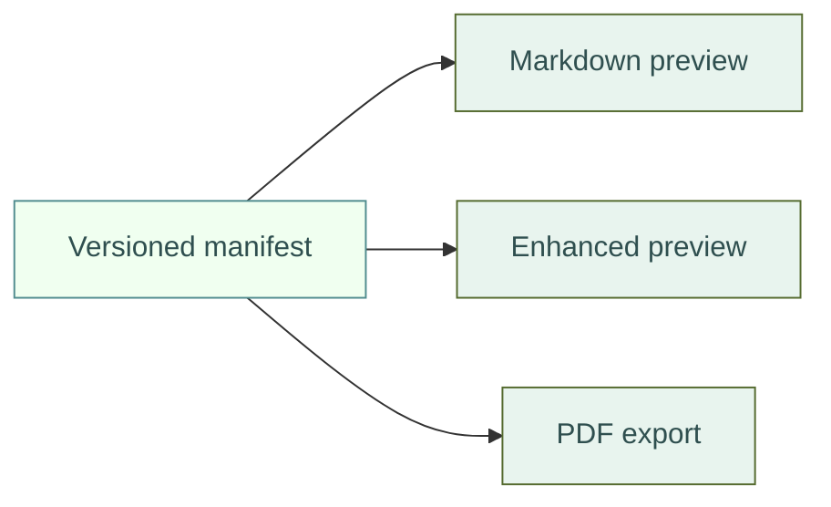

<p align="center">
  
</p>

# Documentation Renderer Test

22 October 2026: REQ-126 coverage/acceptance reconciliation, corrected primary registry counts and canonical references rendered with markdown-it and unchanged Fytala CSS under `.guard-tmp/req126-reconciliation-render`. Local links, JSON and matrix references validated. HTML check only; no screenshot/PDF acceptance. Kit assets unchanged.

22 October 2026: EQName bracket-parser correction and canonical updates rendered with markdown-it and unchanged Fytala CSS under `.guard-tmp/req126-eqname-parser-render`. HTML render check only; no screenshot or PDF acceptance. Kit assets unchanged.

22 October 2026: release1.23.4 notes/readiness and changed canonical documents rendered with markdown-it and unchanged Fytala CSS under `.guard-tmp/release1234-render`; new relative links checked. HTML render check only, not screenshot/PDF review. Kit assets unchanged.

22 October 2026: EQName-priority correction pages rendered with markdown-it and unchanged canonical Fytala CSS under `.guard-tmp/req126-eqname-priority-render`; added relative links checked. HTML render check only; no screenshot/PDF approval. Kit assets unchanged.

22 October 2026: union minimum-priority correction pages rendered with markdown-it and unchanged canonical Fytala CSS under `.guard-tmp/req126-union-minimum-render`. Relative links in added content were checked. This is an HTML render check; no screenshot or PDF approval is claimed. Kit-managed assets are unchanged.

Use this document to approve a FYTALA documentation-kit version in VS Code's built-in Markdown preview, Markdown Preview Enhanced, and Markdown PDF. It deliberately exercises the elements whose presentation is governed by the kit.

## Typography and links

Body text should use the configured type stack with dark-slate text. A [normal link](https://fytala.com) should remain visually distinct, and `inline code` should be readable without overpowering the paragraph.

> Blockquotes should have a restrained accent and remain readable in both preview and PDF output.

## Table

| Element | Expected result | Reference |
|---|---|---|
| Header | Dark slate with light mint text | `--table-header-bg` |
| Link in header | Inherits the header foreground | [Style guide](DOCUMENTATION_STYLE_GUIDE.md) |
| Alternating row | Subtle neutral contrast | Canonical stylesheet |

## Code

```csharp
public sealed record DocumentationKit(string Version, bool IsPortable);
```

## Mermaid diagram



<p class="fytala-figure-caption"><strong>Renderer coverage.</strong> One versioned contract drives all supported local renderers.</p>

## Acceptance checklist

- The logo renders without a decorative frame.
- Table headers use dark slate and light mint, including links and inline code.
- The Mermaid canvas is white while semantic node colors remain visible.
- Code blocks, blockquotes, links, and captions remain legible.
- PDF output preserves local images, page margins, and diagram boundaries.


## Implicit binding documents verification - 2026-10-16

The canonical documents, queue, upstream guide and XSLT40-IMPLICIT-BINDING-DOCUMENTS.md were rendered using markdown-it and the canonical Fytala CSS. HTML artifacts are retained under D:/Development/Bosak/.guard-tmp/variable-binding-render. This is a render check, not a visual screenshot review. Kit-managed assets were unchanged.


## Array template fallback verification - 2026-10-16

Canonical documents, queue, upstream guide and XSLT40-ARRAY-TEMPLATE-FALLBACK.md were rendered using markdown-it and canonical Fytala CSS. HTML artifacts are retained under D:/Development/Bosak/.guard-tmp/array-fallback-render. This is a render check, not a screenshot review. Kit-managed assets are unchanged.


## Array apply-imports fallback verification - 2026-10-16

Canonical documents, queue, upstream guide and XSLT40-ARRAY-IMPORT-FALLBACK.md were rendered using markdown-it and canonical Fytala CSS. HTML artifacts are retained under D:/Development/Bosak/.guard-tmp/array-import-fallback-render. This is a render check, not a screenshot review. Kit-managed assets are unchanged.


## Array profile audit verification - 2026-10-16

Canonical documents, queue, upstream guide and XSLT40-ARRAY-PROFILE-AUDIT.md were rendered using markdown-it and canonical Fytala CSS. HTML artifacts are retained under D:/Development/Bosak/.guard-tmp/array-profile-audit-render. This is a render check, not a screenshot review. Kit-managed assets are unchanged.


## JNode text atomization verification - 2026-10-16

Canonical documents, queue, upstream guide and XSLT40-JNODE-TEXT-ATOMIZATION.md were rendered using markdown-it and canonical Fytala CSS. HTML artifacts are retained under D:/Development/Bosak/.guard-tmp/jnode-text-render. This is a render check, not a screenshot review. Kit-managed assets are unchanged.


## Document construction capture verification - 2026-10-16

Canonical documents, queue, upstream guide and XSLT40-DOCUMENT-CONSTRUCTION-CAPTURE.md were rendered using markdown-it and canonical Fytala CSS. HTML artifacts are retained under D:/Development/Bosak/.guard-tmp/document-capture-render. This is a render check, not a screenshot review. Kit-managed assets are unchanged.


## Computed-element capture verification - 2026-10-16

Canonical documents, queue, upstream guide and XSLT40-COMPUTED-ELEMENT-CAPTURE.md were rendered using markdown-it and canonical Fytala CSS. HTML artifacts are retained under D:/Development/Bosak/.guard-tmp/computed-element-render. This is a render check, not a screenshot review. Kit-managed assets are unchanged.


## Literal-result-element capture receipt - 2026-10-16

Ten current documentation pages, including XSLT40-LITERAL-ELEMENT-CAPTURE.md, rendered successfully using markdown-it and canonical Fytala CSS to `.guard-tmp/literal-element-render`. This verifies Markdown/HTML generation; it is not a visual approval or screenshot receipt. Kit-managed assets were untouched.


## Copied-element capture receipt - 2026-10-16

Ten current documentation pages, including XSLT40-COPY-ELEMENT-CAPTURE.md, rendered using markdown-it and canonical Fytala CSS to `.guard-tmp/copy-capture-render`. This verifies Markdown/HTML generation; it is not a visual approval or screenshot receipt. Kit-managed assets were untouched.


## Copied-document capture receipt - 2026-10-16

Ten current documentation pages, including XSLT40-COPY-DOCUMENT-CAPTURE.md, rendered using markdown-it and canonical Fytala CSS to `.guard-tmp/copy-document-render`. This verifies Markdown/HTML generation; it is not a visual approval or screenshot receipt. Kit-managed assets were untouched.


## Function-body copy capture receipt - 2026-10-16

Ten current documentation pages, including XSLT40-FUNCTION-COPY-CAPTURE.md, rendered using markdown-it and canonical Fytala CSS to `.guard-tmp/function-copy-render`. This verifies Markdown/HTML generation; it is not a visual approval or screenshot receipt. Kit-managed assets were untouched.


## Copy-select state receipt - 2026-10-16

Ten current documentation pages, including XSLT40-COPY-SELECT-STATE.md, rendered using markdown-it and canonical Fytala CSS to `.guard-tmp/copy-select-render`. This verifies Markdown/HTML generation; it is not a visual approval or screenshot receipt. Kit-managed assets were untouched.


## Non-node copy values receipt - 2026-10-16

Ten current documentation pages, including XSLT40-COPY-NON-NODE-VALUES.md, rendered using markdown-it and canonical Fytala CSS to `.guard-tmp/copy-values-render`. This verifies Markdown/HTML generation; it is not a visual approval or screenshot receipt. Kit-managed assets were untouched.


## Copy namespace validation receipt - 2026-10-16

Ten current documentation pages, including XSLT40-COPY-NAMESPACE-VALIDATION.md, rendered using markdown-it and canonical Fytala CSS to `.guard-tmp/copy-xmlns-render`. This verifies Markdown/HTML generation; it is not a visual approval or screenshot receipt. Kit-managed assets were untouched.


## Copy standard attributes receipt - 2026-10-16

Ten current documentation pages, including XSLT40-COPY-STANDARD-ATTRIBUTES.md, rendered using markdown-it and canonical Fytala CSS to `.guard-tmp/copy-standard-render`. This verifies Markdown/HTML generation; it is not a visual approval or screenshot receipt. Kit-managed assets were untouched.


## 2026-10-16 copy forward-compatibility audit receipt

Ten updated documentation pages rendered with markdown-it and canonical Fytala CSS into .guard-tmp/copy-forward-audit-render. Automated HTML generation only; no visual preview approval claimed.


## 2026-10-16 processor-profile receipt

Ten updated documentation pages rendered with markdown-it and canonical Fytala CSS into .guard-tmp/processor-profile-render. Automated HTML generation only; no visual approval claimed.


## 2026-10-16 runner-profile receipt

Ten updated pages rendered with markdown-it and canonical Fytala CSS into .guard-tmp/runner-profile-render. Automated HTML generation only; no visual approval claimed.


## 2026-10-16 fixed-namespace validation receipt

Ten updated pages rendered with markdown-it and canonical Fytala CSS into .guard-tmp/fixed-namespace-validation-render. Automated generation only; no visual approval claimed.


## 2026-10-16 XSLT40-FIELD-REQUIRED-AUDIT

Ten pages rendered with markdown-it and canonical Fytala CSS. Automated HTML generation only; no visual approval claimed.


## 2026-10-16 XSLT40-EARLIER-FIXED-NAMESPACES

Ten pages rendered with markdown-it and canonical Fytala CSS. Automated HTML generation only; no visual approval claimed.


## 2026-10-16 XSLT40-FUTURE-FALLBACK

Ten pages rendered with markdown-it and canonical Fytala CSS. Automated HTML generation only; no visual approval claimed.


## 2026-10-16 Release-readiness review

Ten pages rendered with markdown-it and canonical Fytala CSS. Automated HTML generation only; no visual approval claimed. Complete45-case inventory and seven reduced probe outcomes validated. Engine/tests unchanged; prior exact-source CI and gates retained.


## 2026-10-16 XSLT40-STRUCTURAL-RECORD-SUBTYPING

Ten pages rendered with markdown-it and canonical Fytala CSS. Automated HTML generation only; no visual approval claimed.


## 2026-10-16 XSLT40-RECORD-MAP-SUBTYPING

Ten pages rendered with markdown-it and canonical Fytala CSS. Automated HTML generation only; no visual approval claimed.


## 2026-10-16 Record-subtyping candidate checkpoint

Candidate validation, release notes and canonical pages rendered with markdown-it and canonical Fytala CSS. Automated HTML generation only; no visual approval claimed. Package-only provenance,338 public focused tests,153 broad controls and all36 remaining case dispositions validated. Engine/tests unchanged by this checkpoint.


## 2026-10-16 Release preparation

Eleven pages rendered with markdown-it and canonical Fytala CSS in a fresh output directory. The candidate banner contains a valid h1 element; malformed heading tags are rejected by the renderer check. Relative links and unchanged engine/test trees are checked. Automated rendering only; no visual approval claimed. Prior renderer output is preserved.


## 2026-10-16 Published1.16.5 record

Twelve canonical/publication/release-note/checklist pages rendered with markdown-it and canonical Fytala CSS in a fresh output directory. Valid heading tags and release-note h1 are checked. Public package signatures,153 broad controls,338 public focused tests and exact release provenance verify. Automated rendering only; no visual approval claimed. Engine/tests and immutable release tag unchanged.


## Extension 0.2.5 preparation

Render the new preparation report and canonical status pages with the canonical Fytala stylesheet. Verify branded banners, links and the pending publication wording. No kit assets change.


## Extension 0.2.5 publication

Publication report and canonical status pages use the unchanged Fytala stylesheet. Verify branded banners, publication links and preserved historical candidate notices.


## REQ-129 design checkpoint

Render the readable insertion contract and canonical status notices with the unchanged Fytala stylesheet. Verify tables, XML example, branded banner and explicit proposed/not-implemented language.


## REQ-129 implementation checkpoint

Render the implementation API example, source-only status and canonical notes with unchanged Fytala styles. Verify links and explicit public-release/consumer boundaries.


## Bosak1.17.0 publication

Render the publication report, release notes and canonical notices using unchanged Fytala CSS. Verify publication links, bounded API wording and Braid feedback attribution.


## Literal-text design and consumer acceptance

Render the new contract/matrix and accepted-status notices using unchanged Fytala CSS. Preserve the imported acceptance receipt byte-for-byte; its compact heading is an evidence-record exception. Verify XML examples, table escaping and explicit proposed/no-implementation wording.


## Bosak1.23.0 publication verification - 2026-10-21

Publication proof, release notes, canonical documents and updated delivery guides were rendered with markdown-it and the unchanged canonical Fytala CSS. HTML artifacts remain under `.guard-tmp/release1230-publication-render`. This is a render check, not a visual screenshot or PDF review. No kit-managed assets changed.


## XSLT4 switch boundary slice - 2026-10-21

The switch boundary evidence and canonical documentation were rendered using markdown-it and the unchanged Fytala CSS. HTML artifacts remain under .guard-tmp/switch-boundaries-render. This is a render check, not a visual screenshot or PDF review. Kit-managed assets are unchanged.


## Switch upstream submission record - 2026-10-21

The updated switch evidence, queue and canonical documents were rendered with markdown-it and the unchanged Fytala CSS under `.guard-tmp/switch-submission-render`. This is a render check, not a screenshot or PDF review. Kit assets remain unchanged.


## REQ-126 equality/collation reference - 2026-10-21

The changed catalog/reference pages and canonical documents were rendered with markdown-it and unchanged Fytala CSS under `.guard-tmp/req126-equality-render`. The new entry has all16 required fields; the manifest keeps its2,578 original rows and adds58 checks. JSON/XML and new local links validate. This is a render check, not a screenshot or PDF review. Kit-managed assets are unchanged.


## Index-of empty-collation correction - 2026-10-21

Correction evidence, updated catalog entries and canonical documents were rendered with markdown-it and unchanged Fytala CSS under `.guard-tmp/index-of-collation-render`. New local links/JSON, the exact one-row catalog correction and bounded engine/test diff validate. This is a render check, not screenshot/PDF review. Kit-managed assets are unchanged.


## Release 1.23.2 preparation — 2026-10-21

Changed readiness, notes and canonical documents render with markdown-it and the unchanged Fytala stylesheet under `.guard-tmp/release1232-render`. New relative links and machine-readable package provenance validate. This is an HTML render check, not screenshot/PDF review. Kit-managed assets are unchanged.


## Release1.23.2 publication — 2026-10-21

README package links, canonical status, release notes/readiness and new publication proof render with markdown-it and unchanged Fytala CSS under `.guard-tmp/release1232-publication-render`. New local links, JSON identities and public package versions validate. This is an HTML render check, not screenshot/PDF review. Kit-managed assets are unchanged.


## REQ-126 grammar review — 2026-10-21

New xsl:select, grammar mapping and dispatch examples plus updated canonical/catalog pages render with markdown-it and unchanged Fytala CSS under `.guard-tmp/req126-grammar-render`. New local links, XML, JSON and all16-field entries validate. This is an HTML render check, not screenshot/PDF review. Kit-managed assets are unchanged.


## REQ-126 type/pattern slice — 2026-10-21

Current entries, intake reports, grammar mapping, canonical pages and relocated historical snapshots render with markdown-it and unchanged Fytala CSS under `.guard-tmp/req126-types-render`. New relative links, XML/JSON, all16-field entries and original-row preservation validate. Historical links are rebased to the immutable original revision; raw original Git-blob and transformed-archive hashes are distinct. This is an HTML render check, not screenshot/PDF review; kit assets are unchanged.


## REQ-126 compound-pattern slice — 2026-10-21

Grammar/priority finding, compound entry, manual examples and canonical/catalog updates render with markdown-it and unchanged Fytala CSS under `.guard-tmp/req126-compound-render`. New local links/XML/JSON/headers, all16-field entries and prior-row preservation validate. Observed gaps retain separate normative metadata. This is an HTML render check, not screenshot/PDF review; kit assets unchanged.


## Release1.23.4 publication — 2026-10-22

README package links, canonical status, release notes/readiness, catalog notices and publication proof rendered with markdown-it and unchanged Fytala CSS under `.guard-tmp/release1234-publication-render`; added relative links and public package receipts checked. HTML render check only; no screenshot/PDF review. Kit-managed assets unchanged.
