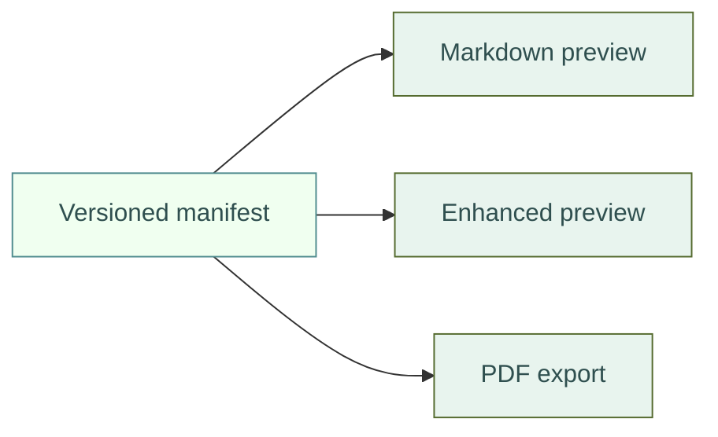

**REQ-126 C05 complete — 26 October 2026:** [Type/collection/pattern review](xpath40-catalog/TYPE-COLLECTION-PATTERN-RECONCILIATION.md) reconciles nine type/collection/pattern rows and 49 selected production names. All 2,457 focused tests pass. Of 275 independent controls, 259 match; 16 retain choice-coercion, record-destructuring and known generic-model gaps. Delivered union/EQName fixes remain closed. Eight closure workpackages remain; C06 is next. No engine or executable example changes, acceptance waiver, profile/gate promotion or release. Skips, Braid and extension work stay deferred; earlier checkpoints are historical.


**K02 guarded loader diagnostics — 27 October 2026:** [Implemented guarded mode](conformance/k02-schema-loader/README.md) delegates eligible schemas to actual query imports only when explicitly enabled for diagnostics; normal eager loading stays the default. All 66 actual-harness diagnostic runs match independent expectations, including wrong-assertion failures and preserved source/profile boundaries. All 21,825 solution tests and both normal gates pass at 31,144/0/677 and 8,436/0/1,894; all 677 QT3 skips/reasons are unchanged. Candidate 1.26.6 is unpublished. K02 profile/capability and wider applicability work remain open; no admission or baseline change. Earlier checkpoints are historical.


**K02 bounded diagnostic correction — 27 October 2026:** [Duration-schema investigation](conformance/k02-schema-duration/README.md) reproduces the unavailable schema duration types and corrects the public aggregated schema-import error to XQST0012. All 9 regressions pass (baseline 4 failed/5 passed). The original public query reaches its declared error alternative, but the QT3 environment still fails before query execution; validateexpr-28 remains skipped. No XSD 1.1 capability, skip, fixture or baseline change. Candidate 1.26.5 is unpublished; public 1.26.3 and REQ-126 acceptance are unchanged. Earlier checkpoints are historical.


**K01 complete; approved QT3 baseline — 27 October 2026:** [Exact two-case adoption](conformance/k01-schema-list/BASELINE-ADOPTION.md) removes only CastAs-ListType-20 and -28 from known skips. The fresh full QT3 gate passes **31,144/0/677**; qt4 remains 8,436/0/1,894. The owner approval and original receipts are preserved; no fixture/assertion/filter change. Source candidate 1.26.4 remains unpublished and REQ-126 remains Complete. Earlier totals and pending-approval notices are historical.


**K01 schema-list correction — 27 October 2026:** [Correction and evidence](conformance/k01-schema-list/README.md) fixes legacy typed bindings reporting XPTY0004 instead of XPST0051 for invalid list item types. All 18 regressions pass (baseline 6 failed/12 passed); direct original QT3 cases CastAs-ListType-20 and -28 now both pass. Both skips and frozen totals stay unchanged pending a separate baseline-policy approval. Source candidate 1.26.4 is unpublished; public 1.26.3 and REQ-126 bounded acceptance are unchanged. Earlier checkpoints are historical.


**REQ-126 complete for the accepted bounded catalog — 26 October 2026:** [Owner acceptance](xpath40-catalog/CATALOG-ACCEPTANCE.md) closes C13 and all 13 workpackages; zero remain open. AC-01 through AC-04 are explicitly accepted for 76 entries/235 bounded contract groups; AC-05 maintained. All 38 catalog dispositions are accepted while all 48 unmet batch observations and original technical exit criteria remain unchanged. No full current-draft compliance, engine fix, gate change or release follows. Earlier open-state notices are historical.


**REQ-126 C13 review prepared — 26 October 2026:** [Final closure review](xpath40-catalog/FINAL-CLOSURE-REVIEW.md) consolidates 76 entries, 235 bounded contract groups and 38 proposed disposition records. All 3,172 fresh documentation tests pass. Six Known Uses sections now state their evidence/gate boundary directly. The [acceptance proposal](xpath40-catalog/C13-ACCEPTANCE-PROPOSAL.md) would close the documentation catalog with explicit limits and open technical follow-ups; it is not approved. All 48 unmet batch observations remain unmet. C13 remains open, AC-01 through AC-04 unchecked and REQ-126 In Progress; no engine, fixture, gate, version or release change. Earlier checkpoints are historical.


**REQ-126 C12 complete — 26 October 2026:** [Final semantic/evidence batch](xpath40-catalog/SEMANTIC-REVIEW-BATCH-4.md) reviews 19 entries/57 contract groups with 369 exact catalog cases and six dedicated walkthroughs. All 5,595 fresh tests pass; independent diagnostics retain 167 matching and eight unmet controls. Choice coercion and switch comparison remain explicit blockers. All 76 entries now have C09-C12 bounded reviews. One workpackage remains: C13 blocker disposition and owner acceptance. REQ-126 stays In Progress; no engine, fixture, profile, gate or release change. Earlier checkpoints are historical.

**REQ-126 C11 complete — 26 October 2026:** [Third semantic/evidence batch](xpath40-catalog/SEMANTIC-REVIEW-BATCH-3.md) reviews 19 entries/56 contract groups and 874 exact linked cases. All 3,756 fresh tests pass; all 26 sample blocks have verification paths, including seven independently executed inline queries. Of 99 supplemental observations, 77 controls match, 20 retain known requirements and two record URI type behavior. Destructuring, spelling, focus and epoch-profile caveats remain explicit. Two workpackages remain; C12 is next. No final acceptance, engine, fixture, profile, gate or release change; earlier checkpoints are historical.

**REQ-126 C10 complete — 26 October 2026:** [Second semantic/evidence batch](xpath40-catalog/SEMANTIC-REVIEW-BATCH-2.md) reviews 19 entries/55 contract groups with 892 exact linked cases and 82 sample blocks. All 3,469 fresh tests pass. Supplemental observations retain 60 matching controls, 10 known draft mismatches, two disputed highest-example controls and two URI observations. The source/example reading issue stays separate from an engine-defect diagnosis. Three packages remain; C11 is next. No final acceptance, engine, fixture, profile, gate or release change; earlier checkpoints are historical.

**REQ-126 C09 complete — 26 October 2026:** [First semantic/evidence batch](xpath40-catalog/SEMANTIC-REVIEW-BATCH-1.md) reviews 19 entries/67 contract groups and 536 distinct linked cases. All 3,447 fresh existing tests pass; 116 sample +8 walkthrough blocks have explicit verification paths. Of 54 independent profile controls, 46 match and eight retain known model/extrema/partial-apply boundaries. Scan sample queries are separated and executed verbatim. Four closure workpackages remain; C10 is next. No final acceptance, engine, fixture, profile, gate or release change; earlier checkpoints are historical.

**REQ-126 C08 complete — 26 October 2026:** [Historical adoption research](xpath40-catalog/ADOPTION-HISTORY-RESEARCH.md) checks all 28 original records through 16 delivery trees, 16 retained PR heads, 58 matching historical commits and 16 PR records. No exact adoption pin was recovered. The owner explicitly approved 26 legacy provenance exceptions and two non-adoption dispositions, retaining all original nulls. C08 is complete; five packages remain open, with C09 next. Earlier receipts, defects and semantic acceptance remain open. No engine, profile, gate or release change; earlier checkpoints are historical.

**REQ-126 C07 complete — 26 October 2026:** [Lifecycle/disposition review](xpath40-catalog/LIFECYCLE-RECONCILIATION.md) reconciles all 76 classifications and 19 original/wider decision groups. All 3,519 fresh existing tests and 113 profile controls pass. Current compound-pattern wording, method-call boundaries and a malformed delivery link are corrected with original receipts retained. Six closure workpackages remain; C08 historical adoption evidence is next. All 28 missing adoption pins, earlier defects and semantic acceptance remain open. No feature/profile/gate promotion or release; skips, Braid and extension work stay deferred. Earlier checkpoints are historical.

**REQ-126 C06 complete — 26 October 2026:** [Host/profile review](xpath40-catalog/HOST-PROFILE-RECONCILIATION.md) reconciles the final three grammar rows; all 18 now have bounded reviews, not semantic acceptance. All 376 focused tests and 3,148 catalog examples pass. Of 154 probe observations, 133 controls match, two retain a switch comparison mismatch, and 19 record context boundaries. Seven closure workpackages remain; C07 is next. Static-mode and loader/adoption limits remain explicit. No engine, profile, gate or release change; skips, Braid and extension work stay deferred. Earlier checkpoints are historical.

26 October 2026: C05 report, 21 scoped/linked pages and twelve canonical/audit pages rendered as HTML with unchanged Fytala CSS. Scoped/new links, source/production hashes and independent unmet controls checked; no screenshot/PDF acceptance.

**REQ-126 C04 complete — 26 October 2026:** [Expression/call/focus review](xpath40-catalog/EXPRESSION-CALL-FOCUS-RECONCILIATION.md) reconciles six expression/call/focus rows and 33 selected production/token names. All 880 focused tests pass; 209 controls match, ten retain current-draft spelling/placeholder/mapping-focus gaps, and eight late-binding observations remain separate. Nine closure workpackages remain; C05 is next. No engine or executable example changes, gate/profile promotion, acceptance waiver or release. C02's atomic-annotation defect remains open. Skips, Braid and extension work stay deferred; earlier checkpoint counts are historical.

26 October 2026: C04 report, eleven scoped pages and twelve canonical/audit pages rendered as HTML using unchanged Fytala CSS. Scoped/new links, production mappings, source/evidence hashes and retained unmet controls checked. No screenshot/PDF acceptance.

**REQ-126 C03 complete — 26 October 2026:** [Constructor/type review](xpath40-catalog/CONSTRUCTOR-TYPE-RECONCILIATION.md) reconciles eight entries and all 49 focus constructors. All 1,333 asserted controls match across 1,357 observations; 245 focused schema/API/host tests pass. Bounded nominal defaults/static fields are now evidenced. Generic wide casts, decimal precision, schema/host context and broader conversion remain explicit boundaries; C02's atomic-annotation defect remains open. Ten closure workpackages remain; C04 is next. No engine/test/example/version/gate change or acceptance waiver; skips/Braid/extension work stays deferred. Earlier checkpoint counts are historical.

26 October 2026: the C03 report, eight entries and fifteen canonical/audit/example/declaration pages rendered as HTML with unchanged Fytala CSS. Local links, retained controls and exact source/evidence hashes checked; no screenshot/PDF acceptance.

**REQ-126 C02 complete — 26 October 2026:** [Function/options reconciliation](xpath40-catalog/FUNCTION-OPTIONS-RECONCILIATION.md) reconciles 30 entries/74 function surfaces with explicit supported boundaries and 14 follow-up groups. Release build and all 21,798 solution tests pass; all 3,148 catalog examples pass separately. The 195 added profile observations include 118 matching controls, two unmet controls for the new `atomic-type-annotation(())` defect, and 75 diagnostics. Eleven closure workpackages remain; C03 is next. C02 closes review scope, not AC-01–04 or the retained defects. Skip fixes, Braid and extension work remain deferred. Original receipts and frozen gates are preserved; no engine/version/release change.

26 October 2026: the C02 report, thirty function entries and twelve canonical/audit pages are rendered as HTML with unchanged Fytala CSS. This checks HTML production and local links; no screenshot/PDF acceptance is claimed.

**REQ-126 C01 complete — 26 October 2026:** [Current inventory and ownership record](xpath40-catalog/FUNCTION-INVENTORY-REFRESH.md) refreshes 316 names against published 1.26.3 and pinned current draft b4723ff5: 119 registered 4.0-only names (70 non-constructors, 49 focus constructors), plus 197 existing names. The retained inventory missed `array:members` and `array:of-members`. All 1,581 profile lookup observations completed without probe errors; four changed declarations and remaining semantic/default/empty/error reviews have explicit C02/C03/C06 owners. Twelve closure workpackages remain open; REQ-126 and AC-01–04 remain partial. Finish these packages before skip fixes, Braid or VS Code extension work. Engine, APIs, tests, version and frozen gates are unchanged; existing passing source/gate evidence is inherited. Earlier counts and checkpoint notices are historical.

26 October 2026: ten REQ-126 closure-plan/skip-triage/canonical/catalog pages rendered as HTML with markdown-it and unchanged Fytala CSS. Thirteen workpackage scopes, four exact 19-entry batches, 18 grammar rows, 28 historical-pin gaps, 2,573 skip cases, actual filters, 26 diagnostic receipts, raw/source/index hashes and links verified. Gate counts/policy unchanged; no fresh full-unit, semantic acceptance, screenshot/PDF, Braid or publication claim.

26 October 2026: eleven 1.26.3 publication/release-note/canonical/catalog pages rendered as HTML with markdown-it and unchanged Fytala CSS. Tag/workflow/public signatures/cache/output/consumer hashes and links verified; original candidate evidence retained. No screenshot/PDF or new Braid acceptance inferred.

26 October 2026: eleven 1.26.3 candidate/release-note/canonical/catalog/audit pages rendered as HTML with markdown-it and unchanged Fytala CSS. Pinned source/tree, package/cache/output/assembly identities, raw receipt/consumer-source hashes, counts, links and diff verified. Original Braid/earlier evidence retained; no screenshot/PDF, signed-public verification or 1.26.3 Braid adoption inferred.

26 October 2026: nine floor/ceiling contract-audit/canonical/catalog pages rendered as HTML with markdown-it and unchanged Fytala CSS. Unchanged-engine source identity, new test/input/receipt/index hashes, required-error controls, links and diff verified. No correction tally, screenshot/PDF, new Braid acceptance or 1.26.3 publication.

26 October 2026: nine floor/ceiling integer/canonical/catalog pages rendered as HTML with markdown-it and unchanged Fytala CSS. Baseline/source/test/receipt/index hashes, numeric identity/sign predicates, links and diff verified; original abs/Braid snapshot retained. No screenshot/PDF, new Braid acceptance or 1.26.3 publication.

26 October 2026: nine abs-integer/adoption/canonical/catalog pages rendered as HTML with markdown-it and unchanged Fytala CSS. Baseline/source/test/receipt/index identities, supplied Braid report snapshot, numeric type/sign/error predicates, links and diff verified. No screenshot/PDF, new Braid native acceptance or 1.26.3 publication claimed.

26 October 2026: eleven 1.26.2 publication/release-note/canonical/catalog pages rendered as HTML with markdown-it and unchanged Fytala CSS. Tag/workflow/public signatures/cache/output/consumer hashes and links verified; original candidate evidence retained. No screenshot/PDF or new Braid acceptance inferred.

26 October 2026: eleven 1.26.2 candidate/release-note/canonical/catalog/kernel pages rendered as HTML with markdown-it and unchanged Fytala CSS. Pinned-source tree, archive/cache/output/assembly provenance, raw receipt and consumer-source hashes, case counts, links and diff verified; no screenshot/PDF, signed public package or Braid outcome inferred.

26 October 2026: ten exact-kernel/canonical/catalog/corrected historical-guide pages rendered as HTML with markdown-it and unchanged Fytala CSS. Source/receipt/index hashes, independent oracle corrections, test counters, local links and diff verified; no screenshot/PDF or Braid outcome inferred.

26 October 2026: nine extreme-rounding precision audit/correction/canonical/catalog pages rendered as HTML with markdown-it and unchanged Fytala CSS. Corrected/draft receipt hashes, pinned baseline source, watchdog and retained-kernel findings, links and diff checked; no screenshot/PDF or Braid acceptance.

26 October 2026: eleven 1.26.1 publication/release-note/canonical/catalog pages rendered as HTML with markdown-it and unchanged Fytala CSS. Tag/workflow/signed-public/cache/output/consumer receipt hashes and links verified; original candidate evidence retained. No screenshot/PDF or Braid native acceptance.

26 October 2026: ten 1.26.1 candidate/release-note/canonical/catalog pages rendered as HTML with markdown-it and unchanged Fytala CSS. Immutable source, package/cache/output/assembly provenance, raw evidence hashes, consumer sources/receipts, local links and diff checked; no screenshot/PDF or signed/public/native acceptance.

26 October 2026: nine rounding-function correction/canonical/catalog pages rendered as HTML with markdown-it and unchanged Fytala CSS. Receipt/source hashes, local links and diff checked; no screenshot/PDF acceptance. Original abs/rounding evidence bytes are protected from line-ending conversion.

25 October 2026: atomic-function conversion audit/correction and canonical status pages rendered as HTML with markdown-it and unchanged Fytala CSS. Local links, source/receipt hashes and diff checked; no screenshot/PDF acceptance.

25 October 2026: five restart/upstream/handover checkpoint pages rendered as HTML with unchanged Fytala CSS. Receipt hashes, upstream heads and engine/test identity verified; no screenshot/PDF acceptance.

25 October 2026: twelve REQ-126 numeric binary/range and REQ-138 acceptance status pages rendered as HTML with markdown-it and unchanged Fytala CSS; source/evidence hashes, links and diff checked. No screenshot/PDF acceptance.

25 October 2026: nine REQ-126 singleton-array correction/canonical/catalog pages rendered as HTML with markdown-it and unchanged Fytala CSS. Source/receipt hashes, links and diff checked; no screenshot/PDF acceptance.

25 October 2026: nine REQ-126 recursive-array audit/canonical/catalog pages rendered as HTML with markdown-it and unchanged Fytala CSS. Receipt/source hashes, links and diff checked; no screenshot/PDF acceptance.

25 October 2026: nine REQ-126 empty unary atomization/canonical/catalog pages rendered as HTML with markdown-it and unchanged Fytala CSS. Receipt/source hashes, links and diff checked; no screenshot/PDF acceptance.

25 October 2026: REQ-126 unary conversion guide and updated canonical/catalog/history pages rendered as HTML with markdown-it and unchanged Fytala CSS. Receipt hashes, local links and diff checked; no screenshot/PDF acceptance.

25 October 2026: twelve 1.26.0 publication/release/API/canonical/catalog pages rendered as HTML using markdown-it and unchanged Fytala CSS; receipt hashes and local links checked. No screenshot/PDF acceptance.

25 October 2026: 1.26.0 candidate notes/proof and canonical/catalog status pages rendered as HTML with markdown-it and unchanged Fytala CSS. Exact merge/source tree, test/package/assembly/cache/audit hashes, new links/JSON and unchanged engine/test/kit/fixture boundaries verified. HTML only; no screenshot/PDF or signed/native acceptance claimed.

25 October 2026: REQ-138 consumer implementation review, documentation-only registry/punctuation corrections and canonical status pages rendered with unchanged Fytala CSS. Exact reviewed engine/test/version/design bytes and independent consumer TRX hashes/counters verified. HTML only; no signed-package or native acceptance claimed.

25 October 2026: REQ-138 implementation/API guide, retained consumer design review and canonical status pages rendered as HTML with markdown-it and unchanged Fytala CSS under `.guard-tmp/req138-implementation-render`. Exact design/request bytes, new relative links, JSON/receipt hashes, source headers/XML-doc build and unchanged kit/fixture boundaries checked. HTML only; no screenshot/PDF or consumer runtime acceptance.

25 October 2026: REQ-138 maintained design, original registration and canonical status pages rendered as HTML with markdown-it and unchanged Fytala CSS. Original Braid documents retained byte-exact; their relative citations retain Braid context. Links/JSON and unchanged engine/kit checked. HTML only; no screenshot/PDF acceptance.

25 October 2026: 1.25.2 release-candidate notes/proof and canonical/catalog status pages rendered as HTML with markdown-it and unchanged Fytala CSS. Pinned source, test/package proof, links/JSON and unchanged engine/assets checked. HTML only; no screenshot/PDF acceptance.

25 October 2026: exact idiv correction and canonical/catalog status pages rendered as HTML with markdown-it and unchanged Fytala CSS. New links/JSON, oracle comparisons and unchanged fixture/kit boundaries checked. HTML only; no screenshot/PDF acceptance.

25 October 2026: idiv precision/range investigation and canonical/catalog status pages rendered as HTML with markdown-it and unchanged Fytala CSS. New links/JSON, exact engine comparison and oracle receipts checked. HTML only; no screenshot/PDF acceptance.

25 October 2026: integer modulo correction, canonical status and catalog evidence pages rendered as HTML with markdown-it and unchanged Fytala CSS. New links/JSON and unchanged gate/fixture/kit boundaries verified. HTML only; no screenshot/PDF acceptance.

25 October 2026: division/modulo audit and canonical/catalog status pages rendered as HTML with markdown-it and unchanged Fytala CSS. New links/JSON and exact unchanged engine boundaries verified. HTML only; no screenshot/PDF acceptance.

25 October 2026: integer unary boundary correction, canonical status and catalog status pages rendered as HTML with markdown-it and unchanged Fytala CSS. New links/JSON and engine/gate/kit boundaries checked. HTML only; no screenshot/PDF acceptance.

24 October 2026: 1.25.1 publication, release notes, retained candidate checkpoint, README and canonical status pages rendered as HTML with markdown-it and unchanged Fytala CSS. JSON/public receipts and links checked; no screenshot/PDF acceptance.

24 October 2026: Unix timestamp contract, timestamp entry and synchronized canonical/catalog status pages rendered with markdown-it and unchanged Fytala CSS under `.guard-tmp/req126-unix-contract-render`. New links/JSON, receipt hashes, 16-field/count audit and source header/XML docs checked. HTML only; no screenshot/PDF acceptance. Engine/kit/fixtures/version unchanged.

24 October 2026: 1.25.0 release notes, verified publication, exact consumer review, README and canonical status pages rendered with markdown-it and unchanged Fytala CSS under `.guard-tmp/release1250-render`. New links/JSON, byte-exact review, package/receipt proofs and unchanged engine/kit/fixtures checked. HTML only; no screenshot/PDF acceptance.

24 October 2026: REQ-137 implementation/API guide, immutable historical request/design/review and canonical status pages rendered with markdown-it and unchanged Fytala CSS under `.guard-tmp/req137-implementation-render`. New links/JSON, raw receipt hashes, source headers/XML documentation and unchanged kit/fixtures/gates checked. HTML only; no screenshot/PDF acceptance.

24 October 2026: REQ-137 consumer design review and synchronized status pages rendered with unchanged Fytala CSS. Original review retained byte-exactly; reviewed proposal/request Git-blob hashes verified. HTML only; owner implementation approval pending.

24 October 2026: REQ-137 request, proposed scope/API and canonical planning counterparts rendered with markdown-it and unchanged Fytala CSS under .guard-tmp/req137-design-render. HTML only; no screenshot/PDF acceptance or runtime change.

<p align="center">
  
</p>

# Documentation Renderer Test

**K04-C05 CLDR review - 27 October 2026:** [CLDR diagnosis](conformance/k04-cldr-review/README.md) preserves the original two QT3 passes, two qt4 direct passes and two qt4 FODF1310 failures. Normal qt4 still dependency-skips all four cases. Focused controls isolate rejected named-cardinal modifiers and lost German named-ordinal endings; initial control-expectation mistakes are preserved separately. No source/admission/baseline change. Inherited source-identical results:22,007 solution passes, QT3 **31,161/0/660**, qt4 gated **8,438/0/1,892**; no fresh full-suite claim. Next: pin immutable specification/CLDR semantics and implement a bounded formatter correction before reviewing admission. Candidate1.26.11 unpublished/public1.26.3; Bosak.Schema owns staged XSD1.1; REQ-126 remains Complete. Earlier K04 notices are historical checkpoints.

**K04-C04 bounded collation admission - 27 October 2026:** [Collation review](conformance/k04-collation-admission/README.md) admits existing non-codepoint collation routes in qt4. The original compare-010 assertion passes; the normal qt4 gate improves to **8,438/0/1,892**, with only that gated skip removed and all retained reasons unchanged. Four exploratory original assertions also pass; eight XQuery-only cases remain dependency-skipped, with their direct diagnostic failures preserved. Seven expression controls and248 before/after filter controls pass. Fresh solution validation passes **22,007 tests**. Normal QT3 remains **31,161/0/660**. No engine, fixture/assertion, GatedSets, schema or QT3 baseline change. Candidate1.26.11 unpublished/public1.26.3; Bosak.Schema retains XSD1.1 ownership; REQ-126 remains Complete. Next: bounded review of four qt4 CLDR format-integer declarations. Earlier K04 notices are historical checkpoints.

**K04-C03 explicit feature admission - 27 October 2026:** [Capability inventory](conformance/k04-feature-inventory/README.md) records all 78,806 catalog cases and 55 feature/profile rows. Both filters now reject unrecognized feature names for either polarity and preserve explicit legacy admissions (19 QT3/17 qt4), without certifying full support. All 222 before/after controls pass; current feature decisions and all skip names/reasons remain unchanged. Fresh solution validation passes **22,007 tests**. Fresh gates remain **31,161/0/660** and **8,437/0/1,893**. Bosak.Schema retains staged XSD 1.1 ownership. Candidate1.26.11 unpublished/public1.26.3; REQ-126 remains Complete. Next: original-assertion review of the single gated qt4 non-codepoint-collation skip. Earlier K04 notices are historical checkpoints.

**K04-C02 bounded polarity correction - 27 October 2026:** [Profile review](conformance/k04-profile-review/README.md) makes negative spec/default-language predicates invert their existing positive predicates in both harnesses, with 74 before/after controls. An inventory of 31,821 QT3 and all 46,985 qt4 cases finds no current negative declaration of either kind. Fresh solution validation passes **22,007 tests**. Fresh gates remain **31,161/0/660** and **8,437/0/1,893**, retaining every skip name/reason. Schema comments now distinguish frozen admission from Bosak.Schema's staged XSD 1.1 implementation; admission is unchanged. F03 broader capabilities and F04 integration remain open. Candidate1.26.11 unpublished/public1.26.3; REQ-126 remains Complete. Next: explicit feature/capability inventory, beginning with unknown-positive fallback. Earlier K04 notices are historical checkpoints.

**K04-C01 adopted ? 27 October 2026:** Owner approved the exact 16-case quote-routing change proposed at `d0ca0741`. The complete normal QT3 gate passes **31,161/0/660**; exactly the 16 approved cases leave the skip set and all 660 retained names/reasons are unchanged. The qt4 gated run passes **8,437/0/1,893**, with 11 Experimental passes. All broader routing/schema/dependency guards remain unchanged. Candidate 1.26.11 remains unpublished; public version is 1.26.3. Bosak.Schema retains XSD 1.1 ownership; REQ-126 remains Complete. Next: the remaining K04 dependency-profile/polarity review. See [adoption receipt](conformance/k04-quote-routing/adoption/BASELINE-ADOPTION.md) for approval and fresh validation. Earlier proposal notices are historical.

**K04-C01 quote-routing proposal — 27 October 2026:** [Exact adoption review](conformance/k04-quote-routing/BASELINE-UPDATE-PROPOSAL.md) verifies all16 original candidate assertions in an isolated corrected harness. Full rehearsal passes31,161/0/660, with exactly those16 skips removed and all660 retained names/reasons unchanged. Eleven boundary cases and13 lexical controls preserve broader guards. Normal source/baseline stays31,145/0/676 pending owner approval; no tracked engine/harness/filter change. Candidate1.26.11 unpublished/public1.26.3;22,007 solution passes and qt4 8,437/0/1,893 are inherited unchanged-engine evidence. Bosak.Schema XSD1.1 ownership and REQ-126 Complete are unchanged.


**K04 applicability audit — 27 October 2026:** [Current dependency/routing review](conformance/k04-dependency-audit/README.md) reproduces all619 QT3 and1,893 gatedqt4 dependency skips through actual filters. Of619 QT3 cases,246 satisfy XQuery dependencies but fail syntax routing;16 are triple-quote candidates. Thirty-two bounded execution probes yield six public-XQuery assertion passes and ten retained failures;62 synthetic predicate assessments expose profile/polarity questions. No engine, filter or baseline change. Next K04-C01: quote-aware routing with complete candidate and rehearsal evidence before any QT3 admission proposal. Candidate1.26.11 unpublished/public1.26.3; inherited22,007 solution passes and gates31,145/0/676 and8,437/0/1,893. Bosak.Schema owns XSD1.1; REQ-126 remains Complete.


**K03 name-storage integration — 27 October 2026:** [Bounded core completion](conformance/k03-name-storage/README.md) preserves Unicode map/provider names, literal values and namespace/copy metadata. All47 new regressions and22,007 solution tests pass. The original map-to-element-053 assertion now passes; qt4 improves to8,437/0/1,893 with exactly that skip removed and all1,893 retained reasons unchanged. QT3 remains31,145/0/676 with identical676 skips. No fixture, assertion, harness filter or gated-set change. Candidate1.26.11 unpublished/public1.26.3. Parser-edition/current-draft limits remain explicit; Bosak.Schema retains XSD1.1 ownership and REQ-126 remains Complete. Next: K04 dependency/routing applicability audit. Earlier open Unicode findings are historical checkpoints.


**K03-C02 serialization — 27 October 2026:** [Content-preserving name decoding](conformance/k03-serialization/README.md) restores encoded element/attribute name tokens while preserving existing literal node content, namespace URIs and declarations. All40 focused regressions and21,960 solution tests pass; QT3 remains31,145/0/676 with identical676 skips, and qt4 remains8,436/0/1,894. The original supplementary-name skip remains. Candidate1.26.10 unpublished/public1.26.3. Next: reversible name-storage integration with loader/accessor/copy round-trip verification; no public API, baseline or XSD1.1 ownership change. REQ-126 remains Complete.


**K03-C01 XML-name validation — 27 October 2026:** [Scalar validation correction](conformance/k03-name-validation/README.md) replaces category/surrogate-pair approximation with explicit XML name ranges and rejects malformed UTF-16. All78 focused tests pass (baseline18 failures), all21,920 solution tests pass, and gates stay QT3 31,145/0/676 and qt4 8,436/0/1,894. All676 QT3 skip names/reasons are unchanged. Original supplementary construction and literal-content serialization findings remain open; next is K03-C02 serialization preservation before provider storage integration. Candidate1.26.9 unpublished/public1.26.3; no baseline or XSD1.1 capability change. REQ-126 remains Complete.


**K03 Unicode-name trace — 27 October 2026:** [Bounded investigation](conformance/k03-unicode-names/README.md) reproduces map-to-element-053 and separates three open corrections: scalar NCName validation, reversible provider name storage, and serialization that preserves literal sentinel text. All 30 isolated diagnostics complete without timeouts; no engine or baseline change. Next: K03-C01 name-validation regressions/correction, followed by serialization preservation before map storage integration. QT3 remains31,145/0/676 and qt4 remains8,436/0/1,894; solution21,842 and gates are inherited unchanged-source evidence. Candidate1.26.8 unpublished/public1.26.3; REQ-126 remains Complete. Bosak.Schema XSD1.1 ownership is unchanged.


**K02 adopted — 27 October 2026:** [Owner-approved normal-runner adoption](conformance/k02-admission-review/BASELINE-ADOPTION.md) is complete. The fresh normal QT3 gate passes **31,145/0/676**; only validateexpr-28 leaves the skip set through its original XQST0012 error alternative, and all 676 retained names/reasons match. AGENTS now requires this exact baseline. The normal runner selects the existing guard; standalone TestExecutor defaults and all profile/structural exclusions remain unchanged. Engine/candidate1.26.8 unchanged and unpublished; public1.26.3. Solution21,842 and qt4 8,436/0/1,894 are inherited source-identical validation. Bosak.Schema owns XSD1.1. REQ-126 remains Complete; earlier pending/default-off notices are historical checkpoints.


**K02 admission review — 27 October 2026:** [Guarded-runner proposal](conformance/k02-admission-review/BASELINE-UPDATE-PROPOSAL.md) is ready for owner approval. Two full actual-runner rehearsals verify current 31,144/0/677 and guarded 31,145/0/676, with only validateexpr-28 leaving the skip set through its existing XQST0012 alternative; all 676 retained names/reasons match. Normal runner, AGENTS policy and baseline remain unchanged pending approval. Candidate 1.26.8 is unpublished/public 1.26.3. Unit21,842 and qt4 8,436/0/1,894 receipts are inherited from unchanged source; no new XSD1.1 capability. Bosak.Schema REQ-009 owns that track; REQ-126 remains Complete.


**K02-C02 relative schema imports — 27 October 2026:** [File-backed source URI correction](conformance/k02-relative-schema-uri/README.md) fixes the four remaining guarded regressions. All 324 eligible original cases now pass in guarded diagnostics; 17 declined-boundary cases remain unchanged. All 21,842 solution tests and both required gates pass: QT3 31,144/0/677 (all 677 skip names/reasons unchanged), qt4 8,436/0/1,894. Guarded loading stays default-off; admission/baseline review is separate. Candidate 1.26.8 is unpublished/public 1.26.3. Bosak.Schema REQ-009 owns XSD 1.1; this slice adds no public API or backend. REQ-126 remains Complete. Earlier failure counts are historical evidence.


**K02-C01 constructor registration — 27 October 2026:** [First-evaluation correction](conformance/k02-constructor-registration/README.md) fixes all 68 constructor regressions in the wider audit. All 11 focused tests and 21,836 solution tests pass; QT3 remains 31,144/0/677 and the qt4 gate 8,436/0/1,894. The 324-case paired sweep leaves four relative-import failures for K02-C02, with no new failures; 17 declined boundaries are unchanged. Guarded loading stays default-off. Candidate 1.26.7 is unpublished/public 1.26.3. Bosak.Schema REQ-009 owns XSD 1.1; no new public schema seam or capability is introduced. REQ-126 remains Complete. Earlier audit counts are historical evidence.


**K02 wider audit — 27 October 2026:** [Schema/import inventory](conformance/k02-schema-inventory/README.md) blocks normal adoption: 324 eligible original cases yield 251 retained passes, 72 regressions and one environment-exception-to-pass transition. All 1,584 metadata/paired/boundary processes complete without timeouts. Two corrections remain open: schema constructor registration after import (68 observed regressions), then relative schema-import base URI (four). Guarded loading stays default-off; no source, skip, baseline or version change. Next: K02-C01 constructor registration. Candidate 1.26.6 unpublished/public 1.26.3; REQ-126 remains Complete. Earlier narrow-sample results remain historical evidence.


23 October2026: PR425 REQ-136 formal consumer acceptance and canonical status counterparts rendered with markdown-it and unchanged Fytala CSS under `.guard-tmp/req136-acceptance-render`; original acceptance Git bytes, four1444-pass TRX hashes/counters, nine signed public assembly identities, reported native limits, registry/detail consistency and new links checked. Evidence was inspected, not rerun. HTML only; no screenshot/PDF acceptance; kit assets unchanged.


23 October2026: REQ-136 consumer implementation receipt, 1.24.0 release notes/readiness and canonical counterparts rendered with markdown-it and unchanged Fytala CSS under `.guard-tmp/release1240-render`; new links/JSON, exact retained review bytes and package verification checked. HTML only; no screenshot/PDF acceptance. Managed kit assets unchanged.


23 October 2026: REQ-136 implementation, exact supported vocabulary, verification receipts and canonical counterparts rendered with markdown-it and unchanged Fytala CSS under `.guard-tmp/req136-implementation-render`; new links, JSON and source headers/XML documentation checked. HTML only; no screenshot/PDF acceptance. The reviewed scope proposal and original request remain byte-unchanged.


23 October 2026: release 1.23.8 notes/readiness and canonical counterparts rendered with markdown-it and unchanged Fytala CSS under `.guard-tmp/release1238-render`; new relative links and JSON checked. HTML only; no screenshot/PDF approval. Kit assets unchanged.

23 October2026: direct module/profile entry, complete library reports, prerequisite separation and canonical evidence counterparts rendered with markdown-it and unchanged Fytala CSS under `.guard-tmp/req126-module-profile-render`; JSON/XML, new links,76-entry/16-field index, source headers and diff checked. HTML only; no screenshot/PDF acceptance. Kit assets unchanged.

23 October2026: function default-mode finding and canonical status counterparts rendered with markdown-it and unchanged Fytala CSS under `.guard-tmp/req126-function-mode-render`; JSON, new links, source headers and diff checked. HTML only; no screenshot/PDF acceptance. Kit assets unchanged.

23 October2026: ordinary stylesheet host/version entry, complete order task and canonical evidence counterparts rendered with markdown-it and unchanged Fytala CSS under `.guard-tmp/req126-host-profile-render`. JSON/XML, new links,75-entry/16-field index and source header checks pass. HTML only; no screenshot/PDF approval. Kit assets unchanged.

23 October2026: release1.23.7 notes/readiness and canonical counterparts rendered with markdown-it and unchanged Fytala CSS under `.guard-tmp/release1237-render`; new relative links checked. HTML only; no screenshot/PDF approval. Kit assets unchanged.

23 October2026: numeric-literal entry, complete telemetry task, lexical finding and canonical coverage/counterparts rendered with markdown-it and unchanged Fytala CSS under `.guard-tmp/req126-numeric-literals-render`. JSON/XML, local-link,16-field/index and source header checks pass. HTML only; no screenshot/PDF acceptance. Kit assets unchanged.


22 October2026: record-contract reference, complete stock task, inline-record signature finding and canonical status/counterpart updates rendered with markdown-it and unchanged Fytala CSS under `.guard-tmp/req126-record-contract-render`. Field/index, local-link, XML/JSON and source header checks pass. HTML check only; no screenshot/PDF acceptance. Kit assets unchanged.

22 October 2026: focus-function syntax entry, complete order-line examples, corrected pipeline prose and synchronized canonical coverage references rendered with markdown-it and unchanged Fytala CSS under `.guard-tmp/req126-focus-syntax-render`. Local links, XML/JSON and 16-field/index checks pass. HTML check only; no screenshot/PDF acceptance. Kit assets unchanged.

22 October 2026: REQ-126 coverage/acceptance reconciliation, corrected primary registry counts and canonical references rendered with markdown-it and unchanged Fytala CSS under `.guard-tmp/req126-reconciliation-render`. Local links, JSON and matrix references validated. HTML check only; no screenshot/PDF acceptance. Kit assets unchanged.

22 October 2026: EQName bracket-parser correction and canonical updates rendered with markdown-it and unchanged Fytala CSS under `.guard-tmp/req126-eqname-parser-render`. HTML render check only; no screenshot or PDF acceptance. Kit assets unchanged.

22 October 2026: release1.23.4 notes/readiness and changed canonical documents rendered with markdown-it and unchanged Fytala CSS under `.guard-tmp/release1234-render`; new relative links checked. HTML render check only, not screenshot/PDF review. Kit assets unchanged.

22 October 2026: EQName-priority correction pages rendered with markdown-it and unchanged canonical Fytala CSS under `.guard-tmp/req126-eqname-priority-render`; added relative links checked. HTML render check only; no screenshot/PDF approval. Kit assets unchanged.

22 October 2026: union minimum-priority correction pages rendered with markdown-it and unchanged canonical Fytala CSS under `.guard-tmp/req126-union-minimum-render`. Relative links in added content were checked. This is an HTML render check; no screenshot or PDF approval is claimed. Kit-managed assets are unchanged.

Use this document to approve a FYTALA documentation-kit version in VS Code's built-in Markdown preview, Markdown Preview Enhanced, and Markdown PDF. It deliberately exercises the elements whose presentation is governed by the kit.

## Typography and links

Body text should use the configured type stack with dark-slate text. A [normal link](https://fytala.com) should remain visually distinct, and `inline code` should be readable without overpowering the paragraph.

> Blockquotes should have a restrained accent and remain readable in both preview and PDF output.

## Table

| Element | Expected result | Reference |
|---|---|---|
| Header | Dark slate with light mint text | `--table-header-bg` |
| Link in header | Inherits the header foreground | [Style guide](DOCUMENTATION_STYLE_GUIDE.md) |
| Alternating row | Subtle neutral contrast | Canonical stylesheet |

## Code

```csharp
public sealed record DocumentationKit(string Version, bool IsPortable);
```

## Mermaid diagram



<p class="fytala-figure-caption"><strong>Renderer coverage.</strong> One versioned contract drives all supported local renderers.</p>

## Acceptance checklist

- The logo renders without a decorative frame.
- Table headers use dark slate and light mint, including links and inline code.
- The Mermaid canvas is white while semantic node colors remain visible.
- Code blocks, blockquotes, links, and captions remain legible.
- PDF output preserves local images, page margins, and diagram boundaries.


## Implicit binding documents verification - 2026-10-16

The canonical documents, queue, upstream guide and XSLT40-IMPLICIT-BINDING-DOCUMENTS.md were rendered using markdown-it and the canonical Fytala CSS. HTML artifacts are retained under D:/Development/Bosak/.guard-tmp/variable-binding-render. This is a render check, not a visual screenshot review. Kit-managed assets were unchanged.


## Array template fallback verification - 2026-10-16

Canonical documents, queue, upstream guide and XSLT40-ARRAY-TEMPLATE-FALLBACK.md were rendered using markdown-it and canonical Fytala CSS. HTML artifacts are retained under D:/Development/Bosak/.guard-tmp/array-fallback-render. This is a render check, not a screenshot review. Kit-managed assets are unchanged.


## Array apply-imports fallback verification - 2026-10-16

Canonical documents, queue, upstream guide and XSLT40-ARRAY-IMPORT-FALLBACK.md were rendered using markdown-it and canonical Fytala CSS. HTML artifacts are retained under D:/Development/Bosak/.guard-tmp/array-import-fallback-render. This is a render check, not a screenshot review. Kit-managed assets are unchanged.


## Array profile audit verification - 2026-10-16

Canonical documents, queue, upstream guide and XSLT40-ARRAY-PROFILE-AUDIT.md were rendered using markdown-it and canonical Fytala CSS. HTML artifacts are retained under D:/Development/Bosak/.guard-tmp/array-profile-audit-render. This is a render check, not a screenshot review. Kit-managed assets are unchanged.


## JNode text atomization verification - 2026-10-16

Canonical documents, queue, upstream guide and XSLT40-JNODE-TEXT-ATOMIZATION.md were rendered using markdown-it and canonical Fytala CSS. HTML artifacts are retained under D:/Development/Bosak/.guard-tmp/jnode-text-render. This is a render check, not a screenshot review. Kit-managed assets are unchanged.


## Document construction capture verification - 2026-10-16

Canonical documents, queue, upstream guide and XSLT40-DOCUMENT-CONSTRUCTION-CAPTURE.md were rendered using markdown-it and canonical Fytala CSS. HTML artifacts are retained under D:/Development/Bosak/.guard-tmp/document-capture-render. This is a render check, not a screenshot review. Kit-managed assets are unchanged.


## Computed-element capture verification - 2026-10-16

Canonical documents, queue, upstream guide and XSLT40-COMPUTED-ELEMENT-CAPTURE.md were rendered using markdown-it and canonical Fytala CSS. HTML artifacts are retained under D:/Development/Bosak/.guard-tmp/computed-element-render. This is a render check, not a screenshot review. Kit-managed assets are unchanged.


## Literal-result-element capture receipt - 2026-10-16

Ten current documentation pages, including XSLT40-LITERAL-ELEMENT-CAPTURE.md, rendered successfully using markdown-it and canonical Fytala CSS to `.guard-tmp/literal-element-render`. This verifies Markdown/HTML generation; it is not a visual approval or screenshot receipt. Kit-managed assets were untouched.


## Copied-element capture receipt - 2026-10-16

Ten current documentation pages, including XSLT40-COPY-ELEMENT-CAPTURE.md, rendered using markdown-it and canonical Fytala CSS to `.guard-tmp/copy-capture-render`. This verifies Markdown/HTML generation; it is not a visual approval or screenshot receipt. Kit-managed assets were untouched.


## Copied-document capture receipt - 2026-10-16

Ten current documentation pages, including XSLT40-COPY-DOCUMENT-CAPTURE.md, rendered using markdown-it and canonical Fytala CSS to `.guard-tmp/copy-document-render`. This verifies Markdown/HTML generation; it is not a visual approval or screenshot receipt. Kit-managed assets were untouched.


## Function-body copy capture receipt - 2026-10-16

Ten current documentation pages, including XSLT40-FUNCTION-COPY-CAPTURE.md, rendered using markdown-it and canonical Fytala CSS to `.guard-tmp/function-copy-render`. This verifies Markdown/HTML generation; it is not a visual approval or screenshot receipt. Kit-managed assets were untouched.


## Copy-select state receipt - 2026-10-16

Ten current documentation pages, including XSLT40-COPY-SELECT-STATE.md, rendered using markdown-it and canonical Fytala CSS to `.guard-tmp/copy-select-render`. This verifies Markdown/HTML generation; it is not a visual approval or screenshot receipt. Kit-managed assets were untouched.


## Non-node copy values receipt - 2026-10-16

Ten current documentation pages, including XSLT40-COPY-NON-NODE-VALUES.md, rendered using markdown-it and canonical Fytala CSS to `.guard-tmp/copy-values-render`. This verifies Markdown/HTML generation; it is not a visual approval or screenshot receipt. Kit-managed assets were untouched.


## Copy namespace validation receipt - 2026-10-16

Ten current documentation pages, including XSLT40-COPY-NAMESPACE-VALIDATION.md, rendered using markdown-it and canonical Fytala CSS to `.guard-tmp/copy-xmlns-render`. This verifies Markdown/HTML generation; it is not a visual approval or screenshot receipt. Kit-managed assets were untouched.


## Copy standard attributes receipt - 2026-10-16

Ten current documentation pages, including XSLT40-COPY-STANDARD-ATTRIBUTES.md, rendered using markdown-it and canonical Fytala CSS to `.guard-tmp/copy-standard-render`. This verifies Markdown/HTML generation; it is not a visual approval or screenshot receipt. Kit-managed assets were untouched.


## 2026-10-16 copy forward-compatibility audit receipt

Ten updated documentation pages rendered with markdown-it and canonical Fytala CSS into .guard-tmp/copy-forward-audit-render. Automated HTML generation only; no visual preview approval claimed.


## 2026-10-16 processor-profile receipt

Ten updated documentation pages rendered with markdown-it and canonical Fytala CSS into .guard-tmp/processor-profile-render. Automated HTML generation only; no visual approval claimed.


## 2026-10-16 runner-profile receipt

Ten updated pages rendered with markdown-it and canonical Fytala CSS into .guard-tmp/runner-profile-render. Automated HTML generation only; no visual approval claimed.


## 2026-10-16 fixed-namespace validation receipt

Ten updated pages rendered with markdown-it and canonical Fytala CSS into .guard-tmp/fixed-namespace-validation-render. Automated generation only; no visual approval claimed.


## 2026-10-16 XSLT40-FIELD-REQUIRED-AUDIT

Ten pages rendered with markdown-it and canonical Fytala CSS. Automated HTML generation only; no visual approval claimed.


## 2026-10-16 XSLT40-EARLIER-FIXED-NAMESPACES

Ten pages rendered with markdown-it and canonical Fytala CSS. Automated HTML generation only; no visual approval claimed.


## 2026-10-16 XSLT40-FUTURE-FALLBACK

Ten pages rendered with markdown-it and canonical Fytala CSS. Automated HTML generation only; no visual approval claimed.


## 2026-10-16 Release-readiness review

Ten pages rendered with markdown-it and canonical Fytala CSS. Automated HTML generation only; no visual approval claimed. Complete45-case inventory and seven reduced probe outcomes validated. Engine/tests unchanged; prior exact-source CI and gates retained.


## 2026-10-16 XSLT40-STRUCTURAL-RECORD-SUBTYPING

Ten pages rendered with markdown-it and canonical Fytala CSS. Automated HTML generation only; no visual approval claimed.


## 2026-10-16 XSLT40-RECORD-MAP-SUBTYPING

Ten pages rendered with markdown-it and canonical Fytala CSS. Automated HTML generation only; no visual approval claimed.


## 2026-10-16 Record-subtyping candidate checkpoint

Candidate validation, release notes and canonical pages rendered with markdown-it and canonical Fytala CSS. Automated HTML generation only; no visual approval claimed. Package-only provenance,338 public focused tests,153 broad controls and all36 remaining case dispositions validated. Engine/tests unchanged by this checkpoint.


## 2026-10-16 Release preparation

Eleven pages rendered with markdown-it and canonical Fytala CSS in a fresh output directory. The candidate banner contains a valid h1 element; malformed heading tags are rejected by the renderer check. Relative links and unchanged engine/test trees are checked. Automated rendering only; no visual approval claimed. Prior renderer output is preserved.


## 2026-10-16 Published1.16.5 record

Twelve canonical/publication/release-note/checklist pages rendered with markdown-it and canonical Fytala CSS in a fresh output directory. Valid heading tags and release-note h1 are checked. Public package signatures,153 broad controls,338 public focused tests and exact release provenance verify. Automated rendering only; no visual approval claimed. Engine/tests and immutable release tag unchanged.


## Extension 0.2.5 preparation

Render the new preparation report and canonical status pages with the canonical Fytala stylesheet. Verify branded banners, links and the pending publication wording. No kit assets change.


## Extension 0.2.5 publication

Publication report and canonical status pages use the unchanged Fytala stylesheet. Verify branded banners, publication links and preserved historical candidate notices.


## REQ-129 design checkpoint

Render the readable insertion contract and canonical status notices with the unchanged Fytala stylesheet. Verify tables, XML example, branded banner and explicit proposed/not-implemented language.


## REQ-129 implementation checkpoint

Render the implementation API example, source-only status and canonical notes with unchanged Fytala styles. Verify links and explicit public-release/consumer boundaries.


## Bosak1.17.0 publication

Render the publication report, release notes and canonical notices using unchanged Fytala CSS. Verify publication links, bounded API wording and Braid feedback attribution.


## Literal-text design and consumer acceptance

Render the new contract/matrix and accepted-status notices using unchanged Fytala CSS. Preserve the imported acceptance receipt byte-for-byte; its compact heading is an evidence-record exception. Verify XML examples, table escaping and explicit proposed/no-implementation wording.


## Bosak1.23.0 publication verification - 2026-10-21

Publication proof, release notes, canonical documents and updated delivery guides were rendered with markdown-it and the unchanged canonical Fytala CSS. HTML artifacts remain under `.guard-tmp/release1230-publication-render`. This is a render check, not a visual screenshot or PDF review. No kit-managed assets changed.


## XSLT4 switch boundary slice - 2026-10-21

The switch boundary evidence and canonical documentation were rendered using markdown-it and the unchanged Fytala CSS. HTML artifacts remain under .guard-tmp/switch-boundaries-render. This is a render check, not a visual screenshot or PDF review. Kit-managed assets are unchanged.


## Switch upstream submission record - 2026-10-21

The updated switch evidence, queue and canonical documents were rendered with markdown-it and the unchanged Fytala CSS under `.guard-tmp/switch-submission-render`. This is a render check, not a screenshot or PDF review. Kit assets remain unchanged.


## REQ-126 equality/collation reference - 2026-10-21

The changed catalog/reference pages and canonical documents were rendered with markdown-it and unchanged Fytala CSS under `.guard-tmp/req126-equality-render`. The new entry has all16 required fields; the manifest keeps its2,578 original rows and adds58 checks. JSON/XML and new local links validate. This is a render check, not a screenshot or PDF review. Kit-managed assets are unchanged.


## Index-of empty-collation correction - 2026-10-21

Correction evidence, updated catalog entries and canonical documents were rendered with markdown-it and unchanged Fytala CSS under `.guard-tmp/index-of-collation-render`. New local links/JSON, the exact one-row catalog correction and bounded engine/test diff validate. This is a render check, not screenshot/PDF review. Kit-managed assets are unchanged.


## Release 1.23.2 preparation — 2026-10-21

Changed readiness, notes and canonical documents render with markdown-it and the unchanged Fytala stylesheet under `.guard-tmp/release1232-render`. New relative links and machine-readable package provenance validate. This is an HTML render check, not screenshot/PDF review. Kit-managed assets are unchanged.


## Release1.23.2 publication — 2026-10-21

README package links, canonical status, release notes/readiness and new publication proof render with markdown-it and unchanged Fytala CSS under `.guard-tmp/release1232-publication-render`. New local links, JSON identities and public package versions validate. This is an HTML render check, not screenshot/PDF review. Kit-managed assets are unchanged.


## REQ-126 grammar review — 2026-10-21

New xsl:select, grammar mapping and dispatch examples plus updated canonical/catalog pages render with markdown-it and unchanged Fytala CSS under `.guard-tmp/req126-grammar-render`. New local links, XML, JSON and all16-field entries validate. This is an HTML render check, not screenshot/PDF review. Kit-managed assets are unchanged.


## REQ-126 type/pattern slice — 2026-10-21

Current entries, intake reports, grammar mapping, canonical pages and relocated historical snapshots render with markdown-it and unchanged Fytala CSS under `.guard-tmp/req126-types-render`. New relative links, XML/JSON, all16-field entries and original-row preservation validate. Historical links are rebased to the immutable original revision; raw original Git-blob and transformed-archive hashes are distinct. This is an HTML render check, not screenshot/PDF review; kit assets are unchanged.


## REQ-126 compound-pattern slice — 2026-10-21

Grammar/priority finding, compound entry, manual examples and canonical/catalog updates render with markdown-it and unchanged Fytala CSS under `.guard-tmp/req126-compound-render`. New local links/XML/JSON/headers, all16-field entries and prior-row preservation validate. Observed gaps retain separate normative metadata. This is an HTML render check, not screenshot/PDF review; kit assets unchanged.


## Release1.23.4 publication — 2026-10-22

README package links, canonical status, release notes/readiness, catalog notices and publication proof rendered with markdown-it and unchanged Fytala CSS under `.guard-tmp/release1234-publication-render`; added relative links and public package receipts checked. HTML render check only; no screenshot/PDF review. Kit-managed assets unchanged.


## Release1.23.7 publication - 23 October2026

README install/package links, canonical status, release notes/readiness, catalog notices and public proof rendered with markdown-it and unchanged Fytala CSS under `.guard-tmp/release1237-publication-render`; new relative links and package receipts checked. HTML only; no screenshot/PDF approval. Kit assets unchanged.


## Release1.23.8 publication - 23 October2026

README install/package/release-note links, canonical status, release notes/readiness, catalog notices and public proof rendered with markdown-it and unchanged Fytala CSS under `.guard-tmp/release1238-publication-render`; new relative links and package receipts checked. HTML only; no screenshot/PDF approval. Kit assets unchanged.


## CSV options/defaults review - 23 October 2026

CSV contract review, supplier-import task, existing entry/index and canonical counterparts rendered with markdown-it and unchanged Fytala CSS under `.guard-tmp/req126-csv-render`. New links/JSON, CSV/XML fixture parity,16 fields, preserved manifest rows and source header checked. HTML only; no screenshot/PDF approval. Kit assets unchanged.

## REQ-136 intake and scope proposal - 23 October2026

Original consumer request, maintainer scope/API proposal and canonical planning counterparts rendered with markdown-it and unchanged Fytala CSS under `.guard-tmp/req136-scope-render`; new links, intake JSON and source/API references checked. HTML only; no screenshot/PDF approval. Kit assets unchanged.


## Release1.24.0 publication — 23 October2026

README install/package/release-note links, canonical status, notes/readiness and signed-public proof rendered with markdown-it and unchanged Fytala CSS under `.guard-tmp/release1240-publication-render`; new links/JSON/README versions and package receipts checked. HTML only; no screenshot/PDF acceptance. Kit assets unchanged.

## CSV PR420 refreshed against accepted 1.24.0 - 23 October 2026

The twelve CSV review/canonical pages are re-rendered under `.guard-tmp/req126-csv-refresh-render` with unchanged Fytala CSS. Original renderer and execution receipts remain preserved. HTML only; no screenshot/PDF acceptance.

## CSV index revision audit - 23 October 2026

Contract/receipt links, seven native failure IDs, immutable revisions and canonical notices are checked. Ten Markdown pages render with markdown-it and unchanged Fytala CSS under `.guard-tmp/req126-csv-index-render`. HTML only; no screenshot/PDF acceptance. Imported native output is preserved byte-for-byte by `.gitattributes`. Kit assets unchanged.

## Current upstream gate audit - 23 October 2026

Ten audit/canonical Markdown pages render with markdown-it and unchanged Fytala CSS under `.guard-tmp/req126-current-gate-render`. Receipt hashes,223 executed names,224 configured names, six dotted-name extraction corrections, all45 native failures, JSON and new relative links are checked. Imported native output is retained byte-for-byte, including the skip dumps' final blank separators through receipt-specific whitespace attributes. HTML only; no screenshot/PDF acceptance. Kit assets unchanged.

## Frozen map-to-element gate repair - 24 October 2026

Eleven repair/canonical/catalog pages render with markdown-it and unchanged Fytala CSS under `.guard-tmp/req126-map-gate-render`. Exact224-name resolution/execution,8434/0/1896,QT3, original receipt hashes, synthetic control XML/exit policy, sixteen-field entry, JSON and new links checked. Native text and synthetic XML evidence retain original bytes and separators. HTML only; no screenshot/PDF acceptance. Kit assets unchanged.

## Experimental substring correction - 24 October 2026

Nine contract/canonical/catalog pages render with markdown-it and unchanged Fytala CSS under `.guard-tmp/req126-substring-contract-render`. Owner policy,38 API/two host controls, raw native receipt hashes, explicit current-frozen failure, JSON/links, header histories and16-field entry checked. Original native output and separators preserved by `.gitattributes`. HTML only; no screenshot/PDF acceptance. Kit assets unchanged.
